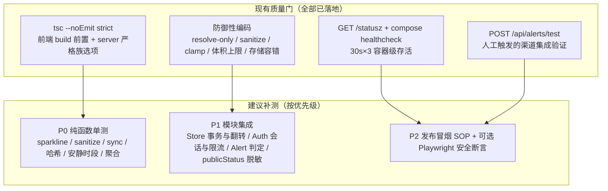

# 09 测试与质量保障
> 项目：nas-console ｜ 版本：v1.1 ｜ 生成日期：2026-10-06 ｜ 依据：源码分析

## 0. 本篇定位

本项目当前**没有任何自动化测试**——这是事实，也是接手者最需要尽早知道的事。本篇做三件事：第一，把「没有测试」的证据链完整列出，并指出源码中预留的测试基建痕迹（说明这是「未完成」而非「被否定」）；第二，盘点当前实际在起作用的质量保障手段——它们是「测试替代物」，在补测试之前是唯一防线；第三，给出按风险排序的补测路线图：优先给哪些纯函数补单测、哪些模块值得集成测试、哪些用 E2E 冒烟覆盖即可。所有建议均以源码现状为依据，不引入超出项目取向的重量级方案。

## 1. 现状：无自动化测试的证据链

以下事实经逐项核实（2026-10-06，v0.3.0 源码）：

| # | 证据 | 位置 | 解读 |
|---|---|---|---|
| 1 | 无任何 `*.test.ts(x)` / `*.spec.ts(x)` 文件 | 全仓库检索为空（排除 node_modules/dist） | 测试零落地 |
| 2 | 根 `package.json` 无 `test` 脚本 | `package.json` scripts 仅 `dev/build/preview` | 无测试入口 |
| 3 | `server/package.json` 同样无 `test` 脚本 | scripts 仅 `build/start/dev` | 服务端同状态 |
| 4 | tsconfig 预置了测试排除项 | `tsconfig.json` 与 `tsconfig.build.json` 的 `exclude: ["src/**/*.test.{ts,tsx}", "src/test-setup.ts"]` | **测试基建已预留**：排除规则先行写好，只等测试文件出现 |
| 5 | `sparkline-path.ts` 头注释「纯函数，便于单测」 | `src/charts/sparkline-path.ts` 第 1-2 行 | 作者有单测意图且刻意把该文件写成纯函数 |
| 6 | 无测试运行器依赖 | devDependencies 无 vitest/jest/testing-library | 连运行器都未安装 |

结论：测试是**预留而未落地**的状态——第 4、5 条表明这不是「不写测试」的技术选型，而是工程节奏上被推迟的事项。⚠️ 待确认：作者是否有未提交的测试计划（06 篇已标注同一待确认项）。对接手者的直接含义有三：任何改动只能靠 `tsc` 与手工冒烟兜底；重构（尤其是前端状态层与 store 合并逻辑）风险高于有测试的项目；补测试的第一步是选型与装运行器，而不是写断言。

## 2. 现有质量门：四道替代物

### 2.1 构建期类型门（唯一自动化关卡）

根 `package.json` 的 `build` 脚本是 `tsc --noEmit -p tsconfig.build.json && vite build`——**strict TS 全量类型检查前置于打包**，类型漂移在构建期暴露，这是本项目唯一的自动化关卡。server 侧 `npm run build` 是纯 tsc，且 `server/tsconfig.json` 开启了比前端更严的选项族：`strict` + `noUnusedLocals` + `noUnusedParameters` + `noUncheckedIndexedAccess`（后者让 `arr[i]` 的类型自动带 `| undefined`，能抓到一批越界访问类 bug）。前端的 `tsconfig.json` 虽无这几个选项，但 `strict` 全开 + `isolatedModules` + `forceConsistentCasingInFileNames` 已覆盖主要面。类型门的价值评估：前后端契约靠 `server/src/types.ts` 与前端镜像类型手工对齐（04 篇第 6 节），类型检查实际上就是「契约编译期校验」——改了 `CheckResult` 字段而忘了改前端镜像时，`tsc --noEmit` 会在使用点报错。这是本项目在没有集成测试的情况下契约仍能保持一致的核心机制。

### 2.2 运行时健康自检

`GET /statusz` 返回 `{ok:true, services, sseClients, authRequired, ts}`（server.ts 第 85-86 行），被两份 compose 的 healthcheck 每 30 秒调用（`interval: 30s, timeout: 5s, retries: 3`）：`node -e "fetch('http://127.0.0.1:5950/statusz')..."`。它验证的是「进程活着、HTTP 栈可用、事件循环未卡死」——config 加载失败会让进程直接起不来（`loadConfig` 抛错）、数据库打不开会在建 Store 时抛错，两者都表现为容器反复重启而非 `/statusz` 异常，因此 healthcheck 实际捕获的是更细粒度的「活着但卡住」场景。它不验证任何业务正确性。

### 2.3 告警链路自测

`POST /api/alerts/test`（server.ts 第 255-259 行 → alerts.ts `test()`）向所有已配置渠道发真实测试消息并返回逐渠道 `{channel, ok, error?}`。这是**人工触发的集成测试**：一次调用验证出站网络可达性、渠道凭据有效性、URL 拼装正确性三个环节。README M2 节明示其用途「可验连通性」。它的问题是没有自动执行时机——配置改完靠人记得点一次。

用测试工程的语言给这四道门定性：类型门是「静态契约检查」，healthcheck 是「活性检查」，alerts test 是「手工集成测试」，防御性编码是「结构性容错」。四者合起来的覆盖盲区恰好是经典的测试金字塔中段——**业务逻辑的自动断言**：规则有没有写对、边界有没有算错、回归有没有复发，这些既不是类型系统能表达的（类型只管形状），也不是活性检查能感知的（进程活着不等于算得对），更不能指望防御性代码替你发现「逻辑本身写反了」。这正是第 3 节补测清单全部落在纯函数与模块级测试上的原因：不补金字塔中段，四道门永远只能保证「系统在正确地执行错误的决定」。

### 2.4 防御性编码（把不变量写进代码形状）

散落在各处的防御式设计，本质是「用类型与结构替代测试断言」：

- `checkHttp`/`checkTcp` 的 **resolve-only** 设计（probe.ts 第 131、199 行）：任何异常路径都 resolve 成 `down + error`，引擎的 `checkAndRecord` 永远不会 await 到 rejection，从根上消灭「未处理 Promise rejection 打崩进程」这类事故；
- `sanitizeProfile`（config.ts）逐字段类型过滤：畸形输入进不了公开快照，详情页白屏风险在写入侧被切断；
- `clampInt`（server.ts 第 388-392 行）：查询参数静默夹取；
- `readJson/readRaw` 体积上限 + `req.destroy()`：请求体失控在传输层被斩断；
- 前端 `useLocalStorage`/`load()/persist()`（health-history.ts）的 try/catch 容错：JSON 损坏回退默认值、配额满留内存态——存储异常不会让页面挂掉；
- `loadOrCreateSecret` 的退化路径（auth.ts 第 128-131 行）：数据目录只读时进程仍能启动。

这些「永不抛出、优雅降级」的结构性防御，覆盖了大部分**可预期的异常输入**；它们替代不了的，是**预期路径上的逻辑错误**——比如 `syncServices` 合并规则被改错、`inQuietHours` 的跨零点判定写反、`buildSparklinePath` 插值公式回归——这些恰恰是下面补测建议的重点。

## 3. 补测路线图（按风险排序）

选型建议先行：**Vitest** 是与现状最契合的运行器——与 Vite 同源（前端零额外配置，`tsconfig.json` 已预留的 exclude 直接兼容）、支持 Node 端测试（server 侧指定 environment: node）、单包即可覆盖前后端。`test-setup.ts` 这个被 exclude 的文件名暗示作者当年设想的可能是 RTL（React Testing Library）+ jest 系，但组件测试在本项目收益最低（见下文分层），从纯函数起步时 Vitest 更轻。建议的脚本形态：根 `package.json` 加 `"test": "vitest run"`，server 侧单开 `server/vitest.config.ts`（或用 workspace 模式）。

### 3.1 P0 —— 纯函数单测（性价比最高，建议首批落地）

这些函数无 I/O、无 React、入参出参明确，一个下午可以写完，且各自守护着一段出过错就很难察觉的逻辑。排序的逻辑值得说明：表中的顺序不是随意的，而是「**改错后多久会被发现**」的倒序——`sanitizeProfile` 与 `syncServices` 排最前，因为它们的错误会写进 config.json 形成持久化污染（发现时已难追溯是哪次写入引入）；哈希与安静时段次之，它们错误的表现是静默的安全削弱或静默的告警丢失；纯展示类的 sparkline 与聚合函数殿后，错了肉眼可见、改了立即恢复。补测时照此顺序写，同样的时间投入获得的风险下降最大。另一个实用建议：这些测试全部可以**先于任何重构**写——它们断言的是当前行为而非理想行为，先固化现状再动代码，是本项目从「零测试」过渡到「有安全网」成本最低的路径。

| 优先级 | 函数 | 文件 | 应覆盖的用例要点 |
|---|---|---|---|
| P0 | `buildSparklinePath` / `toPoints` | `src/charts/sparkline-path.ts` | 空数组返回空串；单点（n=1, step=0）；全等值序列（span=0 → y=50）；monotone 模式下极值点不过冲；linear/monotone 的 area 闭合形状 |
| P0 | `sanitizeProfile` | `server/src/config.ts` | 每个字段的类型不符即丢弃；timeline 元素缺 date/text 丢弃；全空返回 undefined；highlights 过滤空串 |
| P0 | `syncServices` | `server/src/config.ts` | 已存在 id 保留 prev.check；新 id 用 defaultCheck；prune=false 时尾部保留；alerts/auth 段不被触碰；profile 必经净化 |
| P0 | `defaultCheck` | `server/src/config.ts` | checkable+url → http；缺任一 → none |
| P0 | `hashPassword` / `saltOf` / `newSalt` | `server/src/auth.ts` | 格式 `salt$hash`；同密码同盐得同哈希；不同盐不同哈希（幂等性是登录功能的地基） |
| P0 | `inQuietHours` / `parseHM` | `server/src/alerts.ts` | 跨零点窗口（23:00–07:00）；非跨零点；非法输入（"25:00"、"abc"）返回 null 即不启用安静时段 |
| P0 | `clampInt` | `server/src/server.ts` | 非数字回落；小数四舍五入；越界上下夹取 |
| P0 | `matchContainers` | `src/api/host.ts` | 双向包含匹配；大小写不敏感；空列表 |
| P0 | `sumStats` / `mergePageviews` / `mergeMetrics` | `src/pages/Analytics.tsx` | 直和正确；comparison 仅全站齐备才聚合（第 68-69 行的口径保护）；时间点对齐求和；同名维度降序 |
| P0 | `resolveRange` | `src/api/umami.ts` | 24h → unit hour；7d/30d/90d → day；毫秒换算 |
| P0 | `mergeServices` / `collectGroups` | `src/config/services.ts` | 隐藏过滤；内置优先序；预设分组恒定在前 |
| P0 | `prune`（导出后测） | `src/api/health-history.ts` | 90 天裁剪；48h 采样裁剪；空桶删除服务键 |

### 3.2 P1 —— 模块级集成测试（需要最小夹具）

- **`Store`（store.ts）**：用内存 SQLite（`new Database(':memory:')`，需把 dbPath 抽象出来或以临时文件路径实例化）验证 `record` 的核心行为——连续同状态不产生事件、状态翻转产生事件且 `to` 正确、daily 的 UPSERT 累加四列、`recentSamples` 的 240 点均匀降采样、`prune` 只删 checks 不动 daily/events。这是全项目**最值得补的集成测试**：翻转判定是告警与事件列表的共同源头，写错了影响面最大且最不易从 UI 察觉。
- **`Auth`（auth.ts）**：临时目录做 secret 文件，验证 `enabled` 三条件、login 成功返回的 Cookie 串属性齐全、5 次失败触发锁定文案与锁定窗口、verify 对过期 payload/篡改签名/缺失 Cookie 均拒绝、`logout` 返回 Max-Age=0。
- **`AlertManager`（alerts.ts）**：注入 fetch mock，验证阈值「恰好等于」触发一次、抑制窗口内不重发、恢复通知、安静时段只记录、`test()` 返回逐渠道结果。
- **`publicStatus`（server.ts）**：需要把它与 `handleApi` 一样对待——当前是模块私有函数，可先导出再测：白名单分组有 url/tags/error/profile、非白名单分组没有这四个键、days 恒 45 条且无数据日为 null。
- **`SseHub`（sse.ts）**：以假 res 对象（收集 write 调用）验证 serve 的响应头、broadcast 帧格式（`event: status\ndata: {...}\n\n`）、stop 清空。
- **`syncProbeServices`/`getJson`（src/api/probe.ts）**：msw 或 fetch mock 验证 401 → `window.location.reload()` 的副作用、PUT body 的 check 推导。

### 3.3 P2 —— E2E 与手工冒烟

浏览器端自动化（Playwright）对这种个人项目性价比偏低——页面数量少、状态多在 localStorage、SSE 时序难以稳定断言。更现实的是把 06 篇第 6 节的验证清单固化为**发布前手工冒烟 SOP**（探针启动四行日志 → `/statusz` ok → 401 行为 → 登录锁定 → alerts test → `/status` 刷新 → PUT services 后 config.json mtime 与手工 check 保留），并在 README 的发布流程末尾附上。若未来要加 Playwright，优先覆盖两条路径：登录门（未登录访问 /console 显示登录页、登录后进入）与公开快照脱敏（非白名单分组不含 url 字段——把安全断言写成测试，防回归价值最高）。

冒烟 SOP 的执行要点是「每次发布全跑、平时不跑」：它的价值在防升级回归，日常开发靠类型门与单测即可。清单的顺序也有讲究——从无状态到有状态、从只读到写入（先看静态页、再打公开 API、再登录、最后动写端点），这样任何一步失败都能定位到最近的变更层。清单里最容易被跳过但价值最高的两项是「登录失败 5 次触发锁定」与「PUT 后手工 check 段未被覆盖」：前者验证限流内存态的生命周期，后者验证 `syncServices` 的核心保护规则——这两个行为没有任何 UI 反馈，坏了只能靠数据异常才能事后发现。

## 4. 质量保障全景图

## 5. 落地注意事项

给补测的执行者四条提醒。第一，**server 侧测试要处理 ESM**：`server/package.json` 有 `"type": "module"` 且源码以 `.js` 后缀互相 import（NodeNext 规范），Vitest 配置需保持 ESM 语义，别把 `.js` 后缀当编译产物路径报错。第二，**`Store` 的测试不要打真实 `data/probe.db`**：构造函数接受 dbPath 参数，传临时目录路径即可，测试后删除；这也提示一个顺手重构——把 dbPath 支持 `:memory:` 写进测试即可，无需改源码。第三，**前端纯函数测试放进 `src/` 时正好命中已预留的 exclude 语义**：`tsconfig.json` 已排除 `src/**/*.test.{ts,tsx}`，vitest 的默认 include（`**/*.test.*`）与之无缝配合，无需改 tsconfig。第四，**不要追求覆盖率指标**：本项目测试的目标是「锁住合并规则、脱敏规则、判定规则这三类业务不变量」，路由分发、UI 布局、SSE 网络行为留给类型检查与冒烟清单——覆盖率好看但断言空洞的测试对这个项目是负资产。

---

*防御性编码的逐项出处见 07-模块详解对应函数行号；发布冒烟清单的完整版见 06 篇第 6 节；「无测试」作为技术债之一的位置、影响与路线图展开见 13-技术债务与演进建议。*
