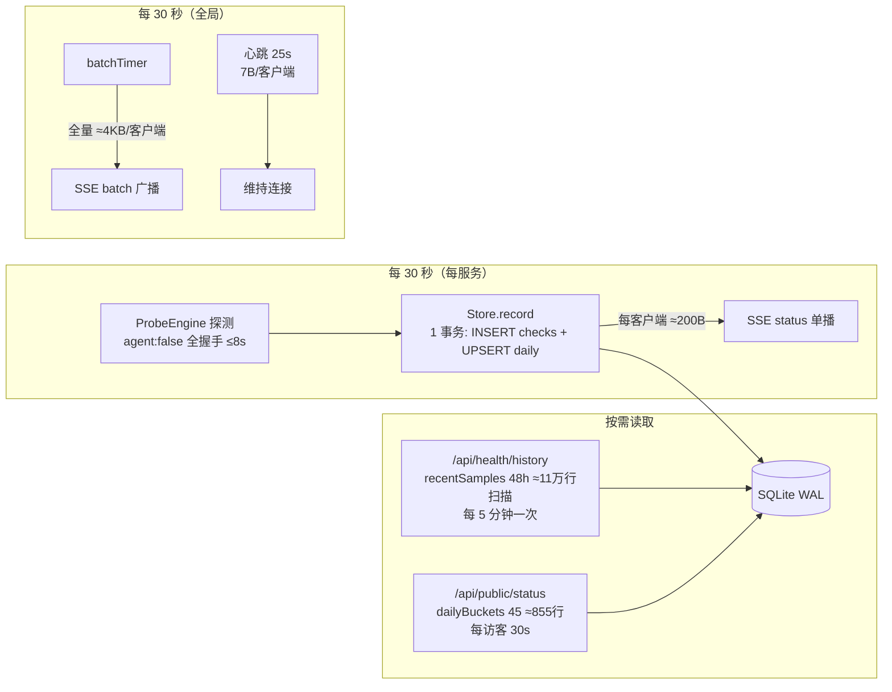

# 10 性能设计与优化
> 项目：nas-console ｜ 版本：v1.1 ｜ 生成日期：2026-10-06 ｜ 依据：源码分析

## 0. 本篇定位与性能预算

性能在本项目不是一个「优化问题」而是「量级问题」：服务数 19、巡检间隔 30 秒、SSE 客户端个位数、页面数据 KB 量级——每个环节都离瓶颈很远，因此源码里的性能相关决策都是为了**守住量级边界**而不是压榨延迟。本篇先建立量级预算，再逐层走读 SQLite 写入模式与 WAL、SSE 三层容错的成本结构、出站探测的开销、前端渲染策略，最后给出按「收益/成本比」排序的优化建议。与 01 篇第 5.3 节的「容量与扩展边界」互补：那一节回答「什么时候会触顶」，本篇回答「现在的开销花在哪、哪些还能省」。

### 0.1 量级预算表

| 环节 | 计算依据（源码常量） | 当前量级 |
|---|---|---|
| 巡检写入速率 | 19 服务 / 30s 间隔（`GLOBAL_INTERVAL_SEC=30`） | ≈ 0.6 行/秒进 `checks` 表 |
| `checks` 表规模 | 0.6/s × 86400 × 90 天 | ≈ 470 万行稳态（90 天窗口内） |
| `daily` 表规模 | 每服务每天 1 行，永久 | 19 × 365 ≈ 7 千行/年 |
| `events` 表规模 | 仅翻转时写入 | 极低频，无裁剪（13 篇） |
| 数据库文件 | 实测 `server/data/probe.db` | 数 MB 量级（含 WAL） |
| SSE 推送 | 每次 `status` ≈ 一条 CheckResult JSON（约 200 字节） | 个位数客户端 × 每 30s 全量 ≈ 可忽略 |
| 公开快照 | 19 服务 × 45 天数组 | 每响应约几十 KB，30s 一次每访客 |
| 前端 localStorage | `health-history.ts` 头注释预算 | 「几十 KB 量级」（上限 240 点/服务、100 事件/服务） |

结论先行：在当前服务数下**没有任何环节接近瓶颈**，NAS（低功耗设备）上真正要在意的是常驻开销（进程内存、定时器数量、SQLite 句柄）而非吞吐。因此下文所有优化建议都标注「当前可不做」或「触发条件」，避免为不存在的规模做功。

## 1. SQLite 写入模式与 WAL

### 1.1 写入路径的精确描述

每轮检查落库走 `Store.record`（store.ts 第 51-90 行），实际执行序列是：prepare 三条语句（INSERT checks / UPSERT daily / SELECT 上一条）→ **查询上一条状态**（事务外）→ `transaction()` 包裹「INSERT checks + UPSERT daily」并执行 → 事务外比对翻转并按需 INSERT events。WAL 模式在构造函数第一行 `pragma('journal_mode = WAL')`（第 20 行）启用。

这个设计的性能特征可以拆成四点。**第一，WAL 与读写并发**：journal_mode=WAL 下写不阻塞读——引擎每 30 秒写、HTTP 请求随时读（`dailyBuckets/recentSamples/events` 每次请求都是全表扫描窗口内的查询），classic rollback journal 会让读请求在写入瞬间等待，WAL 消除了这个抖动，代价是数据目录多出 `-wal/-shm` 伴随文件。**第二，事务粒度**：每次 `record` 一个事务，单条 INSERT+UPSERT 在 WAL 下意味着一次 fsync 级别开销（synchronous 默认 FULL 时每事务一次）；0.6 事务/秒的频率完全无压力，但若服务数 ×100，应考虑把同轮检查合并成批量事务（当前架构每服务独立定时器，同轮概念不存在，见第 5 节）。**第三，prepare 位置**：三条语句在每次 `record` 调用时 prepare（第 52-66 行）而非构造时缓存——better-sqlite3 内部对 prepared statement 有管理，且低频下开销可忽略；但这是一个**零风险的确定性优化点**（把 prepare 提到构造函数存为实例字段），服务数上一个数量级后收益会显现。**第四，索引覆盖**：`idx_checks_service_ts(service_id, ts)` 支撑「上一条」查询（ORDER BY id DESC 实际走主键，service_id 条件靠过滤）与 recentSamples 的窗口扫描；`idx_events_service` 支撑事件查询。`daily` 的主键 `(day, service_id)` 让 `dailyBuckets` 的 `WHERE day >= ?` 走主键前缀扫描，45 天窗口的行数（19×45≈855 行）微小。

### 1.2 读取路径与快照语义

三个查询方法每次 HTTP 请求都执行：`/api/health/history` 调 `dailyBuckets(90) + recentSamples(48h)`——后者把 48 小时内的全部 checks 行（19 服务 × 48h/30s ≈ 11 万行）读进 Node 再逐服务降采样到 ≤240 点，是**单次开销最大的查询**；好在它只被探针模式前端每 5 分钟调用一次。`/api/public/status` 每次调用 `dailyBuckets(45)`（约 855 行）+ 内存 latest，30 秒被每个公开页访客拉一次——按访客量级完全可接受，若未来公开流量增大，给快照加 5-10 秒的进程内缓存（`publicStatus` 是纯组装函数，缓存易加）即可，当前可不做。

## 2. SSE 三层容错的成本结构

01 篇第 5.1 节从可靠性角度讲过「不信任长连接」的设计；本节算它的账。实时链路共四条并行通道，各有固定开销：

| 通道 | 周期/触发 | 服务端成本 | 带宽（每客户端） | 存在意义 |
|---|---|---|---|---|
| `status` 单播 | 每次检查完成 | 一次 `res.write`（字符串拼接 + Set 遍历） | ≈200B×触发频率 | 秒级实时性 |
| `batch` 全量 | 固定 30s（server.ts 第 65 行 batchTimer） | 一次全量 JSON 序列化 + 广播 | ≈19×200B≈4KB/30s | 丢帧后 ≤30s 自愈（最终一致兜底） |
| 心跳 `: ping` | 25s（sse.ts 第 50 行，惰性单例） | 7 字节 × 客户端数 | 7B/25s | 防反代空闲超时断连 |
| latest 轮询兜底 | ≥15s（前端 `Math.max(15, intervalSec)`） | 一次 `latestResults()` JSON | ≈4KB/60s | SSE 完全失效时的降级通道 |
| 历史导入 | 5min | dailyBuckets(90) + recentSamples(48h) | ≈几十 KB/5min | 前端历史与权威源对齐 |

值得强调的成本观：**status + batch + 心跳三条通道同时存在是刻意的冗余**，三者的总开销即使按 10 个客户端算也不到每秒 1KB——用可忽略的带宽买到「任意一条通道静默失效时用户体验不劣化」，是这套设计里性价比最高的决定。反过来，若未来想省，砍掉任何一层都会让对应的失效场景变成可见故障（砍心跳 → 反代掐断空闲连接；砍 batch → 丢帧后状态长期漂移；砍 latest 轮询 → SSE 死掉时页面僵在旧数据）。结论：这层的「优化」方向不是削减而是**参数化**——30s/25s 两个值目前硬编码在 server.ts/sse.ts，纳入 config 的可调项即可。

SSE 还有一个隐性成本：**每客户端一个挂起的 `ServerResponse`**，事件循环为每条连接维护 socket 与缓冲。个位数客户端无感；若把 `/sse` 暴露给公网大量访客（当前 `/status` 页**不订阅 SSE**、只用 30s 轮询，公开面天然规避了这个问题——只有登录后的管理区页面才连 `/sse`），需要考虑连接数上限，当前实现没有限制，记录为扩展前提。

## 3. 出站探测的开销与取舍

`checkHttp` 的三个选择各有性能含义。**`agent: false`**（probe.ts 第 143 行）：每轮探测都完整走 TCP+TLS 握手，19 个服务每 30 秒一轮 ≈ 每 30 秒 19 次完整握手；这是**用延迟换真实性与正确性**的决策（延迟反映访客体感；TLS 会话恢复时证书读不到），注释明言，不应当为省 CPU 而改回连接复用——除非同时放弃 certExpiresInDays。**8 秒超时**（`TIMEOUT_MS`）：最坏情况下一个持续挂起的目标会占用一个定时器回调 8 秒——Node 异步模型下不阻塞事件循环，但会拖长 `runInitial` 的补跑窗口（并发 4 下 19 个服务最坏 19/4×8s≈38 秒才完成首轮）；对长期不可达的服务这是常态，无碍。**关键词检查的 256KB 上限**（`MAX_BODY_BYTES`）：限制单次探测的内存占用与解析成本，且超限后停止累积（`overflow` 短路）而非继续拼接字符串，避免大响应体放大内存；`body += chunk.toString()` 的字符串拼接在 256KB 内可接受。

调度侧，**每服务独立 setInterval** 的模型在百级服务时定时器数量线性增长（Node 定时器很轻，千个无压力），真正的扩展点是 `runInitial` 硬编码的并发 4（probe.ts 第 59 行）与「补跑窗口随服务数线性拉长」——01 篇已指出参数化方向，此处补充量化：服务数 ×10（190 个）时最坏首轮 ≈ 190/4×8s ≈ 6.3 分钟，这决定了「并发窗参数化」的触发时机应在服务数接近百级时。

进程级常驻开销也需要一个基准认知，因为 NAS 上它与别的服务共享有限的内存：Node 22 空载进程 RSS 约 40-60MB，加 better-sqlite3 句柄、19 个定时器、SSE 客户端集合后，本进程的稳态内存仍在百 MB 以内——对 NAS 容器编排而言是一个「不显眼」的住户。CPU 侧的热点集中在探测的 TLS 握手（每 30 秒 19 次完整握手，每次约几毫秒的对称加密与一次非对称运算）与 SQLite 写事务的 fsync，两者在单核占用上都低于 1%。可以说这个进程的性能画像非常「平」：没有峰值、没有抖动源、没有随时间增长的缓存——唯一的随时间变量是 checks 表行数（90 天窗口封顶）与日志体积（交给 Docker 轮转）。这份「平」正是量级预算 Table 0.1 各行相加的自然结果，也意味着任何「感觉变慢」的现象都应先排查宿主机与其余容器，而不是本进程。

## 4. 前端渲染与数据层性能

### 4.1 状态更新的精准性

前端没有全局状态库，渲染性能靠三个机制保证。**其一，`useSyncExternalStore` 的精准订阅**（health-history.ts 第 91-93 行）：历史写入 `emit()` 只通知订阅者（UptimeBars、抽屉、StatTile 等实际读取历史的组件），Dashboard 顶层那次「空调用」（Dashboard.tsx 第 148 行）是订阅惯用法而非全树刷新——比 Context 广播式更新精准得多。**其二，不可变更新 + 浅拷贝**：`recordBatch` 每轮浅拷贝四块结构后逐服务深拷贝受影响的 dayMap/bucket（第 98-115 行），引用比较语义对 React 正确；代价是每轮 O(服务数×修改点) 的拷贝，量级无碍。**其三，裁剪先行**：`prune` 在每次写入后同步执行（90 天桶、48h 采样），localStorage JSON 体积恒定几十 KB，序列化成本稳定不随时间漂移。

### 4.2 渲染与图表

组件层的两个设计值得记录。**UptimeBars/StatusBars 是纯 div 而非图表**：45 天可用率条用 flex div + Tooltip 渲染（StatusPage.tsx 第 145-163 行），比 recharts 便宜两个数量级，且每个公开页访客的 30s 轮询都触发重渲染——用最便宜的 DOM 结构承接最高频的更新是正确的分配。**Sparkline 手写 SVG**（sparkline-path.ts）：`toPoints` + Fritsch–Carlson 单调三次插值生成 path 字符串，`preserveAspectRatio="none"` + `vector-effect="non-scaling-stroke"` 让任意容器尺寸零重算——相比 recharts 实例（每实例带主题计算与事件系统），在 StatTile 这种「一页四个」的场景省掉大量 JS。recharts 封装层（Area/Bar/Donut）只在管理区的低频刷新图（5 分钟 Umami 数据）使用，职责分配合理。可微调项：`Dashboard` 的 `trendRows`、聚合数字都已 useMemo；`ServiceCard` 未做 `React.memo`，但 SSE 单条更新只波及 `results` 引用变化 → 页面函数组件整体重跑，19 张卡的 render 成本在毫秒级，当前可不做。

### 4.3 轮询节奏总表

| 轮询 | 周期 | 来源 |
|---|---|---|
| 巡检（服务端） | 30s/服务，下限 15s | `probe.ts` `Math.max(15, intervalSec ?? 30)` |
| 公开快照（三公开页） | 30s | `Home.tsx` POLL_MS / `StatusPage.tsx` |
| 主机指标 | 30s | `HostMetricsCard.tsx` |
| latest 兜底 | `healthIntervalSec`（默认 60s，下限 15s） | `use-health.ts` |
| 历史导入 | 5min | `use-health.ts` |
| Umami 数据 | 5min | `Dashboard.tsx` / `Analytics.tsx` |
| 清单同步 | 60s | `use-probe-sync.ts` |
| SSE batch / 心跳 | 30s / 25s | `server.ts` / `sse.ts` |
| checks 裁剪 | 24h | `server.ts` pruneTimer |

## 5. 优化建议清单

按「收益/成本比」排序，标注建议时机：

1. **events 表加裁剪**（与 13 篇债项同源）：`prune()` 补一条 `DELETE FROM events WHERE ts < cutoff`（如保留 180 天或每服务 N 条）。收益：消除唯一无界增长点；成本：一行 SQL。时机：**下一次改动 store.ts 时顺手做**。
2. **prepare 提升到构造函数**：`record/dailyBuckets/recentSamples/events` 的语句对象存为实例字段。收益：消除每次调用的 prepare 开销；成本：小重构。时机：服务数过百或写路径改动时。
3. **Cookie 层面无关性能，但 batch/心跳参数化**：把 30_000/25_000 挪进 config（缺省不变）。收益：不同部署（如高抖动反代链路）可调；成本：极低。时机：任意。
4. **公开快照进程内缓存（TTL 5-10s）**：`publicStatus` 结果按 ts 缓存。收益：多访客场景重复组装消失；成本：低。时机：公开页流量可见增长后。
5. **并发窗参数化**：`runInitial` 的 4 提为常量/config。时机：服务数接近百级。
6. **前端 React.memo / 虚拟化**：ServiceCard 列表 memo 化、Services 表已用 antd 分页无需虚拟化。时机：服务数过百且实测卡顿时。
7. **不建议做的**：给 SSE 加压缩（数据量太小，压缩头开销不划算）；把 checks 降采样后删原始行（90 天原始行是延迟走势的权威数据，存储代价仅数 MB）；引入 Redis/消息队列（SQLite WAL 在此量级快得多且零运维）。

## 6. 性能关键路径图

---

*WAL 与三表的存储契约见 04-数据模型第 2 节；SSE 协议帧格式见 15-接口全量参考第 3 节；「events 无裁剪」作为技术债的完整展开见 13-技术债务与演进建议。*
