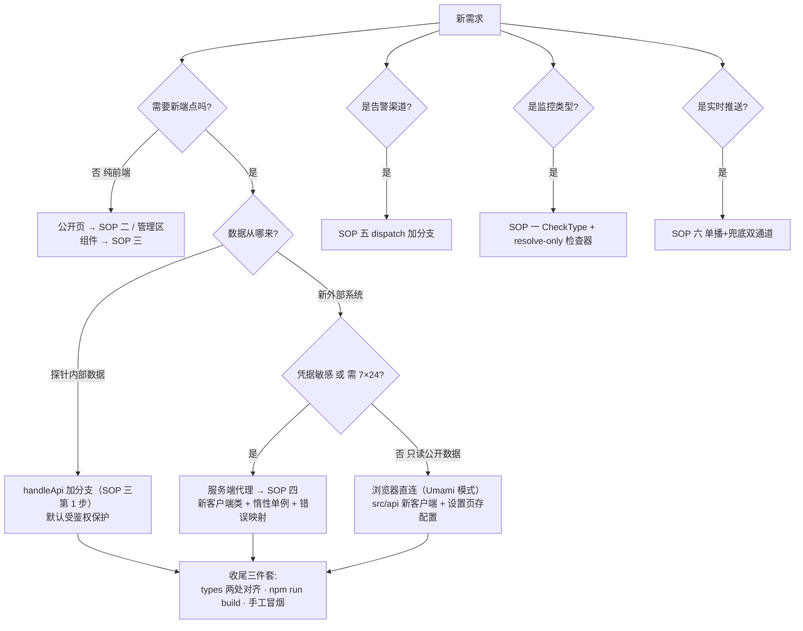

# 11 扩展开发指南
> 项目：nas-console ｜ 版本：v1.1 ｜ 生成日期：2026-10-06 ｜ 依据：源码分析

## 0. 扩展总则

本篇给出六个高频扩展场景的标准作业程序（SOP）。动手前先记住四条贯穿所有场景的「项目宪法」，违反任何一条都会让改动在某个环节静默失效：

1. **契约三处对齐**：跨端数据结构在 `server/src/types.ts`（权威）与前端镜像（`src/api/*.ts` 内的 interface）之间是手工同步的——改任何共享形状必须两处同改，然后跑 `npm run build`（前端 `tsc --noEmit` 前置）让类型门验证。
2. **分层不越级**：前端只有 `src/api/` 允许 fetch；后端新端点只写在 `server/src/server.ts` 的 `handleApi`；新外部系统客户端放 `server/src/` 独立文件并在 `createServer` 装配。不要在页面组件里直接 fetch。
3. **鉴权面默认收紧**：新 `/api/*` 端点自动落在 `authGuard` 的保护范围内（白名单是显式列举，见 auth.ts 第 40-48 行）——**什么都不做就是受保护的**；只有公开端点才需要往 `isPublicPath` 加白名单，加之前过一遍 08 篇第 3 节的泄露面检查。
4. **dev 代理同步**：本地开发新增任何非 `/api`、`/sse`、`/portal-covers` 的后端路由前缀，必须在 `vite.config.ts` 的 proxy 里补一条，否则 dev 环境拿到的是 index.html（SPA fallback）而不是 API 响应，表现为「本地正常线上也正常、唯独 dev 不对」。

每个 SOP 末尾给出验证方法。通用验证三件套：`curl -s http://127.0.0.1:5951/<端点>`（dev 探针）、`npm run build`（类型门）、浏览器 devtools 的 Network 面板确认请求/响应形状。

**如何使用本篇**：六个 SOP 按「改动的重心在后端还是前端、数据从哪来」组织，同一个真实需求往往只落在一个 SOP 上——先读第 7 节的决策速查图定向，再进入对应 SOP 按步骤执行。所有步骤表中的「文件」一列都可直接检索定位；行号是 v0.3.0 的快照，以函数名为准更可靠。执行顺序上有一个共同规律值得预先说明：**后端改动与前端改动可以并行开发，但验证必须串行**——先在 dev 环境（探针 5951 + vite 5173）用 curl 验证后端响应形状，再接前端消费代码，最后跑一次 `npm run build` 让类型门检查两端的契约对齐。跳过中间那步 curl 直接前后端一起写，是本仓库历史问题里「字段名对不上」类缺陷的主要来源（前后端镜像类型是手工维护的，编译期只能发现引用错误，发现不了语义错位）。

## 1. SOP 一：新增被监控服务类型（以 ICMP ping 为例）

目标：让探针支持 `check.type = 'icmp'`（当前只有 http/tcp/none）。改动集中在服务端，前端只有展示层一处联动。

| 步骤 | 文件 | 操作 |
|---|---|---|
| 1 | `server/src/types.ts` | `CheckType` 联合类型加 `'icmp'`；`CheckConfig` 按需加字段（如 `count`） |
| 2 | `server/src/probe.ts` | `check()` 的 if 链（第 83-96 行）加 `check.type === 'icmp'` 分支，调新函数 `checkIcmp`；仿照 `checkTcp` 写 **resolve-only** 的 Promise（异常一律 resolve 成 `down + error`，绝不 reject） |
| 3 | `server/src/config.ts` | `defaultCheck` 不动（新类型只通过手工编辑 config.json 配置）；`sanitizeProfile` 无关 |
| 4 | `server/src/probe.ts` 常量 | 若需要新超时常量，加在文件头部 `TIMEOUT_MS` 旁 |
| 5 | `src/components/ServiceDetailDrawer.tsx` | 元信息卡「探测方式」Tag 的文案映射（第 195-197 行附近）补 icmp 分支 |
| 6 | （可选）前端表单 | `ServiceManagerCard` 目前只生成 `{type:'http'}`/`{type:'none'}`（`syncProbeServices` 第 122 行），icmp 属于「手工调优」类，与 tcp 同待遇，**不改前端** |
| 7 | 构建验证 | `cd server && npm run build` → 重启探针 → 在 config.json 某服务写 `"check": {"type": "icmp"}` → 重启 → `/api/health/latest` 观察结果 |

**陷阱提醒**：`apply()` 会调度所有非 `none` 类型；icmp 实现若用系统 `ping` 子进程，注意 `execFile` 也要走超时与 resolve-only 包装；`hidden` 服务不参与调度（`activeServices` 过滤），无需在新类型里重复判断。配置归属上，手工 check 只对**已存在 id** 受保护（`syncServices` 保留 prev.check），清单重建后需重放——见 14 篇。

再补三点设计判断，帮你决定「要不要走这条路」。第一，**确认新类型真的需要探针侧支持**：很多「想监控 X」的需求其实是 http 检查的参数问题（期望状态码、关键词、自签证书），先翻 `CheckConfig` 现有字段，能不新增类型就不新增——每新增一个类型，前端展示层、设计稿、文档都要跟着长。第二，**子进程型检查是特例**：icmp 需要系统 `ping` 二进制，容器镜像（bookworm-slim）里未必自带 iputils-ping，落地时要同步改 Dockerfile 并在 README 标注镜像依赖变化；这也是为什么 tcp 检查当年被选为第一优先——`net.connect` 纯 Node 实现，零系统依赖。第三，**超时预算要联动**：`TIMEOUT_MS=8000` 是 http/tcp 共用的常量，新类型若需要不同超时，建议在 `CheckConfig` 加可选字段并沿用 `Math.max(15, ...)` 式的防御夹取，而不是引入第二个全局常量——两套超时常量并存会让「最坏首轮窗口」的计算（10 篇第 3 节）失去单一依据。

## 2. SOP 二：新增一个公开页（以「关于我」`/about` 为例）

公开页 = 公开路由 + 公开数据源（可选）+ VPS 层豁免（可选）。当前三个公开页共用 `GET /api/public/status`，新页面大概率也用它，因此**不需要任何后端改动**。

| 步骤 | 文件 | 操作 |
|---|---|---|
| 1 | `src/pages/About.tsx`（新建） | 仿 `StatusPage` 的独立布局（不套 AppLayout）；静态内容直接写组件，动态状态用 `fetchPublicStatus()`（`src/api/public-status.ts`） |
| 2 | `src/App.tsx` | `<Route path="/about" element={<About />} />` 加在公开路由区（第 68-74 行之间） |
| 3 | `src/components/Spotlight.tsx` 的消费方 | 公开首页 `Home.tsx` 的 `spotlightActions`（第 100-119 行）加导航项；`AppLayout.tsx` 的管理区 actions 同理（若管理区也要直达） |
| 4 | `index.html` / 布局 | 确认页面自含 `PageContainer` 或独立容器样式（公开页不继承管理区 Layout） |
| 5 | VPS nginx（可选） | 仅当该页**不需要 basic auth** 时（像 `/status` 一样分享给别人），在 nginx 加 `location = /about { auth_basic off; proxy_pass http://frps_upstream; }`；⚠️ nginx 配置不在仓库内，需登 VPS 手工改并 `nginx -s reload` |
| 6 | 构建验证 | `npm run build` → 同步 dist → 重启容器（或本地 dev 直接看 `127.0.0.1:5173/about`） |

**要点**：公开页不要引用 `ConsoleSettingsContext` 之外的管理区状态；若新页面要展示非白名单分组的数据，**不要**为此扩 `publicStatus` 字段——那是脱敏白名单的洞，正确做法是把服务挪进白名单分组（数据决策）而不是加旁路（代码决策）。

选型上有两个补充判断。**要不要复用 AppLayout**：公开页的视觉身份是独立 Bento/杂志式布局（公开页全部不套管理区 Layout，见 App.tsx 路由结构），如果新页面本质是「管理功能的只读视图」，更合适的做法是放进 `/console` 下挂 RequireAuth，而不是做成公开页——公开面每扩大一寸，08 篇第 3 节的泄露面自查就要重跑一遍。**数据要不要新端点**：公开页的数据哲学是「一个快照端点喂所有公开页」，`/api/public/status` 的 45 天 days 数组与分组结构已经能覆盖大多数展示需求；为新页面单开公开端点应当是例外而非常规，且每开一个都要在 15 篇登记并重新审视鉴权白名单。另外记得公开页轮询的节奏纪律：现有三个公开页统一 30 秒（Home 的 POLL_MS 常量、StatusPage 的 setInterval），新页面沿用同一节奏，避免访客侧流量因页面不同而失衡——这是公开面「每访客每 30 秒一次快照」容量预算的一部分（10 篇第 0.1 节）。

## 3. SOP 三：新增管理功能（以「最近事件卡片」为例）

设计稿（docs/v03-probe-design.md 第 7 节第 4 点）预告过「总览页最近事件卡片」，以此为例走一遍完整的管理区功能链路。

| 步骤 | 文件 | 操作 |
|---|---|---|
| 1 | 后端（本例可跳过） | `GET /api/events` 已存在（server.ts 第 273-276 行），直接复用；若确需新端点：在 `handleApi` 加「方法+路径」分支 → 响应走 `json()` 助手（自动 no-store）→ 参数用 `clampInt` 夹取 → **不加公开白名单** |
| 2 | `src/api/probe.ts` | `fetchProbeEvents(limit)` 已存在；新端点则仿写 `getJson<T>` 客户端函数（自带 3s 超时与 401 整页刷新语义） |
| 3 | `src/pages/Dashboard.tsx` | 新组件 `RecentEventsCard`：`useEffect` 首拉 + `useInterval` 5 分钟；渲染 `events` 列表（字段 `serviceId/ts/to`，DTO 已在 `fetchProbeEvents` 转换为驼峰） |
| 4 | `src/api/health-history.ts`（可选替代） | 若想用本地已导入的事件（`applyServerSnapshot` 每 5 分钟合并过），直接 `getEvents(serviceId)` 按服务读；全局事件流仍建议走 API |
| 5 | 布局 | 卡片插到 `DashboardPage` 的分组服务卡矩阵之前/之后，用 `Card size="small" variant="outlined"` 保持视觉一致 |
| 6 | 验证 | dev 环境确认 `/api/events` 经 vite 代理可达；制造一次翻转（停一个服务超阈值）看卡片出现事件 |

**要点**：管理区新功能默认「探针模式专属」——浏览器降级模式下 `/api/*` 不可达，组件应对 fetch 失败静默降级（参考 `HostMetricsCard` 的 `hidden` 模式），不要让新卡片在降级模式下报错横幅刷屏。

展开说三条经验。**其一，先想数据已经有还是要新拉**：本仓库有两份「事件」数据——服务端 `/api/events`（权威、全局）与本地 health-history store 里合并过的事件（每服务、5 分钟对齐一次），很多需求用后者零端点就能实现；判断标准是「实时性要求」与「是否需要全局视图」，两者都不要就别打 API。**其二，加载失败的形态要提前定**：管理区组件对探针不可达有三种成熟范式——整卡隐藏（HostMetricsCard 的 notConfigured）、降级文案（Dashboard 副标题）、错误横幅（Umami Alert），新功能三选一即可，不要发明第四种。**其三，新端点的响应形状优先复用已有类型**：ProbeEvent、CheckResult、DayBucket 这三个类型覆盖了健康域的大多数展示需求，复用意味着前端镜像类型不用改、类型门继续覆盖契约； inventing 新形状时记得两端同改（总则第 1 条）。

## 4. SOP 四：接入新的外部系统（以 Portainer 为例）

新外部系统（如 Portainer/GDocked/Proxmox 面板）的接入决策与实现模板都已有先例——1Panel 就是模板本身。

**第一步：先回答两个问题定方向**（03 篇第 8 节的两问）。凭据能否下发给浏览器？数据是否需要 7×24 采集？Portainer 的 API token 等价于容器控制权 → 凭据敏感 → **放服务端**（同 1Panel 路线）；若接入的是「天气 API」「公开榜单」这类无凭据只读数据 → 可放浏览器直连（同 Umami 路线）。以下按服务端路线展开。

| 步骤 | 文件 | 操作 |
|---|---|---|
| 1 | `server/src/types.ts` | `ProbeConfig` 加 `portainer?: { baseUrl: string; apiKey: string }` 段（仿 `onePanel` 第 58-64 行，注释标明手工维护） |
| 2 | `server/src/portainer.ts`（新建） | 仿 `1panel.ts` 的类结构：`sign()`/`request<T>()`（`agent:false`、8s 超时、统一错误类 `PortainerError extends Error { code? }`）+ 业务方法；响应包络按 Portainer 文档适配 |
| 3 | `server/src/server.ts` | `createServer` 里仿 `getPanel` 写惰性单例 `getPortainer`（第 47-50 行模式：apiKey 存在才创建）；`handleApi` 加代理端点（如 `/api/portainer/containers`），错误映射仿 `panelMsg`（第 394-399 行）——**鉴权端点不泄露上游地址**，公开语义按 08 篇第 3.2 节自查 |
| 4 | `server/src/config.ts` | 无需改（新段随 `{...config}` 展开自动保留，PUT services 不触碰） |
| 5 | `src/api/portainer.ts`（新建） | 仿 `src/api/host.ts`：`getJson` 的 `notConfigured` 标记模式（400 → 组件自隐藏） |
| 6 | 前端组件 | 仿 `HostMetricsCard`/`ContainerSection`：30s 轮询 + `notConfigured` 隐藏 + 操作类动作走 confirmModal |
| 7 | 部署配置 | docker-compose.nas.yml 无需改（host 网络下源 IP 语义与 1Panel 一致）；config.json 手工加 `portainer` 段后 `docker restart`（非 services 段不热更新） |
| 8 | 文档 | 14 篇配置走读补新段；15 篇端点表补新行 |

**要点**：凭据段命名避免与现有段冲突；新系统的「动作白名单」要显式列举（仿 server.ts 第 237 行的 `allowed` Set），不要透传客户端传来的任意 operation。

两个容易忽略的收尾。**其一，错误翻译层值得多花十分钟**：`panelMsg` 把上游 401 翻译成「密钥或 IP 白名单校验失败」这种可操作的文案，是这套代理模式里排障效率的关键——新系统照抄这个模式（错误码 → 固定中文语义、其余透传 message），未来的你会感谢现在的你；反过来，把上游英文报错原样透传到前端通知里，是排障体验最差的做法。**其二，惰性单例的缓存失效要想清楚**：`getPanel` 一旦创建 PanelClient 就缓存到闭包变量，apiKey 改了要重启才生效——这与「alerts/auth 段改后重启」的既有约定一致，新系统沿用即可；但若未来做「配置热更新」，要把这类客户端单例一起纳入失效逻辑，这是一个跨模块的联动点，不是改一处就完的事。最后提醒部署核对：新系统若与 1Panel 一样有「来源 IP 白名单」机制，host 网络与桥接网络下的源 IP 语义不同（14 篇第 4 节），配置面板侧白名单前先确认用的是哪份 compose。

## 5. SOP 五：新增告警渠道（以钉钉机器人 webhook 为例）

告警渠道是所有扩展里最简单的一类：`AlertManager.dispatch` 的分支结构天然支持并列渠道。

| 步骤 | 文件 | 操作 |
|---|---|---|
| 1 | `server/src/types.ts` | `AlertsConfig` 加 `dingtalk?: { webhookUrl: string; secret?: string }`（仿 `BarkChannel` 第 67-70 行，注释写 URL 形态） |
| 2 | `server/src/alerts.ts` | `dispatch`（第 63-103 行）加一个 if 分支：构造 `sendRequest('POST', url, JSON.stringify({msgtype:'text', text:{content: title+'\\n'+body}}), {'content-type':'application/json'})`，`.then/.catch` 各自 push `{channel:'dingtalk', ok, error?}`——**渠道失败只进自己的结果项**；钉钉的加签 secret 若需要，在 URL 上拼 `&timestamp=..&sign=..`（hmac-sha256 base64，用 node:crypto） |
| 3 | 无其它改动 | `test()`/`notify()`/安静时段/抑制逻辑自动覆盖新渠道（都走 `dispatch`）；`/api/alerts/test` 的响应自动多一个渠道项 |
| 4 | 部署 | config.json `alerts` 段手工加 `dingtalk` 键 → `docker restart` → `curl -X POST http://127.0.0.1:5950/api/alerts/test` 验证响应里 `channel:'dingtalk', ok:true` |

**要点**：渠道投递必须 8 秒超时（复用 `sendRequest`），不要引入无超时的 fetch——告警链路挂在慢渠道上会拖住 `notify` 的 Promise.all；新渠道标题/正文做 URL/JSON 编码时注意 Bark 用的是 URL 段编码而 webhook 是 JSON 体，别混用。

补充两条渠道设计的边界判断。**鉴权型渠道的凭据放哪**：钉钉加签 secret、飞书签名、企业微信 key 这类凭据与 Bark pushKey 同级——进 config.json 的 alerts 段（服务端持有、不进浏览器），这与「告警是 7×24 服务端行为」的定位一致；设置页不做渠道配置 UI（v2.0 路线图项），当前渠道管理的唯一入口就是手工编辑配置文件。**投递语义的一致性**：`dispatch` 的契约是「返回逐渠道结果数组、任何单渠道异常不逃逸」，新渠道若引入重试逻辑要克制——当前实现是单次投递失败即记录（console.error），重试交给下一轮告警事件（down 持续时 30 分钟重发窗口天然提供了重试节奏）；在渠道层自建重试队列会打破「无状态内存告警器」的简单性，不值得。

## 6. SOP 六：新增 SSE 事件类型（以「主机指标实时推送」为例）

当前 SSE 只推巡检结果。若想让总览页主机指标也实时化（替代 30s 轮询），链路如下：

| 步骤 | 文件 | 操作 |
|---|---|---|
| 1 | `server/src/sse.ts` | `broadcast` 的事件名联合类型（第 29 行的 `'status'/'batch'/'event'` 三选一）加 `'host'`（该参数当前仅约束字面量，data 本就 unknown） |
| 2 | `server/src/server.ts` | 把现有 30s 主机指标拉取改为：挂在 batchTimer 旁新增 hostTimer（`unref()`），成功时 `hub.broadcast('host', metrics)`；注意未配置 1Panel 时**不发**（客户端保留轮询降级） |
| 3 | `src/api/probe.ts` | `subscribeProbeEvents` 的 handlers 加 `onHost?`，`es.addEventListener('host', ...)` 仿 status 分支（单条解析失败静默忽略） |
| 4 | `src/components/HostMetricsCard.tsx` | 订阅 SSE 版本 + 保留 30s 轮询兜底（三层容错惯例，见 10 篇第 2 节），数据到达即 setState |
| 5 | 验证 | dev 打两个浏览器标签，`curl -N http://127.0.0.1:5951/sse` 直接观察 `event: host` 帧的到达节奏 |

**要点**：新事件也要走「单播 + 周期全量兜底」双通道模式，不要只发明单播——这是本项目实时链路的核心容错不变量；SSE 客户端断线重连后的首帧靠 batch 兜底对齐，新事件类型需要等价物。

再多说一句「什么不该走 SSE」：SSE 的成本不在带宽而在**连接生命周期管理**——每客户端一条长连接挂在 Set 里，穿过 nginx/frp 两层代理，任何一环的超时参数都可能掐断它。因此「低频、允许分钟级延迟」的数据（历史、清单、档案）全部走轮询，是刻意的分工；只有「秒级延迟有用户价值」的数据（巡检状态）才值得长连接。新事件类型上线前先问：这个数据晚 60 秒到，用户会察觉吗？答案是不会就不该进 SSE。另外，`event` 事件至今未被前端消费这个事实（见上表）提醒我们：新增事件类型时同步评估是否要给既有类型补消费方，避免 SSE 协议面持续膨胀而消费面停滞。

## 8. 发布与验证的收尾流程

任何扩展完成后的统一收尾，按序五步：①`npm run build`（前端）与 `cd server && npm run build`（后端）——类型门是第一道回归防线；②dev 环境全链路手工过一遍新功能（含降级模式：停掉 dev 探针看页面是否优雅降级）；③按 06 篇第 6 节的验证清单跑一遍既有冒烟项，确认没有破坏旧功能（尤其鉴权 401 行为与清单同步的 check 保留规则，这两处最容易被新代码误伤）；④更新文档——15 篇端点表、14 篇配置走读、必要时 03/04 篇，本套文档的分工约定使得「改接口不改文档」的代价会在下次排障时加倍偿还；⑤提交信息里写明影响的 SOP 编号，方便回溯。

## 7. 扩展决策速查图

---

*端点与数据结构的权威定义见 15-接口全量参考；配置字段的完整走读见 14-配置与环境详解；模块内部机制见 07-模块详解。*
