# 12 FAQ 与故障排查
> 项目：nas-console ｜ 版本：v1.1 ｜ 生成日期：2026-10-06 ｜ 依据：源码分析

## 0. 本篇定位与排障总原则

本篇是运维手册：先讲日志入口（系统「会说什么话」），再按「现象 → 根因 → 处置」列高频问题，最后给出从页面现象出发的排查决策树。与 06 篇第 7 节的速查表互补——那是一页速查，本篇是带推理路径的完整手册。排障总原则有三条，都源自架构事实：

1. **先分层再定位**：一次页面异常可能出在「浏览器 → VPS nginx → frp 隧道 → 容器 → SQLite/1Panel/Umami」任何一层，先用 `/statusz`（容器内健康）与 `/api/public/status`（快照可用）两个免费探针把链路切成两半，再向下钻。
2. **看副标题与角标**：管理区页面的副标题直接声明了数据源状态——「探针巡检(服务端 7×24 · 实时)」「浏览器巡检(探针未接入,仅页面打开时)」「巡检初始化…」三种文案（Dashboard.tsx 第 190-194 行）与「实时」角标（`live` 状态）是最快的第一现场。
3. **模式锁定要记得刷新**：前端健康数据源在页面加载时探测一次并锁定（use-health.ts 注释「运行中不自动来回切换」）——修复探针后**必须刷新页面**，否则停留在降级模式是预期行为而非故障。

## 1. 日志入口

探针**只有 console 输出**，没有文件日志、没有日志级别、没有轮转——全部交给 `docker logs`（Docker 默认 json-file 驱动轮转）。全部日志语句清单（排障时对号入座）：

| 日志内容 | 触发点 | 位置 |
|---|---|---|
| `listening on :<PORT>` / `static: <dir>` / `db: .. config: ..` / `services: N checked` | 启动横幅四行 | index.ts 第 22-25 行 |
| `⚠️ 未配置 auth，API 无鉴权（仅建议本地开发使用）` | 启动时 auth 未配置 | server.ts 第 45 行 |
| `[alerts] quiet hours, skipped: <标题>` | 安静时段内告警只记录不推送 | alerts.ts 第 54 行 |
| `[alerts] <channel> 投递失败: <错误>` | 渠道投递失败（HTTP 非 2xx/超时/网络错误） | alerts.ts 第 59 行 |
| `shutting down…` | SIGINT/SIGTERM | index.ts 第 29 行 |
| 未捕获异常（堆栈） | Promise/事件回调未接住的错误（理论上被 resolve-only 设计压到极少） | Node 默认 stderr |

**容器级状态另有三处非日志入口**：`docker ps` 的 health 状态（healthcheck 每 30s 打 `/statusz`）；`GET /statusz` 响应体（`services/sseClients/authRequired/ts` 四字段，`sseClients` 持续为 0 说明前端 SSE 连不上）；浏览器 devtools Network 面板（SSE 连接的 `eventsource` 条目、各 API 的状态码）。前端无日志上报，用户侧问题一律靠 devtools 复现。

读日志时有一个重要的「负面清单」要建立预期：**探针正常运转时几乎不输出任何日志**——没有访问日志、没有巡检周期日志、没有查询日志。这不是日志缺失，而是设计取向（个人规模下访问日志只有磁盘噪音价值）；副作用是「日志里没动静」不能推断「系统没在干活」，确认巡检仍在进行要看三处活体证据：`/api/health/latest` 的 `checkedAt` 持续更新、SQLite 文件 mtime 推进、状态页的时间戳刷新。反过来，「日志里有动静」基本等于「有事发生」——要么启动/停机，要么告警链路在说话（安静时段跳过或投递失败），要么进程要崩了（异常堆栈）。这个「安静即健康」的日志模型与常见服务的「持续输出访问日志」相反，接手者若习惯性用「tail -f 看有没有请求进来」会得到误导性的安静。

## 2. 高频问题 FAQ

### 2.1 健康监控类

**Q1：页面显示「浏览器巡检(探针未接入,仅页面打开时)」，服务端探针明明在跑。**
根因三选一：①dev/生产端口混淆——本地约定探针 5951（vite 代理指向它），容器 5950；在 5950 起了探针而 dev 页面走 5173 时代理到 5951 空，`probeAvailable()` 3 秒超时判负。②frp 链路断——VPS nginx→frps→frpc 任一环断，公网侧等价于探针不可达。③页面比探针先打开且此后未刷新——模式在挂载时锁定。处置：先 `curl -s https://<域名>/api/health/latest`（启用 auth 时走登录会话或直接在 NAS 上 `curl 127.0.0.1:5950/api/health/latest`）确认探针侧可用，再按层缩小；修复后刷新页面。

**Q2：总览页没有「实时」角标（live=false），但数据还在更新（变慢）。**
`live` 只反映 SSE 连接（`onOpen/onError`），数据靠 latest 轮询兜底继续更新。根因通常是中间层掐断了长连接：nginx 未放行 `text/event-stream` 的缓冲/超时参数、frp 对长连接的空闲超时、或公司网络代理。SSE 响应已带 `x-accel-buffering: no` 与 25s 心跳，能扛住多数默认配置；若仍断，优先查 nginx 对应站点的 `proxy_read_timeout`（默认 60s，需大于心跳间隔即可）与 `proxy_buffering off`。⚠️ 该 nginx 参数不在仓库内，需登 VPS 核实。前端 EventSource 会自动重连，恢复后角标自动回来。

**Q3：某服务一直显示「不可达」，但实际网站是好的。**
按检查类型分：http 型看 Tooltip 里的 error 文案——「超过 8s 未响应」是超时（目标慢或链路抖动，考虑调该服务 `intervalSec` 与目标本身的 CDN）；「HTTP 4xx/5xx」是状态码判定（若业务路径正常返回 401/404 属正常，手工配 `expectStatus` 精确命中，见 probe.ts 第 152-154 行）；「关键词未命中」是关键词检查失败（页面改版后关键词消失，更新 config.json 的 keyword）；ECONNREFUSED 类带 host:port 的错误说明目标端口不通。tcp 型「tcp 检查缺少 host/port」是配置缺失（需手工补 `tcpHost/tcpPort`）。另一类高频：**探针重启后证书天数消失**（`certExpiresInDays` 仅内存不入库，types.ts 注释），等下一轮 HTTPS 检查（≤interval）自动恢复。

**Q4：改了 config.json 不生效 / 被「改回去」了。**
两件事分清：`alerts/auth/portal/onePanel` 段只在启动时读入，必须 `docker restart`；`services` 段有两个写入口——手工编辑与前端每 60 秒的 PUT 同步，后者会**保留已存在 id 的手工 check** 但会覆盖这些服务的 name/description/url 等元数据字段为前端清单内容。若看到手工改的元数据被还原，是前端同步的 upsert 语义（`syncServices` 第 75-82 行：元数据以传入为准、check 以探针为准）；想永久改元数据应改前端清单（`src/config/services.ts` 内置项或设置页自定义项）再触发同步。

**Q5：首页/状态页不显示某些服务，或项目详情 404。**
这是字段级脱敏的预期行为：分组不在 `portal.publicGroups` 白名单时无 `url` 字段 → 不成卡、详情 404（Home.tsx 第 60 行、ProjectDetail 第 85-89 行）。处置：config.json 的 `portal.publicGroups` 加分组名（**字符串精确匹配**，注意全半角与空格）→ 重启 → 站长访问一次 `/console` 触发清单同步让 tags 一致（README 明示）。

### 2.2 部署与链路类

**Q6：容器反复重启（Restarting）。**
healthcheck（30s×3 次）连不上 `/statusz` 或进程直接退出。最常见三因：①config.json 的 services 不是数组——`loadConfig` 抛错拒绝启动（config.ts 第 10-12 行），日志有「config.json 格式错误」；②`DB_PATH` 目录不可写——SQLite/WAL 建不了文件，`new Store` 抛错；③端口占用（host 网络下 5950 被占）。处置顺序：`docker logs nas-console-probe --tail 50` 看首条错误。

**Q7：NAS 上 `PUT /api/services` 报 EBUSY / 写配置失败。**
单文件 bind mount 上 `renameSync` 原子替换必然失败（docker-compose.nas.yml 第 24 行注释明言）。处置：改用该 compose 的目录挂载（`./config:/app/config` + `CONFIG_PATH=/app/config/config.json`）。注意 `Dockerfile.nas` 的 ENV 默认是 `/app/config.json`，**compose 的 environment 会覆盖它**——单用 `docker run` 不带 compose 时要自己传对。

**Q8：frp 链路断了怎么判断。**
特征：`/status` 与 `/api/public/`（nginx 豁免 basic auth 的两个公开路径）也打不开，且 NAS 上 `curl 127.0.0.1:5950/statusz` 正常——链路问题而非容器问题。分段验证：VPS 上 `curl 127.0.0.1:5950`（frps 本机）→ NAS 上确认 frpc 进程与日志 → 各自的 frp 配置不在本仓库（⚠️ 待确认，位于 NAS/VPS 自有目录）。恢复后探针数据无损失（SQLite 全程在写），仅浏览器需刷新重进探针模式。

**Q9：升级后首页 tags/档案没更新。**
tags 随内置清单在构建期更新，但**下发依赖一次清单同步**——部署新版后站长先访问一次 `/console`（`useProbeListSync` 挂载触发 PUT）。profile 保存后立即生效（publicStatus 每请求实时组装），无需重启。

### 2.3 外部集成类

**Q10：Umami 面板报「Umami 账号或密码错误」/「授权失败」。**
Umami 凭据在**浏览器 localStorage**（设置页），与探针、服务器无关——换设备/清缓存后要重填。token 在 sessionStorage 且 401 时自动「清 token→重登→重放」一次（umami.ts 第 118-122 行），再失败才抛 `UmamiAuthError`：说明凭据真错了或账号被锁。排障时先在设置页点「保存并测试连接」（直接调 `fetchUmamiWebsites`），区分「授权失败」（凭据问题）与「连接失败」（URL 错/网络不通/CORS 被关——Umami 侧 `/api/*` 需开放 CORS，见其部署配置）。

**Q11：1Panel 相关端点 400 或 502。**
400「未配置 1Panel」：config.json 缺 `onePanel.apiKey`（`getPanel` 返回 null），配好需重启。502 时读响应 error：文案「1Panel 密钥或 IP 白名单校验失败」= PanelError 401（三查：apiKey 是否重新生成过、服务器时间偏差、面板 IP 白名单是否含 NAS 内网 IP——host 网络下源 IP 是 NAS 本机，见 docker-compose.nas.yml 头注释）；「1Panel：xxx」= 面板业务错误透传；「1Panel 请求超时（8s）」= 网络不通或面板负载高。注意面板地址当前仅支持 http（1panel.ts 用 node:http），https 面板需改代码。

**Q12：容器重启按钮点了没反应/报错。**
先确认抽屉里「关联容器」段是否出现——`notConfigured`（400）或匹配为空都会整段隐藏（ServiceDetailDrawer ContainerSection）。出现但重启失败时读通知文案，多半对应 Q11 的 502 分支。重启成功后列表 3 秒才刷新（`setTimeout(load, 3000)`），不是没生效。

### 2.4 数据与状态类

**Q13：历史数据「丢了」。**
三种情况：①dev 在错误工作目录启动，`DB_PATH=data/probe.db` 相对路径新建了空库——回正确目录（server/）或显式传 DB_PATH；②浏览器侧「换设备/清缓存后重置」是抽屉里明示的预期行为（本地历史仅是镜像）；③服务端 90 天前的原始记录被 `prune` 清掉是保留策略，`daily` 聚合永久、可用率条不受影响。真正损坏时：停容器 → 备份并移走 `probe.db` → 重启（自动重建空库，历史从零积累，daily 档案不可恢复除非从备份回灌）。

**Q14：登录报「尝试过于频繁，请 N 分钟后再试」。**
5 次失败锁 10 分钟（MAX_FAILS/LOCKOUT_MS）。注意计数键是 `remoteAddress`，生产链路后**所有用户共享一个键**（08 篇第 2.3 节）——别人试错 5 次会把你锁住。紧急解锁：重启容器（计数在内存）。长期方案见 13 篇（读 X-Forwarded-For）。

**Q15：怀疑会话泄露 / 想强制所有人重新登录。**
改密码没用（校验的是签名不是凭据）。正确动作：删除或替换 `data/session-secret` → `docker restart`——所有已签发会话立即失效。

## 3. 排查决策树

```mermaid
flowchart TD
    A[页面异常] --> B{公开页 / 与 /status 也异常?}
    B -->|否 仅管理区| C{副标题显示哪种模式?}
    B -->|是| D[NAS 上 curl 127.0.0.1:5950/statusz]
    D -->|正常| E[链路问题: nginx → frps → frpc 分段查 Q8]
    D -->|失败| F[容器问题: docker logs 查首条错误 Q6]
    C -->|浏览器巡检| G[探针不可达: 端口约定 Q1 / 链路 Q8 / 修复后刷新]
    C -->|探针巡检 无实时角标| H[SSE 被中间层掐断 Q2<br/>数据仍有轮询兜底]
    C -->|探针巡检 数据错| I{哪类数据错?}
    I -->|某服务 down| J[看 error 文案 → Q3 三分支]
    I -->|历史/事件缺失| K[看 Q13: 工作目录 / 90天裁剪 / 重建库]
    I -->|主机指标缺失| L[1Panel: 400 未配置 / 502 读文案 Q11]
    I -->|Umami 空或报错| M[设置页测试连接 Q10]
    F --> N{config 相关?} -->|是| O[services 非数组 / DB 目录不可写 Q6]
    B -->|仅部分服务不见| P[白名单分组匹配 Q5]
```

## 4. 兜底手段清单

当定位困难时的「重置层级」手段，从轻到重：①刷新页面（重置前端模式与 SSE）；②`docker restart nas-console-probe`（清登录限流、SSE 客户端、告警内存态；引擎立即补跑一轮首检）；③替换 `data/session-secret` 后重启（全员登出，见 Q15）；④备份后移走 `probe.db` 重启（历史从零，daily 不回）；⑤重放 config.json（`cp config.example.json` 后首访 `/console` 自动回填内置清单——注意手工 check 调优与 alerts/auth/portal/onePanel 段需从备份手工恢复，README 明示「手工调优需重新应用」）。任何时候动 `probe.db` 前先停容器（WAL 热拷有丢尾风险，06 篇第 5.2.2 节）。

兜底手段的使用纪律只有一条：**逐级上升，禁止跳级**。直接删库重建会连带着丢掉「本可以只重启解决」的历史；这五级各自重置的状态面不同——①②级零损失、③级丢会话、④级丢原始历史、⑤级丢全部手工配置，每一级都应该在上一级确认无效并明确「愿意承受什么损失」之后才执行。重启（②级）值得单独说明它的副作用清单：告警内存态清零意味着重启后首个故障会重新告警（alerts.ts 头注释认为符合预期）、登录限流清零意味着锁定中的攻击者获得新的 5 次机会、SSE 客户端全部断开由 EventSource 自动重连、巡检定时器重建并立即并发 4 补跑一轮（几十秒内数据回满）——理解这份清单后，「重启大法」在本项目确实是低风险手段，因为它没有任何持久化损失。

---

*速查表版本见 06 篇第 7 节；各机制的源码依据见 07-模块详解；安全类问题（裸奔面/限流失真）的深入分析见 08-安全与权限设计。*
