# 13 技术债务与演进建议
> 项目：nas-console ｜ 版本：v1.1 ｜ 生成日期：2026-10-06 ｜ 依据：源码分析

## 0. 本篇定位

前序各篇在相应位置零散标注过若干问题（⚠️ 待确认、安全注记、设计稿偏差）；本篇把**已发现的五项核心问题**集中起来，每项按统一模板展开：位置（精确到文件与行）→ 证据（源码/文档原文依据）→ 影响（发生条件与后果）→ 建议（可执行的修复动作）。之后给出配套的演进路线图。原则：不夸大——本项目是单用户个人系统，许多「教科书级问题」在这里的真实风险有限；也不回避——每项都给出与风险相称的最小修复成本。

评估口径先说明白，避免用错参照系。这套债务清单对照的是「个人自托管系统」的标准而非「多租户生产服务」的标准：前者优先级最高的是「持久化数据不被污染」与「公网暴露面可控」，而高可用、多副本、灰度发布等企业级议题在此被设计稿第 9 节显式划出边界（「不做的」）。五项问题的共同特征也值得指出：**没有一项是当下正在造成损失的**——它们全部是「条件触发型」风险（特定部署失误、特定增长曲线、特定攻击意图才变现），这决定了修复节奏可以从容排序而不是救火；但同样因为「不疼」，它们最容易被无限期搁置，路线图一节的意义就是把「什么时候该做」钉在版本号上。

## 1. 问题一：auth.admin.json 明文口令暂存

**位置**：仓库根 `/nas-console/auth.admin.json`（.gitignore 第 10 行显式排除）。

**证据**：文件实际存在且含三个键——`auth.username`、`auth.passwordHash`、以及一个**顶层 `password` 明文口令键**（本套文档不记录其值）。没有任何代码、Dockerfile 或 compose 文件引用它（全仓库检索仅 .gitignore 命中）；server 只读 config.json 的 `auth` 段。它应是执行 `hash-password.mjs` 生成凭据时的本地暂存产物——脚本输出 JSON 到 stdout（hash-password.mjs 第 16 行），用户重定向落盘后把明文也一并留在了文件里。06 篇第 3 节的安全注记已要求「本文档不记录其内容」。

**影响**：明文口令以文件形态长期留在工作区。`.gitignore` 挡住了误提交，但挡不住：①整目录打包/同步到 NAS 时被一起带走（README 的部署流程是「上传仓库到 NAS」，rsync/tar 默认不读 .gitignore）；②桌面备份、代码分享压缩包、屏幕共享时的意外暴露。对单用户系统，口令明文落盘的直接危害 = 「能读这个文件的人 = 知道管理员密码的人」。

**建议**：立即项——确认该 hash 已合并进部署机 config.json 后**删除本文件**（或至少移出项目目录并加入部署排除清单）；流程项——把「生成凭据后不落明文文件」写进 README（用 `read -s P` 方案时输出只有 hash，天然无明文，当前文件的明文键疑似手动添加）；防御项——可选在 CI 或 pre-commit 钩子里加一条检测：工作区存在 auth.admin.json 时警告。

## 2. 问题二：events 表无裁剪，与设计稿不符

**位置**：`server/src/store.ts` `prune()`（第 142-145 行）与 `docs/v03-probe-design.md` 第 4 节。

**证据**：设计稿写明保留策略「checks 90 天（每日清理），daily 永久，**events 100 条/服务**」；实现里 `prune` 只有一条 `DELETE FROM checks WHERE ts < ?`，`events` 与 `daily` 均无任何清理。daily 永久符合设计；events 则既没有 100 条/服务上限、也没有时间裁剪——**实现与设计稿不一致**。04 篇第 2 节的 ⚠️ 待确认注记首次标注了这一偏差。

**影响**：`events` 只在状态翻转时写入，个人规模下增长极慢（一年几百行的量级），**当前无实际风险**；真正的问题是它是全项目唯一无界增长的数据容器，违背了「有界状态」的一致哲学（04 篇第 5 节），且若未来发生「探针与目标间链路抖动导致反复翻转」的病态场景（如某服务在超时边缘振荡，每 30 秒翻转一次），增长速度会放大 4 个数量级（≈2880 行/天/服务）。前端侧不受影响（`fetchProbeEvents` 有 limit 且前端本地 store 自己裁剪 100 条）。

**建议**：最小修复（一行）：`prune()` 里补 `this.db.prepare('DELETE FROM events WHERE ts < ?').run(cutoff)`（沿用 90 天或放宽到 365 天）；严格对齐设计稿的修复：每服务保留最近 100 条——需要窗口函数或按 service 分组的删除语句，复杂度略高，且「全局时间裁剪」在实践中已足够。顺带把设计稿第 4 节标注「实现取全局时间裁剪」消除文档漂移。10 篇第 5 节将其列为下一次触碰 store.ts 时顺手完成的改动。

## 3. 问题三：Dockerfile 的 react-ui COPY 疑似历史遗留

**位置**：`Dockerfile` 第 1-10 行与 `compose.yml` 第 2-3、8-10 行。

**证据**：Dockerfile 顶部注释要求「前端构建要消费同级 react-ui 仓库的 es/ 产物」，构建阶段 `COPY react-ui/ react-ui/`；compose.yml 注释要求构建上下文必须是 PROJECT 父目录且 react-ui 需先 `pnpm build:packages`。但当前根 `package.json` 的 dependencies（7 个）与 `package-lock.json` 中**均无 react-ui 相关依赖**；前端导入的组件全部来自 npm 包（antd 等）与本地 `src/`。历史证据链：`src/components/Field.tsx` 与 `src/theme/feedback.tsx` 的注释明说「替代原 Mantine 风格组件」「原 Mantine notifications/modals 包」——项目早期从本地 packages（react-ui monorepo）引组件，迁移 antd v6 后本地包消费消失，COPY 步骤未随之清理。06 篇第 5.2.1 节以 ⚠️ 待确认 标注了同一判断。

**影响**：三层。①**构建脆弱性**：全量构建路径要求 PROJECT 父目录必须存在 react-ui 仓库且完成 `pnpm build:packages`，否则 `docker build` 直接失败——对「只想要 nas-console」的重建场景是纯摩擦；②**构建体积与时间**：COPY 进整个 react-ui 仓库（含其 node_modules 若未 ignore）徒增上下文传输与层体积；③**认知成本**：接手者会以为存在未文档化的本地包依赖，排查「为什么构建要 react-ui」浪费时间。

**建议**：先做证实动作——注释掉 `COPY react-ui/ react-ui/` 后跑一次全量构建并 `npm run build`，若成功则坐实无消费；随后删除 Dockerfile 第 1-10 行的 react-ui 注释与 COPY、把 compose.yml 的 `context: ..` 改回 `context: .`、dockerfile 指向本目录（或直接统一只保留 Dockerfile.nas 路径，见路线图）；最后更新 README 部署节移除「需同级 react-ui」的表述。

## 4. 问题四：无自动化测试

**位置**：全仓库（证据链完整版见 09 篇第 1 节：无测试文件、无 test 脚本、tsconfig 预置 exclude、sparkline-path.ts 注释称便于单测）。

**影响**：分三层说。**现状层**：唯一自动化关卡是 `tsc --noEmit`，它擅长抓契约漂移（前后端镜像类型）但不抓逻辑错误——`syncServices` 合并规则、`inQuietHours` 跨零点、AlertManager 抑制窗口这类纯逻辑回归只能靠人肉发现。**演进层**：09 篇给出的 P0 清单（约 12 个纯函数）一天可落地，未落地前每一次重构都在「裸奔」，且重构意愿会随时间衰减——债务是随时间复利的。**协作层**：单人项目影响有限，但 README 与设计稿显示作者有持续演进意图（M1→M3 里程碑、0.3.1 迭代），测试缺位会让「改一处、坏一处」的概率随功能面增长。

**建议**：按 09 篇第 3 节的路线执行——Vitest 运行器 + P0 纯函数单测（含 `Store` 的内存库集成测试）为第一目标；把「发布前手工冒烟 SOP」写进 README 作为过渡防线；不追求覆盖率指标，只锁业务不变量（合并规则/脱敏规则/判定规则三类）。

## 5. 问题五：Cookie 无 Secure 属性 + 未配置 auth 的裸奔面

**位置**：`server/src/auth.ts` 第 93 行（Set-Cookie 属性串无 `Secure`）与第 102-109 行（`authGuard` 未启用时恒放行）。

**证据与影响拆成两半。****Secure 缺失**：生产链路浏览器→nginx 段是 TLS，Cookie 明文窗口收窄为「nginx→frps→frpc→容器」内网/隧道段与 http 开发环境；更现实的场景是用户被引导访问 `http://console...` 时若 nginx 未强制跳 https，明文请求会带出 Cookie（⚠️ nginx 强跳配置不在仓库内，待确认）。修复成本极低（属性串追加 `Secure`），副作用仅是本地 http dev 无法种 Cookie——用 `NODE_ENV === 'production'` 条件追加即可。**裸奔面**：`authGuard` 对未配置 auth 恒放行 + 启动日志警告 + README 加粗警告，三层都只是「提醒」；一旦公网部署者漏配，暴露的完整端点清单与后果评估见 08 篇第 6 节（其中「任何人可重启/停止 NAS 容器」是最重的单项）。两者叠加的复合风险：裸奔环境下连「限制谁在操作」的机制都没有，而 Cookie 属性的缺失让启用 auth 后的会话也少一层传输保障。

**建议**：Cookie `Secure` 按生产条件追加（v1.1 项）；裸奔面加一道代码级防线——`onePanel.apiKey` 已配置但 `auth.enabled === false` 时，进程启动即 `throw`（宁可起不来也不带高危暴露运行），或至少把警告升级为每请求日志；文档层把「公网部署检查清单」（06 篇第 6.1 节）的引用挂到 README 部署节首行。

## 6. 顺带记录：三项观察级问题

未达「技术债」量级但值得接手者知晓：①**限流键在反代后失真**（08 篇第 2.3 节）：`remoteAddress` 在 frp/nginx 后是转发端地址，5 次锁定实为全局共享且可被恶意锁死管理员——修复需读 `X-Forwarded-For` 并信任边界代理，属安全增强而非 bug；②**`PanelClient` 仅支持 http 面板**（1panel.ts 用 node:http）：面板改 https 即失效；③**`src/config/services.ts` 的 TODO**（第 7-8 行注释）：XSearch/Tools/music/downloader 四个服务的公网 URL 待 NAS 文档卷挂载后补齐并放开 checkable——这是一条明确的自述欠账。

## 7. 演进路线图

以「风险消除 → 质量地基 → 运维成熟 → 能力扩展」为序，每个阶段都有独立可交付的边界：

```mermaid
flowchart LR
    subgraph v11["v1.1 安全与正确性小补（半天）"]
        A1["Cookie 生产追加 Secure"]
        A2["删除 auth.admin.json"]
        A3["prune 补 events 裁剪"]
        A4["onePanel+无auth 时拒绝启动(可选)"]
    end
    subgraph v12["v1.2 测试地基（1-2 天）"]
        B1["Vitest 运行器"]
        B2["P0 纯函数单测 12 项"]
        B3["Store 内存库集成测试"]
        B4["发布冒烟 SOP 进 README"]
    end
    subgraph v13["v1.3 构建与运维收敛（1 天）"]
        C1["移除 react-ui COPY/context"]
        C2["统一单 Dockerfile 路径(可选)"]
        C3["batch/心跳/并发窗参数化进 config"]
        C4["限流改读 X-Forwarded-For"]
    end
    subgraph v20["v2.0 能力扩展（按需）"]
        D1["https 面板支持"]
        D2["告警配置 UI 化(替代手工 config)"]
        D3["公开快照缓存 + SSE 公开化评估"]
        D4["新监控类型/新面板接入(11 篇 SOP)"]
    end
    v11 --> v12 --> v13 --> v20
```

路线图的三条取舍说明：**v1.1 全部是小时级改动且各自独立**，适合作为接手后的第一次提交热身；**v1.2 提前于 v1.3**——先有测试再动构建与参数化，让重构有安全网；**v2.0 的四项互不依赖**，按实际需求拉动，其中「告警配置 UI 化」是唯一直接触及数据模型的方向（alerts 段从手工编辑转为 API 写入，需给 `PUT /api/alerts` 设计与 services 同款的「段所有权」边界）。全项目最优先单点始终是：**任何时刻保证「公网可达的实例都启用了 auth」**——它不是一项开发任务，而是一条部署纪律。

关于阶段划分再多说一句方法论。v1.1 与 v1.2 的边界是「正确性补丁」与「能力建设」的分界：前者不改任何行为模型（Cookie 属性、一行 DELETE、删文件），风险近乎零；后者开始引入新依赖（Vitest）与新流程（冒烟 SOP），需要一次完整的验证周期。把测试排在构建收敛（v1.3）之前，是因为 v1.3 的两项主改动——移除 react-ui COPY 与统一 Dockerfile——恰好会触碰全量构建路径这个历史上最少被走过的分支，没有测试与冒烟清单护航的构建系统重构，是「改完不敢删旧文件」心态的温床。v2.0 保持全开放是有意的：个人项目的演进方向由真实需求拉动而非路线图拉动，这里的四项只是「届时从哪个 SOP 进入」的锚点。

---

*各问题的机制细节：auth.admin.json 与部署安全见 06 篇第 3/6.1 节；events 表设计对照见 04 篇第 2 节；react-ui 历史与构建形态见 06 篇第 5 节与 14-配置与环境详解；测试路线见 09 篇；Cookie 与裸奔面分析见 08 篇。*
