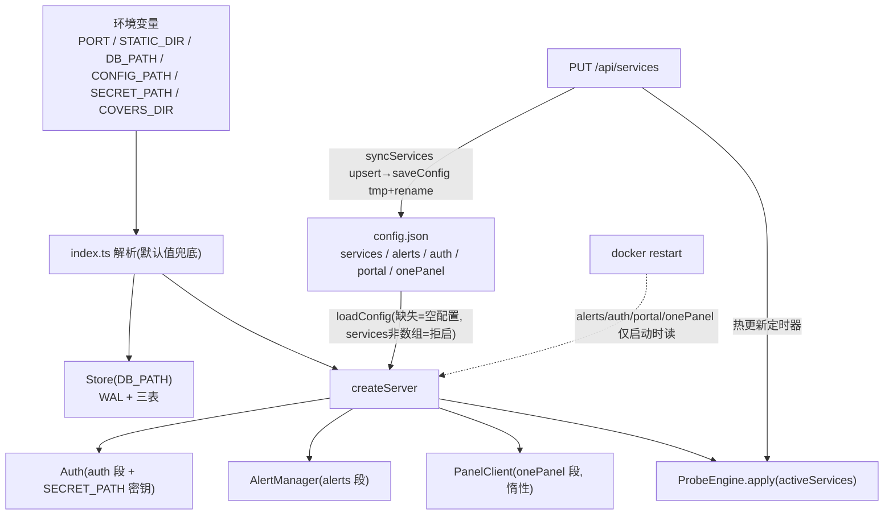

# 14 配置与环境详解
> 项目：nas-console ｜ 版本：v1.1 ｜ 生成日期：2026-10-06 ｜ 依据：源码分析

## 0. 本篇定位

配置面散落在五类载体上：探针 `config.json`（唯一的服务端配置）、六个环境变量、两个 Dockerfile、两份 compose、以及脚本与数据文件。04 篇第 1 节给过 config.json 的 schema 速览，06 篇给过部署对照表；本篇是**逐字段、逐段、逐行**的手册级展开——每个配置项「从哪读进代码、改了是否要重启、错误值会发生什么」三个问题都有明确答案。先给一张配置加载全景图，再分区走读。

## 1. config.example.json 逐字段走读

样例文件（根目录 `config.example.json`）内容只有三段：`services: []`、`alerts: {}`、`auth: {username: "admin", passwordHash: ""}`。三段的填写策略：

- **`services`**：可以留空数组启动。首次打开管理区后，前端把「内置 19 项 + 自定义」经 `PUT /api/services` 自动 upsert 落盘（实际部署机的 config.json 即由前端写就，services 段不需要手工拼）。手工编辑仅用于前端表达不了的探测细节：`check.type`（tcp/关键词）、`expectStatus`、`tlsSkipVerify`、`intervalSec`、`tcpHost/tcpPort`——注意这些字段挂在**已存在的 id** 上才会在后续同步中被保留（`syncServices` 保留 prev.check，新 id 的 check 由前端推导覆盖）。
- **`alerts`**：完全手工维护，至少配一个渠道（bark/telegram/webhook 三选其一二三），策略字段 `consecutiveDowns`(默认 3)/`renotifyAfterMin`(默认 30)/`quietFrom`/`quietTo`(HH:mm，可跨零点) 可选。错误值行为：渠道字段不完整（如有 botToken 无 chatId）时该渠道**静默不启用**（dispatch 的 if 判定）；`quietFrom` 格式非法（如 "25:00"）时安静时段整体不生效（parseHM 返回 null）。改后必须 `docker restart`。
- **`auth`**：`username` 非空 + `passwordHash` 含 `$` 才启用鉴权（三条件同时成立，auth.ts 第 36-38 行）。`passwordHash` 用 `cd server && read -s P && node scripts/hash-password.mjs admin "$P"` 生成（输出即本段 JSON，可直接合并）。空串 `""` 不含 `$` → 鉴权关闭（裸奔面见 08 篇第 6 节）。改后重启；**注意换 passwordHash 不使已签发会话失效**，强制登出要换 session-secret。

三段放在一起看，能看到 config.json 的一个隐含设计立场：**它是「服务器侧真相」而非「用户界面」**——所有段都没有 schema 校验之外的友好性（无注释、无枚举提示、写错值大多静默降级），因为作者假设编辑它的人刚读完 README 或本篇。这也决定了配置排障的第一动作永远是「对照 types.ts 检查字段名与类型」：JSON 里多一个逗号、字段名拼错（`passwrodHash`）、类型写错（`consecutiveDowns: "3"` 字符串）都不会报错，只会表现为对应功能不生效——「配置没生效」类问题的排查顺序永远是先验 JSON 合法性（`python3 -m json.tool config.json`），再对字段名，最后才怀疑代码。

样例文件**不含**的两个可选段（需按 `server/src/types.ts` 第 50-65 行手工添加）：

- **`portal`**：`{ "publicGroups": ["应用站点", "文档与统计"], "publicMetrics": false }`。不写时后端有缺省值：`publicGroups` 缺省同样两组（server.ts 第 343 行）、`publicMetrics` 缺省 false——因此**显式写出与否行为一致**，写出来的意义是「这是我有意决策的公开策略」。
- **`onePanel`**：`{ "baseUrl": "http://192.168.1.18:10086", "apiKey": "<面板生成>", "hostHeader": "<仅域名绑定时>" }`。apiKey 缺失/空 → `getPanel` 返回 null → 四个相关端点恒 400「未配置 1Panel」，UI 自隐藏，攻击面为零。改后重启。

### 1.1 portal.publicGroups 白名单机制详解

这是公开面的总开关，语义要点有五：①**匹配是字符串精确相等**（`publicGroups.includes(s.group)`，server.ts 第 375 行）——分组名「应用站点」与「应用站点 」（带空格）是两个分组，配置前后空格需与 `services[].group` 逐字符一致；②**作用是分组级**：白名单里的分组下**所有**服务的 `url/tags/error/profile` 全部公开，无法只公开分组内某个服务——需要细粒度时建一个新分组；③**字段级含义**：非白名单分组的公开快照条目没有 `url` 字段本身（而非空串），前端以字段存在性判定成卡/成详情页（见 07 篇第 13 节）；④**error 随白名单下发**：白名单分组的失败文案对访客可见（StatusPage 的 Tooltip），因此白名单分组里只应放公网服务；⑤**生效即时**：publicStatus 每次请求实时读取 config，改段并重启后下一次轮询（≤30s）即生效，无需再同步清单。

## 2. 环境变量全表

六个变量全部在 `server/src/index.ts` 第 5-10 行解析，注意默认值的相对基准（这是全篇最容易踩的坑所在）：六个默认值分属**两种相对基准**——`STATIC_DIR` 相对编译产物位置（`import.meta.url`），其余五个相对进程工作目录（cwd）。容器内一切由镜像 ENV 钉死所以无感；本地开发与手工 `docker run` 时，「在哪个目录启动」直接决定 DB/config/secret/covers 四个文件落在哪里。dev 的 README 约定是「在 server/ 目录下 `node dist/index.js`」，此时 `data/probe.db`、`config.json` 都落在 server/ 下；换目录启动不会报错，而是**静默新建一套空文件**——历史「消失」、清单「回空」的现象十有八九源于此。判断当前进程用了哪套路径，看启动横幅第二三行（`static:` 与 `db: ... config: ...`）即可。

| 变量 | 默认值 | 相对基准 | 说明与坑 |
|---|---|---|---|
| `PORT` | `5950` | — | dev 约定 5951（vite 代理指向）；两份 compose 都显式传 5950 |
| `STATIC_DIR` | `../../dist`（经 `new URL('../../dist', import.meta.url)`） | **编译产物位置**（server/dist/index.js 上两级） | 唯一一个默认值相对 import.meta.url 而非 cwd 的变量；Dockerfile.nas 显式设 `/app/dist` |
| `DB_PATH` | `data/probe.db` | **进程工作目录** | dev 在 server/ 下启动才落对位置；错误 cwd 会静默新建空库（12 篇 Q13） |
| `CONFIG_PATH` | `config.json` | cwd | 同上；Dockerfile.nas ENV 为 `/app/config.json`，docker-compose.nas.yml 覆盖为 `/app/config/config.json` |
| `SECRET_PATH` | `<DB_PATH 目录>/session-secret` | 随 DB_PATH | 首启生成 32 字节 hex、0600；删除即全员登出 |
| `COVERS_DIR` | `<DB_PATH 目录>/covers` | 随 DB_PATH | 首启 `mkdirSync(recursive)`；封面按 `<id>.<ext>` 落盘 |

容器内由镜像 ENV 钉死（`NODE_ENV=production PORT=5950` + 各 compose 补 DB_PATH/CONFIG_PATH/STATIC_DIR），本地开发全部走默认值。前端**没有任何环境变量**——Umami 地址等在设置页（localStorage），API 走同源相对路径。

## 3. 两种 Dockerfile 逐段对比

### 3.1 `Dockerfile`（全量构建，单阶段 build + 运行阶段）

逐段走读：第 1-4 行注释声明构建上下文必须是 PROJECT 父目录并给出两种命令形态；第 6-13 行 build 阶段——`node:22-bookworm-slim`、`COPY react-ui/ react-ui/`（疑似遗留，见 13 篇问题三）、`COPY nas-console/ nas-console/`、`npm ci && npm run build`（前端 tsc+vite）接 `cd server && npm ci && npm run build`；第 17-24 行运行阶段——同为 bookworm-slim（第 16 行注释：glibc 命中 better-sqlite3 预编译二进制，alpine 需现场编译）、`ENV NODE_ENV=production PORT=5950`、四个 COPY（前端 dist、server/dist、server/node_modules、server/package.json）；第 26-30 行 `VOLUME /app/data`、`EXPOSE 5950`、`WORKDIR /app/server`、`CMD node dist/index.js`。

### 3.2 `Dockerfile.nas`（NAS 轻量构建，两阶段）

第 1-2 行注释定位「仅构建探针服务端；前端 dist 由宿主机挂载」；deps 阶段（第 3-7 行）只 COPY `server/package.json package-lock.json` 后 `npm ci --omit=dev`——**better-sqlite3 在这一步按 NAS 实际平台拉预编译二进制**（注释明示 linux x64 glibc）；运行阶段（第 9-19 行）ENV 四件套 `NODE_ENV/PORT/DB_PATH=/app/data/probe.db/CONFIG_PATH=/app/config.json/STATIC_DIR=/app/dist`，第 16 行注释是全文件最重要的一行：「package.json 必须在场：含 type: module，缺失会把 ESM 当 CJS 解析」——所以运行阶段单独 COPY 了 server/package.json；随后 COPY node_modules 与 server/dist。**没有** VOLUME/健康check 声明（healthcheck 在 compose 层给）。

### 3.3 关键差异速览

| 维度 | Dockerfile | Dockerfile.nas |
|---|---|---|
| 构建内容 | 前端 dist + 探针一锅出 | 仅探针；dist 宿主机挂载 |
| 阶段 | build + runtime（两层） | deps + runtime（两层） |
| npm 安装 | 全量 dev+prod（build 阶段） | `--omit=dev` |
| CONFIG_PATH 默认 | 无 ENV（compose.yml 传 `/app/config.json`） | `/app/config.json`（compose.nas 覆盖为 `/app/config/config.json`） |
| 适用 | 一次性完整构建/CI | NAS 日常更新（本机 build dist 后同步上传） |

**怎么选**：判断标准是「NAS 上要不要跑前端构建」。NAS 常是低功耗设备，在它上面 `npm ci + vite build` 既慢又占内存，所以生产路径选择「本机构建 dist、NAS 只装探针运行时」——这正是 Dockerfile.nas 存在的理由；Dockerfile 全量路径适合 CI 机器或换 NAS 时的首次完整部署。选择还牵动一个容易被忽略的点：better-sqlite3 的原生二进制与平台绑定，Dockerfile.nas 的 deps 阶段在 **NAS 平台上**执行 `npm ci`（构建即目标平台），而 Dockerfile 全量路径如果在 x86 机器构建再迁移到 ARM NAS，预编译二进制会不匹配——这也是「NAS 日常更新走 Dockerfile.nas」的第二个理由（在正确的平台上拉二进制）。两份镜像内 `node:22-bookworm-slim` 的选择同源（glibc 命中预编译），不要换成 alpine，否则进入 musl 现场编译 better-sqlite3 的路径（需要 python3/make/g++，镜像骤增数百 MB）。

## 4. 两份 compose 逐段对比

**`compose.yml`（桥接网络）**：`build.context: ..` + `dockerfile: nas-console/Dockerfile`（父目录上下文，配合 react-ui 遗留依赖）；`ports: "5950:5950"`（注释：与旧 nas-console-web 的 5950:80 对齐，frpc/反代无需改动）；environment 三件（PORT/DB_PATH/CONFIG_PATH=/app/config.json/STATIC_DIR）；volumes 两条——`./data:/app/data` 与 **`./config.json:/app/config.json`（单文件挂载）**；healthcheck 用 node 一行 fetch `/statusz`（30s/5s/3 次）。**单文件挂载与 `saveConfig` 的 rename 原子写冲突（EBUSY），这是它的已知隐患**——06 篇第 5.1 节备注「新部署建议用目录挂载」。

**`docker-compose.nas.yml`（host 网络，生产在用）**：`build.context: .` + `Dockerfile.nas`；`network_mode: host`（头注释给出三条理由：直连本机 1Panel 源 IP 匹配面板白名单、与 frp 链路解耦、frpc 无需改动）；environment 的 CONFIG_PATH 覆盖为 `/app/config/config.json`；volumes 三条——`./dist:/app/dist:ro`（只读，更新前端=替换宿主文件+重启）、`./data:/app/data`、`./config:/app/config`（**目录挂载规避 rename EBUSY**，第 24 行注释明言）；healthcheck 同款。两份 compose 的 `container_name` 同为 `nas-console-probe`、`restart: unless-stopped`、`name: nas-console`——**不可同时部署**（重名冲突），它们是同一服务的两种形态而非两个服务。

host 网络的选择还带来两个不在注释里的衍生语义，部署与排障时要知道。其一，**端口即宿主机端口**：容器内 5950 直接绑定在 NAS 的 5950 上，没有端口映射层——`docker ps` 不显示端口转发列、`docker port` 无输出属正常；也意味着 5950 被宿主机其它进程占用时容器起不来（错误信息是 bind EADDRINUSE 而非常见的映射冲突）。其二，**防火墙与暴露面语义变化**：桥接模式下未映射的端口天然不可达，host 模式下 5950 是否对外可达取决于 NAS 防火墙——按部署约定 5950 只应接受来自 frpc（本机）与内网的访问，若 NAS 防火墙全开，等于把控制台直接暴露在内网之外，这是换成 host 网络后值得做的一次性核查项（对照 08 篇的信任边界）。

## 5. nginx / frp 链路配置

生产访问链路（README「部署」节）：浏览器 → `https://console.zhangzhengyang.com`（VPS nginx + basic auth + certbot）→ frps 5950 → NAS frpc → 容器 5950。仓库内**没有** nginx/frps/frpc 的配置文件，只有 README 给出的放行规则要点，逐条转述并补语义：

1. `/status` 与 `/api/public/` 豁免 basic auth（nginx 示例：`location = /status { auth_basic off; ... }` 与 `location /api/public/ { auth_basic off; ... }`）——注意 README 用了 `location =` **精确匹配** `/status`，避免 `/statusXYZ` 之类子路径被误放行；`/api/public/` 前缀匹配是刻意的（公开 API 只此一个前缀）。
2. 其余路径保持 basic auth；启用探针侧登录后 basic auth 可退役或留作第二道门（README 0.3.1 节）。
3. SSE 路径 `/sse` 需要反代关闭缓冲与足够长的读超时（服务端已发 `x-accel-buffering: no` 与 25s 心跳；nginx 侧建议 `proxy_buffering off` 且 `proxy_read_timeout` 大于 25s）——⚠️ 具体 nginx 参数不在仓库内，需登 VPS 核实。
4. frp 侧：frps 监听 5950，frpc 转发 NAS 5950；是否启用 frp 的 tls/加密未在仓库内体现（08 篇边界二的 ⚠️ 待确认）。
5. 启用 1Panel 集成时，面板侧「API 接口」白名单需含 NAS 内网 IP（host 网络下探针出站源 IP 即 NAS 本机，docker-compose.nas.yml 头注释）；域名绑定时 config 的 `onePanel.hostHeader` 填绑定域名。

## 6. scripts 全量说明

仓库只有两个脚本，都是零第三方依赖的纯 Node：

- **`server/scripts/hash-password.mjs`（17 行）**：生成 config.json `auth` 段。用法 `node scripts/hash-password.mjs <用户名> <密码>`；头注释给出防进 shell 历史的 `read -s P` 写法。实现要点：`import { newSalt, hashPassword } from '../dist/auth.js'`——**直接复用编译产物的哈希函数**，杜绝「脚本与校验算法漂移」（04 篇第 6 节的同源复用机制）；输出为格式化 JSON `{"auth": {...}}`，stdout 打印，由用户自行合并。前置条件：先 `npm run build`（依赖 dist/auth.js 存在）。
- **`scripts/make-icons.mjs`（109 行）**：PWA 图标生成。纯 Node `node:zlib` 手写 PNG 编码（IHDR/IDAT/IEND chunk + CRC32 表 + deflate），按 512 基准坐标渲染「靛蓝底 + 白色机架三横条 + 绿/橙状态灯」的位图（落在 maskable 安全区），输出 `public/icons/icon-{512,192,180}.png`。用途仅是图标源文件再生成，日常运维不碰；`public/manifest.webmanifest` 引用这三个尺寸（192/512 any + 512 maskable）。

## 7. 数据文件清单（data/ 卷）

| 文件 | 生成方式 | 语义与运维要点 |
|---|---|---|
| `probe.db` | Store 构造 | WAL 模式，伴随 `-wal/-shm` 两文件；备份用 sqlite3 `.backup` 或停容器拷贝（热拷主文件有丢尾风险） |
| `session-secret` | Auth 构造首启生成（0600） | 泄露=可伪造任意会话；删除/替换=全员登出；备份优先级与库同级 |
| `covers/` | 上传端点写 | 封面 `<id>.<png|jpg|webp>`、截图 `<id>-s<N>.<ext>`；孤儿文件（上传后未保存档案）不自动清理，可定期比对 profile 引用后手工清 |

数据卷的宿主机落点在 NAS 上是 `/volume1/docker/nas-console/data`（设计稿第 2 节的约定），日常运维三件事围绕它展开。**容量**：probe.db 稳态数 MB，covers 随上传增长（单文件 ≤5MB 封顶），整卷给 1GB 富余即可，无需监控。**迁移**：换 NAS 或换部署目录时，`data/` 与 `config/`（或单文件 config.json）两个一起搬即可完整保留历史与凭据，dist 与镜像可重建——「可再生物」与「不可再生物」的分界线就在这两个目录。**权限**：容器内进程以 root 运行（镜像未建非 root 用户），宿主机侧目录保持 root 可写即可；`session-secret` 的 0600 是文件内权限语义，在挂载卷上表现为宿主机 root 属主，不要放宽为 world-readable。

## 8. 配置变更速查表（改什么、怎么生效）

| 想改什么 | 改哪里 | 生效方式 |
|---|---|---|
| 服务清单元数据（名称/描述/分组/图标/tags） | 设置页（自定义）或 `src/config/services.ts`（内置，需重新构建 dist） | 访问一次 `/console` 触发同步，即时 |
| 探测细节（tcp/关键词/expectStatus/tlsSkipVerify/intervalSec） | config.json 对应服务的 check 段 | `docker restart`（或本地重启进程） |
| 告警渠道与策略 | config.json `alerts` 段 | `docker restart` + `POST /api/alerts/test` 验证 |
| 管理员凭据 | hash-password.mjs 生成 → config.json `auth` 段 | `docker restart`；强制登出另换 session-secret |
| 公开白名单 | config.json `portal.publicGroups` | `docker restart`，≤30s 生效于公开页 |
| 1Panel 集成 | config.json `onePanel` 段 | `docker restart`；白名单/hostHeader 在面板侧配合 |
| 主机名/端口/路径 | 环境变量（compose environment） | `docker compose up -d` 重建容器 |
| 首页名片文案 | `src/config/identity.ts` | 改代码 → `npm run build` → 同步 dist → 重启 |

---

*config.json 各段的 schema 细节与段所有权（谁可写）见 04 篇第 1 节；部署操作序列与备份例程见 06 篇；Dockerfile react-ui 遗留问题的处置见 13 篇问题三。*
