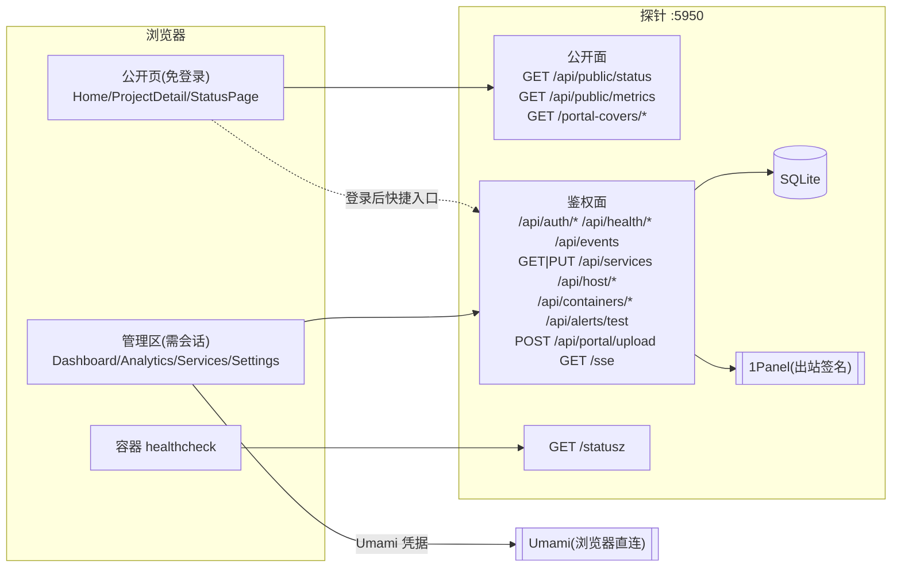

# 15 接口全量参考
> 项目：nas-console ｜ 版本：v1.1 ｜ 生成日期：2026-10-06 ｜ 依据：源码分析

## 0. 本篇定位与总览

本篇是速查手册：server 全量 API 端点详表（方法/路径/用途/入参/响应/鉴权）、SSE 流式端点专节、前端 localStorage/sessionStorage 键全表，以及前端消费的上游外部接口（Umami/1Panel）清单。03 篇讲「接口如何设计与为什么」，本篇只讲「每个接口长什么样、怎么调」——按本篇的请求示例可以直接用 curl 复现。全部端点定义集中在 `server/src/server.ts` 的 `handleApi`（第 110-306 行），鉴权门在 `auth.ts` 的 `authGuard`。

总览图（客户端视角的端点分组与数据源）：

六条贯穿性约定（03 篇第 1.5 节有完整论述，此处仅列名）：无版本前缀；响应无统一包络（查询回领域对象、写入回 `{ok:true}`、错误回 `{error:中文}`）；时间戳全毫秒（唯一例外 1Panel 出站签名用秒）；列表参数 `clampInt` 静默夹取；读端点全 `no-store`；写端点全量 upsert 语义。以下各表中「鉴权：会话」指启用 auth 时需要有效 `nas-console-session` Cookie（未启用 auth 时全部放行，见 08 篇）。

**如何用本篇调试**。所有端点都可以用 curl 直接复现，本地 dev 探针约定监听 5951（vite 代理目标），生产容器内是 5950。未启用 auth 时任意端点裸调即可；启用 auth 后需要先拿会话：`curl -s -c /tmp/nas-cookie.txt -X POST http://127.0.0.1:5951/api/auth/login -H 'content-type: application/json' -d '{"username":"admin","password":"<口令>"}'`，随后带 `-b /tmp/nas-cookie.txt` 访问受保护端点。判断「401 是哪一层拦的」看响应体：`{"error":"unauthorized"}` 是 authGuard 拦截（会话缺失/无效），登录端点的 401 则携带具体中文原因——两者语义不同，前者该重新登录，后者该看限流。所有查询端点都禁缓存（`no-store`），curl 加不加缓存头无差别；唯一可缓存的是封面图片与静态 assets。以下各节按端点分组给出详表，每个表后的补充段落记录该组端点的行为细节与易错点。

## 1. server 全量端点详表

### 1.1 鉴权（3 个）

| 端点 | 鉴权 | 入参 | 成功响应 | 失败 | 消费方 |
|---|---|---|---|---|---|
| `POST /api/auth/login` | 公开 | body `{username, password}` | `{ok:true}` + `set-cookie: nas-console-session=...`（HttpOnly; SameSite=Lax; Max-Age=2592000） | 401 `{error}`：凭据错 / 「失败次数过多，锁定 10 分钟」/ 「尝试过于频繁，请 N 分钟后再试」/「未启用登录」 | `LoginPage` |
| `GET /api/auth/session` | 公开 | — | `{authRequired: boolean, authed: boolean}` | 网络失败时前端按 `ok` 处理（降级兼容） | `RequireAuth`、`HomePage` |
| `POST /api/auth/logout` | 会话 | — | `{ok:true}` + `set-cookie` Max-Age=0 | —（注意不在公开白名单，需有效会话） | `AppLayout`、`HomePage` 的退出按钮 |

### 1.2 健康与事件（3 个）

| 端点 | 鉴权 | 入参 | 成功响应 | 失败 | 消费方 |
|---|---|---|---|---|---|
| `GET /api/health/latest` | 会话 | — | `{ts, results: CheckResult[]}`；CheckResult=`{id, status:'up'\|'down', latencyMs:number\|null, checkedAt, error?, certExpiresInDays?}` | 401 | `use-health.ts`（首屏+兜底轮询）、`probeAvailable`（3s 超时探测）、`QuickLinksCard` |
| `GET /api/health/history` | 会话 | `?days=`（clamp 1–90，默认 45；前端传 90） | `{days: Record<服务id, Record<'YYYY-MM-DD', DayBucket>>, recent: Record<服务id, RecentSample[]>}`；DayBucket=`{up,down,latencySum,latencyN}`；RecentSample=`{t,s:0\|1,l}`（≤240 点/服务，48h 窗口） | 401 | `use-health.ts` 每 5 分钟导入 |
| `GET /api/events` | 会话 | `?limit=`（clamp 1–200，默认 50；前端传 100） | `{events: [{service_id, ts, to:'up'\|'down'}]}`——**线格式为蛇形 `service_id`**（`store.events()` 的 `as ProbeEvent[]` 断言运行时失真，仅 `to` 经 SQL 别名转正；驼峰 `serviceId` 只出现在 SSE `event` 帧，前端 `fetchProbeEvents` 做 DTO 映射，19 篇第 2.3 节） | 401 | `use-health.ts` 每 5 分钟导入 |

### 1.3 服务清单（2 个）

| 端点 | 鉴权 | 入参 | 成功响应 | 失败 | 消费方 |
|---|---|---|---|---|---|
| `GET /api/services` | 会话 | — | `{services: ServiceConfig[]}`（权威副本全量） | 401 | `useProbeListSync` 组装、`QuickLinksCard`、`ProfileModal` 回填 |
| `PUT /api/services` | 会话 | body `{services: [{id*, name*, description?, group, url, internalPort?, icon?, checkable, hidden?, check, tags?}]}` | `{ok:true, total:<合并后总数>}` | 400 `{error}`：`services 应为数组` / `服务缺少 id/name` | `useProbeListSync`（60s 周期）、`ProfileModal` 保存 |

PUT 语义（`syncServices`）：已存在 id 保留探针侧 `check`、profile 经 `sanitizeProfile` 净化；新 id 用传入 check 或 `defaultCheck` 推导；不删除（prune=false，探针多出的服务保留尾部）；只重写 `services` 段；落盘 tmp+rename 后 `engine.apply` 热更新。

**这一组的行为细节**。`/api/health/latest` 的响应里只包含**已纳入巡检**的服务（引擎内存快照），`check.type='none'` 或 `hidden` 的服务不会出现——前端「服务在线」分母因此只统计可检服务，与页面观感一致。`certExpiresInDays` 是纯内存字段（不入库），进程重启后直到下一轮 HTTPS 检查前该字段缺失，消费方都做了 `!= null` 判空。`/api/health/history` 是全接口中单次开销最大的查询（48h 原始采样窗口扫描后逐服务降采样），`days` 参数只影响 daily 部分、recent 恒为 48h 窗口——两个窗口不对称是设计使然（可用率看长期、延迟走势只看近期）。`/api/events` 返回的是**全局**事件流（跨服务混排、按时间倒序），线格式是蛇形 `service_id`（与 SSE `event` 帧的驼峰 `serviceId` 形成对照），前端 `fetchProbeEvents` 完成 `service_id → serviceId` 的 DTO 映射后才按 serviceId 分组；`to` 字段经 SQL 别名已是最终拼写，前端无需再处理 `to_status`。PUT 的两个高频误用值得点名：其一，body 里带了 `check` 也不会生效在已有服务上（被探针侧配置覆盖），想改探测行为请编辑 config.json 而不是改前端清单；其二，PUT 是全量语义，漏传的服务不会丢（prune=false 兜底），但误传的服务元数据会以传入为准覆盖旧值。

### 1.4 公开面（2 个 + 封面托管）

公开面是全部端点中唯一「匿名可调」的业务面，也是脱敏策略的落点：`/api/public/status` 每次请求实时组装（无缓存层），`days` 数组恒为最近 45 天（无数据日 `availability: null`），`groups` 的顺序即 config 清单中分组首次出现的顺序。`PublicService` 的完整字段契约见 1.4 节表；这里补充两个消费侧约定：前端以 `s.url` 字段的**存在性**判定项目卡与详情页可达（字段级脱敏的开关语义），以 `s.error` 的存在性决定状态页 Tooltip 是否有内容可展示——因此「白名单分组里放内网服务」会同时暴露其地址与失败文案，配置白名单时必须把「这个分组里的服务都愿意完全公开」当作前置条件。封面托管与公开快照是两套独立的脱敏单元：`/portal-covers/*` 只要文件名合法即可访问，与分组白名单无关——封面图被 profile 引用才进入公开语义，上传了但未保存档案的「孤儿文件」同样可被猜名访问（id 可枚举），这是已记录的边界而非缺陷（个人门户可接受）。

| 端点 | 鉴权 | 入参 | 成功响应 | 失败 | 消费方 |
|---|---|---|---|---|---|
| `GET /api/public/status` | 公开 | — | `{ts, portal:{publicMetrics}, groups:[{name, services: PublicService[]}]}`；所有服务含 `id/name/description?/group/icon?/status/latencyMs/checkedAt/certExpiresInDays?/days[45]`；**白名单分组（portal.publicGroups）额外**：`url/tags/error/profile` | —（探针离线时前端 degraded 态） | `Home`/`ProjectDetail`/`StatusPage`（30s 轮询） |
| `GET /api/public/metrics` | 公开 | — | `{ts, current:{cpuUsedPercent, memoryUsedPercent, loadUsagePercent, cpuTotal}}`（仅 4 字段） | 404 `{error:'not found'}`：`publicMetrics=false` 或未配置面板（**故意 404 不暴露端点存在**）；502 `{error:panelMsg}`：面板不可用 | `NasCard` 级联第二跳 |
| `GET /portal-covers/<file>` | 公开（白名单前缀） | 路径段文件名，须匹配 `^[a-z0-9-]+\.(png\|jpe?g\|webp)$` | 图片流，`cache-control: public, max-age=86400` | 404（正则外/文件不存在） | 详情页/卡片封面、截图 |

### 1.5 1Panel 代理（3 个）

| 端点 | 鉴权 | 入参 | 成功响应 | 失败 | 消费方 |
|---|---|---|---|---|---|
| `GET /api/host/metrics` | 会话 | — | `{ts, current: PanelNodeCurrent, os: PanelOsInfo}`（全字段，含 load1/5/15、memoryTotal/Used、swap、prettyDistro、kernelArch 等） | 400 `{error:'未配置 1Panel…'}`（前端标 `notConfigured` 自隐藏）；502 `{error:'1Panel 暂不可用'}`（**不回传 panelMsg**，防泄露面板地址） | `HostMetricsCard`（30s）、`NasCard` 第一跳 |
| `GET /api/containers` | 会话 | `?name=`（模糊搜索，可空） | `{containers: PanelContainer[]}`（containerID/name/state/imageName/runTime/ports/appName） | 400 / 502（错误带 panelMsg，会话面内可透传） | `ContainerSection` |
| `POST /api/containers/operate` | 会话 | body `{names: string[], operation: string}`；白名单 `start/stop/restart/kill/pause/unpause` | `{ok:true}` | 400：缺 names/operation 或「不允许的操作：<op>」（remove 等被显式排除）；502 | `ContainerSection` 重启按钮 |

### 1.6 告警与上传（2 个）

| 端点 | 鉴权 | 入参 | 成功响应 | 失败 | 消费方 |
|---|---|---|---|---|---|
| `POST /api/alerts/test` | 会话 | — | `{results:[{channel:'bark'\|'telegram'\|'webhook', ok:boolean, error?}]}`（**恒 200**，逐渠道携带结果） | 渠道失败体现在 results 内 | README 建议配置后手工验证 |
| `POST /api/portal/upload?service=<id>` | 会话 | `?service=` 须匹配 `^[a-z0-9-]+$`；body 为原始图片字节（Content-Type 决定扩展名 png/jpeg/webp）；≤5MB | `{url:'/portal-covers/<id>.<ext>'}` | 400：`service id 不合法` / `仅支持 png/jpeg/webp` / `空文件` / `文件超过 5MB 限制` | `ProfileModal` 封面/截图上传 |

### 1.7 进程健康与静态（2 类）

| 端点 | 鉴权 | 说明 |
|---|---|---|
| `GET /statusz` | 公开（不设防） | `{ok:true, services:<config条数>, sseClients:<SSE客户端数>, authRequired:boolean, ts}`；compose healthcheck 每 30s 调用；也是排障第一探针（12 篇） |
| `GET /*`（其余全部） | 公开 | SPA 静态托管：`normalize`+前缀校验防穿越（403）；不存在/目录回落 index.html（SPA fallback）；`assets/` 目录 `max-age=31536000, immutable`，其余 `no-cache`；MIME 表覆盖 html/js/css/json/webmanifest/png/jpg/webp/svg/ico/txt |

`/statusz` 是无副作用的最小探针：`services` 是 config 清单总条数（含 hidden/none），`sseClients` 是当前 SSE 连接数（管理区页签数级别，长期为 0 说明前端长连不上），`authRequired` 直接反映鉴权启用状态——排障时它同时回答「容器活着吗」「配置读到了吗」「实时链路通吗」三个问题。静态托管没有独立端点定义，它是所有未匹配路径的兜底：SPA fallback 意味着**任意不存在的路径都返回 200 与 index.html**（前端路由接手渲染 404 视图），这解释了「dev 代理漏配时页面拿到 HTML 而非 JSON」的经典现象——排障时若某 API 响应的 content-type 是 text/html，第一怀疑对象就是代理漏配而非后端。

未匹配任何分支的 `/api/*` 统一 404 `{error:'not found'}`；全 API 包在大 try/catch，未捕获异常 500 `{error: message}`。

### 1.8 调用顺序与依赖关系

端点之间不是平等的：有几个隐式的调用顺序约定值得记录。前端启动序列是「`/api/auth/session` 判态 →（ok）→ `probeAvailable()` 探测 →（probe 模式）→ latest + history + events 三连 → SSE 订阅」，任何一环 401 都会触发整页刷新回到会话判定——所以调试时改了会话状态后，看到的是「整页重载」而不是局部报错，属预期行为。`PUT /api/services` 与 `POST /api/portal/upload` 是仅有的两个写端点，二者有业务先后：上传只落文件并返回 URL，档案 PUT 才引用该 URL——「上传成功但忘了保存」的状态不会自动收敛（孤儿文件），ProfileModal 的流程把两步串成体验上的一步。`/api/public/*` 与会话面完全正交：公开端点不读 Cookie、会话过期不影响公开页，这是「访客永不被管理员会话状态波及」的可用性保证。

## 2. SSE 流式端点专节（GET /sse）

**握手与帧格式**：响应头 `content-type: text/event-stream; charset=utf-8`、`cache-control: no-store`、`connection: keep-alive`、`x-accel-buffering: no`；连接建立立即写注释行 `: connected\n\n`，此后每 25 秒写 `: ping\n\n`（防代理空闲断连，浏览器不派发事件）。三类命名事件，帧格式统一为 `event: <类型>\ndata: <单行 JSON>\n\n`：

| 事件 | data 载荷 | 触发时机 | 前端处理 |
|---|---|---|---|
| `status` | 单个 `CheckResult` | 每次检查完成即广播（无论是否翻转） | 合并进 `results` map（`onStatus`） |
| `batch` | `CheckResult[]` 全量 | 服务端固定 30s 一拍（batchTimer，防客户端丢帧的最终一致兜底） | 按键整体覆盖合并（`onBatch`） |
| `event` | `{serviceId, ts, to}` | 状态翻转入库时 | 当前前端未消费（事件列表靠 5 分钟历史导入对齐），保留给扩展（11 篇 SOP 六） |

**客户端行为**（`src/api/probe.ts` `subscribeProbeEvents`）：原生 `EventSource`（自动携带 Cookie 鉴权、断线自动重连）；单条 JSON 解析失败静默忽略；`onopen/onerror` 驱动 `live` 状态（页面「实时」角标）。**调试方法**：`curl -N -H "Cookie: nas-console-session=<...>" http://127.0.0.1:5950/sse` 直接观察帧流；dev 环境 `http://127.0.0.1:5173/sse` 经 vite 代理（已注入同一 `x-accel-buffering: no`）。

**生命周期与状态语义**。一条 SSE 连接的状态机很简单：建立（`serve` 写头并加入 clients 集合）→ 稳定期（被动接收三类事件 + 25s 心跳）→ 终止（浏览器关闭页签或网络断开触发 `req close` 事件，服务端从集合摘除）。服务端对客户端**没有任何主动管理**：无认证后的二次校验、无心跳超时踢除、无单客户端速率限制——「信任已通过 authGuard 的连接」是这个设计的隐含前提。断线重连的恢复语义由两层兜底补齐：重连成功后 EventSource 不会补发断线期间的事件，但 30 秒一拍的 batch 全量快照会在半分钟内把状态对齐；再不济 latest 轮询（默认 60s）也在工作。因此对消费方（无论是页面代码还是未来的第三方客户端）的正确心态是：把 `status` 当「尽力而为的加速器」、把 `batch` 当「周期性真相」、把 HTTP 查询当「最终裁决」——三层依次增强，任何一层静默失效系统照常正确。

## 3. 前端存储键全表

| 键 | 存储 | 写入方 | 结构与要点 |
|---|---|---|---|
| `nas-console-settings` | localStorage | `ConsoleSettingsContext`（读取与 DEFAULT_SETTINGS 浅合并，新增字段向后兼容）；`ProfileModal` 绕过 Context 双写自定义服务 profile | `{theme:'light'\|'dark'\|'auto', healthIntervalSec:number(15–600), umamiUrl, umamiUsername, umamiPassword, dashboardSiteId, customServices: ServiceDef[], hiddenServiceIds: string[]}`；**含 Umami 明文密码**（本机浏览器内） |
| `nas-console-health-history` | localStorage | `health-history.ts` 的 `persist()`（recordBatch/applyServerSnapshot 后） | `{days, recent, events, lastStatus}` 四 Record；裁剪预算：days 90 天、recent 48h 且 ≤240 点/服务、events ≤100 条/服务；读取损坏回退空态、写入失败留内存 |
| `nas-console-umami-token` | **sessionStorage** | `umami.ts` 的 `writeToken` | Bearer token 字符串；标签页级（关闭即失效，隐私模式降级内存态）；401 自动清除重登重放一次 |

三个键全部可随时删除而不损坏系统：settings 删除后回默认值（Umami 凭据需重填）、health-history 删除后浏览器侧历史从零（服务端 SQLite 无损）、token 删除后下次请求自动重登。另注意 `RequireAuth` 的会话本体是 HttpOnly Cookie，JS 不可读，不在本表语义内。

**存储的运维视角**。这三个键的读写全部有 try/catch 容错（隐私模式、配额满、JSON 损坏都静默降级为内存态或默认值），因此「存储异常」在 UI 上的表现是**功能性退化而非报错**——Umami 反复要求登录（token 写不进）、可用率条渐空（历史写不进）、设置反复回默认（settings 写不进），遇到这类「不报错但记不住」的现象，先查浏览器的站点存储状态。跨设备语义同样由这三键决定：换浏览器/设备后，设置里的 Umami 凭据、自定义服务、隐藏清单全部为空（它们只存在本机），健康历史为空（服务端历史会在 5 分钟内通过 `applyServerSnapshot` 整体回灌 days/recent 并合并事件，所以可用率数据不丢）；只有「自定义服务的 profile 双写」是例外——ProfileModal 同时把 profile 推给了探针 config（权威），localStorage 只是缓存，因此换设备也不丢档案。排查存储问题时在控制台执行 `JSON.parse(localStorage.getItem('nas-console-settings'))` 与 `Object.keys(JSON.parse(localStorage.getItem('nas-console-health-history')).days).length` 可分别确认设置完整性与历史覆盖的服务数。

## 4. 前端消费的上游外部接口

本节列出的是前端/探针作为**客户端**去调用的外部系统接口——它们不在本仓库内实现，契约由上游决定，此处记录的是代码实际消费的形状与兼容处理，供上游升级时对照排查。

**Umami（浏览器直连，`src/api/umami.ts`，凭据来自 localStorage）**：

| Umami 端点 | 用途 | 封装函数 |
|---|---|---|
| `POST /api/auth/login` | 登录取 token | `login`（401/403 → UmamiAuthError） |
| `GET /api/websites` | 站点列表 | `fetchUmamiWebsites`（兼容 `{data}` 包裹） |
| `GET /api/websites/{id}/stats?startAt&endAt` | 五项指标+对比期 | `fetchUmamiStats` |
| `GET /api/websites/{id}/pageviews?startAt&endAt&unit` | PV/Sessions 时间序列（unit: hour/day） | `fetchUmamiPageviews` |
| `GET /api/websites/{id}/metrics?type=&startAt&endAt` | 维度 Top（path/referrer/browser/os/device/country） | `fetchUmamiMetrics`（兼容数组与 `{data}` 两种形状） |
| `GET /api/websites/{id}/active` | 实时在线 | `fetchUmamiActive`（兼容 `number` 与 `{visitors\|x}` 两种形状） |

**1Panel v2（探针服务端出站，`server/src/1panel.ts`，md5 时间戳签名）**：

| 1Panel 端点 | 用途 | 封装方法 |
|---|---|---|
| `GET /api/v2/dashboard/current/node` | 主机实时指标 | `nodeCurrent` |
| `GET /api/v2/dashboard/base/os` | OS 信息 | `osInfo` |
| `POST /api/v2/containers/search` | 容器列表（body 含面板必填的 State/OrderBy/Order） | `searchContainers` |
| `POST /api/v2/containers/operate` | 容器操作（服务端白名单过滤后透传） | `operateContainers` |

两个上游的容错策略对比值得在此收拢。Umami 侧是**形状防御**：三个接口（websites/metrics/active）都做了「数组或 `{data}` 包裹」「number 或 `{visitors|x}` 对象」的双形态兼容，因为 Umami 版本迭代中响应形状变过——这是对外部 API 不可控处的防御性读取（04 篇第 6 节契约机制第 4 条）。1Panel 侧是**包络判定**：统一按 `{code:200, data}` 判成功、非 200 抛带 code 的 `PanelError`，形状是稳定的，防御重点在签名三要素（apiKey/时钟/Host 头）与网络超时（8 秒，agent:false）。升级上游版本时先看本表：Umami 升级重点回归登录与三个双形态接口；1Panel 升级重点回归签名头与容器搜索的必填字段（`State/OrderBy/Order`，1panel.ts 第 126 行注释标明是面板侧必填）。

---

*端点设计理由与错误处理约定见 03-接口设计；数据结构完整定义见 04-数据模型；鉴权机制与公开面脱敏的深度分析见 08-安全与权限设计；本篇与 00–06 篇共同构成完整文档集，接口变更时请同步更新本篇与 03 篇。*
