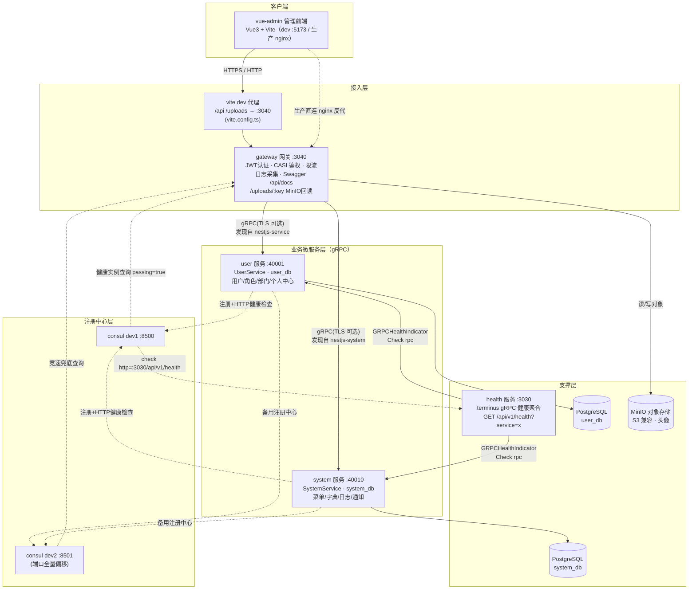
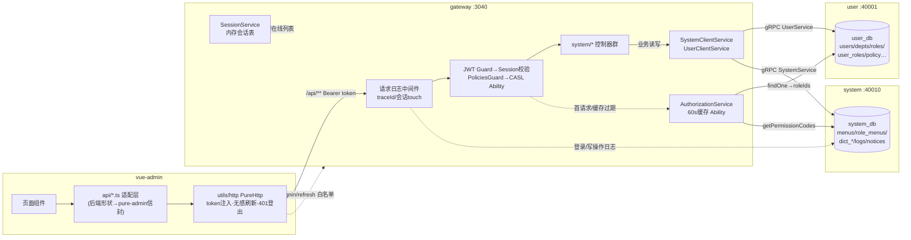

# 01 系统架构

> 项目：nestjs-admin ｜ 版本：v1.0 ｜ 生成日期：2026-10-06 ｜ 依据：源码分析

## 1. 整体架构图

下图依据 `nestjs-microservice-app/gateway/src/app.module.ts`（双 ConsulModule 注册）、`dev-start.sh`（端口与启动顺序）、`user/src/main.ts`（gRPC 服务端）、`proto-pkg/src/utils/consul-http.ts`（注册发现客户端）绘制：

要点：前端**只认识网关**（vite 代理目标 `http://localhost:3040`，见 `vue-admin/vite.config.ts`）；所有业务数据由网关经 gRPC 调用 user/system 两个微服务获得；gRPC 服务不直接对 HTTP 开放，其"存活信号"由 health 服务代答——Consul 对 user/system 的健康检查配置是 HTTP URL（`CHECK=http://127.0.0.1:3030/api/v1/health?service=user_grpc`，`user/src/consul/consul-client.service.ts` 第 15-17 行），health 收到请求后再用 terminus 的 `GRPCHealthIndicator` 真正去调一次 gRPC 标准健康检查（`health/src/consul/consul.controller.ts`）。

## 2. 微服务拆分与职责

| 服务 | 端口/协议 | 职责边界 | 关键源码位置 |
|---|---|---|---|
| gateway | :3040 HTTP | 唯一入口：JWT 认证、CASL 授权、限流、请求日志/操作日志/登录日志采集、gRPC→HTTP 异常映射、Swagger、MinIO 上传回读、内存会话（在线用户） | `gateway/src/`（auth/ consul/ system/ common/） |
| user | :40001 gRPC | 用户域：认证数据（argon2 哈希）、用户/角色/部门 CRUD、个人资料/密码/头像/偏好/密保、CASL 策略规则输出、用户侧仪表盘统计 | `user/src/app.controller.ts`（26 个 `@GrpcMethod`） |
| system | :40010 gRPC | 系统域：菜单树、角色-菜单授权、权限码、字典、操作/登录/系统三类日志、通知、系统侧仪表盘统计 | `system/src/app.controller.ts`（31 个 `@GrpcMethod`） |
| health | :3030 HTTP | 健康探测聚合器：把 `SERVICE_HEALTHCHECK_ENDPOINTS` 环境变量描述的若干 gRPC 端点暴露为独立 HTTP 健康端点 | `health/src/consul/consul.controller.ts`、`health/src/main.ts` |
| proto-pkg | 共享包 | proto 契约与产物（tsup 构建）、`loadProto`、`promisifyServiceMethods`、`ConsulHttpClient`、`loadGrpcTls` | `proto-pkg/src/` |
| template | 脚手架 | 新微服务模板（复制后改 `package.json` name、proto、端口即可），不参与生产构建（`Dockerfile` 注释） | `template/src/` |

拆分逻辑是**按领域限界上下文**：user 域回答"人是谁、能做什么（数据策略）"，system 域回答"系统长什么样、发生过什么（菜单/日志）"。两域各自持有独立 PostgreSQL 库（`user_db`/`system_db`），互不 join——跨域展示（如用户列表显示部门名）在 user 域内部完成（`Dept` 也在 `user_db`），而"用户→角色→菜单权限码"的跨库链路在网关 `authorization.service.ts` 中通过**两次 gRPC 调用拼接**完成：先 `UserService.findOne` 拿角色，再 `SystemService.getPermissionCodes` 拿权限码。

这个拆分粒度在同类项目里属于"恰好"的一档：既没有细到每个资源一个服务（那会让网关聚合层变成性能瓶颈与排障黑洞），也没有粗到只剩一个业务单体（那微服务就成了纯粹的部署负担）。划分的隐形准则是**数据所有权**——凡是需要事务一致性的数据（用户与他的角色分配、菜单与按钮权限码）必须在同一个服务、同一个库里；凡是只读引用（授权页拉角色列表、日志表记用户名字符串）都接受最终一致甚至弱引用。health 服务单列还有一个容易被忽略的理由：它是唯一的"无业务、无库"纯基础设施服务，可以随 Consul 一起最先启动、最后关闭，充当整个栈的就绪信号——dev-start.sh 的启动顺序（health 第二个起、gateway 最后起）正是利用了这一点。proto-pkg 虽然不是运行时服务，但把它当作架构成员来看更准确：它是所有服务共享的"类型宇宙"，proto 变更必须从这里出发向两端扩散，任何绕过它直接改生成物的做法都会在下次重生成时被冲掉。

注册进 Consul 的服务名有两个（发现键）：user 服务注册为 `nestjs-service`（`SERVICE_NAME` 默认值，`user/src/consul/consul-client.service.ts` 第 10 行），system 服务由 `dev-start.sh` 显式传 `SERVICE_NAME=nestjs-system SERVICE_KIND=system`。实例 ID 默认 `nestjs-user-${PORT}`（user 侧写死；system 侧缺省经 `SERVICE_KIND` 拼装为 `nestjs-system-${PORT}`，见《14-配置与环境详解》§5），多实例部署时必须以 `SERVICE_ID` 区分（同文件注释：ID 重复会互相覆盖注册）。

## 3. 服务注册与发现机制（源码级）

### 3.1 注册侧（user/system → Consul）

`user/src/consul/consul-client.service.ts` 在 `onModuleInit` 调用 `consul.agent.service.register`，注册体包含 `id/name/address/port/check`；check 为 HTTP 探测：

- `http: CHECK 环境变量`（指向 health 服务的 `/api/v1/health?service=<key>`）
- `interval: '10s'`，`deregisterCriticalServiceAfter: '60s'`——连续失败的实例 60 秒后被 Consul 摘除（这就是 HANDOFF §4.5 中"health 探测端需 GRPC_TLS=on，否则 60s 被 consul 注销"的原因）。
- `onModuleDestroy` 调用 `deregisterService` 优雅注销（`main.ts` 的 `enableShutdownHooks` 保证 SIGTERM 时执行）。

### 3.2 发现侧（gateway → Consul）

`gateway/src/app.module.ts` 用 `ConsulModule.forRoot` 声明了**两个注册中心实例**（consul1:8500、consul2:8501），每个实例各自描述要发现的远端服务（consul1 只配 user，consul2 配 user+system——HANDOFF 陷阱 18 指出 consul1 的 services 必须数组且含全部服务，否则授权链路拿不到 system 客户端）。`ConsulCoreModule.forRoot`（`consul-core.module.ts`）为每个被发现的 `serviceName` 注册一个**工厂 provider**：注入 `@Inject('nestjs-service')` 得到的是"一个返回随机客户端槽位的函数"，而不是静态客户端实例。

发现与客户端构建流程（`gateway/src/consul/consul.service.ts`）：

1. `getServiceInfo`：调 `ConsulHttpClient.health.service({ service, passing: true })`，从健康实例列表**随机取一个**（负载均衡语义），失败按指数退避重试 3 次（`retry({ count: 3, delay: retryCount => timer(2^retryCount * 1000) })`）。
2. `retryGetServiceInfo`：把请求**并行 fan-out 到所有 Consul 实例**（`from(this.grpcClients).pipe(mergeMap(...), take(1))`），任一实例先返回即采用（多注册中心容灾竞速）；全部落空时抛出带上下文的 `no passing instance found for ...`。
3. `initGrpcClient`：用拿到的 address:port 经 `ClientProxyFactory.create({ transport: Transport.GRPC, package, packageDefinition: loadProto(...) })` 构建 gRPC 客户端；`GRPC_TLS=on` 时附加 `ChannelCredentials.createSsl(loadGrpcTls().rootCerts)`。客户端实例被放入**模块级共享注册表 `grpcClientRegistry`**（按 consulName+serviceName 去重），其 `client` 字段是 `BehaviorSubject<ClientGrpc|null>`——所有消费者订阅这个流，客户端热更新时自动收到新实例。
4. **自愈**：每次 gRPC 调用失败时，`promisifyServiceMethods`（`proto-pkg/src/utils/grpc-utils.ts`）的错误回调触发 `updateGrpcClient(serviceName)` 重新发现并重建客户端，随后通知注册表中**所有同服务条目**（`updateGrpcClient` 里的 `targets = grpcClientRegistry.filter(c => c.serviceName === serviceName)`）——保证订阅在任一条目上的消费者都能恢复；重建失败按 5 秒间隔重试。

### 3.3 服务间通信机制

- **协议**：网关→业务服务为 gRPC（Unary），契约在 `proto-pkg/proto/user.proto`（26 个 rpc）与 `system.proto`（31 个 rpc），另有 `health.proto` 标准 gRPC 健康检查被 user/system 实现（`user.proto:248`、`system.proto:276` 的 `rpc Check`）。
- **运行时形态**：`loadProto` 使用 `@grpc/proto-loader.loadSync` 且 `keepCase: true`——运行时对象键保持 proto 原名（如 `UserRole`），而 ts-proto 生成类型是 camelCase（`userRole`），网关 `authorization.service.ts:148-150` 明确按 `UserRole` 取值并留有注释（HANDOFF 陷阱 4）。
- **Promise 化**：Nest gRPC 客户端方法返回 rxjs Observable，`promisifyServiceMethods` 把其全部方法包装为 async 函数并挂错误回调（自愈入口）。
- **超时与降级**：`SystemClientService.withTimeout` 给 delete/clear 类写操作加 10-15s 超时（`system-client.service.ts:256-273`）；客户端未就绪时 `requireClient()` 同步抛错，日志类写入（`writeOperLog/writeLoginLog`）整体 try/catch 降级为 warn，保证"日志丢失不影响业务"。
- **业务服务之间**：user 与 system 之间**没有直接 gRPC 调用**，跨域编排全部发生在网关层（如 dashboard 聚合、授权规则拼接）。

## 4. 网关内部架构与横切能力

网关是这个架构里唯一"什么都知道"的角色，因此它的内部结构值得单独展开。网关自身是一个标准 NestJS 单体，装配于 `gateway/src/app.module.ts`：

- **中间件**：`RequestLoggingMiddleware` 对所有路由生效——生成 `traceId`（randomUUID）写入 `X-Request-Id` 响应头；携带 Bearer token 时刷新内存会话活跃时间（`sessionService.touch`）；`res.on('finish')` 中按路径分流采集：`/api/auth/signin|signup` → 登录日志（success = statusCode<400），POST/PUT/DELETE/PATCH → 操作日志（module 取 URL 前两段拼 `a:b`）。
- **全局管道**：`ValidationPipe({ whitelist: true, transform: true })`——DTO 未声明的属性一律剥离。
- **全局守卫**：`ThrottlerGuard`（APP_GUARD）+ 各控制器显式 `AuthGuard('jwt')` + 业务写接口 `PoliciesGuard` + `@CheckPolicies` 元数据。
- **全局过滤器**：`AllExceptionsFilter`（`common/filters/all-exceptions.filter.ts`）——`HttpException` 原样透传；非 Http 异常按 gRPC 状态码映射表（3→400、5→404、6→409、7→403、8→429、14→503、16→401 等）转换；≥500 的错误统一 `recordSystemError` 异步落 system 服务 `system_logs` 表（系统日志页数据源），落库失败静默降级。
- **会话层**：`SessionService`（`common/session/session.service.ts`）三张内存 Map（access_token→记录、sessionId→token、refresh_token→sessionId），承载在线用户列表（30 分钟活跃窗口）、强退（`forceLogout`）、refresh 换发（`rotateAccessToken` 换 key 即旧 access 立即失效）、8 天陈旧清扫（30 分钟周期定时器）。设计注释明确"单例部署为最终方案，多实例需换 Redis 共享"。
- **进程级兜底**：`main.ts` 挂 `unhandledRejection`/`uncaughtException` 记日志不崩进程（可用性优先）；`trust proxy 1` 保证反代链路下 `req.ip` 取真实客户端 IP，限流不折叠成单桶。

把这几层横切能力串起来看，网关的设计哲学是"**请求永远能被响应，且响应可追溯**"。守卫层决定了"能不能进"（认证与授权），管道层决定了"进来的数据干不干净"（白名单剥离），过滤器层决定了"出去的错误长什么样"（统一形态与状态码映射），中间件与日志层决定了"整个过程留没留痕"（traceId 贯穿、三级日志落库），会话层决定了"服务端能否主动终结一个客户端"（登出与强退）。这五层彼此解耦、各司其职，任何一层失效都不会放大成全局故障：守卫失败只影响单个请求，日志通道断了业务照常，会话表被清空只是让所有人重新登录。对网关的改动应当保持这种分层纪律——例如新加一个横切关注点时，优先选择中间件或拦截器而不是往控制器里塞逻辑；新加错误分支时优先在 gRPC 异常映射表里补条目而不是散落 try/catch。

## 5. 数据流向图

读路径典型链路（以用户列表为例）：`views/system/user/hook` → `api/system.ts getUserList`（解包 `{users,total}` 适配成 `{list,total,...}` 信封）→ PureHttp 注入 Bearer → 网关中间件（traceId + touch）→ JWT Guard（签名 + 会话存在）→ `UserController.list`（`@CheckPolicies(ability.can('system:user:list','perm'))`）→ `UserClientService.listUsers` gRPC → user 服务 Prisma 查 `user_db` → 原路返回，网关侧不缓存业务数据。

写路径额外多三件事：中间件在响应 finish 时异步写操作日志到 system_db；网关 `SystemClientService` 对 delete/clear 加超时；权限变更通过 `role_menus`/`user_roles` 在下一次 Ability 缓存过期（60s，`authorization.service.ts` 的 `CACHE_TTL_MS`）后生效。

## 6. 关键设计决策与设计模式

| 决策/模式 | 落点 | 说明 |
|---|---|---|
| 网关聚合模式（API Gateway / BFF） | `gateway/src/system/*` | 前端只对接网关；网关做协议转换（HTTP↔gRPC）、鉴权、日志、聚合（dashboard 跨两服务统计） |
| 注册中心 + 客户端发现 | `ConsulService` | 服务端注册（register API）+ 客户端发现（health API 随机选实例），而非 DNS/服务端 LB |
| 观察者模式的客户端热更新 | `grpcClientRegistry` + `BehaviorSubject` | gRPC 客户端是可订阅的"槽位"，服务实例漂移时消费者无感重建 |
| 多注册中心容灾竞速 | `retryGetServiceInfo` | 双 Consul 并行查询 `take(1)`，任一可用即可用（mergeMap 并行、注释明确 concatMap 才是串行） |
| 策略模式的权限引擎 | `PoliciesGuard` + CASL `Ability` | 路由声明 `@CheckPolicies(fn)`，能力由数据库规则动态编译，规则来源双通道（Policy 表 + 菜单权限码） |
| 单活跃会话 + 双 token | `SessionService`/`auth.service.ts` | JWT 无状态 + 内存会话有状态化：登出/强退立即失效（`jwt.strategy.ts` validate 强制 `sessionService.has(token)`）；refresh 换发不换会话 |
| 装饰器元数据 + Reflector | `CheckPolicies`/`Serialize`/`@Throttle` | 声明式横切关注点 |
| 尽力而为的旁路写入 | `writeOperLog`/`writeLoginLog`/`recordSystemError` | 日志采集整体 try/catch、fire-and-forget，绝不阻塞或打崩主请求 |
| 失败即重建的自愈 | `promisifyServiceMethods` errorCallback → `updateGrpcClient` | 调用失败视为实例失联信号，重新发现重建客户端并广播 |
| 数据库-per-service | user_db / system_db | 每微服务私库，禁止跨库 join；Prisma 7 + 驱动适配器，迁移随服务仓库走 |
| 单镜像多角色部署 | `Dockerfile`（生产）/`Dockerfile.service`（参数化） | 同一构建产物按 compose `command`/`SERVICE` 参数跑不同服务，简化 NAS 场景构建 |
| 约定优于配置的动态菜单 | `api/routes.ts` + `router/utils.ts` | 后端菜单 type 0目录/1菜单/2按钮/3iframe/4外链 五类语义映射为 pure-admin 路由/权限/外链，组件路径约定 `views/<path>/index.vue` |

## 7. 架构约束与已知边界

以下事实来自源码注释与 HANDOFF，接手者必须知晓：

1. **网关内存会话限定单实例部署**（`session.service.ts` 头注释 + HANDOFF 第三排优化⑤）。水平扩容前必须先替换 SessionService 实现为 Redis 共享（接口已收敛，替换即可）。
2. **gRPC TLS 为可选项**：`GRPC_TLS=on` 时服务端用 `ServerCredentials.createSsl`（`user/src/main.ts`）、网关客户端与健康检查客户端用 `createSsl(rootCerts)`；证书是 proto-pkg 自带的自签证书，**生产部署因容器间服务名互连需重签含 SAN 的证书卷挂覆盖**（HANDOFF §4.5 部署坑①）。
3. **权限码双重来源**：user_db `Policy` 表（CASL 数据策略，subject 自由）与 system_db 菜单 `permission` 字段（`<域>:<资源>:<动作>` 命名，subject 固定为 `'perm'`），在 `buildAbility` 中合并；前端按钮级权限只消费后者（`type===2` 按钮型菜单的 permission 码）。
4. **proto 消息不可重名**（HANDOFF 陷阱 22：曾因 system.proto 重复 `IdRequest` 导致 loadProto 直接报错），user/system 两 proto 同名消息需改名（如 `SystemDashboardStatsRequest`）。
5. **多实例扩 user 服务**是受支持的：`package.json` 根目录提供 `dev:user1`/`dev:user2` 脚本示例（不同 PORT/SERVICE_ID/CONSUL_PORT/CHECK_KEY），网关随机选择健康实例；但 system 服务、网关会话均未按多实例设计。
6. **健康检查链路绕经 HTTP**：Consul 只会做 HTTP 检查，因此 health 服务是 gRPC 服务的"存活代理"；若 health 挂了，所有 gRPC 服务会在 60s 后被 Consul 摘除——health 的可用性等于全系统可发现性。

## 8. 扩展路径：如何往这套架构里加东西

理解架构最好的检验方式是推演变更。**新增一个微服务**的标准动作是：复制 `template/` 目录改名（它自带与 user 服务完全相同的 main.ts 引导、Consul 注册客户端与数据库模块骨架），在新服务的 proto 文件里定义消息与服务，把 proto 交给 proto-pkg 统一生成；随后在网关 `app.module.ts` 里为两个 ConsulModule 的 `services` 数组各补一条 `{serviceName, packageName}`（别忘了 HANDOFF 陷阱 18 的教训——漏配任何一个实例都会让对应客户端在容灾竞速时拿不到），再仿照 `system-client.service.ts` 写一个订阅式客户端持有器，最后在 compose 或 dev-start.sh 里登记启动项。**给现有服务加实例**更简单：换端口、换 `SERVICE_ID` 再起一个进程即可，Consul 会自动把它纳入健康实例列表，网关的随机选择策略立即生效；根 `package.json` 的 `dev:user1/dev:user2` 脚本就是这套打法的现成示例。**多注册中心扩容**同理，再调一次 `ConsulModule.forRoot` 就行，发现侧的并行竞速逻辑对实例数量无感。反过来，**把网关做成多实例**目前不可行，卡点是内存会话；按 `SessionService` 头注释预留的方案，把三张 Map 换成 Redis 实现并保持方法签名不变，其余代码无需改动。这种"接口先行、实现可换"的收口方式（客户端槽位函数、会话服务、对象存储服务都是如此）是整个架构可持续演进的底气所在。
