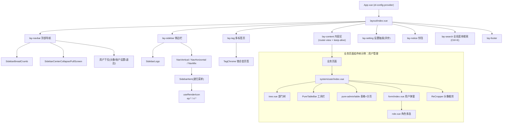
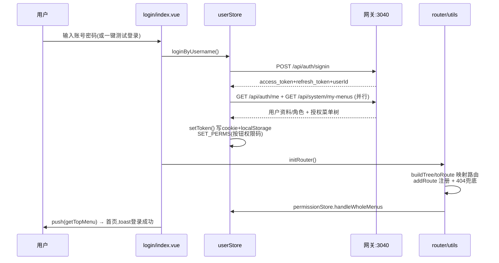
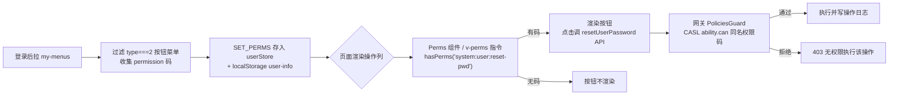

# 02 页面设计

> 项目：nestjs-admin ｜ 版本：v1.0 ｜ 生成日期：2026-10-06 ｜ 依据：源码分析

## 1. 页面总体设计思路

管理端 `vue-admin/` 基于 vue-pure-admin 完整版改造，保留了基座的三段式外壳（侧边栏 + 顶部导航 + 内容区/多标签页），业务上做了两件关键改造：其一，**菜单与路由不再来自前端写死配置，而是登录后调用 `GET /api/system/my-menus` 由后端按角色授权动态下发**（`src/api/routes.ts` 的 `getAsyncRoutes`）；其二，**按钮级权限改用后端菜单表中的权限码**（type=2 按钮型菜单的 `permission` 字段，如 `system:user:reset-pwd`），经 `src/utils/auth.ts` 的 `hasPerms` 与 `v-perms` 指令、`<Perms>` 组件消费，`*:*:*` 为超管通配码。模板自带的演示页面（表格/组件/流图等）保留作组件示例，不与后端交互。

路由模式为 HTML5 history（三个环境文件 `.env.development/.env.staging/.env.production` 均配置 `VITE_ROUTER_HISTORY = "h5"`），因此生产 nginx 必须配置 SPA 回退（见 06 篇）。布局模式默认 vertical（`public/platform-config.json` 的 `"Layout": "vertical"`），支持 horizontal/mix 三种侧边栏形态（`src/layout/components/lay-sidebar/` 下 `NavVertical/NavHorizontal/NavMix` 三组件）。

## 2. 路由与页面总表

路由由两部分组成：**静态路由**（`src/router/modules/`）与**动态路由**（后端 `my-menus` 下发）。静态路由经 `formatTwoStageRoutes(formatFlatteningRoutes(...))` 全部拍平为二级（keep-alive 只支持二级缓存，`router/index.ts:57` 注释）。

| 路由路径 | 页面组件 | 归属 | 说明 |
|---|---|---|---|
| `/login` | `views/login/index.vue` | 静态（remaining.ts） | 登录/注册双 Tab，白名单路由 |
| `/welcome` | `views/welcome/index.vue` | 静态（home.ts） | 首页仪表盘（真实统计） |
| `/access-denied`、`/server-error` | `views/error/403.vue`、`500.vue` | 静态 | 全屏错误页；404 由 `addPathMatch()` 动态兜底（`router/utils.ts:144`） |
| `/redirect/:path(.*)` | `layout/redirect.vue` | 静态 | 标签页刷新中转 |
| `/account-settings` | `views/account-settings/index.vue` | 静态 | 个人中心四卡片（不进菜单） |
| `/empty` | `views/empty/index.vue` | 静态 | 无 Layout 全屏空白页示例 |
| `/system/user/index` | `views/system/user/index.vue` | 动态（菜单 type=1） | 用户管理 |
| `/system/role/index` | `views/system/role/index.vue` | 动态 | 角色管理 |
| `/system/menu/index` | `views/system/menu/index.vue` | 动态 | 菜单管理 |
| `/system/dept/index` | `views/system/dept/index.vue` | 动态 | 部门管理 |
| `/system/dict/index` | `views/system/dict/index.vue` | 动态 | 字典管理 |
| `/monitor/logs/operation/index` | `views/monitor/logs/operation/` | 动态 | 操作日志（`views/monitor/index.vue` 是它的转发壳） |
| `/monitor/logs/login/index` | `views/monitor/logs/login/` | 动态 | 登录日志 |
| `/monitor/logs/system/index` + `detail.vue` | `views/monitor/logs/system/` | 动态 | 系统日志（菜单 id33 补入，HANDOFF 最终排查轮） |
| `/monitor/online/index` | `views/monitor/online/` | 动态 | 在线用户（网关内存会话） |
| `/iframe/:id` | `views/iframe/index.vue` | 动态合成 | 菜单 type=3 时由 `api/routes.ts` 生成，`meta.iframeLink` 存真实 URL |
| （不注册路由） | — | 动态（type=4） | 外链菜单：name 即 URL，侧边栏新窗口打开（`SidebarLinkItem` 约定） |
| `views/table|able|components|flow-chart|vue-flow|…` | 各演示页 | 静态/模板 | pure-admin 基座自带演示，`meta.showLink` 控制是否入菜单 |

动态路由生成规则（`api/routes.ts` 的 `toRoute`）：目录（type 0）输出为带 children 的父路由且**无可见子级时不输出**；菜单（type 1）路径追加 `/index` 后缀并按 pure-admin 约定映射 `src/views` 下的组件文件（`addAsyncRoutes` 用 `import.meta.glob("/src/views/**/*.{vue,tsx}")` 匹配 component 或 path，`router/utils.ts:26、322-348`）；iframe/外链见上表。所有动态路由打 `meta.backstage = true` 标记；目录名自动加 `Parent` 后缀避免与子路由 name 冲突。

## 3. 核心页面逐个解析

先交代所有业务页面共享的"页面组织范式"，后文逐页解析时不再重复：每个页面目录由 `index.vue`（壳，负责模板布局与组件拼装）、可选的 `hook.tsx` 或 `utils/hook.tsx`（composable，聚合 loading、columns、dataList、pagination 等响应式状态与方法）、`form.vue` 或 `form/` 目录（弹窗表单）、`utils/`（校验规则 rule.ts 与类型 types.ts）构成。表格页一律用 `PureTableBar` 包裹 `@pureadmin/table`，前者提供刷新、列显隐、密度切换等工具栏能力；数据获取一律走 `src/api/` 适配层而非在组件里直接发请求，适配层负责把网关返回形状翻译成模板组件期望的信封（`{code, message, data:{list,total,...}}`）。这套范式意味着：看懂一个页面等于看懂所有页面，新增页面的成本主要在 API 适配器与列定义，交互层几乎零新代码。

### 3.1 登录页（`views/login/index.vue`）

- **布局**：左右分栏插画式（`./utils/static` 提供 bg 与 illustration），右侧为登录卡片；品牌资源为新设计的 `public/logo.svg`（引用带 `?v=20260911` 缓存破坏参数）。
- **交互**：账号/密码表单（`loginRules` 校验）+ "7天内免登录"复选框 + 登录按钮 + **"一键测试登录"**按钮（`onTestLogin` 填入 `p1user/secret123` 直接提交）。回车键经 `useEventListener(document,'keydown')` 触发 1 秒防抖登录。注册 Tab（`LoginRegist.vue`）对接真实 `POST /api/auth/signup`（用户名 5-20、密码 6-32 校验，无手机号/短信字段——模板假流程已删）。
- **状态**：`useUserStore().loginByUsername` 成功后 `setToken` 写双存储；勾选免登录时把**用户名**（不含密码）存 localStorage `login-remembered-username`，下次进入自动回填并勾选；失败提示透出后端 message（如"用户名或者密码错误"、429 限流文案）。
- **登录成功后续**：`await initRouter()` 拉动态路由 → `router.push(getTopMenu(true).path)` 跳第一个授权菜单 → toast"登录成功"。

### 3.2 首页仪表盘（`views/welcome/index.vue`）

- **布局**：顶部 4 张统计卡（用户/部门/角色/菜单总数，`ReNormalCountTo` 数字滚动动画，配 RiIconFn 图标与柔和底色）+ 中部 3 项日志/在线统计 + 底部"最新通知"列表（取通知 Tab 前 5 条，`formatTime` 格式化为"x月x日 HH:mm"）。
- **数据**：`onMounted` 并行调 `getDashboardStats()`（`GET /api/system/dashboard-stats`，网关聚合 user/system/网关三方计数）与 `getNotices()`；接口异常静默保留 0 值。此页是 M8 重写的真实仪表盘（HANDOFF：删除了假图表假表格组件，净删 868 行）。

### 3.3 用户管理（`views/system/user/`）

- **布局**：左侧部门树（`tree.vue`，点击节点按 `deptId` 过滤右侧列表）+ 右侧 `PureTableBar` 工具栏（刷新/列显隐/搜索）+ `@pureadmin/table` 表格 + 分页。操作列为 el-dropdown（**click 触发**——M8 将 hover 改 click 以支持自动化测试与移动端，HANDOFF 待办 8）。
- **交互**：新增（`form/index.vue` 弹窗，含角色多选 `role.vue`）、编辑、删除二次确认、分配角色、启停开关（`updateUserStatus`）、重置密码（`resetUserPassword`，按权限码 `system:user:reset-pwd` 显隐）、改头像（`updateUserAvatar` 走 ReCropper 裁剪后 multipart 上传）。搜索支持用户名/手机号模糊 + 部门过滤。
- **状态**：页面逻辑集中在 `utils/hook.tsx` 风格的 composable 中（loading/columns/dataList/pagination 响应式聚合），数据经 `api/system.ts` 的 `asUser` 适配器把后端 `{users,total}` 转为模板表格 `{list,total,pageSize,currentPage}` 信封。

### 3.4 角色/菜单/部门/字典管理

- **角色管理**（`system/role/`）：表格 + `form.vue` 弹窗 CRUD；核心交互是**授权**入口——拉取全量菜单树（`getRoleMenu`）+ 该角色已选 `menuIds`（`getRoleMenuIds`），树形勾选后 `assignRoleMenus` 全量提交；权限码随 `role_menus` 变更在网关 Ability 缓存过期（60s）后生效。
- **菜单管理**（`system/menu/`）：树形表格；`form.vue` 支持五种类型（`utils/enums.ts`：0 目录/1 菜单/2 按钮/3 iframe/4 外链——HANDOFF 陷阱 24 记录了模板 0/1/3 与后端 0/1/2 的历史分裂及修复）；按钮类型表单需填 `permission` 权限码，iframe/外链需填完整 URL（存 `path` 字段）。
- **部门管理**（`system/dept/`）：树形表格 + `form.vue`（父部门选择、排序、状态）；删除由后端兜底校验（存在子部门或在编用户返回 `FAILED_PRECONDITION` → 400，`user/src/app.controller.ts` 的 `DeleteDept`）。
- **字典管理**（`system/dict/index.vue`）：左右布局——左字典类型列表、右所选类型的字典项；均支持增删改（`getDictTypes/getDictItems/createDictType/createDictItem/updateDictType/deleteDictType/updateDictItem/deleteDictItem`），按钮按 `system:dict:update/delete` 权限码显隐。

### 3.5 日志监控四页（`views/monitor/`）

四页共享同一套 `PureTableBar + hook.tsx` 模式（`monitor/utils.ts` 存放公共工具）：

- **操作日志**（`logs/operation/`）：列含 traceId/操作人/模块/URL/IP/状态/耗时；搜索支持模块模糊、状态、时间范围；行点击看详情（`getOperLogDetail`）；支持批量删除（ids 逗号拼接 `DELETE /api/monitor/oper-logs/:ids`）与清空（`/clean`），权限码 `monitor:operlog:list/delete`。
- **登录日志**（`logs/login/`）：列含用户名/IP/状态/消息/时间；支持用户名模糊（M9）、状态与时间范围筛选、真分页（第三排优化修复了此前"列表恒空"的 `res.data ?? []` 取值错误，见 `api/system.ts getLoginLogsList` 注释）。
- **系统日志**（`logs/system/`）：level/module/message/详情（`detail.vue` 抽屉查看堆栈）；数据源为网关 `AllExceptionsFilter` 落库的 5xx（`GET /api/monitor/system-logs` 无分页参数，前端切片分页）；"批量删除/清空"明确置灰提示"暂不支持"（接口未实现，避免假成功）。
- **在线用户**（`online/`）：网关内存会话列表（用户名/IP/登录时间/最近活跃），`id` 即 sessionId；"强退"按钮二次确认后 `kickOnlineUser(sessionId)`，被踢会话的 access 与 refresh 同时失效（用户侧下一个请求即 401 弹回登录页）。

### 3.6 个人中心（`views/account-settings/`）

非菜单页（顶部导航头像下拉进入），`index.vue` 左侧资料摘要 + 右侧 el-tabs 四页签：**Profile**（资料表单 + ReCropper 头像上传，失败透出后端 message 如"超 2MB"；成功后 `SET_AVATAR` 同步导航栏）、**Preferences**（偏好开关组，`updatePreferences` 存 users.preferences JSON）、**AccountManagement**（改密码弹窗 480px + align-center；p1user 会被后端 403"测试账号不可以修改密码"；另有密保信息设置 `updateSecurity`）、**SecurityLog**（安全日志 = 本人登录日志，服务端分页 `getMineLogs`）。

## 4. 布局与组件树

`lay-content` 对 `meta.keepAlive` 的页面用 `<keep-alive :include="permissionStore.cachePageList">` 包裹（`router/index.ts` 守卫里 `handleAliveRoute(to,'add')` 维护缓存名单，标签关闭时 `cacheOperate({mode:'delete'})` 同步清理）。

## 5. 状态管理设计

Pinia store 定义于 `src/store/modules/`，`src/store/index.ts` 的 `setupStore` 负责安装：

| Store | id | 职责与关键 state/actions |
|---|---|---|
| user | `pure-user` | avatar/username/nickname/roles/permissions（初始值从 localStorage `user-info` 恢复）；`loginByUsername`、`handRefreshToken`、`logOut`（清 token + 重置路由 + 跳登录）、`SET_PERMS`（`api/routes.ts` 在每次拉菜单时同步按钮权限码） |
| permission | `pure-permission` | `wholeMenus`（静态 constantMenus + 动态路由合成、经 `filterNoPermissionTree` 按角色过滤、`filterTree` 剔除 showLink=false）、`flatteningRoutes`、`cachePageList`（keep-alive 名单，`cacheOperate` 增删/刷新） |
| multiTags | — | 多标签页数组与 localStorage 持久化（`MultiTagsCache` 开关） |
| app / epTheme / settings | — | 侧边栏开合、设备类型、主题色/暗黑模式、布局配置（与 `platform-config.json` + responsive-storage 联动） |

**token 双存储策略**（`src/utils/auth.ts`）：`authorized-token` cookie 存 `{accessToken,expires,refreshToken}`（随 access 2h 过期自动销毁），`multiple-tabs` cookie 判定"已登录"（浏览器关闭即销毁，实现多标签共享登录态），`user-info` localStorage 存用户资料+角色+权限码。`getToken()` 优先 cookie、回退 localStorage。

**HTTP 层状态协同**（`src/utils/http/index.ts`）：请求拦截器对非白名单（`/auth/signin`、`/auth/refresh`）请求检查 `expires`——过期则置 `isRefreshing` 单飞调 `handRefreshToken`，期间并发请求进入 `requests` 队列挂起，新 token 下发后重放；刷新失败清空队列、`logOut()` 并提示"登录已过期"。响应拦截器对 401 调 `clearLoginState()` 并按 pathname 跳转 `/login`（history 模式适配）。axios 默认超时 10s。

## 6. 关键 UI 交互流程

### 6.1 登录到进入首页（含动态菜单装配）

### 6.2 按钮级权限判定（以"重置密码"为例）

前端显隐与后端守卫**使用同一套权限码字符串**，形成双保险：即使前端被绕过，网关 `@CheckPolicies` 仍会拒绝（`gateway/src/auth/policies/policies.guard.ts`）。

### 6.3 页面刷新恢复流程

刷新时 `router.beforeEach` 检测 `_from.name === undefined`：若 `wholeMenus` 为空则重新走 `initRouter()`（`CachingAsyncRoutes=false` 时不落本地缓存，每次实拉 `my-menus`），随后恢复多标签并 `router.push(to.fullPath)` 补跳（`router/index.ts:158-206`，注释特别说明守卫可能触发两次的时序）。这正是 HANDOFF 中"日志管理菜单点开 403 属旧标签页状态残留"结论的机制背景——旧标签页缓存的路由结构可能与重启后的菜单不一致，新开标签页即恢复。

## 7. 视觉与样式体系

样式入口在 `src/main.ts` 按固定顺序引入：`reset.css` → `layout-base.css`（布局共享规则，注释强调必须先于 index.css）→ `index.css` → `tailwind.css`（放 main.ts 防 HMR 慢）→ element-plus 官方样式 → `tokens.css`（设计令牌，**必须在 EP 官方样式之后**以保证 `--el-*` 覆盖生效）→ remixicon。主题体系由 `layout/hooks/useDataThemeChange.ts` 驱动，支持亮/暗模式与多主题色；深色模式通过 `html.dark` 把侧边栏三变量（menu-bg/sub-menu-bg/sidebar-logo）统一为 `var(--el-bg-color)`（HANDOFF 深色侧边栏修复），浅色道奇蓝主题的子菜单色与容器同色系加深（`#000c17`）。全局图标经 `ReIcon` 封装统一尺寸（EP `ep:*` 与 Remixicon `ri:*` 双体系），`useRenderIcon` 对裸 svg 组件补 16×16 定尺寸的教训已沉淀在 `SearchResult.vue`、`SearchHistoryItem.vue`（HANDOFF 主动样式巡检轮）。

样式体系背后有一段值得了解的演进史，`vue-admin/docs/superpowers/plans/2026-09-03-layout-token-renovation.md` 记录了这次"布局令牌化改造"的完整计划：把散落各布局组件的魔法色值收敛为 CSS 设计令牌，让"换主题"从改十几个文件变成改一组变量。改造后形成了一条明确的覆盖链——element-plus 官方变量是最底层，`tokens.css` 之上的业务令牌次之，暗黑模式用 `html.dark` 选择器做最后一层覆盖；这也是为什么 `main.ts` 的样式引入顺序被写死并配上注释，任何人调整顺序都可能让令牌失效。图标体系同样经历过一次整治：项目早期混用 element-plus icons 与模板自带 iconify 方案，后来统一为"element-plus icons + remixicon"双轨（`.codebuddy/plans/图标方案替换` 计划文件可查），`RiIconFn` 工厂函数成为业务代码取图标的标准入口，菜单种子里的短名图标（`setting/user/dict` 等）则由 `api/routes.ts` 的 `ICON_MAP` 在运行时映射为 `ep:*` 前缀。布局巡检沉淀的方法论也值得继承：用脚本批量检测"巨型图标大于 80 像素、容器横向溢出、分页与表格重叠、文字挤压小于 26 像素"四类问题，并且**旧标签页的状态不可信，一律新开标签页复验**——这条经验直接来自"日志管理菜单点开 403 实为旧标签页残留"的误报教训。

## 8. 页面级可访问性与响应式

管理端对响应式与操作效率做了三类基础投入，虽然不起眼但直接影响日常使用手感。其一是**设备自适应**：`layout/index.vue` 通过 `deviceDetection` 与 `useResizeObserver` 侦测视口，移动端自动切换为抽屉式侧边栏（`set.device === 'mobile'` 时遮罩模式），个人中心的左侧导航在移动端也默认收起（`account-settings/index.vue` 的 `isOpen` 初始值随设备判定）；`src/utils/responsive.ts` 配合 responsive-storage 把布局配置按命名空间持久化，刷新后布局状态不丢。其二是**键盘与快捷路径**：登录页回车即提交（全局 keydown 监听加防抖），顶栏全局菜单搜索支持关键字模糊匹配菜单树并保留最近六条历史（`platform-config.json` 的 `MenuSearchHistory: 6`，历史项存 localforage/IndexedDB 而非 localStorage，避免大对象阻塞主线程）；标签页右键菜单提供关闭其余、全屏、固定等批量操作。其三是**加载与反馈的一致性**：所有表格页共用 NProgress 顶部进度条（路由守卫统一启停，已加载过的路径不重复展示）、操作按钮统一 loading 态防重复提交、message 提示统一走 `src/utils/message.ts` 封装（深浅色主题自适应）；`directives/optimize` 提供防抖节流指令供页面按需挂载。这些约定没有集中文档，但全部可以从 `layout/hooks`、`directives/` 目录与各页 hook 的公共结构中归纳出来，新写页面时对照任意一个成熟页面（推荐 `views/system/role/`，体量最小模式最全）照抄骨架即可。
