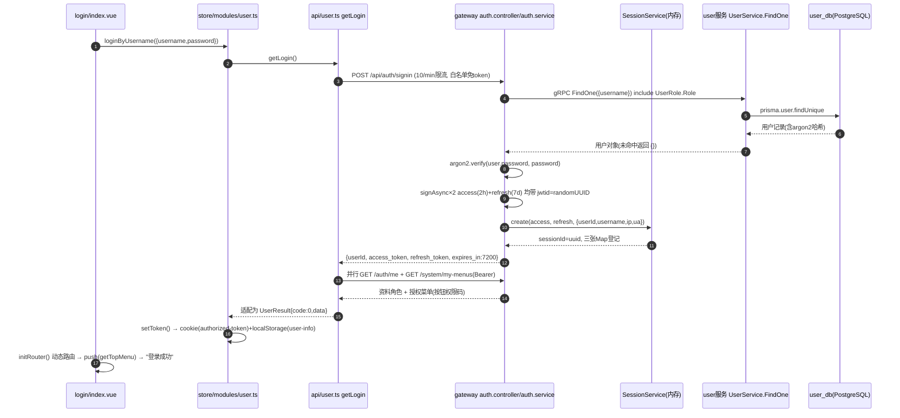
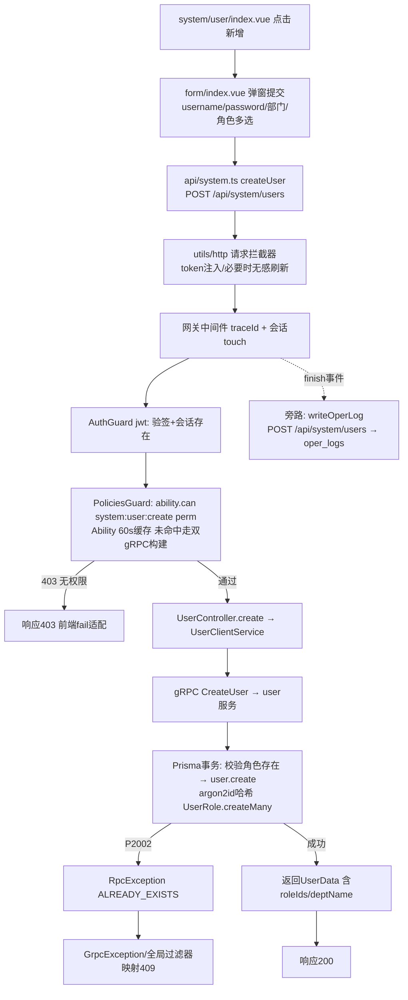
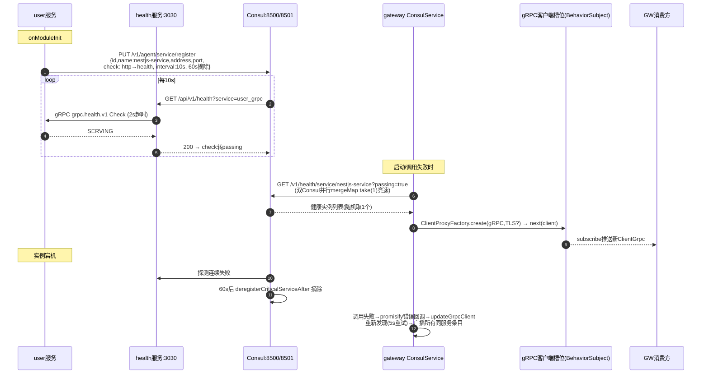
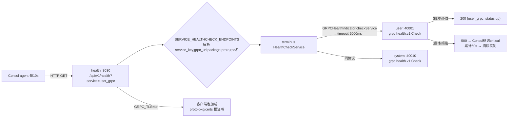
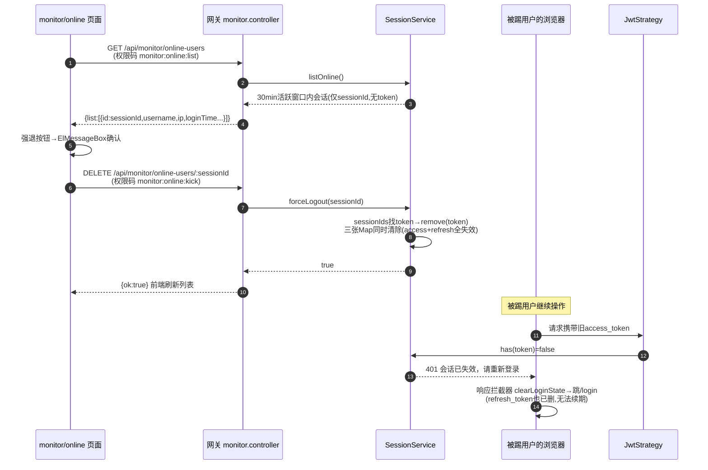

# 05 核心流程

> 项目：nestjs-admin ｜ 版本：v1.0 ｜ 生成日期：2026-10-06 ｜ 依据：源码分析

本章选取五个最具代表性的端到端流程，每个流程配时序/流程图、分步说明与涉及文件清单，全部依据源码还原。

挑选这五个流程的理由值得一提：它们分别覆盖了系统的一类核心能力——**流程一**覆盖认证与会话（所有请求的前提），**流程二**覆盖授权与业务写路径（日常开发接触最多的模式），**流程三**覆盖服务治理（微服务架构区别于单体 essence 的部分），**流程四**覆盖可观测性（生产稳定性的生命线），**流程五**覆盖安全管控（管理员对会话的主动干预）。把这五条链路在脑中跑通之后，系统里其余流程（字典 CRUD、通知已读、仪表盘聚合、头像上传回读等）都是这些模式的排列组合：要么是流程二的同构复刻（换个 RPC 换个权限码），要么是流程一与流程五的局部变体。建议初读时对照源码逐行验证图中每一步，之后排障时便可以直接从"链路断在第几步"开始定位——每个流程的涉及文件清单就是现成的排查路线图。

## 流程一：登录鉴权与双 Token 会话建立

这是全系统的入口流程，横跨前端三层（登录页 → user store → http 封装）与后端三处（网关 auth 控制器 → user 服务 → 网关内存会话）。

分步说明：

1. **前端提交**：`vue-admin/src/views/login/index.vue` 的 `onLogin` 经表单校验后调 `useUserStoreHook().loginByUsername`；回车触发走 1 秒防抖 `immediateDebounce`。失败时 catch 透出后端 message（"登录失败：用户名或者密码错误"、限流 429 文案等），不再吞成统一文案（HANDOFF 缺陷修复③）。
2. **网关认证**：`gateway/src/auth/auth.controller.ts` `signin` 上有 `@Throttle({default:{limit:10,ttl:60_000}})`；`auth.service.ts` 的 `signin` 先 gRPC 调 `UserService.FindOne`，**以 `user.id` 判断存在性**（user 服务对未命中返回 `{}` 而非 null，代码注释明确此坑）；`argon2.verify` 失败抛 403"用户名或者密码错误"。
3. **双 token 签发**：access 2h（`ACCESS_TOKEN_TTL='2h'`）、refresh 7d 且 payload 带 `type:'refresh'`；两者都传 `jwtid: randomUUID()`——JWT 的 iat 精度为秒，不带 jwtid 时同秒同 payload 会产生一模一样的 token（HANDOFF 陷阱 27）。
4. **会话登记**：`gateway/src/common/session/session.service.ts` 的 `create` 生成 `sessionId=uuid`，写三张 Map（access_token→记录、sessionId→access_token、refresh_token→sessionId）。refresh 也挂会话，这是"强退后 refresh 一并失效"的基础。
5. **登录后补数据**：`api/user.ts getLogin` 拿到 access_token 后**并行**请求 `/auth/me`（真实角色/昵称/头像，user 服务不可用时降级空数组不阻断登录）与 `/system/my-menus`（按钮权限码：`menus.filter(m=>m.type===2&&m.permission)`）。两项均 10s 超时（HANDOFF 缺陷修复⑧）。
6. **本地态落盘**：`src/utils/auth.ts setToken` 写 `authorized-token` cookie（随 access 过期销毁）、`multiple-tabs` cookie（勾选免登录时 7 天）、`user-info` localStorage（七项资料）。勾选"7天内免登录"还会把用户名写入 localStorage `login-remembered-username`（不存密码）。
7. **路由装配**：`router/utils.ts initRouter` → `getAsyncRoutes()`（`api/routes.ts`）把 my-menus 转成路由树并 `addRoute`，随后 `getTopMenu(true)` 跳转第一个授权菜单。

**无感刷新续期**（同一流程的延长线）：access 过期时 `src/utils/http/index.ts` 请求拦截器检测 `expires-now<=0`，置 `isRefreshing` 单飞调 `handRefreshToken` → `POST /api/auth/refresh` → 网关 `auth.service.refresh` 验签+验 `type==='refresh'` 后换发新 access，`SessionService.rotateAccessToken` 换会话键（旧 access 即刻 401，单活跃会话）并续期会话活跃时间；期间挂起的并发请求进 `requests` 队列待新 token 重放；刷新失败则清队列、`logOut()`、提示"登录已过期"。

这个流程里藏着三个容易被误判为 bug 的**有意设计**，值得专门点破。第一，"同一账号重复登录会产生多个并存会话"：signin 每次都 create 新会话，旧会话（旧浏览器/旧标签页）并不被顶掉——在线用户列表里会看到同一用户名多行记录，这是当前实现的既定行为而非缺陷；若业务要求单点登录，需要在 signin 里先按 userId 清理旧会话，改动点同样收敛在 SessionService。第二，"refresh 换发后旧 access 立即 401"：会话以 access_token 明文为 Map 键，换 key 即旧键消失（HANDOFF 陷阱 28 明确这是特性），前端在 2h 大限前静默刷新即可平滑过渡；如果你在测试时发现"token 换发后旧 token 还能用"，那说明你测的路径没走到 rotateAccessToken。第三，"登录失败也会写登录日志"：中间件按 `statusCode < 400` 判定成败并落库，失败尝试（含撞限流的 429）都有审计记录，个人中心安全日志里看到失败条目不必惊慌——它可能只是你自己输错了一次密码。

涉及文件清单：`vue-admin/src/views/login/index.vue`、`src/store/modules/user.ts`、`src/api/user.ts`、`src/utils/http/index.ts`、`src/utils/auth.ts`、`src/router/utils.ts`、`gateway/src/auth/auth.controller.ts`、`gateway/src/auth/auth.service.ts`、`gateway/src/common/session/session.service.ts`、`user/src/app.controller.ts`（FindOne/Create）。

## 流程二：典型管理页 CRUD（新建用户，含权限校验与日志采集）

以管理员在用户管理页新建一个用户为例，展示"前端页面 → API 适配层 → 网关守卫链 → gRPC → Prisma → 日志旁路"的完整写路径。

分步说明：

1. **页面与弹窗**：`vue-admin/src/views/system/user/index.vue` 使用 `utils/hook.tsx` 聚合的 loading/columns/dataList/pagination 状态；新增弹窗 `form/index.vue` 内嵌 `role.vue` 角色多选（选项来自 `getAllRoleList`）。
2. **API 适配**：`api/system.ts` 的 `createUser` 走统一 `call()` 包装——GET 用 params、其余用 data，错误响应的 `message`（class-validator 时为数组）`join('；')` 转为可读文案并返回 `{code:1}` 信封，页面据此弹 message。
3. **网关守卫**：`gateway/src/system/user.controller.ts` 类级 `@UseGuards(AuthGuard('jwt'), PoliciesGuard)` + 方法级 `@CheckPolicies((ability) => ability.can('system:user:create','perm'))`。首次校验时 `authorization.service.ts buildAbility` 并行拉两路规则：user 服务 `GetUserRules`（user_db policy 链）与 system 服务 `GetPermissionCodes`（system_db 菜单权限码），编译成 CASL Ability 并缓存 60 秒。
4. **服务端事务**：`user/src/app.controller.ts createUser` 在 `$transaction` 内先 `role.count({where:{id:{in:roleIds}}})` 校验角色齐全（缺失抛 NOT_FOUND"部分角色不存在"），未传角色时回落 `ROLE_ID=1` 默认角色；密码 `argon2.hash(argon2id)` 后 `user.create` 带 `UserRole.createMany`。唯一约束冲突捕获 `P2002` 转 `ALREADY_EXISTS`，网关过滤器映射 **409**。
5. **旁路日志**：响应 `finish` 后 `RequestLoggingMiddleware` 调 `SystemClientService.writeOperLog`（整体 try/catch + fire-and-forget），module 取 URL 前两段 `system:users`，落 `oper_logs`——包括这次"创建用户"本身。
6. **列表回显**：成功后页面 `onSearch()` 重拉 `getUserList`（读路径），表格出现新用户。

同构流程可套用到角色/菜单/部门/字典/通知的全部写接口（差异仅在权限码与下游 RPC）。涉及文件：`vue-admin/src/views/system/user/**`、`src/api/system.ts`、`src/utils/http/index.ts`；`gateway/src/system/user.controller.ts`、`gateway/src/system/user-client.service.ts`、`gateway/src/auth/{policies/authorization}`、`gateway/src/common/{middleware/filters}`；`user/src/app.controller.ts`、`user/src/database/database.service.ts`。

沿这条写路径排障时，"看响应状态码就能定位到断点"是一个可靠的启发式：**401** 断在认证层（token 过期未刷新或会话被踢，先查前端是否有有效会话再查网关日志的会话校验失败记录）；**403** 断在授权层（`PoliciesGuard` 的"无权限执行该操作"意味着权限码未授权给该角色——九成情况是 seed 没跑或 role_menus 缺行，剩余一成是 Ability 缓存的 60 秒窗口）；**400** 多为 DTO 校验（响应 message 是数组）或服务端前置条件（如部门删除约束，message 可读）；**409** 是唯一约束冲突；**429** 是限流；**500** 则要按 traceId 三处取证——网关控制台（带 traceId 的请求行）、`system_logs` 表（异常过滤器落库的堆栈）、目标服务日志（Prisma 层错误），三者用同一个 traceId 串起来。另有一个写路径特有的现象值得预告：删除日志类接口的调用本身也会生成新的操作日志（模块 `monitor:oper-logs` 之类），所以"清空后数量不为零、又冒出一条"不是清空失败，HANDOFF 对此专门提示过冒烟断言要按"目标 id 消失"来判断。

## 流程三：服务注册与发现（含故障自愈）

分步说明：

1. **注册**：`user/src/consul/consul-client.service.ts` 在 `onModuleInit` 调 `ConsulHttpClient.agent.service.register`。服务名 `nestjs-service` 是**发现键**（所有实例一致），实例 ID 默认 `nestjs-user-${PORT}`（多实例必须用 `SERVICE_ID` 区分，否则互相覆盖）。system 服务同理注册为 `nestjs-system`（`dev-start.sh` 传 `SERVICE_NAME=nestjs-system`）。
2. **健康检查**：Consul 每 10s 以 **HTTP** 探测 `CHECK` 地址（指向 health 服务）；`health/src/consul/consul.controller.ts` 用 terminus `GRPCHealthIndicator.checkService`（2s 超时）真正调一次目标服务的 gRPC `Check`（`health.proto`），把 gRPC 存活翻译成 HTTP 200/500。连续失败的实例 60 秒后被 Consul 自动摘除。
3. **发现**：`gateway/src/consul/consul.service.ts getServiceInfo` 查询 `passing=true` 实例并**随机选一个**；查询本身带 3 次指数退避重试。`retryGetServiceInfo` 把查询并行 fan-out 到**两个 Consul 实例**（consul1/consul2，`mergeMap` 并行 + `take(1)` 竞速，注释说明 `concatMap` 才是串行），任一命中即用；全部落空抛 `[consulN] no passing instance found for ...`。
4. **客户端构建与订阅**：`initGrpcClient` 用 `ClientProxyFactory.create` 构建 gRPC 客户端（`GRPC_TLS=on` 时挂 `loadGrpcTls().rootCerts` 的 SSL 凭据），推入模块级注册表 `grpcClientRegistry` 中该 (consulName, serviceName) 槽位的 `BehaviorSubject`；`AuthService`、`AuthorizationService`、`SystemClientService`、`UserClientService` 都通过 `@Inject('nestjs-service'/'nestjs-system')` 拿到"取槽位函数"并 `subscribe` 接收客户端实例。
5. **自愈**：任一 gRPC 调用失败，`proto-pkg/src/utils/grpc-utils.ts promisifyServiceMethods` 挂的错误回调触发 `updateGrpcClient(serviceName)`：重新竞速发现 → 重建客户端 → **广播给注册表中所有同服务条目**（订阅可能挂在任一 Consul 的槽位上，只更新单条会出现"落选条目上的消费者永远收不到新客户端"的bug，见 `updateGrpcClient` 注释）；重建失败 5 秒后重试。
6. **优雅下线**：服务进程收到 SIGTERM（`enableShutdownHooks`）→ `onModuleDestroy` → `agent.service.deregister(serviceId)`。

涉及文件：`user/src/consul/consul-client.service.ts`、`user/src/main.ts`、`health/src/consul/consul.controller.ts`、`health/src/main.ts`、`proto-pkg/src/utils/consul-http.ts`、`proto-pkg/src/utils/grpc-utils.ts`、`gateway/src/consul/{consul.service.ts, consul-core.module.ts, consul.module.ts}`、`gateway/src/app.module.ts`、`gateway/src/auth/auth.service.ts`（订阅与重建示例）。

## 流程四：健康检查链路（Consul 视角的 gRPC 存活）

说明：端点清单来自环境变量 `SERVICE_HEALTHCHECK_ENDPOINTS`，格式 `service_key,grpc_url,packageName,protoName,rpc服务名`，多段用 `|` 分隔——dev-start.sh 默认值同时描述 user 与 system 两段；`?service=` 指定查询其中一个 key，未命中返回 404。该设计的动机是 Consul（此处为 dev agent）不便直接做 gRPC 健康检查，于是用 health 服务做"协议翻译器"。生产事故注记（HANDOFF §4.5）：health 探测端未开 `GRPC_TLS=on` 时无法连上 TLS 的 gRPC 服务，探测恒 500，实例 60 秒后被 Consul 注销、网关随之发现不到服务。

涉及文件：`health/src/consul/consul.controller.ts`、`health/src/app.module.ts`（`ConsulModule.forRoot()`）、`health/src/main.ts`（端口 3030、URI 版本 `/api/v1`）、`dev-start.sh`（ENDPOINTS 缺省值）、`proto-pkg/proto/health.proto`、`user/src/app.controller.ts`（gRPC Check 的承载服务）。

## 流程五：在线用户强退（管理员踢人会话）

分步说明：

1. **列表**：`gateway/src/system/monitor.controller.ts` `GET online-users` 直接读网关进程内存 `SessionService.listOnline()`——仅展示最近 30 分钟活跃（`onlineWindowMs`）的会话，按最近活跃倒序，**对外只暴露 `sessionId`（uuid），绝不返回 token**；遍历中顺带清理超 8 天的陈旧会话。
2. **强退**：`DELETE online-users/:sessionId`（权限码 `monitor:online:kick`，seed id=25）→ `forceLogout(sessionId)` → `remove(token)` 同步删掉 sessions、sessionIds、refreshTokens 三张 Map 的记录——access 与 refresh **同时失效**（M7 真实化改造，见 HANDOFF 待办 4）。
3. **被踢方感知**：其下一个任意请求经 `jwt.strategy.ts validate` 的 `sessionService.has(token)` 校验失败，返回 401"会话已失效，请重新登录"；前端 `utils/http/index.ts` 响应拦截器对 401 调 `clearLoginState()`（清 cookie 与 localStorage）并 `window.location.href='/login'`。即使前端缓存了 refresh_token 也无济于事——`refreshTokens` Map 中该条已删，`rotateAccessToken` 返回 false，网关 `auth.controller.refresh` 抛 401。
4. **边界**：该机制依赖网关单实例（内存会话），网关重启即全员下线；多实例需先落地 Redis 共享会话（`session.service.ts` 头注释的设计预留）。

这一流程还有两个运维视角的注脚。其一，"强退自己"是完全可能的——在线用户列表里管理员能看到自己的会话，M8 的全链路浏览器实测就验证过"强退当前会话后自动跳登录页"的行为，因此页面交互上把这一操作设计为带明确文案的二次确认而非直接执行。其二，"会话与在线是两个概念"：SessionService 里所有未过期的会话构成"登录态"，而 30 分钟活跃窗口过滤后的子集才是"在线"，管理员在在线用户页看不到的会话仍然有效（用户可能只是半小时没操作）——如果按"列表里没有 = 可以忽略"来理解会误判安全态势，需要审计全部登录态时应以会话清扫周期（8 天）为界重新定义口径。

涉及文件：`vue-admin/src/views/monitor/online/{index.vue,hook.tsx}`、`vue-admin/src/api/system.ts`（`getOnlineLogsList/kickOnlineUser`）、`gateway/src/system/monitor.controller.ts`、`gateway/src/common/session/session.service.ts`、`gateway/src/auth/strategies/jwt.strategy.ts`、`vue-admin/src/utils/http/index.ts`。
