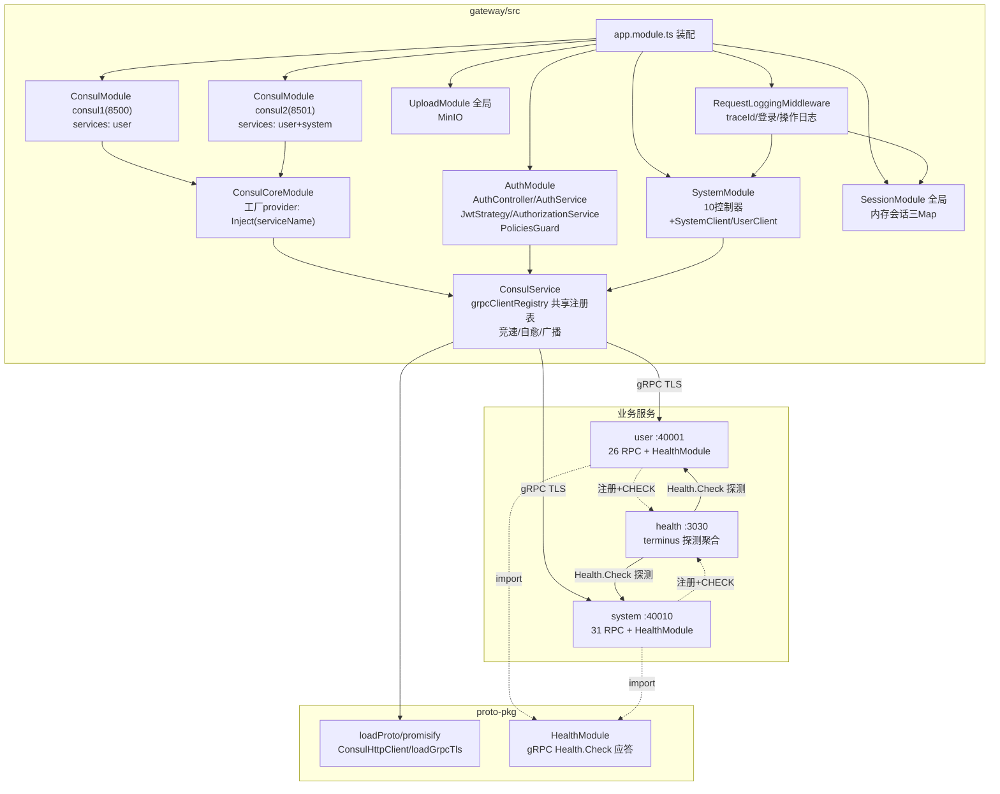

# 07 模块详解

> 项目：nestjs-admin ｜ 版本：v1.1 ｜ 生成日期：2026-10-06 ｜ 依据：源码分析

本文是"逐模块深读手册"：把每个微服务、网关的关键模块与前端核心模块拆开讲透——职责、组成清单、内部机制走读、与其他服务的交互。全景与设计动机见《00-项目总览》《01-系统架构》，页面层细节见《02-页面设计》，本章只回答"每个模块里到底装了什么、怎么运转"。

## 1. gateway 网关（`gateway/src/`，:3040 HTTP）

### 1.1 模块清单与装配

网关的装配地图是 `gateway/src/app.module.ts`（全文仅 57 行，但信息密度极高），imports 顺序如下表：

| 模块 | 源码位置 | 职责 | 关键配置 |
|---|---|---|---|
| ConsulModule(forRoot consul1) | `gateway/src/consul/consul.module.ts` | 第一注册中心 + user 服务发现 | `CONSUL1_HOST:8500`，services 仅 `nestjs-service` |
| ConsulModule(forRoot consul2) | 同上 | 第二注册中心（容灾竞速） | `CONSUL2_HOST:8501`，services 含 user+system 两项 |
| ConfigModule | `gateway/src/common/config/config.module.ts` | @nestjs/config 全局化 | 读 `.env.{NODE_ENV}` 与 `.env`，validate 校验 NODE_ENV 合法值 |
| SessionModule | `gateway/src/common/session/session.service.ts` | 内存会话表（@Global） | 三张 Map + 30 分钟清扫定时器 |
| UploadModule | `gateway/src/common/upload/upload.service.ts` | MinIO 对象存储客户端（@Global） | 缺凭据时 onModuleInit 仅 warn 降级 |
| AuthModule | `gateway/src/auth/auth.module.ts` | 认证与授权 | Passport + JwtModule（secret 读 JWT_SECRET） |
| SystemModule | `gateway/src/system/system.module.ts` | 业务透传层（10 个控制器 + 2 个客户端服务） | imports AuthModule（复用守卫） |
| ScheduleModule.forRoot() | @nestjs/schedule | 定时任务容器 | 当前无任何 @Cron 任务（预留） |
| ThrottlerModule + ThrottlerGuard | @nestjs/throttler | 全局限流 | `[{ttl:60_000, limit:100}]`，以 APP_GUARD 注册 |

中间件层只有一条：`configure()` 里 `RequestLoggingMiddleware` 挂 `forRoutes('*')`。控制器层在根模块直接注册了 `AppController`（`GET /api` 探针与 `GET /admin/ping` CASL 拒绝示例）与 `UploadsController`（`GET /uploads/:key`）。两个易漏的事实：其一，ConsulModule 也是 `@Global()` 且内部注册了 `ConsulController`（`gateway/src/consul/consul.controller.ts`，`GET /api/health?service=xxx`）——也就是说**网关自己也带一份健康聚合端点**，与 health 服务 `:3030` 的实现几乎逐行相同，这是从单体模板演进时留下的双份能力；其二，consul1 的 services 只配了 user 一项，consul2 配了 user+system 两项，二者不对称但依赖"恢复时广播所有同服务条目"的机制兜底（见 1.3）。

### 1.2 启动时序走读（`gateway/src/main.ts`）

`bootstrap()` 的动作顺序是理解网关行为的第一手材料：创建应用 → `set('trust proxy', 1)`（反代链路下 `req.ip` 取 XFF 真实 IP，注释明确是防限流折叠）→ 读 `VERSION`/`PREFIX` 配置 → `setGlobalPrefix('api')` 且 **exclude `uploads/:key`**（前端代理路径不变）→ 全局 `ValidationPipe({whitelist, transform})` → `helmet()` → 注入 `AllExceptionsFilter`（构造时从容器取出 SystemClientService，用于 5xx 落系统日志）→ 注册 `unhandledRejection`/`uncaughtException` 进程级兜底（记日志不崩进程）→ `enableVersioning(URI, VERSION_NEUTRAL)` → 按 `SWAGGER_ENABLED ?? (NODE_ENV!=='production')` 决定是否挂 `/api/docs` → `enableShutdownHooks()` → `listen(3040)`。每个请求因此经历的完整管线是：**trust proxy → helmet → ThrottlerGuard → RequestLoggingMiddleware → 路由匹配 → AuthGuard('jwt') → PoliciesGuard（如有 @CheckPolicies）→ ValidationPipe → 控制器 → GrpcExceptionInterceptor（auth 前缀控制器）→ AllExceptionsFilter 兜底**。

### 1.3 consul 模块（服务发现核心）

这是网关最精巧的模块，四个文件各司其职：`consul.module.ts` 是外壳（@Global，imports TerminusModule 与 CoreModule）；`consul-core.module.ts` 是动态工厂——`forRoot(options)` 里 `new ConsulService(options)` 存入静态注册表，并为每个被发现的 serviceName 注册一个 **provider 工厂**：`@Inject('nestjs-service')` 注入的不是客户端，而是"一个函数"，调用时从共享注册表过滤出该服务的条目并**随机返回一条**（多 Consul 实例下的负载均衡第二层）；`consul.constraints.ts` 存注入 token 常量；`consul.service.ts` 是机制主体：

- **共享注册表 `grpcClientRegistry`**（模块级数组，测试可经 `resetGrpcClientRegistry` 复位）：每条记录 = `(consulName, serviceName)` 的一个槽位，`client` 字段是 `BehaviorSubject<ClientGrpc|null>`——客户端实例是"可订阅的流"而非静态对象，实例漂移时所有订阅者自动收到新客户端。
- **首次发现** `initGrpcClient`：查 Consul 健康实例 → `ClientProxyFactory.create`（GRPC_TLS=on 时挂 `loadGrpcTls().rootCerts` 的 SSL 凭据）→ `item.client.next(client)`。发现失败时不抛出（Node 对未处理拒绝会崩进程），而是走 5 秒间隔的 `updateGrpcClient` 重试链。
- **单实例查询** `getServiceInfo`：`ConsulHttpClient.health.service({service, passing:true})` → 健康列表**随机取一个** → 失败按 2s/4s/8s 指数退避重试 3 次 → 最终仍失败返回 null（不抛）。
- **多实例竞速** `retryGetServiceInfo`：`from(this.grpcClients).pipe(mergeMap(并行查询), take(1))`，任一 Consul 先返回即采用；全部落空时把 rxjs 的裸 `EmptyError`（"no elements in sequence"）翻译成带上下文的 `[consulN] no passing instance found for ...`。
- **自愈广播** `updateGrpcClient(serviceName)`：重新竞速发现后，对注册表中**所有同服务条目**（`filter(c => c.serviceName === serviceName)`，注释明确"订阅方可能挂在任意一条客户端条目上，只更新单条会出现落选条目上的消费者永远收不到新 client"）并行重建并推送。
- **生命周期**：`onModuleDestroy` 从共享注册表摘除本实例的槽位，避免悬挂引用。

消费侧有三个代表：`AuthService`（订阅 user 客户端 + promisify + 失败回调重建）、`AuthorizationService`（同时订阅 user 与 system 两个客户端）、`SystemClientService`/`UserClientService`（业务透传，订阅 + 3 秒重试初始化）。四者模式完全一致，新增服务消费者时照抄即可。

### 1.4 控制器清单

| 控制器 | 源码文件 | 路由前缀 | 端点数 | 守卫 |
|---|---|---|---|---|
| AppController | `gateway/src/app.controller.ts` | `/`、`/admin/ping` | 2 | 后者 JWT+Policies（`manage/admin` 示例） |
| AuthController | `gateway/src/auth/auth.controller.ts` | `/auth` | 13 | 分端点：公开(3) + JWT(9) + JWT+Policies(1) |
| SystemController | `gateway/src/system/system.controller.ts` | `/system/menus` | 4 | JWT + Policies（menu:* 四码） |
| MyMenuController | 同上（同文件第二控制器） | `/system/my-menus` | 1 | 仅 JWT |
| UserController + RoleController | `gateway/src/system/user.controller.ts` | `/system/users`、`/system/roles` | 8 + 4 | JWT + Policies |
| DeptController | `gateway/src/system/dept.controller.ts` | `/system/depts` | 4 | JWT + Policies |
| DictController | `gateway/src/system/dict.controller.ts` | `/system/dicts` | 8 | JWT + Policies |
| RoleMenuController | `gateway/src/system/rolemenu.controller.ts` | `/system/role-menus` | 2 | JWT + Policies（`system:role:assign`） |
| NoticeController | `gateway/src/system/notice.controller.ts` | `/system/notices` | 4 | JWT（create 另加 Policies） |
| DashboardController | `gateway/src/system/dashboard.controller.ts` | `/system/dashboard-stats` | 1 | 仅 JWT |
| MonitorController | `gateway/src/system/monitor.controller.ts` | `/monitor` | 10 | JWT + Policies（monitor:*） |
| UploadsController | `gateway/src/common/upload/uploads.controller.ts` | `/uploads/:key` | 1 | 无（公开回读） |
| ConsulController | `gateway/src/consul/consul.controller.ts` | `/health` | 1 | 无 |

值得点名的两个网关内"服务端兜底"业务规则：`user.controller.ts` 的 `update`/`remove` 在透传前校验"不能停用/删除当前登录账号"（分别抛 403/400），`resetPassword` 校验新密码 ≥6 位——这类规则放在网关而不是业务服务，是因为它们与 HTTP 语义（ParseIntPipe 参数）和会话上下文（req.user）强相关。端点级明细见《15-接口全量参考》。

## 2. user 服务（`user/src/`，:40001 gRPC，user_db）

### 2.1 模块组成

`user/src/app.module.ts` 仅五件套：DatabaseModule（Prisma）、ConfigModule.forRoot（读 `.env`）、HealthModule（来自 @toimc/proto-pkg，见 2.3）、AppController（全部 gRPC handler）、ConsulClientService（注册/注销）+ ConsulController（HTTP `/health` 探针残留，见《13-技术债务》）。`main.ts` 用 `NestFactory.createMicroservice` 起 gRPC 服务端，监听 `0.0.0.0:${PORT||40001}`，`GRPC_TLS=on` 时以 `ServerCredentials.createSsl(null, [{private_key, cert_chain}], false)` 启用服务端证书（不校验客户端证书，注释称 mTLS-ready 实为单向 TLS），并 `enableShutdownHooks()` 保证 SIGTERM 时触发 Consul 注销。

### 2.2 RPC 清单（`user/src/app.controller.ts`，26 个 @GrpcMethod）

| 分组 | RPC | 内部机制要点 |
|---|---|---|
| 认证数据 | FindOne、Create | FindOne 按 username 查并 include UserRole→Role→RolePermissions，**未命中返回 `{}` 而非 null**（网关靠 id 判存在）；Create 事务内哈希 argon2id + 校验/回落默认角色（ROLE_ID=1）+ P2002 转 ALREADY_EXISTS |
| 个人中心 | GetProfile、UpdateProfile、UpdatePassword、UpdateAvatar | buildProfile 私有方法拼装 deptName/roleIds/roleNames；UpdatePassword 内置两道业务拒绝：p1user 写死"测试账号不可以修改密码"（PERMISSION_DENIED）、旧密码 argon2.verify 失败 |
| 用户设置 | GetSettings、UpdatePreferences、UpdateSecurity | UpdatePreferences 服务端 JSON.parse 校验格式（INVALID_ARGUMENT） |
| 管理员操作 | AdminResetPassword、AdminUpdateAvatar | 同样写死 p1user 保护；文件不落此服务（网关传 URL 字符串） |
| 部门树 | ListDepts、CreateDept、UpdateDept、DeleteDept | DeleteDept 双前置校验（子部门/在编用户）抛 FAILED_PRECONDITION |
| 用户管理 | ListUsers、CreateUser、UpdateUser、DeleteUser、UpdateUserRoles、UpdateUserStatus | ListUsers 分页钳制 `page=max(1,page)`、`size=min(100,max(1,size))`，findMany+count 放同一 `$transaction`；DeleteUser 事务内先清 user_roles；UpdateUserRoles 全量覆盖（先 deleteMany 再 createMany，预校验角色存在） |
| 角色 | ListRoles、CreateRole、UpdateRole | CreateRole 捕获 P2002 → "角色名已存在"；无 DeleteRole（网关 DELETE 语义为置停用改名） |
| 策略输出 | GetUserRules | 四层 include（UserRole→Role→RolePolicy→Policy）拍平为 CASL 规则数组，fields/conditions 序列化为字符串 |
| 统计 | GetDashboardStats | 并行 count users/depts/roles |

### 2.3 两个容易被忽略的机制

第一，**gRPC 健康应答来自 proto-pkg 的 HealthModule**：`user/src/app.module.ts` import 了 `@toimc/proto-pkg` 导出的 HealthModule，其 `nestjs-health/health.controller.ts` 用 ts-proto 生成的 `@HealthControllerMethods()` 装饰器注册了 Health.Check 处理器，恒定返回 `status: 1`（SERVING）。health 服务 terminus 探测的就是它——这解释了"proto 里声明了 Health 服务但 app.controller 里 grep 不到 Check"的疑惑。第二，**Consul 注册参数全部读环境变量**（`user/src/consul/consul-client.service.ts`）：服务名 `SERVICE_NAME||nestjs-service`（发现键，实例间一致）、实例 ID `SERVICE_ID||nestjs-user-${PORT}`（必须唯一否则互相覆盖）、注册地址 `HOST||127.0.0.1`（容器内必须写服务名）、HTTP 健康检查 `CHECK`（指向 health 服务，10s 间隔、60s 摘除）。注册失败仅记 error 日志不重试——Consul 不可达时服务照常监听，只是发现不到。

## 3. system 服务（`system/src/`，:40010 gRPC，system_db）

结构与 user 服务完全同构（main.ts TLS 引导、ConsulClientService、PrismaService、HealthModule），差异在三处：一是 `main.ts` 额外挂了 `unhandledRejection`/`uncaughtException` 进程级兜底（user 服务没有，见《13-技术债务》不对称清单）；二是数据库连接串读 `SYSTEM_DATABASE_URL || DATABASE_URL`（`system/src/database/database.service.ts`，HANDOFF 陷阱 19 的连错库事故后加的兜底）；三是 app.controller 有 31 个 @GrpcMethod，按域分组如下：

| 分组 | RPC | 机制要点 |
|---|---|---|
| 菜单 | ListMenus、CreateMenu、UpdateMenu、DeleteMenu | ListMenus 是最讲究的一个：无 roleIds 时全量（管理页）；有 roleIds 时先查 role_menus 命中项，再**迭代补祖先链**（while 循环按 parentId 逐层 findMany）维持树形完整，内存排序后输出；DeleteMenu 先把子节点 parentId 置空、再删 role_menus、最后删本体 |
| 权限码 | GetPermissionCodes | 按 roleIds 聚合 role_menus→menu，过滤 `status===1 && permission 非空`，Set 去重输出——权限系统的数据源 |
| 字典 | ListDictTypes、CreateDictType、ListDictItems、CreateDictItem、UpdateDictType、DeleteDictType、UpdateDictItem、DeleteDictItem | 编码唯一冲突 P2002→"字典编码已存在"；ListDictItems 按 code 反查类型并只返回 status=1 的项；DeleteDictType 连带删项 |
| 日志 | Create/ListOperLogs、GetOperLogDetail、Create/ListLoginLogs、Create/ListSystemLogs、Delete/ClearOperLogs、Delete/ClearLoginLogs | 列表接口共用一套筛选构建（username/module 模糊、status 1=2xx/0=非 2xx/-1 不筛、时间范围 gte/lte），分页 page=0 视为 1、pageSize 默认 100；ListSystemLogs 固定 take 100；删除/清空整体 try/catch 返回 `{ok:false,error}` 不抛 |
| 通知 | ListNotices、CreateNotice、MarkNoticeRead、MarkAllNoticesRead | ListNotices 固定取最近 50 条；MarkAllNoticesRead 支持按 category 局部已读 |
| 授权 | ListRoleMenus、AssignRoleMenus | Assign 事务内先删后插，且先 findMany 过滤掉不存在的菜单 id |
| 统计 | GetSystemDashboardStats | 并行 count menus/operLogs/loginLogs |

## 4. health 服务（`health/src/`，:3030 HTTP）

最小的服务：app.module 只挂 ConfigModule 与 `ConsulModule.forRoot()`（无 services 配置，仅复用 TerminusModule），真正的逻辑在 `consul/consul.controller.ts`——运行时解析 `SERVICE_HEALTHCHECK_ENDPOINTS`（格式 `service_key,grpc_url,packageName,protoName,rpc名`，竖线分隔多段），为每个 key 动态构造一个 terminus `HealthIndicatorFunction`：`GRPCHealthIndicator.checkService(key, serviceNameParam, {timeout:2000, url, package, packageDefinition: loadProto(...), GRPC_TLS=on 时挂 rootCerts})`。`?service=` 命中哪个 key 就只探测哪个，未命中 404，探测异常 500。terminus 的 checkService 内部会创建 gRPC 客户端调用目标服务的 `Health.Check`（即 2.3 所述 proto-pkg HealthModule 应答的那一个），并把 gRPC 存活翻译成 HTTP 200/500 给 Consul。`main.ts` 的版本控制有个小怪癖：`VERSION` 缺省时取字符串 '1'，因此 health 的路径是 **`/api/v1/health`**（带 v1 段），与网关的 `/api/health`（VERSION_NEUTRAL）不同——写 CHECK 环境变量时必须带 `/v1`。

## 5. proto-pkg（`proto-pkg/src/`，共享契约包）

五块内容：① `proto/` 三份契约（user.proto 26 业务 RPC + Health、system.proto 31 业务 RPC + Health、health.proto）；② `utils/proto-utils.ts` 的 `loadProto`（@grpc/proto-loader loadSync，`keepCase:true` —— 运行时对象键保持 proto 原名如 `UserRole`，这是陷阱 4 的根源）；③ `utils/grpc-utils.ts` 的 `promisifyServiceMethods`（把 gRPC 客户端全部 Observable 方法包装为 async，try/catch 里先调 errorCallback 再 rethrow——错误回调是全系统"调用失败即重建客户端"自愈机制的触发点）与 `loadGrpcTls`（读 `certs/` 下自签证书）；④ `utils/consul-http.ts` 的 `ConsulHttpClient`（替代被弃用官方 consul 包的 fetch 薄封装，仅 health.service/agent.service.register/agent.service.deregister 三个能力，10s 超时，支持 X-Consul-Token）；⑤ `nestjs-health/`（gRPC Health 应答模块，user/system 共用）与 `nestjs-ts/`（ts-proto 生成的 TS 类型）。构建用 tsup 打 `src/index.js`，产物含 `dist/`、`proto/`、`certs/` 三目录——Dockerfile 卷挂覆盖证书时覆盖的就是 `/app/proto-pkg/certs/`。

## 6. template 脚手架（`template/src/`）

四个文件的最小 NestJS HTTP 服务（app.module/app.controller/app.service/main.ts，监听 3000），本身不含 Consul 注册与 gRPC——它示范的是"包结构与构建链"，复制后需仿照 user 服务补齐 main.ts 的 createMicroservice 引导、consul-client.service、prisma 目录与 proto 定义（完整步骤见《11-扩展开发指南》SOP-1）。根 `Dockerfile` 注释明确 template 不参与生产构建。

## 7. vue-admin 核心模块（`vue-admin/src/`）

### 7.1 请求层：`utils/http/index.ts` + `utils/auth.ts`

PureHttp 类封装 axios（默认超时 10s、qs 序列化数组参数）。请求拦截器维护三个静态字段：`requests`（刷新期间挂起的请求队列）、`isRefreshing`（单飞标志）、白名单 `["/auth/signin","/auth/refresh"]`——非白名单请求先查 `getToken()`，发现 access 过期则单飞调 `handRefreshToken`，期间并发请求进队列，新 token 下发后重放；刷新失败清队列 + `logOut()` + "登录已过期"提示。响应拦截器对 401 调 `clearLoginState()`（清 authorized-token/multiple-tabs cookie 与 user-info localStorage）并按 pathname 跳 `/login`（history 模式适配）。`utils/auth.ts` 的 `hasPerms` 是按钮权限的唯一判定入口：权限数组恰为 `['*:*:*']` 时直通，否则 includes/子集包含判断。

### 7.2 路由层：`router/index.ts` + `router/utils.ts` + `api/routes.ts`

静态路由经 `import.meta.glob("./modules/**/*.ts", !remaining)` 自动收集，`formatTwoStageRoutes(formatFlatteningRoutes(...))` 全部拍平为二级（keep-alive 只支持二级）。全局守卫 `beforeEach` 的分支树：已登录（multiple-tabs cookie + user-info）→ 角色不匹配跳 403 → `_from.name` 存在为站内跳转、否则为刷新场景——wholeMenus 为空时重新 `initRouter()` 拉菜单重建动态路由并补跳。`api/routes.ts` 的 `getAsyncRoutes` 是前后端菜单契约的翻译器：`buildTree` 把平铺菜单组装成树 → `toRoute` 按 type 映射（0 目录无可见子级不输出、1 菜单路径加 `/index` 后缀、3 iframe 生成 `/iframe/:id` 并把真实 URL 存 `meta.iframeLink`、4 外链不注册路由 name=URL）→ **顺带把 type=2 按钮菜单的 permission 码 `SET_PERMS` 进 user store**——这一步让"拉菜单"同时完成了按钮权限下发。`addPathMatch` 在动态路由注册完后才追加全屏 404，避免刷新动态页误跳 404。

### 7.3 状态层：`store/modules/` 六仓

| store | id | 关键点 |
|---|---|---|
| user.ts | pure-user | state 初始值从 localStorage `user-info` 恢复；`loginByUsername`/`handRefreshToken` 成功即 `setToken`；`logOut` 纯前端（不调后端登出接口——后端会话由 token 自然过期或管理员强退清理） |
| permission.ts | pure-permission | wholeMenus = 静态 constantMenus + 动态路由合成，经 filterNoPermissionTree/filterTree 过滤；cachePageList 驱动 keep-alive |
| multiTags / app / epTheme / settings | — | 标签页持久化、设备与布局状态、主题（与 responsive-storage 联动） |

### 7.4 API 适配层：`api/user.ts`、`api/routes.ts`、`api/system.ts`

`api/system.ts`（544 行，30+ 导出函数）是业务 API 的唯一出入口，统一走 `call()` 包装：GET 用 params、其余用 data，错误 message（class-validator 数组）`join('；')` 后返回 `{code:1}` 信封；读接口做形状适配（如 `getUserList` 把 `{users,total}` 适配为表格信封 `{list,total,pageSize,currentPage}`）。`api/user.ts` 负责认证与个人中心，`getLogin` 在拿到 token 后**并行**拉 `/auth/me` 与 `/system/my-menus`（各 10s 超时）并适配成 pure-admin 期望的 UserResult 信封。函数级清单见《15-接口全量参考》§6。

### 7.5 指令与组件基座

`directives/perms`（无权限时直接 removeChild 移除 DOM）、`directives/auth`（基于路由 meta.auths）、`directives/optimize`（防抖节流）等 7 个指令在 `main.ts` 全局注册；业务页面统一复用 `PureTableBar + @pureadmin/table + Re* 封装组件`（Dialog/Drawer/Cropper 等）的页面范式。这套基座意味着新增页面只需写"数据怎么来、操作怎么发"（见《11-扩展开发指南》SOP-3）。

## 8. 模块依赖总览图

读图要点：`ConsulService` 是网关一切 gRPC 能力的交汇点（Auth、System、User 三类消费者全部经它拿客户端）；业务服务与 health 之间是"被探测"关系（虚线），与 proto-pkg 之间是"包导入"关系——整张图没有任何 user↔system 直连边，印证《01-系统架构》§3 的"以网关为根的星形拓扑"。
