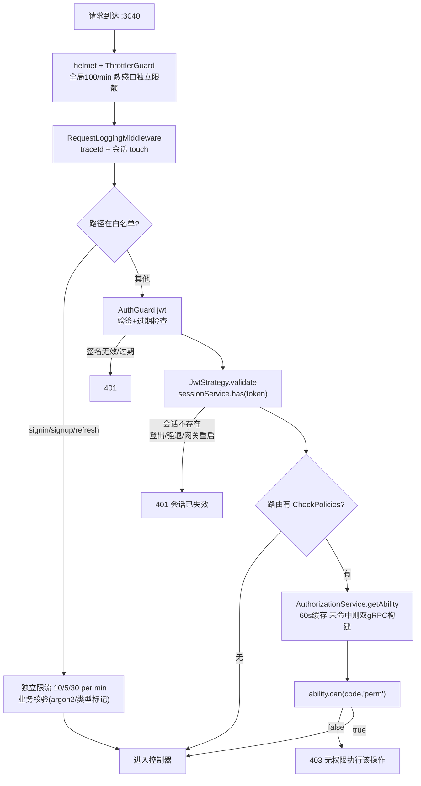

# 08 安全与权限设计

> 项目：nestjs-admin ｜ 版本：v1.1 ｜ 生成日期：2026-10-06 ｜ 依据：源码分析

本文聚焦"谁能访问什么、凭什么凭证、被谁拦截、密钥放在哪"。认证的端到端时序见《05-核心流程》流程一，接口级权限码映射见《03-接口设计》§4 与《15-接口全量参考》，本章补齐机制细节、CORS 现状、secrets 管理与已知隐患清单。

## 1. 认证体系：双 token + 内存会话有状态化

### 1.1 凭证签发（`gateway/src/auth/auth.service.ts`）

登录成功后同时签发两枚 HS256 JWT：access token 有效期 `ACCESS_TOKEN_TTL='2h'`（返回体带 `expires_in: 7200` 秒），refresh token 有效期 `'7d'` 且 payload 附加 `type:'refresh'` 作类型标记。两枚 token 都携带 `jwtid: randomUUID()`——JWT 的 iat 精度只到秒，不带 jwtid 时同秒同 payload 会产生完全相同的 token，refresh 换发将等于没换（HANDOFF 陷阱 27 的真实教训）。密码校验用 `argon2.verify`，"用户不存在"与"密码错误"分别抛 403（文案不同，存在用户名枚举面，见 §6 隐患 3）。

### 1.2 会话存在性校验（`gateway/src/auth/strategies/jwt.strategy.ts`）

JWT 本身无状态，但本项目给它加了"有状态开关"：`JwtStrategy.validate` 在验签成功后**必须**通过 `sessionService.has(token)`——被登出或被强退的 token 即使 JWT 未过期也返回 401"会话已失效，请重新登录"。策略构造函数里还有一个防御性设计：`JWT_SECRET` 未配置时直接 `throw new Error('JWT_SECRET 未配置')`，服务拒绝启动而不是在首个请求时报错（快速失败）。`passReqToCallback: true` 把原始请求传进 validate，token 从 Authorization 头剥离后作为会话键。

### 1.3 会话表（`gateway/src/common/session/session.service.ts`）

三张内存 Map 构成会话的完整生命周期：`sessions`（access_token 明文 → 会话记录）、`sessionIds`（sessionId → token）、`refreshTokens`（refresh_token → sessionId）。关键参数全部有注释背书：在线窗口 30 分钟（仅影响在线列表展示，不删会话）、陈旧上限 8 天（**必须略长于 refresh 的 7 天**，否则清扫会抢先失效"7 天免登录"——曾因设 24h 导致名不副实的事故）、清扫周期 30 分钟（定时器 `unref()` 不阻止进程退出）。三个写操作的语义：`create` 登录时三 Map 同时登记；`rotateAccessToken` 换发时**换键不换会话**（旧 access 立即 401，单活跃会话语义，HANDOFF 陷阱 28 确认为特性）；`forceLogout(sessionId)` 按会话 ID 删除，access 与 refresh 同时失效。对外接口（`listOnline`）只暴露 sessionId（uuid），绝不返回 token 明文。

### 1.4 刷新闭环（`gateway/src/auth/auth.controller.ts`）

`POST /auth/refresh`（限流 30/min）的校验链：verifyAsync 验签 → `payload.type === 'refresh'` 且有 sub，否则 403 → 签发新 access → `sessionService.rotateAccessToken` 换键，**换键失败（refresh 已被登出/强退清除）抛 401**。前端配合在 `vue-admin/src/utils/http/index.ts`：白名单放行 signin/refresh、过期单飞刷新、并发请求队列重放、失败全局登出——两端合起来构成无感续期的完整闭环。

## 2. 授权体系：RBAC 权限码 + CASL 双源能力

### 2.1 权限数据的存储形态

权限本体是 system_db `menus` 表中 type=2 的"按钮"记录（`permission` 字段，命名 `<域>:<资源>:<动作>`，如 `system:user:reset-pwd`），经 `role_menus` 授权给角色——**权限码即菜单记录**，"加一个按钮权限"是纯数据操作（seed 或菜单管理页插入 + 授权）。全量 33 条种子见 `system/prisma/seed.sql`（id 1-33，其中 21 条 type=2 按钮码记录 + 9 条带 list 码的页面记录，唯一权限码共 29 个），role_menus 以 `INSERT INTO role_menus SELECT 1, id FROM menus` 给默认角色全量授权。另一路是 user_db 的 `policy` 表（CASL 通用策略，支持 fields/conditions），经 role_policies 关联角色——这是历史 course 权限模型的遗留，表达力强但当前线上主要依赖前者。

### 2.2 能力编译与缓存（`gateway/src/auth/authorization.service.ts`）

`buildAbility(username)` 合并两路 gRPC 规则：① `UserService.GetUserRules`——user 库四层链路输出的 `{action, subject, inverted, fields, conditions}`（注意 keepCase 下角色列表键是 `UserRole`，`authorization.service.ts:148-150` 有明确注释）；② `SystemService.GetPermissionCodes`——权限码编译为 `{action: code, subject: 'perm'}`。两者合成一个 `Ability<[string,string]>` 实例，按用户名缓存 60 秒（`CACHE_TTL_MS=60_000`），并有同期清扫器防无界增长。失败语义值得强调：任一路 gRPC 失败时 `fetchRules`/`fetchMenuPermissionRules` 捕获后**返回空数组**——能力为空即全部拒绝（fail-closed），配合 `PoliciesGuard` 的默认拒绝，服务降级时的行为是"全站 403"而不是"全站放行"。无角色的用户直接短路返回空规则，不调用 system 服务。

### 2.3 守卫判定（`gateway/src/auth/policies/policies.guard.ts`)

`@CheckPolicies((ability) => ability.can('system:user:list','perm'))` 把判定函数写入路由元数据；`PoliciesGuard` 读取后三步走：取 `req.user.username`（缺失抛 403"缺少用户身份"）→ `getAbility(username)`（缓存命中或重建）→ 执行判定，失败抛 403"无权限执行该操作"。所有业务写接口的权限码与前端按钮码**同名同源**（都来自 menus.permission），形成"前端显隐 + 后端守卫"双保险。前端消费侧：`api/routes.ts` 收集 type=2 权限码 → `SET_PERMS` 存 user store → `hasPerms()`/`v-perms` 指令判定，`*:*:*` 为超管通配码。

### 2.4 认证 + 授权完整判定流程

## 3. 网关层防线（纵深防御清单）

从外到内共七层，全部有源码落点：① **限流**——ThrottlerGuard 全局 100/min/IP，signin 10/min、signup 5/min、refresh 30/min 分口收紧（防爆破/批量建号/token 跑量），`trust proxy 1` 保证反代后按真实 IP 分桶；② **安全响应头**——`app.use(helmet())`（`gateway/src/main.ts:36`）；③ **输入净化**——全局 `ValidationPipe({whitelist:true})` 剥离 DTO 未声明属性，transform 启用类型转换；④ **认证**——JWT 验签 + 会话存在性；⑤ **授权**——CASL 权限码；⑥ **业务兜底**——网关侧"不能删/停自己"（`user.controller.ts` update/remove）、重置密码长度 ≥6、p1user 改密双侧硬拒绝（`user/src/app.controller.ts` 的 updatePassword 与 adminResetPassword 双写）；⑦ **传输加密**——外层 HTTPS（VPS nginx Let's Encrypt）+ 内层 gRPC TLS（`GRPC_TLS=on`，自签证书，生产卷挂含服务名 SAN 的证书覆盖）。上传面另有双重限制：multipart 仅接受 `image/*`、`fileSize` 限 2MB（`auth.controller.ts` 的 `AVATAR_MAX_BYTES`）。

## 4. CORS 与同源策略现状

一个必须向接手者交代的事实：**后端源码中没有任何 CORS 配置**——`gateway/src/main.ts` 未调用 `app.enableCors()`，各 `package.json` 也无 `@nestjs/cors` 依赖。这是有意的同源架构而非疏漏：开发期前端 :5173 经 vite 代理把 `/api`、`/uploads` 转发到 :3040（浏览器视角是同源请求）；生产期前端容器 nginx 把 `/api/`、`/uploads/` 反代到 `gateway:3040`（`admin-vue-deploy/nginx-admin.conf`），页面与 API 同域名，浏览器根本不发起预检。这套设计省掉了 CORS 配置面，但也意味着**若未来把前端与 API 分域部署，必须显式补 enableCors 并配白名单**——当前代码不含任何 CORS 头，分域直连会被浏览器拦截。⚠️ 待确认：如需第三方页面嵌入 iframe 调用 API（菜单 iframe 只是页面嵌入、不涉及 API 跨域），需另行评估 CSP 与 X-Frame-Options（helmet 默认会带 frameguard）。

## 5. Secrets 管理

### 5.1 本机开发：`nestjs-microservice-app/dev-secrets.env`

"机密不入库"的实践载体：文件被 .gitignore 忽略，`dev-start.sh` 检测到即 `set -a; source ./dev-secrets.env; set +a` 全量导出。当前内容两类：`REDIS_*`（106.15.35.71:16379）与 `MINIO_*`（106.15.35.71:19000，桶 nestjs-demo）。注意 **REDIS_* 已无任何消费方**（验证码功能 2026-09-10 整体移除），变量保留纯属惯性，属于应清理的凭据暴露面（见 §6 隐患 5）。无此文件时脚本回退本机 MinIO 默认值并提示"上传功能降级"——机密缺失不阻断启动，符合"可选依赖降级"原则。

### 5.2 正式环境：环境变量覆盖链

生产侧的对应物是三段式：`admin-vue-deploy/env.production.template` 模板（含 PG_USER/PG_PASSWORD/JWT_SECRET/MINIO_* 六类）→ 落地为 NAS `/volume1/docker/admin-vue/.env`（**600 权限**）→ compose 的 `environment` 经 `${VAR}` 插值注入容器（`admin-vue-deploy/docker-compose.yml` 的 gateway 服务）。模板明确要求 `JWT_SECRET=CHANGE_ME_TO_STRONG_RANDOM_64HEX` 首部署时生成新值。后端消费链路：`ConfigModule`（@nestjs/config，读 `.env.{NODE_ENV}` 与 `.env`）+ 直读 `process.env`（consul-client、upload.service 等），环境变量的优先级天然是**真实环境变量 > .env 文件**，这正是"同一镜像、不同环境注入"的基础。`JWT_SECRET` 缺失时 JwtStrategy 构造期抛错拒绝启动（快速失败），不存在"默认密钥静默上线"的通道。

### 5.3 密钥与演示账号清单

| 密钥/账号 | 位置 | 现状 |
|---|---|---|
| JWT_SECRET | 环境变量 | dev 默认 `dev-secret-change-me`（仅本机）；生产模板要求 64hex 强随机 |
| MinIO ACCESS/SECRET_KEY | dev-secrets.env / 生产 .env | 本仓库 dev-secrets.env 与 env.production.template 内是**同一对真实凭据**（minio-62db9a7b） |
| PG 口令 | 生产 .env（PG_PASSWORD） | dev 为示例 nestjs/nestjs123 |
| p1user/secret123 | 前端 `views/login/index.vue` 的 TEST_ACCOUNT + 后端写死改密保护 | 演示账号，前后端双写死 |
| prodadmin/admin123456 | HANDOFF §4.5 | 生产管理员，文档明确"建议改密" ⚠️ 待确认是否已改 |
| Consul ACL Token | `CONSUL_TOKEN` 环境变量 | dev agent 无 ACL；⚠️ 待确认生产 consul:1.20 是否启用 ACL |

## 6. 已知隐患清单（按风险排序）

1. **仓库内含真实凭据两份**：`dev-secrets.env`（.gitignore 忽略但仍在本地工作区）与 `admin-vue-deploy/env.production.template`（**未被忽略且含真实 MinIO 密钥与 PG 口令**，注释写"勿提交"但文件就在工件目录里）。建议：模板改为占位符，真实值仅存 NAS 侧；已泄露的密钥轮换。
2. **dev-secrets.env 的 REDIS_* 凭据无消费方**：功能已移除但公网 Redis 凭据仍在文件里，属纯暴露面。建议直接删除该段并视情况下线/改密该 Redis 实例。
3. **登录错误文案可枚举用户名**："用户不存在"与"用户名或者密码错误"文案分离，攻击者可借此探测有效账号。缓解因素是 signin 10/min 限流；若要收紧，统一文案为一个即可（改动点 `auth.service.ts` signin）。
4. **网关内存会话限定单实例 + 重启即全员下线**：`session.service.ts` 头注释确认"单例部署为最终方案"，多实例需换 Redis 共享（方法签名已收敛，替换实现即可）。重启网关 = 全部会话消失，用户需重新登录。
5. **gRPC TLS 信任锚是随包分发的自签证书**：`proto-pkg/certs` 的私钥在仓库里（生产以卷挂覆盖），任何拿到仓库的人都能签发被信任的证书——内层 TLS 仅防窃听，不防持有仓库的攻击者。长期应改为运行时挂载的独立密钥体系或内网 mTLS。
6. **上传回读端点 `/uploads/:key` 无鉴权**：头像对象名含用户名与时间戳（`avatar-u{id}-...`），知道对象名即可匿名读取。管理后台头像敏感度低，可接受，但若存其他业务文件需加访问控制。
7. **`consul.service.ts` initConsul 的 defaults 兜底 token 是字面量 `'your-master-token'`**：显式配置了 options.defaults 时会用真实值，否则带一个无效 token 头——对无 ACL 的 dev agent 无害，接入 ACL 后会成为隐性 403 源，建议改为不设默认。
8. **权限变更的 60 秒窗口**：角色授权改动后 Ability 缓存最长 60s 才过期（`authorization.service.ts`），期间被撤权的用户仍可调用旧接口。可接受但需知晓；需要即时生效时调小 TTL 或在授权写接口主动失效缓存。
9. **helmet 默认 CSP 对 Swagger 页面的兼容性**：生产若用 `SWAGGER_ENABLED=true` 打开文档，helmet 默认策略可能拦截 Swagger UI 的内联脚本（当前生产默认关闭，未构成实际故障）。⚠️ 待确认打开后的实际表现。

## 7. 小结

这套安全设计的整体取向是"**无状态凭证 + 有状态管控 + 数据驱动的授权 + fail-closed 降级**"：JWT 让网关不必查库验签，内存会话让登出/强退即时生效，权限码把"谁能干什么"从代码里搬到数据库，gRPC 降级时能力清空宁可全拒不放行。理解这四个取向后，§6 的每条隐患都能看出它是"取向的代价"还是"纯粹的疏漏"——前者（单实例会话、60 秒窗口）是已知取舍，有明确的演进路径（Redis 会话、主动失效）；后者（模板含真实密钥、REDIS 残留、无效 token 兜底）应尽快清理。两种情况都不要在未读 HANDOFF 陷阱清单的情况下动手"修复"。
