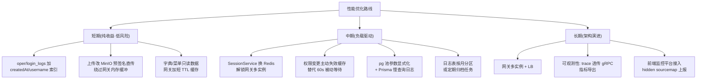

# 10 性能设计与优化

> 项目：nestjs-admin ｜ 版本：v1.1 ｜ 生成日期：2026-10-06 ｜ 依据：源码分析

本文回答"每个请求花在哪、瓶颈可能在哪、怎么优化"。架构层面的通信模型见《01-系统架构》§3-§5，本章做成本拆解、连接与内存管理走读、前端构建与加载分析，并给出按投入产出排序的优化建议。基准前提：教学/演示级负载（活跃用户数十人量级），当前设计不构成任何瓶颈；本文的价值在于负载增长时知道先动哪里。

## 1. 服务间通信开销：一个请求的真实成本

### 1.1 链路成本模型

以前端"用户列表页"为例，一次 HTTP 请求在系统内的完整旅程：vite/nginx 代理（本机/容器内跳，<1ms）→ 网关管线（helmet/限流/中间件，均为内存操作，可忽略）→ JWT 验签（HS256，微秒级）+ 会话 Map 查询（O(1)）→ CASL 判定（60s 缓存命中时 O(1)）→ **gRPC 调用**（本项目的主要开销：HTTP/2 建连已由客户端复用，单次 unary 调用本机约 1-5ms，跨容器 2-10ms）→ Prisma 查询（findMany + count，同库事务内 2-10ms）→ 原路返回。响应落定后还有一笔**旁路成本**：中间件 fire-and-forget 写操作日志，再经 gRPC 到 system 服务落库——它不阻塞响应，但占用 gRPC 连接与 system 服务的写入吞吐。

真正值得盯的是**鉴权冷启动路径**：Ability 缓存未命中（首次请求或 60s 过期）时，`buildAbility` 要串行做三件事——`GetUserRules`（user 库四层 include 查询）、`UserService.findOne`（拿角色列表）、`GetPermissionCodes`（system 库 role_menus join menus）。合计约 4 次数据库查询 + 3 次 gRPC，单用户冷启动约 20-50ms；此后 60 秒内同用户所有请求零成本。这个设计的隐含权衡是"**缓存周期 = 权限变更生效延迟**"，详见 §4 优化 2。

### 1.2 超时与重试的叠加（防雪崩，也防慢请求拖死）

网关对下游设置了多层保护，排障时要知道它们会叠加：`SystemClientService.withTimeout` 给 delete/clear 类写操作 10-15s 超时（`system-client.service.ts:256-273`）；`GrpcExceptionInterceptor`（auth 控制器挂载）对连接类失败（`No connection established` + `ECONNREFUSED`）先等 1s 再以 2s/4s/8s 指数退避重试 3 次——最坏情况一个请求在拦截器里耗约 15s 才报错；`ConsulService` 的发现查询本身有 3 次指数退避（2/4/8s），外加 5s 间隔的客户端重建重试。这些数字意味着：**下游宕机时用户侧感知是"转圈约 10-15 秒后报错"而非立即失败**——可用性换响应性的一次明确取舍，若要改成快速失败，调整点集中在拦截器与 client service 两处。

### 1.3 聚合读的并行化

仅有的两处跨服务聚合都做了并行：`dashboard.controller.ts` 用 `Promise.all` 同时调 user/system 两侧统计再加内存在线计数（七项指标一次往返）；`api/user.ts` 的 `getLogin` 并行拉 `/auth/me` 与 `/system/my-menus`。user 服务内部的统计与列表查询也都用 `Promise.all`/`$transaction` 并行（`listUsers` 的 findMany+count、`GetDashboardStats` 三个 count）。"网关聚合并行化、业务服务内查询并行化、两业务服务间零调用"这三条纪律保持了依赖图为星形，是排障时拓扑清晰的根本原因。

## 2. 连接与内存管理

### 2.1 数据库连接（Prisma 7 + PrismaPg 适配器）

两服务各持一个 `PrismaClient`（`user/src/database/database.service.ts`、`system/src/database/database.service.ts`），经 `@prisma/adapter-pg` 直连——底层是 node-postgres 的连接池，**默认 max 10 连接/实例**（pg 库默认值，代码未显式调参，⚠️ 待确认线上实际负载下的池占用）。两个值得注意的点：其一，`onModuleInit` 时 `$connect()` 预热，`onModuleDestroy` 时 `$disconnect()` 优雅释放；其二，Prisma 的 `$transaction`（数组形式）会让 findMany+count 共享同一连接快照，`listUsers` 的总数与列表必然一致。日志表只增不改、写多读少，读写共用同一个池；若监控页查询变慢，第一优先动作不是调池而是加索引（见 §4 优化 1）。

### 2.2 gRPC 客户端复用与热更新

网关的 gRPC 客户端**不按请求创建**：`grpcClientRegistry` 按 `(consulName, serviceName)` 去重持有长连通道（HTTP/2 多路复用，一条通道并发跑所有请求），实例漂移时经 BehaviorSubject 推送重建，消费者无感。这里有一个防止"重建风暴"的细节：`promisifyServiceMethods` 的错误回调在每次调用失败时触发 `updateGrpcClient`，若下游持续宕机，理论上每个失败请求都会触发一次重新发现——Consul 查询有 3 次退避重试兜底 + 发现失败走 5s 间隔重试链，实际放大系数可控；但极端场景（下游宕机 + 高并发）下 Consul 会承受可观的查询压力，这是水平扩容前要评估的点。terminus 健康探测端同样做了通道复用（`GRPCHealthIndicator` 的 `clients` Map，注释明确"每个 key 一个客户端跨探测复用，避免 gRPC 通道自引用定时器导致泄漏"）。

### 2.3 内存型组件与清理机制

网关进程内三块有界内存：SessionService 三张 Map（8 天陈旧上限 + 30 分钟清扫定时器 + `unref()` 不阻退出）、AuthorizationService 的 Ability 缓存（60s TTL + 同周期清扫）、Throttler 的内存令牌桶（按 IP 窗口计数，自动过期）。三者的共同点是**都有兜底清理但都不可横向共享**——网关多实例前必须替换为 Redis（SessionService 头注释已预留该路径）。system 服务的 `ListSystemLogs` 固定 take 100、`ListNotices` 固定 take 50，两个无分页接口用硬上限防了大结果集拖垮内存与带宽。

## 3. 前端构建与加载

### 3.1 构建配置（`vue-admin/vite.config.ts` + `build/`）

构建链的关键决策与注释依据：**rolldown-vite 分包**——`advancedChunks` 把 node_modules 拆为 vue-vendor（vue/router/pinia/@vueuse）、element-plus、echarts（含 zrender）、vxe-table 四组，业务代码改动不再打爆 entry 的 hash，长缓存命中率最大化；`sourcemap: "hidden"` 生成 map 但不注入引用（线上报错可上传监控平台定位，用户端不下载）；`assetsInlineLimit: 1024`（默认 4096 会把 2-4KB 图片内联进 CSS，降到 1024 让图片独立产出可并行加载）；`chunkSizeWarningLimit: 1000` 作分包回归告警；`target: "es2020"` 与 browserslist 对齐避免全量降级膨胀。压缩按 `.env.production` 的 `VITE_COMPRESSION="both"` 同时产出 gzip 与 brotli（不删原文件，由 nginx 按浏览器能力协商）；staging 可开 `VITE_CDN=true` 用 CDN 替换本地大依赖（生产当前关闭）。构建脚本 `pnpm build` 是 `rimraf dist && NODE_OPTIONS=--max-old-space-size=8192 vite build && generate-version-file`，8GB heap 上限是给大型依赖图留的余量。

### 3.2 运行时加载链路

生产链路的缓存策略在 `admin-vue-deploy/nginx-admin.conf`：`index.html` 强制 no-cache（发版后存活标签页必得新版）、`/assets/`（构建产物实际落 `static/js|css/...`，⚠️ 待确认该 location 与实际产物目录的匹配情况）一年 immutable、SPA 回退 `try_files $uri $uri/ /index.html`。应用侧的加载优化：路由级代码分割（动态路由组件经 `import.meta.glob("/src/views/**/*.vue")` 惰性匹配）、keep-alive 缓存已访问页（`meta.keepAlive` 驱动 cachePageList）、`warmup` 预热 index.html 与 views/components 降低冷启动瀑布、vite dev 的 `optimizeDeps.include` 预打包常用依赖。双 nginx 链路（VPS → frp → NAS 前端容器 → 网关）中，前端容器对 `/api/` 反代设了 `proxy_buffer_size 16k` 等缓冲参数与 10s 连接/60s 读超时，与 vite dev 的 15s 代理超时大致对齐。

## 4. 优化建议（按投入产出排序）

1. **日志表加索引（收益最大的一件小事）**：`oper_logs`/`login_logs` 除主键外无任何索引，监控页的 username/module 模糊筛选与时间范围查询随数据量线性变慢，而操作日志每个写请求都在插入。最小改动是在两个迁移续 `CREATE INDEX ... (createdAt)` 与 `(username)`；配合把"日志清空"从人工按钮变成按保留期的定时任务（`ScheduleModule` 已装配但无任务，正好落点）。
2. **权限缓存主动失效**：`authorization.service.ts` 暴露一个 `invalidate(username)`，在角色授权（`PUT role-menus/:roleId`）与用户角色分配（`PUT users/:id/roles`）成功后调用——授权变更从"最长 60s"变为"下一个请求即生效"，同时可以把 TTL 放宽到 5 分钟降低冷启动频率。改动收敛在两个文件。
3. **上传链路绕开网关内存**：当前头像是"前端 multipart → 网关 memoryStorage（全量进内存）→ MinIO putObject"，2MB 限制下单请求内存峰值可控，但并发上传会线性放大。改用 MinIO 预签名 URL 直传（网关只签发 URL 与登记元数据）可彻底卸载；同时补上"换头像先删旧对象"（`upload.service.ts` 的 `remove` 已存在仅无调用方，见《13-技术债务》条目 4）。
4. **数据库池显式化**：PrismaPg 适配器下 pg 池参数未显式配置，按"每实例 10 连接、两服务 + 迁移任务共享一个 PG 实例"估算，多实例扩容前应显式设置 `max` 并给监控页慢查询开 Prisma 日志。
5. **ListMenus 祖先链补全的查询次数**：`system/src/app.controller.ts` 的 `listMenus` 按角色过滤时用 while 循环逐层补父节点，树越深查询越多（每层一次 findMany）。菜单树当前三层内，无感知；若菜单层级加深，改为一次性全量拉取后内存组树更划算（菜单表本来就小）。
6. **网关多实例前置项**：SessionService 换 Redis 实现（方法签名不变）→ Throttler 换 Redis 存储 → Ability 缓存换集中式或按实例缓存——三者完成后网关才可水平扩容；按当前负载这些均为"储备"，无负载信号不必提前动。
7. **前端两项微优化**：echarts/vxe-table 已分包但仍全量进入 bundle，若首屏指标敏感可改按需引入（welcome 页只用 echarts 局部注册）；`public/platform-config.json` 建议响应头设短缓存（当前走默认，改标题后偶发不生效即缓存残留）。

## 5. 小结

这套系统的性能画像可以概括为"**内存换延迟、并行换吞吐、上限换简单**"：会话与能力缓存全在内存（换来 O(1) 鉴权与单实例约束）、聚合读与统计读全部并行（换来一次往返）、日志与通知接口用硬上限防失控（换来无需分页的简单契约）。在演示规模下没有任何一个环节接近瓶颈；扩展时遵循本文 §4 的排序——先做零风险纯收益项（索引、缓存失效、直传），负载真实增长后再做架构项（Redis 会话、多实例），并且每一步都先跑《09-测试与质量保障》的冒烟与单测确认行为不变。
