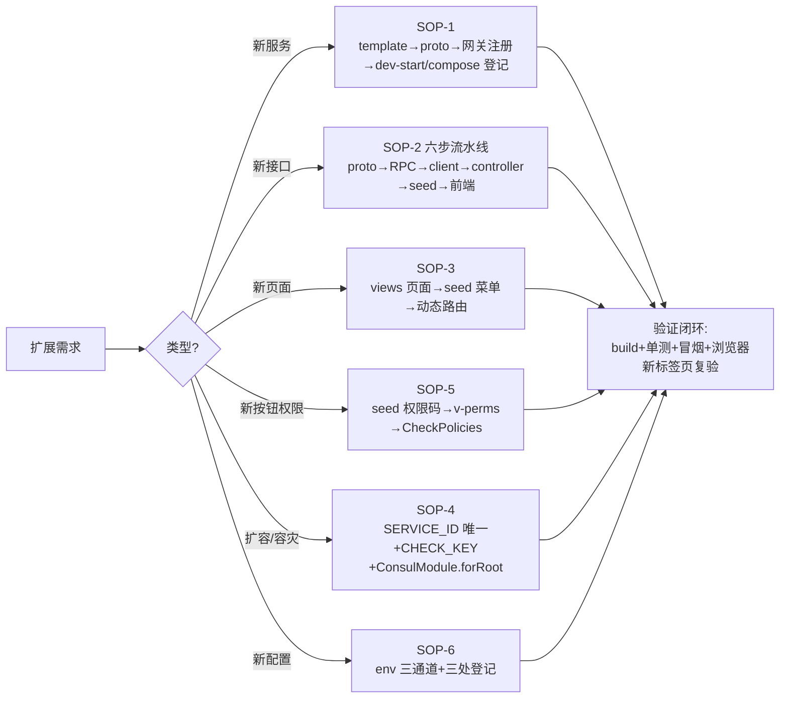

# 11 扩展开发指南

> 项目：nestjs-admin ｜ 版本：v1.1 ｜ 生成日期：2026-10-06 ｜ 依据：源码分析

本文是"照着做就能成"的 SOP 手册，六个场景覆盖本系统 95% 的扩展动作。每个 SOP 给出前置条件、固定步骤（含精确文件路径）、验证方法与该场景特有的坑。开工前先读两条通用纪律：其一，本项目加功能的固定节奏是"**契约先行（proto）→ 服务端实现 → 网关透传 → 前端接线 → seed 补权限码**"，顺序不要乱，尤其是 seed（HANDOFF 陷阱 20：字典 update/delete 就因漏 seed 403 过一次）；其二，改完必须过《09-测试与质量保障》§3 的门禁（build + 单测 + typecheck + 冒烟）。

## SOP-1：新增一个微服务并注册到网关

**前置**：`pnpm -r build` 通过；本机 Consul（dev-start.sh 起）可用。

1. **复制脚手架**：复制 `template/` 目录为 `myfeature/`（或在 `nestjs-microservice-app/` 下新建包），改 `myfeature/package.json` 的 `name` 为 `@toimc/myfeature`（workspace 靠这个名字过滤），根 `pnpm-workspace.yaml` 已按 glob 覆盖无需改。template 只提供最小 HTTP 骨架，业务服务需从 user 服务**再抄三样**：`main.ts` 的 `NestFactory.createMicroservice`（GRPC 传输 + GRPC_TLS 证书分支 + enableShutdownHooks）、`consul/consul-client.service.ts`（注册/注销客户端）、`database/`（如需独立库）。
2. **定义 proto 契约**：在 `proto-pkg/proto/` 新建 `myfeature.proto`（package 取服务名），加到 `proto-pkg/package.json` 的 generate 脚本链（HANDOFF 陷阱 6：重生成时必须把 import 链上所有 proto 一起传）。**先 grep 现有 proto 确认消息不重名**（陷阱 22：system.proto 曾因重复 IdRequest 直接编译失败；跨 proto 需要同名消息时加前缀，如 `SystemDashboardStatsRequest` 的先例）。跑 `pnpm --filter @toimc/proto-pkg build`。
3. **网关注册发现**：`gateway/src/app.module.ts` 的**两个** ConsulModule 都要补 `{serviceName: 'nestjs-myfeature', packageName: 'myfeature'}`——consul1 的 services 当前只有 user 一项，consul2 有 user+system 两项，新服务建议两边都加（陷阱 18：漏配任一实例会导致该服务的客户端在容灾竞速时拿不到，症状是偶发 403/no passing instance）。
4. **写客户端持有器**：仿 `gateway/src/system/system-client.service.ts` 建 `MyFeatureClientService`——`@Inject('nestjs-myfeature')` 注入槽位函数、subscribe 接收客户端、`promisifyServiceMethods` 挂自愈回调、`requireClient()` 防未就绪；并在 `system.module.ts`（或新 module）注册 provider。
5. **登记启动**：`dev-start.sh` 仿 [4/6] 段加一行（`PORT=400xx SERVICE_NAME=nestjs-myfeature CHECK=http://127.0.0.1:3030/api/v1/health?service=myfeature_grpc`），并在 `SERVICE_HEALTHCHECK_ENDPOINTS` 追加 `myfeature_grpc,127.0.0.1:400xx,myfeature,myfeature,myfeature_grpc` 段；`docker-compose.full.yml` 与生产 compose 同理（`HOST` 写服务名、`CHECK` 指向 health 容器）。
6. **验证**：`bash dev-start.sh` 看到 `passing: myfeature≥1`；`curl "http://127.0.0.1:3030/api/v1/health?service=myfeature_grpc"` 返回 200；从网关写一个临时控制器调一次 RPC 走通全链路。

**特有坑**：新服务 proto 里必须带 `service Health { rpc Check }`（复制 user.proto 尾部即可）并 import proto-pkg 的 HealthModule，否则 health 服务探测 UNIMPLEMENTED，实例 60s 后被 Consul 摘除——这是新服务最常见的"注册成功又消失"根因。

## SOP-2：给现有服务新增一个接口（六步流水线）

以"给用户域加导出用户列表"为例：

1. **改 proto**：`proto-pkg/proto/user.proto` 加 `ExportUsersRequest/Response` 与 `rpc ExportUsers(...)`（消息名先 grep 防重），`pnpm --filter @toimc/proto-pkg build` 重生成。
2. **服务端实现**：`user/src/app.controller.ts` 加 `@GrpcMethod('UserService','ExportUsers')`（注意 grep 大小写：方法名小写驼峰、装饰器字符串大写，陷阱 9）；涉及新表字段先 `prisma migrate dev` 且**显式 `prisma generate`**（陷阱 7）。
3. **网关客户端**：`gateway/src/system/user-client.service.ts` 的 `UserDeptApi` 接口加方法签名 + 类里加透传方法。**改了接口类型必须 grep 所有实现**（陷阱 29：曾因漏改 client 签名，swc 构建通过但 tsc/jest 全挂）。
4. **网关控制器**：在对应控制器加路由。**公开/半公开口必须配 @Throttle**；业务写口挂 `@CheckPolicies((ability) => ability.can('system:user:export','perm'))`；入参走 DTO + ValidationPipe 或 @Query/@Param。
5. **seed 补权限码**：`system/prisma/seed.sql` 追加一段 `INSERT INTO menus (type=2 按钮, permission='system:user:export')` + `role_menus` 授权 + `setval` 推序列，重放到 system_db（模式照抄 seed 里 M8 段）。**漏这步 = 前端拿不到按钮码 + 调用 403**。
6. **前端接线**：`vue-admin/src/api/system.ts` 加 API 函数（走统一 `call()` 包装并适配响应形状——先 curl 一遍真实接口确认返回结构，陷阱 23），页面按钮加 `v-perms="'system:user:export'"`。

**验证**：`pnpm -r build` + `cd gateway && pnpm test` + 冒烟 + 用 p1user 登录确认按钮出现且调用 200。

## SOP-3：新增一个管理页面与菜单

1. **写页面**：在 `vue-admin/src/views/myfeature/` 下建 `index.vue`（+ 可选 `hook.tsx`/`form.vue`），**照抄一个成熟页面的骨架**（推荐 `views/system/role/`，体量最小模式最全：PureTableBar + @pureadmin/table + 分页 + 弹窗表单）。组件路径约定：菜单 component 字段填 `myfeature/index`，`router/utils.ts` 的 `import.meta.glob("/src/views/**/*.{vue,tsx}")` 按 path 或 component 匹配。
2. **seed 菜单记录**：`system/prisma/seed.sql` 插 type=1 菜单（parentId 挂目录、path=`/myfeature`、component=`myfeature/index`、icon 短名——前端 `api/routes.ts` 的 ICON_MAP 未命中时回退 `ep:<原名>`），按钮权限插 type=2 子记录；重放 + role_menus 授权。运行时加菜单也可以直接在"菜单管理"页操作（数据驱动，无需发版）。
3. **理解路由生成规则**：`api/routes.ts` 的 `toRoute` 把 type=1 的 path 自动加 `/index` 后缀；目录（type 0）无可见子级不输出；iframe/外链用 type 3/4（枚举语义已统一为 0目录/1菜单/2按钮/3iframe/4外链，陷阱 24——不要用模板老的 menuType 0/1/3）。
4. **验证**：p1user 登录（默认角色已授权）→ 侧边栏出现新菜单 → 刷新页面验证动态路由重建 → 深链接直达不 404。**调试铁律：旧标签页不可信，一律新开标签页复验**（CachingAsyncRoutes=false 每次实拉，但旧页内存态可能残留）。

## SOP-4：多实例扩容与新增 Consul 注册中心

**扩 user 服务实例**（受支持，零代码改动）：`pnpm dev:user1`（:40002）/ `pnpm dev:user2`（:40003，注册到 8501）——关键三点：`SERVICE_ID` 必须显式唯一（缺省 `nestjs-user-${PORT}` 已含端口，但同端口双进程必须手动区分）、`CHECK_KEY` 区分健康键（user1_grpc/user2_grpc，并同步扩 `SERVICE_HEALTHCHECK_ENDPOINTS`）、网关侧随机负载均衡自动生效无需配置。**system 服务与网关不可复制此做法**（会话内存表 + 无状态假设未验证）。**新增注册中心**：`app.module.ts` 再加一个 `ConsulModule.forRoot({name:'consul3', options:{...}, services:[...]})`，`retryGetServiceInfo` 的并行竞速对实例数量无感；但注意 consul2 那条"services 必须数组且含全部服务"的纪律同样适用于新实例。**本地起第二个 Consul agent** 必须全套端口偏移（`dev-start.sh` 的 dev2 示例：http 8501、server 8310、serf-lan 8311、serf-wan 8312、dns 8601、grpc 8513、grpc-tls 8514——漏偏移会撞 8300，陷阱 12）。

## SOP-5：新增一种按钮权限码并绑定前端

最小闭环演示权限系统是纯数据驱动的：① 决定码名 `<域>:<资源>:<动作>`（与既有 21 个按钮码风格一致，见 `system/prisma/seed.sql`）；② `INSERT INTO menus (..., 2, '', '', '<码名>', ...)` + role_menus 授权 + setval；③ 前端目标按钮加 `v-perms="'<码名>'"` 或 `<Perms :perms="['<码名>']">` 组件（`directives/perms` 无权限直接移除 DOM）；④ 网关对应接口挂同名 `@CheckPolicies`。**生效时序**：授权写入后，网关 Ability 缓存最长 60s 过期（`CACHE_TTL_MS`，急用可重启网关立即生效）；前端权限码在**下次拉 my-menus 时**刷新（登录后/刷新页面），当前会话不自动更新。验证路径：授权前按钮不渲染且 curl 直调得 403 → 授权 + 等 60s → 按钮出现且 200。

## SOP-6：新增环境变量与配置项

本项目的配置消费有三条通道，按场景选：**启动期一次性读取**（推荐）：`process.env.XXX || '默认值'` 直读，如 `consul-client.service.ts` 的 SERVICE_NAME/HOST/CHECK 模式——配合 `dev-start.sh` 加默认导出、`.env.example` 补文档、compose 补 environment 三处。**网关 Nest 配置体系**：`gateway/src/common/config/config.module.ts` 的 ConfigModule 是全局的，控制器/服务里注入 `ConfigService.get('XXX')`（JWT_SECRET/VERSION/PREFIX/SWAGGER_ENABLED 走此通道）；注意 v12 起 `@nestjs/config` 不再支持 Joi validationSchema，校验写 `validate` 函数（陷阱 14）。**业务服务**：`user/system` 的 ConfigModule.forRoot 读各自目录 `.env`（isGlobal），`prisma.config.ts` 是 CLI 专用通道（Prisma 7 从 schema 移除了 url）。**红线**：密钥类只进 dev-secrets.env / 生产 .env，绝不进 `.env.example` 或代码；新增变量必须在《14-配置与环境详解》§5 的清单里登记。

## 扩展动作全景图

最后提醒一句边界：以上 SOP 覆盖的是"既有架构内的扩展"；若需求触及"网关多实例""服务间直连""跨库 join"三者之一，先回到《01-系统架构》§7 的架构约束与《13-技术债务与演进建议》的路线图评估，不要在 SOP 层面硬绕——这些约束每一个背后都有明确的设计理由与替代方案。
