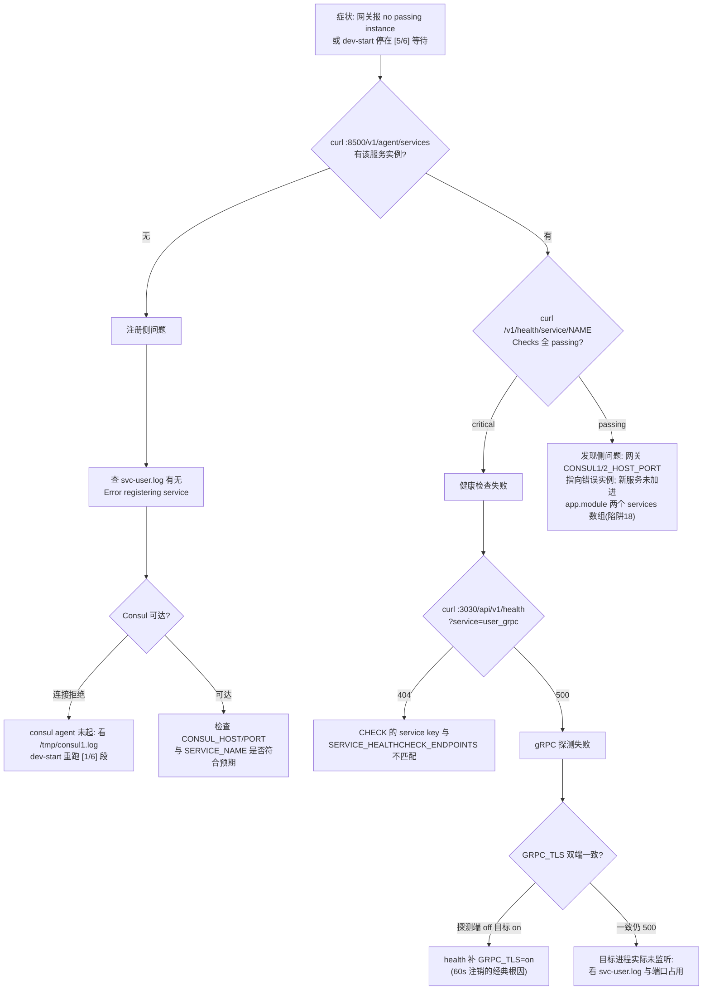
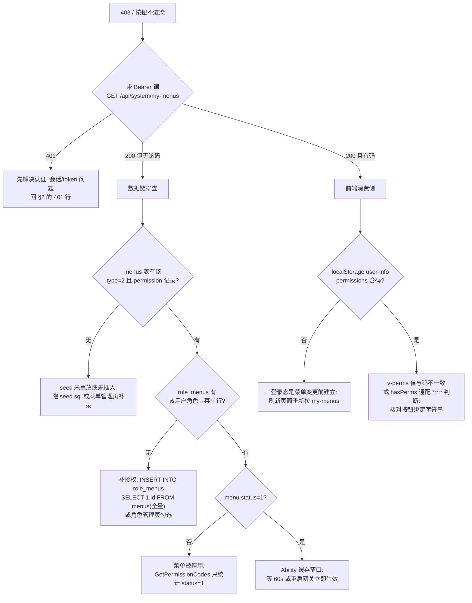

# 12 FAQ 与故障排查

> 项目：nestjs-admin ｜ 版本：v1.1 ｜ 生成日期：2026-10-06 ｜ 依据：源码分析

本文是排障手册：高频报错按"症状 → 根因 → 处置"组织，附两张 mermaid 决策树（服务不可达/注册失败、403）与日志入口清单。部署命令与环境陷阱见《06-部署运行》§6，接口错误码语义见《03-接口设计》§5。**排障总原则**：先看网关日志确定请求死在哪一层，再用 traceId 跨日志关联，最后才动代码——本项目绝大多数"怪问题"在 HANDOFF 陷阱清单里有前人记录。

## 1. 日志入口清单（排障的第一现场）

| 入口 | 位置/命令 | 看什么 |
|---|---|---|
| 网关进程日志 | `/tmp/svc-gateway.log` | 每请求一行 `traceId method url statusCode 耗时`（RequestLoggingMiddleware）；Nest Logger 的错误与警告 |
| user/system 日志 | `/tmp/svc-user.log`、`/tmp/svc-system.log` | gRPC 层 Prisma 错误、注册成败（`Service registered: ...`） |
| health 日志 | `/tmp/svc-health.log` | terminus 探测异常 |
| Consul 日志 | `/tmp/consul1.log`、`/tmp/consul2.log` | agent 状态、健康检查翻转、注销事件 |
| 注册表实况 | `curl http://127.0.0.1:8500/v1/agent/services` | 已注册实例清单（id/name/address/port） |
| 健康实例 | `curl "http://127.0.0.1:8500/v1/health/service/nestjs-service?passing=true"` | Checks 数组 Status 是否 passing |
| gRPC 健康聚合 | `curl "http://127.0.0.1:3030/api/v1/health?service=user_grpc"` | 200=存活 / 404=key 不在 ENDPOINTS / 500=探测失败 |
| 网关探针 | `curl http://127.0.0.1:3040/api` | 网关进程存活（Hello World!） |
| 操作日志表 | system_db `oper_logs`（或监控页） | 按 traceId 反查请求上下文（userId/url/ip/状态/耗时） |
| 系统日志表 | system_db `system_logs`（监控页"系统日志"） | 网关 5xx 的 message + 截断 2000 字符堆栈（module=gateway） |
| 登录日志表 | system_db `login_logs`（监控页"登录日志"） | 认证行为审计（含失败尝试与 429） |
| Swagger | `http://localhost:3040/api/docs`（非生产默认开） | 端点契约核对 |

traceId 关联链：前端不发 traceId，由网关中间件生成（`randomUUID`）并回写响应头 `X-Request-Id`；同一 traceId 会出现在网关请求行、该请求触发的操作日志（oper_logs.traceId）、以及 5xx 时的 system_logs 里——跨服务取证按这个字段串。

## 2. 高频报错速查表

| 症状 | 根因 | 处置 |
|---|---|---|
| 登录 500，user 日志报 `column users.preferences does not exist` | 库缺迁移（换机后只同步了代码）：陷阱 31 的真实事故 | 两服务目录各跑 `npx prisma migrate deploy`（user 导 DATABASE_URL、system 导 SYSTEM_DATABASE_URL），再补 seed |
| 登录 500，报 `relation "xxx" does not exist` 或权限码全 403 | system 服务连错库（陷阱 19）或 system_db 未建/未迁移 | 核对 `SYSTEM_DATABASE_URL`（运行时 `database.service.ts` 与 CLI `prisma.config.ts` 必须指向同一库）；确认 `system-db-init`/建库已执行 |
| 登录 403"用户名或者密码错误"（确认密码没输错） | 密码哈希问题：用户由绕过哈希的路径写入，或库是旧明文数据 | 用注册接口/管理页重建用户；检查写入侧是否 `argon2.hash(argon2id)` |
| 登录 429 | signin 10/min 限流（**特性**，含失败尝试累计；Throttler 跨进程内累计，陷阱 26） | 等 60s 或 `pkill -f "node dist/main.js"` 重启网关 |
| 任意接口 401"会话已失效，请重新登录" | 会话被强退/登出/网关重启（内存会话清空）；或 refresh 换发后拿旧 access（陷阱 28 特性） | 重新登录；验证"旧 token 失效"属预期行为 |
| 调用 403"无权限执行该操作" | 权限码未授权给该角色（九成是 seed/role_menus 缺行），或 Ability 缓存 60s 窗口 | 见 §4 决策树逐项排查 |
| 按钮不显示/权限码"拿不到" | 前端权限码来自 my-menus 的 type=2 记录，菜单缺记录或角色未授权 | 同 §4，另查 `GET /api/system/my-menus` 响应里有无该码 |
| 网关起不来或调用报 `no passing instance found for nestjs-service` | Consul 未起、CHECK 配错、health 探测端没开 GRPC_TLS（60s 后实例被注销） | 按图一决策树排查 |
| 容器间 gRPC 报 `ERR_TLS_CERT_ALTNAME_INVALID` | 自签证书 SAN 只含 localhost，容器服务名互连不匹配（生产部署坑①） | 重签含服务名 SAN 的证书，卷挂覆盖 `/app/proto-pkg/certs/`（admin-vue-deploy/docker-compose.yml 的 volumes 即此方案） |
| health 探测恒 500 → 服务 60s 被 Consul 注销 | 探测端 GRPC_TLS 与目标不一致（目标 on、探测 off） | health 容器补 `GRPC_TLS=on`（生产 compose 已带，自建环境常漏） |
| `argon2` 报 `No native build was found (abi=127)` | node_modules 跨机器同步架构不匹配（陷阱 30） | `CI=true pnpm install` + `pnpm rebuild argon2`，验证 `ls node_modules/.pnpm \| grep darwin-x64` |
| 前端任意请求 502 `{"message":"后端服务不可用..."}` | vite 代理目标 :3040 未启动（vite.config.ts 的错误兜底 JSON，非故障是提示） | `bash dev-start.sh` 起后端 |
| 生产深链接 404 / 刷新 404 | nginx 丢 SPA 回退 | 保留 `try_files $uri $uri/ /index.html`（nginx-admin.conf） |
| 限流把全站折叠成一个桶（所有人都 429） | 反代链路 XFF 断链或 trust proxy 失效，全站按同一 IP 计数 | 检查 VPS nginx `X-Forwarded-For $remote_addr`（覆盖写）与前端容器 `$http_x_forwarded_for`（透传），网关 `trust proxy 1` |
| 新建菜单/按钮保存后报 500 撞主键 | seed 显式 ID 后未 setval 推进序列 | 每段 seed 末尾 `SELECT setval(pg_get_serial_sequence('menus','id'), (SELECT MAX(id) FROM menus))` |
| proto 改完运行时报消息未定义/编译冲突 | proto 消息重名（陷阱 22）或未重生成 proto-pkg | 加消息前 grep；`pnpm --filter @toimc/proto-pkg build` 重生成 |
| 表格空白/字段 undefined（字典、日志页） | 适配器没解包 `{types/items/logs:[]}` 信封（陷阱 23） | 先 curl 真实接口确认形状，改 `api/system.ts` 适配器 |
| 单测报错 jest 0 matches（user 目录） | user 服务本就无测试文件 | 正常现象（陷阱 21），勿当故障修 |
| 冒烟第二轮起全 429 | 冒烟连跑耗尽 signin 配额 | 与登录 429 同处置；`NODE_PATH=./node_modules` 按原样命令跑 |

## 3. 决策树一：服务不可达 / 注册失败

## 4. 决策树二：403 与按钮码"拿不到"

先交代这条最经典问题的机制背景（即标题所说的"按钮码 20 拿不到、调用 403"类问题）：前端按钮码唯一来源是 `GET /api/system/my-menus` 响应里 **type=2 且 permission 非空**的菜单记录（`api/routes.ts` 过滤后 `SET_PERMS`）；网关守卫唯一依据是 `GetPermissionCodes` 按角色聚合的同一批记录（`system/src/app.controller.ts`，且只统计 `menu.status===1`）。两路同源，因此 403/按钮缺失的根因几乎必然在数据链（seed、role_menus、status、缓存）而非代码。

## 5. 典型问题 FAQ（速查表之外）

**Q1：为什么我在 Consul UI 里看到服务一会儿绿一会儿消失？**——health 服务探测失败时实例 60 秒后被 `deregisterCriticalServiceAfter` 自动注销；恢复探测后重新注册要等服务重启。结合图一先查 `?service=` 的 key 与 GRPC_TLS 一致性，这两个占了九成。

**Q2：改了菜单/权限，为什么另一个已经登录的人没变化？**——两处缓存：网关 Ability 60s（权限码判定）、前端 permissions 存 localStorage（按钮显隐，直到下次拉 my-menus）。想立即生效：重启网关（清 Ability 缓存）+ 让用户刷新页面（重拉菜单）。

**Q3：删除操作日志后数量没归零反而多了一条？**——网关中间件对 DELETE 请求本身也写一条操作日志（module 形如 `monitor:oper-logs`）。断言按"目标 id 消失"而非数量归零（HANDOFF M8 注意事项），这是设计不是 bug。

**Q4：p1user 改密码/被重置密码报 403"测试账号不可以修改密码"？**——后端两处写死保护（`user/src/app.controller.ts` 的 updatePassword 与 adminResetPassword），演示账号绑定前端一键登录，属有意设计。要解除需改源码并理解它同时被 TEST_ACCOUNT 引用。

**Q5：refresh 之后旧 token 还能用？/ 换发后另一个标签页掉线了？**——`rotateAccessToken` 换会话键，旧 access 立即 401（单活跃会话特性，陷阱 28）；同账号第二个标签页共享的是前端 localStorage，若它持旧 access 会掉线，刷新即恢复。

**Q6：docker-compose.full.yml 一键起栈失败？**——文件头自述"尚未实测"（在无 docker 的开发机上编写）。优先核对镜像版本、`HOST` 是否写服务名、`CONSUL1/2_HOST` 是否指向 consul 容器；生产实际使用的是 `admin-vue-deploy/docker-compose.yml`（已实测），可对照差异。

**Q7：`pnpm test` 报 ESM 相关错误？**——Node 版本低于 24.9 或没带 `NODE_OPTIONS=--experimental-vm-modules`（脚本已内置，通常是绕过脚本直接调 jest 所致）；zsh 非交互 shell 里用 nvm 的绝对路径（陷阱 21）。

**Q8：登录后跳转白屏或菜单错乱？**——九成是旧标签页状态残留或动态路由缓存：硬刷新/新开标签页；仍异常则清 localStorage 的 `user-info` 与 `async-routes-*` 再登录。`CachingAsyncRoutes=false` 时理论上每次实拉，浏览器缓存另计。

## 6. 案例复盘：新环境首启"全栈起得来但登录 403"的一次完整排查

用一个真实感很强的复合案例把本文方法串起来。假设你在新机器上按《06-部署运行》§2 起栈：dev-start.sh 显示 `passing: user=1 system=1`，网关探针 200，但 p1user 登录后所有管理页调用 403"无权限执行该操作"，侧边栏只有"首页"。按本文工作法走一遍：第一步看状态码分类——403 落在授权层，进入图二决策树；第二步带 token 调 `GET /api/system/my-menus`，发现返回 `{menus:[]}` 且无任何按钮码，说明问题在数据链而非前端；第三步查 system 侧——`curl "http://127.0.0.1:3030/api/v1/health?service=system_grpc"` 返回 200（服务活着），再看 `svc-system.log`，如果出现 `relation "menus" does not exist` 之类的 Prisma 错误，根因即锁定为"system_db 未跑迁移或未重放 seed"（陷阱 19/31 的组合：SYSTEM_DATABASE_URL 指向了空库，`GetPermissionCodes` 查不到任何菜单，能力为空 → fail-closed 全 403）。处置：核对 system_db 的连接串、跑 `npx prisma migrate deploy` 与 `psql -f prisma/seed.sql`、重放 role_menus 授权、等 60 秒 Ability 缓存过期（或重启网关立即生效）、重新登录。这个案例覆盖了本文最核心的两条经验：**403 九成在数据链**（seed/role_menus/status/缓存四查），以及**能力为空时系统按全拒处理是有意设计**——排障时不要把它当"权限系统坏了"，它恰恰说明防线在工作。

## 7. 排障工作法小结

把上面所有内容收敛成一句操作序列：**curl 网关探针 → 看状态码分类（401 认证 / 403 授权 / 400 入参 / 409 冲突 / 429 限流 / 5xx 取证）→ 5xx 按 traceId 串网关日志 + system_logs + 目标服务日志 → 发现类问题查 Consul 注册表与健康接口 → 数据类问题查 menus/role_menus/seed → 改动后冒烟 + 新标签页复验**。配套纪律：不要凭感觉改代码来"绕过"报错——本项目的错误信息都是有意透出的可诊断文案，先在本文速查表与 HANDOFF 陷阱清单里对号入座，绝大多数问题十分钟内有答案。
