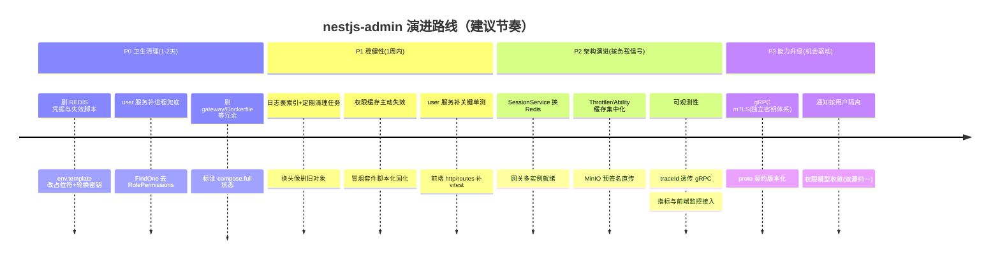

# 13 技术债务与演进建议

> 项目：nestjs-admin ｜ 版本：v1.1 ｜ 生成日期：2026-10-06 ｜ 依据：源码分析

本文把散落在源码注释、HANDOFF 待办与《04》《06》《08》各篇的"已知不完美"汇总为一份可执行的债务台账：每条给出位置、证据、影响与处置建议，并给出三阶段演进路线图。定性原则先讲清楚：本项目是"教学/演示级、按生产思路实现"（HANDOFF 定位），因此债务分两类——**设计取舍**（有意为之、有注释背书、有演进预留，不该"修"只该按路线图演进）与**真实疏漏**（无注释解释、纯惯性遗留，应尽快清理）。逐条判断时先归此类。

## 1. 死代码与冗余清单（逐条分析）

### 1.1 权限模型的历史遗留三表（设计取舍，建议保留但加注释）

- **位置**：`user/prisma/schema.prisma` 的 `permissions`/`role_permissions`/`permission_polices` 三模型；`user/prisma/seed.sql` 的 permissions 4 条种子。
- **证据**：运行时鉴权链 `GetUserRules`（`user/src/app.controller.ts`）只走 `UserRole→Role→RolePolicy→Policy` 链；permissions 链无任何 gRPC/网关消费方。唯一"接触"是 `FindOne` 的 include 里带着 `RolePermissions`（`user/src/app.controller.ts:26`），查询结果原样返回、无人读取——纯多余查询。表名 `permission_polices` 是 schema 原样拼写（polices 少一个 r），迁移已定名无法无损改名。
- **影响**：读者误以为 permissions 参与鉴权（多份文档需要专门澄清，见《04-数据模型》§2.4）；FindOne 每次登录/鉴权都多查一层无用关系；三张空表长期无人写入。
- **建议**：短期删掉 FindOne include 里的 `RolePermissions`（一行改动，减少一层 join）；中期三选一——① 作为 CASL 扩展示范保留并在 schema 加注释声明"当前未消费"；② 写一个迁移删掉三表；③ 真正接通（让 permissions 成为 role_permissions 的结构化定义源）。不建议维持"既在 schema 又无人懂"的模糊态。

### 1.2 dev-secrets.env 的 REDIS_* 残留凭据（真实疏漏，尽快清理）

- **位置**：`nestjs-microservice-app/dev-secrets.env` 第 4-6 行。
- **证据**：验证码功能（CaptchaService/RedisModule/ioredis）2026-09-10 整体移除（HANDOFF 待办 4），全仓已无任何 REDIS_ 读取方；dev-start.sh 照常 source 该文件。
- **影响**：公网 Redis 实例（106.15.35.71:16379）的真实密码留在工作区文件里，是纯暴露面，零功能价值。
- **建议**：删除该三行；确认该 Redis 实例无其他用途后下线或改密。这条与《08-安全与权限设计》§6 隐患 2 同源。

### 1.3 gateway 的死常量与失效脚本（真实疏漏，顺手清理）

- **位置/证据**：① `gateway/src/common/config.ts` 仅含 `export const SERVICE_USER = 'SERVICE_USER'`，全仓无引用（auth.module.ts 里相关注入代码已注释）；② `gateway/src/auth/auth.module.ts` 尾部注释掉的 `ClientsModule/Transport` 块（直连客户端的旧方案遗迹）；③ `gateway/package.json` 的 `gen:proto` 脚本指向 `./proto/user.proto`，而 `gateway/proto/` 目录不存在（proto 已收编进 proto-pkg），脚本必失败；④ `gateway/src/app.service.ts` import 了 `Cron/CronExpression` 却无任何 @Cron 装饰器，`app.module.ts` 的 `ScheduleModule.forRoot()` 因此无任务可跑。
- **影响**：误导接手者以为存在多套配置/直连方案；`pnpm gen:proto` 会报错挫败感强；ScheduleModule 成为"看起来有用实际空转"的模块。
- **建议**：删 config.ts、注释块、gen:proto 脚本；ScheduleModule 二选一——删掉，或在 §3 路线图落地"日志定期清理任务"时再启用。

### 1.4 UploadService.remove 无调用方 → 头像孤儿对象（设计取舍未闭环）

- **位置**：`gateway/src/common/upload/upload.service.ts` 的 `remove()`（含 `stat()` 也仅回读链在用）；调用方检索为零。
- **证据**：换头像时文件名带时间戳（`avatar-${username}-${Date.now()}`），新对象写入后 users.avatar 指向新 URL，旧对象永留 MinIO 桶；上传中断残片同理。`/uploads/:key` 回读端点与 MinIO 均无生命周期规则。
- **影响**：桶体积随上传次数单调增长；《04-数据模型》§5 已把它列为运维自觉管理的两项风险之一。
- **建议**：最小改动是"更新头像前先删旧对象"（user 服务先返回旧 avatar 再调 remove，或网关在 updateAvatar 成功后异步清理）；彻底方案是 MinIO 桶配生命周期规则 + 定期按 users.avatar 反查无引用对象。同理 `notice` 无删除接口、`system_logs` 无删除链路，属同款"只增不减"债务，按 §3 路线图统一处理。

### 1.5 服务模板残留物（真实疏漏，低优先级）

- **位置/证据**：① `user/src/consul/consul.controller.ts` 是一个 HTTP `@Controller('health')` 返回固定 ok——user 服务是纯 gRPC 服务没有 HTTP 端口，此控制器永不生效，Consul 实际探测的是 health 服务的聚合端点；② `user/src/app.service.ts`、`system/src/app.service.ts` 的 getHello 与 `user/src/app.module.ts` 里注册的 AppService 均无业务意义（Nest 脚手架默认产物）；③ `ServiceInfo` 接口字段拼写 `servcieName`（`gateway/src/consul/consul.interface.ts`，无引用方）。
- **影响**：无运行时影响，纯认知噪音；consul.controller 容易让人误以为 user 有健康端点。
- **建议**：删除即可，重构窗口顺手做。

### 1.6 未挂载的拦截器与不对称加固（记录在案）

- **位置/证据**：① `gateway/src/common/interceptors/big-int.interceptor.ts` 全仓无挂载点（proto-loader 的 `longs: String` 已在源头规避 bigint 序列化问题，该拦截器成为冗余备胎）；② `SerializeInterceptor` 有测试、有装饰器封装（`common/decorators/serialize.decorator.ts`），但全系统仅 `signup` 一处使用 `@Serialize(PublicUserDto)`——其余端点靠"服务端只返回安全字段"的约定保证不泄 password，约束靠纪律不靠机制；③ 进程级兜底不对称：gateway 与 system 的 main.ts 都挂了 `unhandledRejection/uncaughtException`，**user 没有**（user 是认证数据服务，反而是最不该裸奔的）。
- **影响**：②是潜在安全隐患面——若未来有人在 user 服务新增返回字段包含 password 的 RPC 且网关直接透传，没有 Serialize 白名单兜底；③使 user 服务对未处理拒绝零防御。
- **建议**：user/main.ts 补两个 process.on（照抄 system 三行）；signup 之外的敏感输出端点逐步挂 @Serialize；BigIntInterceptor 删除或留注释声明保留原因。

### 1.7 角色删除的语义含混（设计取舍，建议文档化）

- **位置/证据**：`gateway/src/system/user.controller.ts` 的 `RoleController.remove`——`DELETE /api/system/roles/:id` 实际执行 `updateRole({id, name: '已停用-'+id, status: 0})`（软删除，因角色可能被 user_roles 引用且角色库无外键约束清理链）。
- **影响**：语义上是 DELETE 实为停用改名；重复删除会叠加"已停用-已停用-3"式名称；前端角色列表会一直看到僵尸角色。
- **建议**：要么接口改名（`PUT /roles/:id/disable`）并在前端用"停用"文案；要么实现真删除（事务内先清 user_roles/role_policies/role_menus——后者跨库，需网关聚合两次调用）。当前实现安全但含混，至少在《15-接口全量参考》已按实际语义标注。

### 1.8 部署工件冗余（记录在案）

- **位置/证据**：① `gateway/Dockerfile`（子目录版，node:24-alpine 三阶段，COPY package*.json 与 RUN npm run build 的组合在 monorepo 下本就跑不通）与根 `Dockerfile`/`Dockerfile.service` 并存，生产用的是根目录两份；② `docker-compose.full.yml` 头注释自述"尚未实测"；③ `consul/` 目录的 server 模式 compose（`bootstrap-expect=1`）开发期未使用（本机用 dev agent）。
- **影响**：三套容器化入口并存，接手者难辨哪个是真。
- **建议**：`gateway/Dockerfile` 删除或标注 DEPRECATED；`docker-compose.full.yml` 要么实测转正（补进《06》验证清单）要么归档；`consul/` 目录保留作 server 模式参考但 README 注明"非当前开发路径"。

## 2. ⚠️ 待确认与已知边界汇总

| 条目 | 位置 | 状态 |
|---|---|---|
| docker-compose.full.yml 从未实测 | 文件头注释 | ⚠️ 待确认；生产用 admin-vue-deploy compose |
| 生产管理员 prodadmin 密码 | HANDOFF §4.5"建议改密" | ⚠️ 待确认是否已改 |
| 生产 Consul（hashicorp/consul:1.20）未配 ACL | admin-vue-deploy/docker-compose.yml | ⚠️ 待确认是否需要；当前内网 devnet 隔离 |
| MinIO ACCESS/SECRET_KEY 出现在仓库工件 env.production.template | 未 gitignore | 已确认泄露面，建议轮换（08 篇隐患 1） |
| 前端 nginx `/assets/` location 与产物目录 `static/` 的匹配 | nginx-admin.conf vs vite.config.ts assetFileNames | ⚠️ 待确认；immutable 缓存可能未覆盖 JS/CSS 产物 |
| notices 无接收者维度（全局广播）且无删除链路 | system_db notices 表 | 设计边界，按需扩展（04 篇 §3.4） |
| 网关内存会话/限流/Ability 缓存均为单实例态 | session.service.ts 头注释 | 已确认取舍，演进见 §3 |
| oper/login_logs 无索引、无自动清理 | system/prisma/migrations | 已确认，§3 P1 |
| 通知 status 字段存 el-tag 类型（数据耦合 UI 库） | system_db notices.status | 设计取舍（04 篇已评述），换组件库时需迁移 |

## 3. 演进路线图

P0 全部是零风险清理，建议一次 PR 完成（对应 §1.2/1.3/1.5/1.8 与 §2 的凭据项）。P1 的优先级依据是《09-测试与质量保障》§4 的缺口排序与《10-性能设计与优化》§4 的收益排序，其中"权限缓存主动失效"是体验与安全双收益的最高性价比项。P2 各项互相独立，唯一的前置关系是"网关多实例"必须在会话/限流/缓存三者集中化之后；触发信号建议定为"单网关实例 CPU 持续 >50% 或会话数破千"。P3 的 mTLS 与契约版本化是"从演示级走向企业级"的分水岭，做之前先确认团队愿意承担 proto 演进的纪律成本（向后兼容规则、消息命名空间、生成物审查）。

## 4. 结语：与债务共处的三条原则

第一，**每条债务先归类再动手**：本文凡有"注释背书/文档先例"的（单实例会话、60 秒窗口、软删除角色、通知全局广播）都是有意取舍，改动前先读《01-系统架构》§7 的约束条款；凡标注"真实疏漏"的（凭据残留、死代码、user 无兜底）不要犹豫，清理成本远低于误用成本。第二，**清理与演进分离**：P0 卫生 PR 不夹带任何行为变更，P1/P2 每项独立分支、独立验证（冒烟 + 相关单测），保持"每个 diff 都能单独回滚"。第三，**文档即防腐剂**：本篇台账应随代码演进滚动更新——每完成一项划掉一项，每新增一笔"已知取舍"就补一行；接手者接手的不是代码库，是这份不断更新的判断集合。
