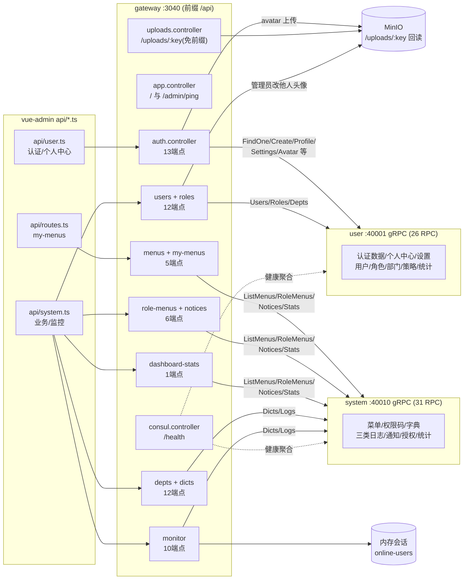

# 15 接口全量参考

> 项目：nestjs-admin ｜ 版本：v1.1 ｜ 生成日期：2026-10-06 ｜ 依据：源码分析

本文是全量端点速查：HTTP 端点 64 个（网关 63 + health 服务 1）、gRPC 契约 57 个（user 26 + system 31），逐个给出方法、路径、鉴权、入参、响应与错误码。契约的最终解释权在 `proto-pkg/proto/*.proto` 与各控制器源码，本文与其不一致时以源码为准。设计与调用约定见《03-接口设计》，本文只做"查字典"用途。

**鉴权图例**：🔓 公开（仅限流）；🔒JWT 登录即可（AuthGuard('jwt')，会话必须存在）；🔑Perm 登录 + 权限码（另挂 PoliciesGuard + @CheckPolicies）。**响应约定**：网关 JSON 直出（非信封）；写操作统一 `{ok:true}`；列表统一 `{<复数名>: [...], total}`；错误体 `{statusCode, message, error?}`，class-validator 校验失败时 message 为字符串数组（前端 `join('；')`）。POST 默认 201，signin/refresh/logout 显式 200。

## 1. 服务-端点总览图

## 2. 认证与个人中心（`gateway/src/auth/auth.controller.ts`，类级挂 GrpcExceptionInterceptor）

| # | 方法/路径 | 鉴权/限流 | 入参 | 响应 | 主要错误码 |
|---|---|---|---|---|---|
| 1 | POST `/api/auth/signin` | 🔓 10/min | body `{username(5-20), password(6-32)}` | `{userId, access_token, refresh_token, expires_in:7200}`；副作用：会话登记 + 登录日志 | 400 校验数组；403 用户不存在/用户名或者密码错误；429 |
| 2 | POST `/api/auth/refresh` | 🔓 30/min | body `{refreshToken}` | `{access_token, expires_in:7200}`；换发后旧 access 立即失效 | 403 刷新令牌无效或已过期；401 会话已被踢/登出 |
| 3 | POST `/api/auth/signup` | 🔓 5/min | body 同 signin（roles 数组经 CreateUserPipe 转 int，可选） | PublicUserDto 序列化：`{id, username, roles:[roleId]}`（password 被 @Exclude） | 400；403 用户已存在；409 用户名已存在（P2002） |
| 4 | POST `/api/auth/logout` | 🔒JWT | 无（token 取自头） | `{ok:true}`；access+refresh 同时失效 | 401 |
| 5 | GET `/api/auth/me` | 🔒JWT | 无 | `{userId, username, roles[], nickname, avatar}`；user 服务不可用时角色降级 `[]` 不阻断 | 401 |
| 6 | GET `/api/auth/profile` | 🔒JWT | 无 | `{id, username, status, deptId, deptName, roleIds, roleNames, createdAt, nickname, phone, email, avatar}` | 401；404 用户不存在 |
| 7 | PUT `/api/auth/profile` | 🔒JWT | body `{nickname?, phone?, email?}` | 同 6（最新 profile） | 401；404 |
| 8 | PUT `/api/auth/password` | 🔒JWT | body `{oldPassword, newPassword}` | `{ok:true}` | 401；403 测试账号不可以修改密码 / 原密码错误；404 用户不存在 |
| 9 | POST `/api/auth/avatar` | 🔒JWT | multipart `file`（image/* ≤2MB，memoryStorage） | `{url:"/uploads/avatar-<username>-<ts><ext>"}`；先传 MinIO 再 UpdateAvatar | 401；超限/类型不符上传失败；MinIO 降级时报错 |
| 10 | GET `/api/auth/settings` | 🔒JWT | 无 | `{preferences(JSON串), securityQuestion, backupEmail, phone}` | 401；404 |
| 11 | PUT `/api/auth/preferences` | 🔒JWT | body `{preferences: {键:布尔}}`（网关 JSON.stringify） | `{ok:true}` | 401；400 偏好设置格式错误 |
| 12 | PUT `/api/auth/security` | 🔒JWT | body `{securityQuestion?, securityAnswer?, backupEmail?, phone?}` | `{ok:true}` | 401；404 |
| 13 | GET `/api/auth/profile-demo` | 🔑Perm CASL `can('read','user')` | 无 | `{userId, username}` | 401；403（默认角色 policy 种子已授此能力） |

## 3. 系统管理（user/role/dept/dict/menus/role-menus/notices/dashboard 控制器）

### 3.1 用户管理（`gateway/src/system/user.controller.ts`，类守卫 🔒JWT + PoliciesGuard）

| # | 方法/路径 | 权限码 | 入参 | 响应 | 主要错误码 |
|---|---|---|---|---|---|
| 14 | GET `/api/system/users` | `system:user:list` | query `page,size,username,deptId,phone`（服务端钳制 page≥1、size≤100） | `{users:[{id,username,status,deptId,deptName,roleIds,roleNames,createdAt,nickname,phone,email,avatar}], total}` | 401；403 |
| 15 | POST `/api/system/users` | `system:user:create` | body `{username,password,nickname?,phone?,email?,deptId?,roleIds?}`（roleIds 缺省回落 ROLE_ID=1） | UserData（同 14 的元素） | 409 用户名已存在；404 部分角色不存在 |
| 16 | PUT `/api/system/users/:id` | `system:user:update` | body `{nickname?,phone?,email?,deptId?,status?}` | UserData | 400 不能删除当前登录账号的姊妹规则：**不能停用当前登录账号（403）**；404 |
| 17 | DELETE `/api/system/users/:id` | `system:user:delete` | — | `{ok:true}`；事务内连带清 user_roles | 400 不能删除当前登录账号；404 |
| 18 | PUT `/api/system/users/:id/roles` | `system:user:update` | body `{roleIds:[...]}` 全量覆盖 | `{ok:true}` | 404 部分角色不存在 |
| 19 | PUT `/api/system/users/:id/status` | `system:user:update` | body `{status:0\|1}` | `{ok:true}` | 403（停用自己，经 16 的校验） |
| 20 | PUT `/api/system/users/:id/password` | `system:user:reset-pwd` | body `{newPassword}`（≥6 位网关预校验） | `{ok:true}` | 400 新密码至少 6 位；403 测试账号保护；404 |
| 21 | POST `/api/system/users/:id/avatar` | `system:user:update-avatar` | multipart `file`（image/* ≤2MB） | `{url}`；网关传 MinIO，服务端只写 URL | 403；404 |

### 3.2 角色与角色-菜单（`user.controller.ts` RoleController + `rolemenu.controller.ts`）

| # | 方法/路径 | 权限码 | 入参 | 响应 | 主要错误码 |
|---|---|---|---|---|---|
| 22 | GET `/api/system/roles` | `system:role:list` | — | `{roles:[{id,name,description,status}]}` | 401；403 |
| 23 | POST `/api/system/roles` | `system:role:create` | body `{name, description?}` | RoleData（status=1） | 409 角色名已存在 |
| 24 | PUT `/api/system/roles/:id` | `system:role:update` | body `{name, description?, status?}` | RoleData | 404 |
| 25 | DELETE `/api/system/roles/:id` | `system:role:update`（注意非 delete 码） | — | **软删除**：返回改名"已停用-:id"且 status=0 的 RoleData | 404 |
| 26 | GET `/api/system/role-menus/:roleId` | `system:role:assign` | — | `{menuIds:[...]}` | 401；403 |
| 27 | PUT `/api/system/role-menus/:roleId` | `system:role:assign` | body `{menuIds:[...]}` 全量覆盖（无效 id 被过滤） | `{ok:true}`；生效受 Ability 60s 缓存影响 | 401；403 |

### 3.3 部门与字典

| # | 方法/路径 | 权限码 | 入参 | 响应 | 主要错误码 |
|---|---|---|---|---|---|
| 28 | GET `/api/system/depts` | `system:dept:list` | — | `{depts:[{id,parentId,name,order,status}]}` | 401；403 |
| 29 | POST `/api/system/depts` | `system:dept:create` | body `{parentId, name, order?}` | DeptData | 401；403 |
| 30 | PUT `/api/system/depts/:id` | `system:dept:update` | body `{parentId?,name?,order?,status?}`（parentId 缺省按 0=根） | DeptData | 404 |
| 31 | DELETE `/api/system/depts/:id` | `system:dept:delete` | — | `{ok:true}` | **400 存在子部门 / 部门下存在用户**（FAILED_PRECONDITION） |
| 32 | GET `/api/system/dicts` | `system:dict:list` | — | `{types:[{id,name,code,status}]}` | 401；403 |
| 33 | POST `/api/system/dicts` | `system:dict:create` | body `{name, code}` | DictTypeData | 409 字典编码已存在 |
| 34 | GET `/api/system/dicts/:code/items` | `system:dict:list` | path code | `{items:[{id,dictTypeId,label,value,order,status}]}`（仅 status=1） | 401；403 |
| 35 | POST `/api/system/dicts/:code/items` | `system:dict:create` | body `{label, value, order?}`；code→typeId 由网关 `createDictItemByCode` 解析 | DictItemData | 500 dict type not found（code 不存在时网关抛 Error） |
| 36 | PUT `/api/system/dicts/type/:id` | `system:dict:update` | body `{name, code, status?}` | DictTypeData | 409 字典编码已存在 |
| 37 | DELETE `/api/system/dicts/type/:id` | `system:dict:delete` | — | `{ok:true}`；连带删全部字典项 | 401；403 |
| 38 | PUT `/api/system/dicts/item/:id` | `system:dict:update` | body `{label, value, order?, status?}` | DictItemData | 404 |
| 39 | DELETE `/api/system/dicts/item/:id` | `system:dict:delete` | — | `{ok:true}` | 401；403 |

### 3.4 菜单、我的菜单、通知、仪表盘

| # | 方法/路径 | 鉴权 | 入参 | 响应 | 主要错误码 |
|---|---|---|---|---|---|
| 40 | GET `/api/system/menus` | 🔑Perm `system:menu:list` | — | `{menus:[MenuData]}` 全量平铺（MenuData=id,parentId,name,type,path,component,permission,icon,order,status） | 401；403 |
| 41 | POST `/api/system/menus` | 🔑Perm `system:menu:create` | body `{parentId,name,type,path?,component?,permission?,icon?,order?}` | MenuData | 401；403 |
| 42 | PUT `/api/system/menus/:id` | 🔑Perm `system:menu:update` | body 同上 + status | MenuData | 404 |
| 43 | DELETE `/api/system/menus/:id` | 🔑Perm `system:menu:delete` | — | `{ok:true}`；子节点 parentId 置空 + 删 role_menus 后删本体 | 401；403 |
| 44 | GET `/api/system/my-menus` | 🔒JWT | 无 | `{menus:[MenuData]}` 按当前用户角色过滤并补祖先链；前端权限码唯一来源 | 401 |
| 45 | GET `/api/system/notices` | 🔒JWT | — | `{tabs:[{key:"1"\|"2"\|"3", name, list:[{id,avatar,title,description,datetime,type,status?,extra?,read}], emptyText, unread}]}` | 401 |
| 46 | POST `/api/system/notices` | 🔑Perm `system:notice:create` | body `{category?, title, description?, avatar?, extra?, status?}` | NoticeData | 401；403 |
| 47 | PUT `/api/system/notices/:id/read` | 🔒JWT | — | `{ok:true}` | 401；404 |
| 48 | PUT `/api/system/notices/read-all` | 🔒JWT | body `{category?}`（缺省全量） | `{ok:true}` | 401 |
| 49 | GET `/api/system/dashboard-stats` | 🔒JWT | — | `{userCount, deptCount, roleCount, menuCount, operLogCount, loginLogCount, onlineCount}`（user+system 两 gRPC + 内存在线数并行聚合） | 401 |

## 4. 监控与基础设施

### 4.1 监控（`gateway/src/system/monitor.controller.ts`，类守卫 🔒JWT + PoliciesGuard）

| # | 方法/路径 | 权限码 | 入参 | 响应 | 主要错误码 |
|---|---|---|---|---|---|
| 50 | GET `/api/monitor/oper-logs` | `monitor:operlog:list` | query `username,module(均模糊),status(1成功/0失败/-1不筛),startTime,endTime,page,pageSize` | `{logs:[OperLogData], total}`（真分页；OperLogData 含 traceId,userId,username,module,method,url,ip,statusCode,durationMs,createdAt） | 401；403 |
| 51 | GET `/api/monitor/oper-logs/:id` | `monitor:operlog:list` | — | `{log: OperLogData}` | 404 操作日志不存在 |
| 52 | GET `/api/monitor/system-logs` | `monitor:operlog:list` | — | `{logs:[{id,level,module,message,detail,createdAt}]}` 固定最近 100 条（无分页参数） | 401；403 |
| 53 | GET `/api/monitor/login-logs` | `monitor:loginlog:list` | query 同 50（无 module） | `{logs:[{id,username,ip,success,message,createdAt}], total}` | 401；403 |
| 54 | DELETE `/api/monitor/oper-logs/clean` | `monitor:operlog:delete` | — | `{ok:true}`；**路由必须声明在 :ids 之前** | 401；403 |
| 55 | DELETE `/api/monitor/oper-logs/:ids` | `monitor:operlog:delete` | path ids 逗号分隔（非法段被过滤，空集直接 ok） | `{ok:true}`；注意本次 DELETE 自身也会写一条操作日志 | 401；403 |
| 56 | DELETE `/api/monitor/login-logs/clean` | `monitor:loginlog:delete` | — | `{ok:true}` | 401；403 |
| 57 | DELETE `/api/monitor/login-logs/:ids` | `monitor:loginlog:delete` | 同 55 | `{ok:true}` | 401；403 |
| 58 | GET `/api/monitor/online-users` | `monitor:online:list` | — | `{list:[{id:sessionId, username, ip, address:"", system:"", browser:userAgent, loginTime, lastActiveTime}], total}`；仅 30 分钟活跃窗口，不暴露 token | 401；403 |
| 59 | DELETE `/api/monitor/online-users/:sessionId` | `monitor:online:kick` | — | `{ok:true\|false}`；被踢会话 access+refresh 同时失效 | 401；403 |

### 4.2 基础设施与健康

| # | 方法/路径 | 鉴权 | 响应 | 说明 |
|---|---|---|---|---|
| 60 | GET `/api` | 🔓 | `"Hello World!"` | 网关存活探针（dev-start.sh 与 e2e 使用） |
| 61 | GET `/api/admin/ping` | 🔑Perm CASL `can('manage','admin')` | `{pong:true, as:'admin'}` | CASL 拒绝演示：默认策略未授予，普通用户 403 |
| 62 | GET `/uploads/:key`（无 /api 前缀） | 🔓 | 对象流（Content-Type 取 MinIO metadata） | MinIO 回读；404 `文件不存在` |
| 63 | GET `/api/health?service=<key>` | 🔓 | 200 `{<key>:{status:"up"}}` / 404 / 500 | 网关内嵌健康聚合（与 #64 同实现） |
| 64 | GET `:3030/api/v1/health?service=<key>` | 🔓（内网） | 200/404/500 | health 服务；Consul CHECK 指向这里；key 取 SERVICE_HEALTHCHECK_ENDPOINTS |

## 5. gRPC 契约速查（`proto-pkg/proto/`）

网关客户端服务方法与 RPC 同名（经 promisifyServiceMethods 包装为 Promise）。**user.proto（package user，UserService 26 RPC）**：FindOne、Create、GetUserRules、ListDepts、CreateDept、UpdateDept、DeleteDept、ListUsers、UpdateUserRoles、UpdateUserStatus、CreateUser、UpdateUser、DeleteUser、GetProfile、UpdateProfile、UpdatePassword、UpdateAvatar、GetSettings、UpdatePreferences、UpdateSecurity、AdminResetPassword、AdminUpdateAvatar、GetDashboardStats、ListRoles、CreateRole、UpdateRole（另 Health.Check 由 proto-pkg HealthModule 应答）。**system.proto（package system，SystemService 31 RPC）**：ListMenus、CreateMenu、UpdateMenu、DeleteMenu、GetPermissionCodes、ListDictTypes、CreateDictType、ListDictItems、CreateDictItem、UpdateDictType、DeleteDictType、UpdateDictItem、DeleteDictItem、CreateOperLog、ListOperLogs、GetOperLogDetail、CreateSystemLog、ListSystemLogs、CreateLoginLog、ListLoginLogs、DeleteOperLogs、ClearOperLogs、DeleteLoginLogs、ClearLoginLogs、ListNotices、CreateNotice、MarkNoticeRead、MarkAllNoticesRead、GetSystemDashboardStats、ListRoleMenus、AssignRoleMenus（另 Health.Check 同上）。字段级消息定义直接查 proto 文件；注意运行时 keepCase——返回对象键保持 proto 原名（如 `UserRole`），类型标注勿用 camelCase。

**HTTP 端点 → RPC 对照（摘要）**：auth 控制器 → FindOne/Create/GetProfile/UpdateProfile/UpdatePassword/UpdateAvatar/GetSettings/UpdatePreferences/UpdateSecurity；users/roles 控制器 → ListUsers/CreateUser/UpdateUser/DeleteUser/UpdateUserRoles/UpdateUserStatus/AdminResetPassword/AdminUpdateAvatar/ListRoles/CreateRole/UpdateRole；depts → 四个 Dept RPC；menus/my-menus/role-menus/notices/dashboard/monitor → 对应 SystemService RPC（my-menus 经网关两次调用：UserService.findOne 取角色 + SystemService.listMenus 过滤）。

## 6. 错误码总表

| HTTP | gRPC 来源码 | 典型 message | 高发端点 |
|---|---|---|---|
| 400 | INVALID_ARGUMENT(3) / FAILED_PRECONDITION(9) / ValidationPipe | class-validator 数组；新密码至少 6 位；偏好设置格式错误；存在子部门，不允许删除；部门下存在用户 | signup、users:20、preferences、depts:31 |
| 401 | UNAUTHENTICATED(16) / JwtStrategy / rotate 失败 | 会话已失效，请重新登录；刷新令牌无效或已过期 | 全部 🔒 端点 |
| 403 | PERMISSION_DENIED(7) / PoliciesGuard / 业务 | 用户名或者密码错误；用户不存在；无权限执行该操作；测试账号不可以修改密码；不能停用当前登录账号；原密码错误；缺少用户身份 | signin:1、password:8、全部 🔑Perm |
| 404 | NOT_FOUND(5) | 用户不存在；操作日志不存在；部分角色不存在；Service Not Found(health) | profile、oper-logs/:id、users:15/18 |
| 409 | ALREADY_EXISTS(6)（Prisma P2002） | 用户名已存在；用户已存在；角色名已存在；字典编码已存在 | signup:3、users:15、roles:23、dicts:33 |
| 429 | RESOURCE_EXHAUSTED(8) / Throttler | 限流文案（throttler 默认） | signin/refresh/signup 超额、全局 100/min |
| 500 | INTERNAL(13)/DATA_LOSS(15)/未映射 | Internal server error（对外最小信息，完整堆栈落 system_logs） | 任意；dicts:35 的 dict type not found 例外（直透） |
| 502 | — | 后端服务不可用，请确认网关 :3040 已启动 | vite/nginx 代理兜底，非网关产生 |
| 503 | UNAVAILABLE(14) | Service Unavailable | 下游 gRPC 不可达经过滤器映射 |

## 7. 使用提示

三则在查表之外容易被忽略的细节。第一，**权限码与端点不是一一对应**：`PUT users/:id` 与 `PUT users/:id/roles`、`PUT users/:id/status` 共用 `system:user:update` 一个码（前端按钮再细分 reset-pwd/update-avatar），`DELETE roles/:id` 用的是 update 码——做权限收敛时按本表核对，不要按命名想当然。第二，**路由声明顺序有语义**：monitor 的 `clean` 必须先于 `:ids` 注册（Nest 按声明顺序匹配参数路由），新加静态段路由时保持这一纪律，否则 clean 会被当成 ids 解析成 NaN 静默返回。第三，**响应字段的服务端默认值**：proto3 缺省值会让"未传"与"0"不可区分，因此筛选类参数约定 -1 表示不筛选、page=0 视为 1（`system/src/app.controller.ts` 各列表 RPC 注释），调用方传参前先看本表入参列的口径，不要自行发明缺省语义。
