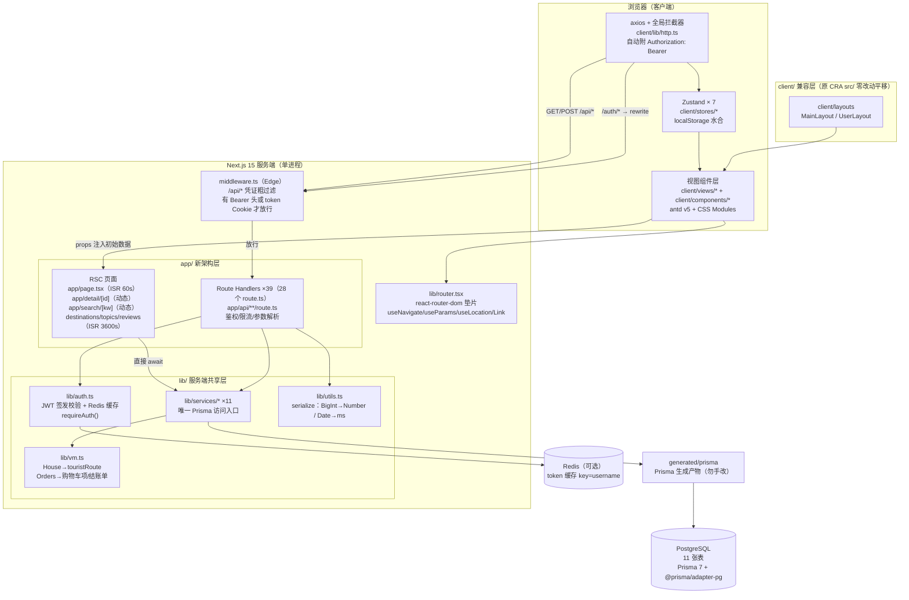
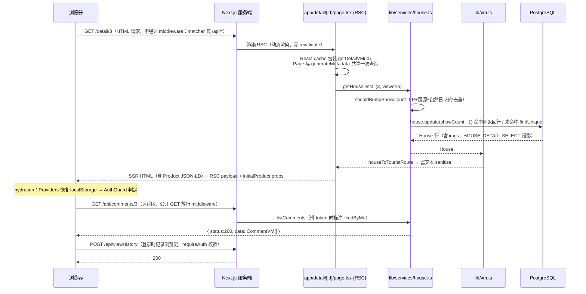

# 01-系统架构

> 项目：react-travel ｜ 版本：v1.0 ｜ 生成日期：2026-10-05 ｜ 依据：源码分析

## 1. 整体架构总览

react-travel 是一个 **Next.js 15 App Router 全栈单体**：浏览器发出的每一个请求都进入同一个 Node 进程（开发期 `next dev`，生产期 `next start` 或 standalone 的 `server.js`），由 Next.js 的文件系统路由决定它是被 React Server Components（RSC）渲染成 HTML，还是被 `app/api/**` 下的 Route Handler 处理成 JSON 响应。数据层统一收敛到 PostgreSQL（Prisma ORM），可选 Redis 承担"服务端 token 注销"职责。

整体分层自上而下为五层：

1. **接入层**：`middleware.ts`（Edge Runtime）对 `/api/:path*` 做凭证粗过滤；`next.config.js` 的 `rewrites` 把旧路径 `/auth/:path*` 映射到 `/api/auth/:path*`。
2. **页面层（RSC 优先）**：`app/**/page.tsx`。内容页（首页/详情/搜索/目的地/专题/游记）是 async Server Component，服务端直取数据；交互页（购物车/下单/订单/个人中心/收藏）是 `"use client"` 薄壳，仅包一层 `AuthGuard` 后渲染 `client/views/**`。
3. **API 层**：`app/api/**/route.ts`，共 28 个端点文件（39 个导出 Handler），负责参数解析、鉴权（`requireAuth`）、限流、调用服务层、组装响应。
4. **服务层**：`lib/services/*.ts`（11 个文件）封装全部 Prisma 查询；`lib/vm.ts` 把数据库行转换为前端期望的视图模型（touristRoute / shoppingCartItem / checkout order）；`lib/utils.ts` 提供统一响应函数与 BigInt/Date 序列化。
5. **数据层**：`generated/prisma`（Prisma 7 生成客户端）+ `@prisma/adapter-pg` 驱动适配器 → PostgreSQL；`lib/auth.ts` 内的可选 Redis（ioredis）用于 token 缓存与注销。

客户端一侧的分层则为：`client/views`（页面组件）→ `client/components`（通用组件）→ `client/stores`（7 个 Zustand store）→ axios（`client/lib/http.ts` 全局拦截器自动附带 Bearer token）→ 回到服务端 API。

## 2. 双层结构与迁移策略详解

### 2.1 双层架构图

### 2.2 迁移背景与双层成因

项目的前身是两个独立部署：CRA SPA（`react-scripts 5.0.1` + `react-router-dom@6` + Redux Toolkit）与 Egg.js 后端（MySQL/Sequelize + egg-jwt，13 个 `/api/*` POST 接口）。仓库根的 `NEXT_MIGRATION_PLAN.md` 完整记录了迁移决策，其中与本仓库现状直接相关的结论是：

- **数据库从 MySQL 切换为 PostgreSQL**，ORM 统一为 Prisma；密码保留 `md5(password + salt)` 以兼容存量用户（后来在 `lib/password.ts` 演进为 bcrypt 新账 + md5 存量的双轨校验）。
- **前端不重写**：CRA 的 `src/` 整体平移为 `client/`，通过两条关键兼容技术实现零改动运行（见 2.3）。
- **后端按前端实际路径重建**：Egg 的 `/api/house/hot`、`/api/orders/addOrder` 等 13 个 POST 接口，被重建为前端 slice 实际调用的 RESTful 形状（`/api/touristRoutes`、`/api/shoppingCart/items` 等），并新增 imooc 视图模型适配层 `lib/vm.ts`。
- **原计划的 Redux Toolkit 并未保留**：最终代码中客户端状态管理落地为 Zustand（`client/stores/`），这是迁移计划与实际落地的差异点，以源码为准。

### 2.3 兼容层的三根支柱

兼容层之所以能"零改动"，靠的是三处基础设施，修改它们必须同步评估全部旧组件：

1. **路由垫片 `lib/router.tsx`**：旧组件大量使用 `useNavigate / useParams / useLocation / Link / Navigate`，该文件基于 `next/navigation` 提供同名同签名的 API。细节包括：`useNavigate` 内做 `normalizePath`（`/signIn` → `/signin` 大小写归一，且不能用 `next.config.js` 的 `redirects` 实现——Next 的 redirects 匹配大小写不敏感，会命中 `/signin` 自身造成无限重定向，`next.config.js` 底部注释明确记载了这一坑）；`useParams` 对 Next 已解码的参数做 `safeDecode` 兜底（`client/lib/slugMap.ts`，解码失败不抛 URIError）；`useLocation` 刻意不用 `useSearchParams()` 以规避构建期 Suspense 边界要求，`search` 直接读 `window.location.search`；`BrowserRouter/Routes/Route` 导出为空占位组件防止旧引用崩溃。
2. **静态资源 CRA 语义**：`next.config.js` 配置 `images.disableStaticImages: true`，并用 webpack 规则把 `png/jpe?g/gif/svg/ico` 按 `asset/resource` 处理（产物 `static/media/[name].[hash:8][ext]`），使 `import bg1 from "xxx.jpg"` 返回 URL 字符串；`types/assets.d.ts` 提供对应模块类型声明。这样 `client/views/home/HomePage.tsx` 顶部三张轮播图的 `` 无需任何改造。
3. **路径 rewrite**：`next.config.js#rewrites` 把 `/auth/:path*` → `/api/auth/:path*`。旧登录/注册表单（`client/views/signIn/SignInForm.tsx`、`client/views/register/RegisterForm.tsx`）请求 `/auth/login`、`/auth/register` 即被透明转发到新 Route Handler。

### 2.4 hydration 与路由兼容处理

SSR 环境下旧 SPA 代码会遭遇两类崩溃点，项目在 `app/providers.tsx` 与各 store 中做了系统性防御：

- **localStorage 水合时序**：`useUserStore` 的 token 初始为 `null`，真实值要等 `Providers` 的 `useIsomorphicLayoutEffect`（服务端降级为 `useEffect`）调用 `_hydrate()` 从 localStorage 的 `travel_user` 键恢复；`hydrateOrderStore()` 同理恢复 `travel_order`。用 layout effect 是为了保证水合一定早于所有子组件的被动 effect。两个 store 都有 `hydrated` 布尔位，`AuthGuard`（`app/_components/AuthGuard.tsx`）必须等 `hydrated === true` 才判定登录态——否则首帧 token 为 null 会把已登录用户误踢到登录页（水合竞态），这是旧迁移方案（redux-persist + PersistGate）在新架构下的等价重写。
- **受保护页守卫**：`AuthGuard` 无 token 时 `router.replace("/signin")`，替换了原 CRA 的 `PrivateRoute`/`Navigate` 组件。`/orderSuccess` 没有用 AuthGuard，而是校验 `useOrderStore.currentOrder.state === "Completed"`，非支付完成状态重定向回 `/placeOrder`，防止手动输入 URL 看到假成功页。
- **antd v5 SSR**：根布局 `app/layout.tsx` 用 `<AntdRegistry>` 包裹 `<Providers>`，服务端抽取 CSS-in-JS 样式；`ConfigProvider` 注入中文 locale 与品牌主题（colorPrimary `#0e7490`，与 `client/styles/tokens.css` 设计令牌同源）。
- **StrictMode 双跑防御**：开发模式 effect 双跑会造成重复请求/重复写入，代码用三处 ref 守卫：`HomePage` 的 `recommendedFetched`、`DetailPage` 的 `reportedView`（浏览历史上报）、以及 `client/lib/http.ts` 拦截器的 `installed` 标志（防 HMR 重复注册）。

## 3. 一次请求的端到端数据流

以"用户访问详情页 `/detail/3`，未登录"为例（RSC 直取链路 + 客户端交互链路）：

两条铁律贯穿该数据流：**其一**，HTML 请求不经过 `middleware.ts`（`config.matcher` 只有 `/api/:path*`），页面级登录控制完全交给客户端 AuthGuard；**其二**，RSC 直取与 API 回退共用同一个 `lib/services` 函数（如首页 `getHomeCollections` 同时被 `app/page.tsx` 与 `app/api/productCollections/route.ts` 调用），当 DB 异常时 RSC 捕获异常并降级为"不传 props"，客户端 store 会自动走 `/api/*` 链路兜底——这是全项目最重要的可靠性设计。

## 4. 关键设计决策与设计模式

| 决策 | 位置 | 动机与代价 |
|---|---|---|
| RSC 直取 + 客户端回退双链路 | `app/page.tsx`、`app/detail/[touristRouteId]/page.tsx`、`app/search/[keywords]/page.tsx` 等 | SEO 与首屏直出；DB 挂掉时页面不 500。代价：每个视图组件都要实现 `initialXxx?` 可选 props 与 store 双数据源合并（如 `SearchPage` 的 `injectedActive` 判定） |
| 视图模型适配层（Adapter 模式） | `lib/vm.ts` | PG 的 `House/Orders` 与前端期望的 imooc 形状（`touristRoute/shoppingCartItem/order`）字段名完全不同，适配层让前端零改动。`houseToCardRoute` 进一步裁剪富文本大字段，减小 RSC props 序列化体积 |
| 单一数据源服务层（Facade 模式） | `lib/services/*` | RSC 与 Route Handler 共用查询逻辑，杜绝两处实现漂移；`buildWhere` 让列表与计数共用 where，保证分页自洽 |
| 统一响应与序列化 | `lib/utils.ts` 的 `json()/errMsg()/apiError()/serialize()` | Prisma 的 BigInt 字段（`publishTime` 等）无法被 `Response.json` 序列化，`serialize` 递归转 Number/毫秒；`apiError` 对客户端脱敏 500 细节 |
| Edge 粗过滤 + Handler 细校验（双层鉴权） | `middleware.ts` + `lib/auth.ts#requireAuth` | Edge Runtime 跑不了 `jsonwebtoken`（Node crypto），middleware 只检查"是否携带 Bearer 头或 token Cookie"，真正的签名校验与 Redis 存在性校验在 Node 侧 Handler 完成 |
| 优雅降级链 | `lib/auth.ts`（无 Redis 跳过存在性校验）、`lib/rate-limit.ts`（内存限流单实例够用）、`lib/prisma.ts`（dev 才开 query 日志） | Redis 故障时 fail-open 只信 JWT 签名；明确注释"多实例部署需换 Redis"，留出演进路径 |
| 价格快照 + advisory lock | `lib/services/cart.ts`、`lib/services/orders.ts` | 下单/支付时固化 `amount/houseName/houseCover`，防止房源改价污染历史订单；`pg_advisory_xact_lock(userId)` 串行化"查重→插入"防快速双击重复加购（注释说明不能用唯一约束：会阻断同一房源再次购买） |
| 请求序号守卫（防竞态） | `useProductDetailStore`、`useProductSearchStore`、`useOrderStore`、`useHotKeywords` | 快速切换关键词/详情/翻页时，迟到响应不得覆盖新数据（`seq !== xxxSeq` 丢弃） |
| ISR 分级缓存 | 首页 `revalidate = 60`；目的地/专题/游记 `revalidate = 3600`；详情与搜索刻意动态渲染 | 详情页浏览量需实时自增、搜索词多变，注释明确"不设 revalidate"的理由 |
| 生成代码隔离 | `generated/prisma/` + `tsconfig.exclude` + `lib/prisma.ts` 相对路径导入 | Prisma 7 新 `prisma-client` 生成器产物，重装依赖自动再生成；业务代码只经 `lib/prisma.ts` 单例引用 |

## 5. 新代码放置约定（维护者必读）

1. **新页面**：落在 `app/<path>/page.tsx`。内容型页面写 async RSC + `export const revalidate`，数据经 `lib/services` 直取后以 props 注入 `client/views` 对应视图组件；交互型页面写 `"use client"` 薄壳 + `AuthGuard` + `client/views` 组件。公开页记得补 metadata（或 `generateMetadata`）。
2. **新接口**：`app/api/<domain>/route.ts`，导出与 HTTP 方法同名的函数。鉴权接口开头三件套：`requireAuth` → `rateLimit` → 参数钳制；响应一律走 `lib/utils.ts` 的 `json/errMsg/apiError`。
3. **新数据访问**：只写在 `lib/services/*.ts`，RSC 与 API 共用；禁止在 `app/` 页面组件或 Route Handler 里直接 `import { prisma }` 写查询（现有例外：`app/api/commons/hotKeywords/route.ts` 与 `app/sitemap.ts` 为轻量直查，属历史遗留风格，新代码不建议效仿）。
4. **新客户端状态**：`client/stores/` 新增 zustand store 并在 `client/stores/index.ts` 导出；涉及登录态的持久化必须带 `hydrated` 位并在 `Providers` 水合。
5. **旧组件改造**：`client/` 内组件可逐步把 `lib/router.tsx` 的垫片 API 替换为原生 `next/navigation`（README 记载的长期方向），替换完成后从垫片移除对应导出；但在垫片彻底退役前，不要删除其任何导出，`client/App.module.css` 等被根布局引用的文件同理。
