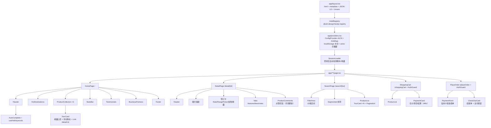
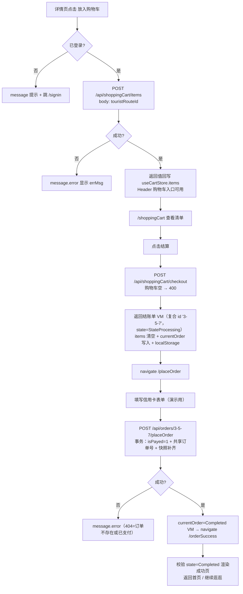

# 02-页面设计

> 项目：react-travel ｜ 版本：v1.0 ｜ 生成日期：2026-10-05 ｜ 依据：源码分析

## 1. 路由与页面总表

站点共 17 条页面路由（不含 API）。`app/` 层的 `page.tsx` 只负责数据获取与元信息，真正的 UI 全部渲染 `client/` 兼容层的视图组件——下表"渲染方式"列即标注了这一归属。

| 路由 | 渲染方式 | 页面组件（client/） | 数据来源 | 守卫 | 缓存策略 |
|---|---|---|---|---|---|
| `/` | RSC（首页） | `client/views/home/HomePage.tsx` | RSC 直取 `getHomeCollections()`，回退 `/api/productCollections` | 公开 | ISR，`revalidate = 60` |
| `/detail/[touristRouteId]` | RSC（动态） | `client/views/detail/DetailPage.tsx` | RSC 直取 `getHouseDetail(id, ip)`，回退 `/api/touristRoutes/:id` | 公开 | 动态（浏览量需实时） |
| `/search/[keywords]` | RSC（动态） | `client/views/search/Searchpage.tsx` | RSC 直取 `searchHouses/countHouses`，回退 `/api/touristRoutes?keyword=` | 公开 | 动态（词多变） |
| `/destinations` | RSC | `client/views/destinations/DestinationsPage.tsx` | `listDestinations()`，回退 `/api/destinations` | 公开 | ISR 3600s |
| `/topics` | RSC | `client/views/topics/TopicsPage.tsx` | `listTopics()`，回退 `/api/topics` | 公开 | ISR 3600s |
| `/reviews` | RSC | `client/views/reviews/ReviewsPage.tsx` | `listReviews()`，回退 `/api/reviews` | 公开 | ISR 3600s |
| `/about` | 客户端 | `client/views/about/AboutPage.tsx` | 纯静态数据（团队/价值观写死在组件内） | 公开 | 静态 |
| `/help` | 客户端 | `client/views/help/HelpPage.tsx` | 静态 FAQ 数据（4 类手风琴） | 公开 | 静态 |
| `/signin` | 客户端 | `client/views/signIn/SignInPage.tsx` + `SignInForm.tsx` | `POST /auth/login`（rewrite） | 已登录自动跳首页 | 静态 |
| `/register` | 客户端 | `client/views/register/RegisterPage.tsx` + `RegisterForm.tsx` | `POST /auth/register`（rewrite） | 公开 | 静态 |
| `/shoppingCart` | 客户端 + AuthGuard | `client/views/shoppingCart/ShoppingCart.tsx` | `GET /api/shoppingCart` | 登录 | 动态 |
| `/placeOrder` | 客户端 + AuthGuard | `client/views/placeOrder/PlaceOrder.tsx` | `useOrderStore.currentOrder` + `POST /api/orders/:id/placeOrder` | 登录 + 有结算单 | 动态 |
| `/orderSuccess` | 客户端 | `app/orderSuccess/page.tsx`（直接写在 app 层） | `useOrderStore.currentOrder` | 订单状态校验（非 AuthGuard） | 动态 |
| `/orders` | 客户端 + AuthGuard | `client/views/orders/OrdersPage.tsx` | `GET /api/orders?type=&pageNum=` | 登录 | 动态 |
| `/orders/[orderId]` | 客户端 + AuthGuard | `client/views/orders/OrderDetailPage.tsx` | `GET /api/orders/:id` | 登录 | 动态 |
| `/personal` | 客户端 + AuthGuard | `client/views/personal/PersonalPage.tsx` | `POST /api/user/detail`、`/api/user/edit`、`GET /api/viewHistory` | 登录 | 动态 |
| `/favorites` | 客户端 + AuthGuard | `client/views/favorites/FavoritesPage.tsx` | `GET /api/favorites?pageNum=` | 登录 | 动态 |
| 404 | — | `app/not-found.tsx`（"页面去火星了"） | — | 公开 | — |

路由层增强文件：`app/detail/[touristRouteId]/loading.tsx` 与 `app/search/[keywords]/loading.tsx` 提供路由切换骨架（antd `Spin`）；`app/error.tsx`（根错误边界，含"重试/返回首页"）、`app/global-error.tsx`（根布局崩溃兜底，自带 `<html>`）、`app/not-found.tsx`；`/detail` 的 `layout.tsx` 是刻意的直通布局，注释说明 metadata 必须由 `page.tsx` 的 `generateMetadata` 独家提供（避免 layout 与 page 不共享 React cache 导致重复查库）。`/orders`、`/personal`、`/shoppingCart` 等受保护页各自有轻量 `layout.tsx`，仅声明静态 metadata（如"我的订单 - 小叶旅游网"）。

## 2. 布局体系

项目未使用路由组（route groups）做布局，而是沿用 CRA 时代的两个"手工布局组件"，由各页面自行包裹：

- **MainLayout**（`client/layouts/mainLayout/MainLayout.tsx`）：`Header + 内容区 + Footer` 三段式。被首页以外的绝大多数页面使用（`DetailPage`、`SearchPage`、`ShoppingCart`、`PlaceOrder`、`OrdersPage`、`PersonalPage`、`FavoritesPage`、`OrderDetailPage`、`OrderSuccess`）。首页 `HomePage` 因为要在 Header 与内容之间插入全幅 Hero，自行组装 `Header/Footer` 而不套 MainLayout；`DestinationsPage/TopicsPage/ReviewsPage/AboutPage/HelpPage` 同样自行组装。
- **UserLayout**（`client/layouts/userLayout/UserLayout.tsx`）：登录/注册共用，品牌渐变背景 + 居中白卡片，含"✈ 小叶旅游网"logo 与"返回首页"链接（走 `lib/router.tsx` 的 `Link`）。
- **Header**（`client/components/header/Header.tsx`）：双栏结构。主栏含品牌按钮、AutoComplete 搜索框（`useHotKeywords` 联想，300ms 防抖，热词前缀 "🔥 "）、用户区（登录后 antd Dropdown：个人中心/我的订单/我的收藏/购物车/退出登录）；导航栏含 8 个主导航（首页 + 周末游/跟团游/自由行/私家团/酒店+景点/当地玩乐/定制游，全部跳 `/search/<slug>`）与 5 个内容页入口（目的地/旅游专题/用户游记/关于我们/帮助中心）。active 高亮逻辑：当前路径恰为某分类 slug 的搜索页时高亮该 tab，否则"首页"兜底高亮。
- **Footer**（`client/components/footer/Footer.tsx`）：产品/服务/关于三栏站内链接（`/search/group`、`/destinations`、`/help` 等），修复了旧实现"全是无 href 的 `<a>`"导致内容页无法站内到达的问题。

antd 与 App Router 的集成方式集中在根布局：`app/layout.tsx` 以 `<AntdRegistry><Providers>…</Providers></AntdRegistry>` 包裹全站——AntdRegistry 负责服务端样式抽取；`app/providers.tsx`（`"use client"`）内是 `ConfigProvider`（zhCN locale + 品牌主题 token：colorPrimary/colorInfo/colorLink `#0e7490`、borderRadius 8、Collapse 白底）嵌 `AntdApp`（提供 `App.useApp()` 的 message 上下文）嵌 `SessionLoader`（登录态存在时自动拉购物车与收藏）。

## 3. 核心页面布局与交互

### 3.1 首页（`/` → `HomePage.tsx`）

自上而下七个区块：① 全幅沉浸式 Hero 轮播（3 张背景图 `client/assets/images/carousel_*.jpg`，5.5s 自动切换 + 圆点指示器 + SVG 弧形过渡，叠加 AutoComplete 大搜索框与"大家都在搜"8 个快捷词 chips，点击跳 `/search/<slug>`）；② HotDestinations 热门目的地横向滚动轨道（10 个渐变色卡片：三亚/云南/北京…，左右箭头按滚动位置显隐）；③ 推荐产品集合 ×3（`ProductCollection`：爆款推荐/新品上市/国内游推荐，各 9 张 `TourCard`，标题色条分别为橙/青/绿）；④ StatsBar 信任数据（1200+ 线路、98% 好评率等，IntersectionObserver 触发 rAF 数字滚动动画）；⑤ Testimonials 用户好评（3 条静态推荐语）；⑥ BusinessPartners 合作品牌；⑦ Footer。数据策略：RSC 注入 `initialCollections` 时直接渲染（SSR HTML 已含内容，无 loading 态）；否则 `useRecommendStore.fetchRecommendProducts()` 回退，经 ref 守卫防 StrictMode 双跑。

### 3.2 线路详情页（`/detail/[id]` → `DetailPage.tsx`）

两栏布局（Row/Col，lg=13/11）。左栏图片画廊：主图 + 缩略图行，`activeImg` state 切换主图，图片懒加载（`loading="lazy"`）。右栏吸顶预订卡：标题、Rate 评分（disabled allowHalf）、价格行（¥ xx /人起）、出发地/行程天数/行程类型信息行、出行日期 RangePicker（纯展示，未参与下单参数）、"放入购物车"主按钮（独立 `adding` loading，未登录先 `message.warning("请先登录")` 并跳 `/signin`；成功后 message 提示，`useCartStore.addShoppingCartItem` 内部已把最新购物车行回写 store）与收藏心形按钮（`useIsFavorited` 订阅全局收藏集合，红心高亮，`toggleFavorite` 乐观更新）。下方 Tabs 四页：产品特色/费用说明/预订须知（三个富文本区块，`dangerouslySetInnerHTML` 渲染——服务端已用 `sanitizeRichText` 净化）与用户评价（`ProductComments` 组件）。挂载副作用：非 RSC 注入时 `fetchProductDetail`；评论始终客户端拉取（点赞态依赖登录者）；登录态下 POST `/api/viewHistory` 上报浏览史（ref 守卫同一房源只报一次）。

### 3.3 搜索页（`/search/[keywords]` → `Searchpage.tsx`）

左右两栏（lg=6/18）：左 `FilterArea` 价格区间筛选（InputNumber 最/最高价 + 确定/重置）；右排序栏（antd `Segmented`：综合推荐/价格从低到高/价格从高到低/最新上架）+ `ProductList` 卡片网格与分页。数据流是全站最精巧的"RSC 首屏 + 客户端接管"模式：`injectedActive = !clientMode && initialKeyword === keywords && Array.isArray(initialProducts)`，即 URL 关键词与服务端注入一致且用户尚未交互时直接渲染注入数据；一旦翻页/筛选/排序，`setClientMode(true)` 后数据源切到 `useProductSearchStore`（`searchProduct` 携带 sortBy/priceMin/priceMax 调 `/api/touristRoutes`，从 `x-pagination` 响应头解析分页）。关键词解析经 `client/lib/slugMap.ts`：URL 只出现英文 slug（`weekend/group/sanya/japan` 等 25 个），`resolveKeyword` 映射回中文（如 `group → 跟团游` 走 tripType 精确匹配语义），手动输入中文搜索则原样编码进 URL，两向兼容。

### 3.4 购物车与下单（`/shoppingCart`、`/placeOrder`、`/orderSuccess`）

购物车页左 16/24 为 `ProductList`（数据 `useCartStore.items` 的 `touristRoute` 字段），右 8/24 为 `Affix` 吸顶的 `PaymentCard`：合计原价与折后价、清空（`DELETE /api/shoppingCart/items/(1,2,3)`）与结算（`POST /api/shoppingCart/checkout`，成功后 navigate `/placeOrder`）两按钮，错误经 Alert 显式提示避免空列表被误读。下单页左半 `PaymentForm`（信用卡卡号/有效期/CVC 表单——源码注释记载原 `react-payment-inputs` 在 Next 生产构建下 CSS 加载失败，改用 antd Form 等价替身，不采集真实卡信息），右半 `CheckOutCard` 结账单表格；支付按钮调 `useOrderStore.placeOrder`（`POST /api/orders/:id/placeOrder`，id 为 checkout 返回的 "3-5-7" 复合 id），成功跳 `/orderSuccess`。成功页校验 `currentOrder.state === "Completed"` 后展示 Result 成功图标 + 订单号 + 逐项金额与实付总额，提供"返回首页/继续逛逛"。三页共同依赖 `hydrated` 位防 localStorage 未恢复时的误判。

### 3.5 订单/个人中心/收藏

`OrdersPage`：Tabs 全部/待支付（type=0）/已支付（type=1）+ Pagination（每页 5 条），订单卡优先展示快照字段（`houseCover/houseName/amount`），提供查看详情、已支付的"再次预订"、待支付的"去支付"与 Popconfirm"取消订单"（`DELETE /api/orders/:id`）。`PersonalPage`：头像/资料表单（编辑态 `editUserInfo` 走 `POST /api/user/edit`）+ Tabs 浏览历史列表（`GET /api/viewHistory`）。`FavoritesPage`：收藏网格 + 分页 + 删除（走 `useFavoriteStore.remove` 保证全局收藏集合同步，列表卡片心形不残留）。

## 4. 组件树

## 5. Zustand 状态管理设计

7 个 store 全部位于 `client/stores/`，经 `index.ts` 桶导出。与 CRA 时代的 Redux Toolkit 相比，去掉了 action/reducer 样板与 redux-persist，改为"store 内聚异步 action + 手工 localStorage 水合"：

| Store | 关键 state | 关键 action | 持久化与防御 |
|---|---|---|---|
| `useUserStore` | token/username/avatar/phone/sign、loading、error、hydrated | `signIn`（POST `/auth/login` 后 `getMe` 补全资料）、`getMe`、`editUserInfo`、`logOut`（清空购物车缓存 + 通知服务端 Redis 删 token，失败不阻塞）、`_hydrate` | localStorage `travel_user`；`hydrated` 位防首帧误判 |
| `useCartStore` | items（shoppingCartItem VM）、loading、error | `getShoppingCart`、`addShoppingCartItem`（返回值直接回写 items）、`checkout`（清空 items + `setCurrentOrder` 交接给订单 store）、`clearShoppingCartItem` | 401 时自动 `logOut + resetOrder` 联动登出 |
| `useOrderStore` | currentOrder、myOrders/myOrdersTotal、hydrated | `placeOrder`（复合 id 支付）、`getMyOrders`（`myOrdersSeq` 序号丢弃迟到响应）、`removeOrder`、`resetOrder`、`hydrateOrderStore` | localStorage `travel_order` 持久化结算单，刷新 `/placeOrder` `/orderSuccess` 不丢 |
| `useProductDetailStore` | data、comments（CommentVM[]） | `fetchProductDetail`、`fetchProductComments`（先清旧房源评论防串页） | `detailSeq/commentsSeq` 双序号守卫 |
| `useProductSearchStore` | data、pagination、hasSearched | `searchProduct`（空关键词直接给空结果防卡 loading；解析 `x-pagination` 头，JSON.parse 异常兜底 null） | `searchSeq` 守卫 |
| `useRecommendStore` | productList | `fetchRecommendProducts` | — |
| `useFavoriteStore` | ids（houseId 集合）、pending | `load`（登录后由 Providers 拉一次 `/api/favorites/ids`）、`toggle`（乐观更新+失败回滚+pending 合并并发）、`remove`、`reset`；派生 hook `useIsFavorited(houseId)` 返回稳定布尔 | 避免每张卡片各发请求/各自 useState 导致状态打架 |

水合时序约定（维护必读）：`Providers` 在 `useIsomorphicLayoutEffect` 里调用 `_hydrate()` 与 `hydrateOrderStore()`；任何依赖登录态/订单态的判定必须等 `hydrated === true`（`AuthGuard`、`PlaceOrderPage`、`OrderSuccessPage` 均如此）。`SessionLoader` 监听 `hydrated && token` 变化，登录会话内统一预取购物车与收藏 id 集合。

## 6. 关键 UI 交互流程：加入购物车 → 结算 → 支付

其余值得记录的交互细节：评论点赞与回复均走"乐观更新 + 失败回滚"（`ProductComments.tsx`），未登录点击给出明确提示而非静默；`TourCard` 的收藏按钮 `stopPropagation` 防触发卡片跳转；`Header` 的联想下拉与首页 Hero 共用 `useHotKeywords`（卸载时 `seqRef++` 丢弃在途响应）；`OrdersPage` 的 `getMyOrders` 用模块级 `myOrdersSeq` 防快速切 tab 时旧数据覆盖新 tab。
