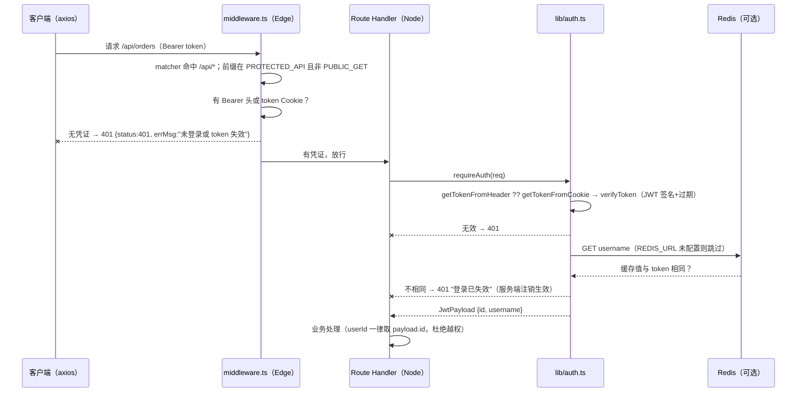

# 03-接口设计

> 项目：react-travel ｜ 版本：v1.0 ｜ 生成日期：2026-10-05 ｜ 依据：源码分析

## 1. API 总体约定

全部后端接口为 Next.js Route Handlers，物理位置 `app/api/**/route.ts`，共 14 个业务域、28 个端点文件（39 个导出 Handler）。请求先经过 `middleware.ts`（`config.matcher = ["/api/:path*"]`）做凭证粗过滤，再进入 Handler。全站接口遵循以下约定（均为源码行为，非人为规范）：

- **认证方式**：`Authorization: Bearer <jwt>`（主要）或 `token` Cookie（备用）。Edge 中间件只判断"是否携带凭证"，真正的签名校验与 Redis 存在性校验由 Handler 内 `requireAuth()`（`lib/auth.ts`）完成，返回 `JwtPayload { id, username }` 或 401 Response。
- **响应格式**：成功一般 `{ status: 200, .../data }`（继承原 Egg 的 `{status, data}` 风格）；部分 imooc 形状接口（购物车、线路列表）返回裸数组/裸对象。错误统一 `{ status: <http码>, errMsg: "<中文文案>" }`，由 `lib/utils.ts` 的 `errMsg()` 产出；未捕获异常经 `apiError()` 脱敏为 500"服务器内部错误，请稍后重试"（完整堆栈只进服务端日志）。
- **序列化**：所有响应经 `serialize()`（BigInt→Number、Date→毫秒时间戳），因为 `Response.json` 无法直接序列化 Prisma 的 BigInt 字段。
- **限流**：`lib/rate-limit.ts` 内存固定窗口。写接口（评论/点赞/收藏）`WRITE_LIMIT` 每用户 20 次/分钟；登录/注册 `AUTH_LIMIT` 8 次/分钟（登录按"用户名+IP"、注册按 IP 维度）。命中返回 429 + `Retry-After` 头。
- **分页**：请求 `pageNum/pageSize`（搜索接口兼容 `pageNumber`），响应侧 `parsePage()` 钳制 pageSize ∈ [1,100]、pageNum ≥ 1；搜索列表通过 `x-pagination` 响应头返回 `{currentPage,pageSize,totalCount,totalPages}`。
- **幂等约定**：收藏/点赞的重复写（Prisma P2002）与重复删（P2025）均返回 200 幂等语义，不做报错。
- **方法兼容**：多数接口同时导出 GET/POST 或 POST/DELETE 别名（如 `/api/touristRoutes/[id]` 的 GET 与 POST 等价、`/api/orders/[id]` 的 DELETE 与 POST 等价），用于兼容原 Egg 全 POST 的旧调用习惯。

## 2. API 端点总表

### 2.1 认证与用户

| 方法 | 路径 | 用途 | 关键入参 | 响应要点 | 鉴权 |
|---|---|---|---|---|---|
| POST | `/api/auth/register`（`/auth/register` 经 rewrite） | 注册 | `username|email`(3-20字符)、`password`(6-20)、`confirmPassword?`、`avatar?/phone?/sign?` | `{status:200, id, username, avatar, phone, sign, createTime, token}`；重名→400"用户已经存在"（预查 + P2002 双保险） | 公开（IP 限流 8/min） |
| POST | `/api/auth/login`（`/auth/login` 经 rewrite） | 登录 | `username|email`、`password` | 同上含 token；凭据错误→401"用户名或密码错误" | 公开（用户名+IP 限流） |
| POST | `/api/auth/logout` | 退出（删 Redis token） | 无 body | `{status:200, data:"ok"}` | requireAuth |
| POST | `/api/user/detail` | 当前用户信息 | 无 body | `{status:200, id, username, avatar, phone, sign, createTime}`（`serializeUser` 剥离 password） | requireAuth |
| POST | `/api/user/edit` | 改资料 | `avatar?(≤2000)`、`phone?(≤20)`、`sign?`（stripHtml 后 ≤300） | `{status:200, data: userVM}` | requireAuth |

### 2.2 线路（房源）与内容

| 方法 | 路径 | 用途 | 关键入参 | 响应要点 | 鉴权 |
|---|---|---|---|---|---|
| GET | `/api/touristRoutes` | 搜索/列表 | `keyword`、`tripType`、`pageNumber|pageNum`、`pageSize`、`priceMin/priceMax`、`sortBy∈{recommended,price-asc,price-desc,newest}` | touristRoute VM 裸数组 + `x-pagination` 头；非法 sortBy 回落 recommended | 公开 |
| POST | `/api/touristRoutes` | 同上（原 Egg 形状） | body：`houseName|keyword`、`tripType`、`code`、`startTime/endTime`、价格区间、分页 | `{status:200, data: rows}` | 公开 |
| GET/POST | `/api/touristRoutes/[id]` | 详情 | 路径 id | touristRoute 完整 VM（features/fees/notes 已净化）；400 无效 id / 404 不存在；浏览量按 IP+房源+自然日去重自增 | 公开 |
| GET | `/api/productCollections` | 首页三推荐集合 | 无 | `[{id,title,touristRoutes: CardVM×9}]`（爆款/新品/国内游） | 公开 |
| GET | `/api/destinations` | 目的地列表 | 无 | `{status:200, data: Destination[]}`（sortOrder 升序） | 公开 |
| GET | `/api/topics` | 专题列表（含线路卡） | 无 | `{status:200, data: Topic[]}`（topicHouses.house 含 id/name/price/首图） | 公开 |
| GET | `/api/reviews` | 游记列表 | `pageNum/pageSize`（默认 100） | `{status:200, data: Review[]}`（user 含 username/avatar/sign，createTime 为毫秒） | 公开 |
| GET | `/api/commons/citys` | 城市数据 | 无 | `{status:200, data: citys[]}`；转发 `CITYS_API` 外部接口（fetch 缓存 1 天），外部不可达→500 | 公开 |
| GET | `/api/commons/hotKeywords` | 热词/联想 | 无 → showCount Top10；`?keyword=` → 模糊 Top8（剔 %_\ 通配符，限长 30） | `{status:200, data: [{id,name}]}` | 公开 |

### 2.3 互动（评论/点赞/收藏/浏览史）

| 方法 | 路径 | 用途 | 关键入参 | 响应要点 | 鉴权 |
|---|---|---|---|---|---|
| GET | `/api/comments/[houseId]` | 房源评论列表 | 路径 houseId；`pageNum/pageSize` | `{status:200, data: CommentVM[]}`：顶级评论 + replies（≤20）+ likeCount；带有效 token 时标注 `likedByMe` | 公开（GET 放行） |
| POST | `/api/comments` | 发评论/回复 | `houseId`、`comment|msg`（stripHtml ≤500）、`parentId?` | `{status:200, data}`（含 user 头像昵称） | requireAuth + 20/min |
| POST | `/api/commentLikes` | 点赞 | `commentId` | `{status:200, data:{liked:true}}`；P2002 → 已点赞 | requireAuth + 20/min |
| DELETE | `/api/commentLikes` | 取消点赞 | `commentId` | `{liked:false}`；P2025 幂等 | requireAuth |
| GET | `/api/favorites` | 收藏列表/单查 | 无参 → `{list,total}`；`?houseId=` → `{favorited}` | `{status:200, data}` | requireAuth |
| GET | `/api/favorites/ids` | 收藏 id 集合 | 无 | `{status:200, data:{ids:[houseId]}}`（列表/详情批量判态，避免 N+1 请求） | requireAuth |
| POST | `/api/favorites` | 收藏 | `houseId` | `{favorited:true}`；P2002 → 已收藏 | requireAuth + 20/min |
| DELETE | `/api/favorites` | 取消收藏 | `houseId`（DELETE body） | `{favorited:false}`；P2025 幂等 | requireAuth + 20/min |
| GET | `/api/viewHistory` | 浏览历史 | `pageNum/pageSize`（默认 20） | `{status:200, data:{list,total}}`（含房源 + 首图） | requireAuth |
| POST | `/api/viewHistory` | 记录浏览 | `houseId` | `{status:200, data:null}`；upsert 语义（存在则刷新 viewTime） | requireAuth |

### 2.4 购物车与订单

购物车的存储语义：**购物车 = Orders 表中 `isPayed=0` 的行**（`lib/services/cart.ts` 顶部注释），支付即把行置 `isPayed=1` 并生成订单号，无独立购物车表。

| 方法 | 路径 | 用途 | 关键入参 | 响应要点 | 鉴权 |
|---|---|---|---|---|---|
| GET | `/api/shoppingCart` | 购物车列表 | 无 | `{shoppingCartItems: CartItemVM[]}`（`orderToCartItem`：id/originalPrice/discountPresent/touristRoute） | requireAuth |
| POST | `/api/shoppingCart/items` | 加购 | `touristRouteId` | 最新 `{shoppingCartItems}`；事务 + `pg_advisory_xact_lock(userId)` 防双击重复；同时写入价格快照；房源不存在→500"房源不存在" | requireAuth |
| DELETE | `/api/shoppingCart/items/(1,2,3)` | 删除条目 | 路径段括号逗号 id 列表 | 最新 `{shoppingCartItems}`；仅删本人未支付行 | requireAuth |
| POST | `/api/shoppingCart/checkout` | 结算 | 无（对当前购物车整体） | 结账单 VM：`{id:"3-5-7"(复合), orderNumber, state:"StateProcessing", orderItems:[...]}`；空车→400 | requireAuth |
| POST | `/api/orders/[id]/placeOrder` | 支付（imooc 主链路） | 路径 id 为复合 id（按 `[-,]` 拆分） | Completed 结账单 VM；事务批量 `isPayed=1` + 共享订单号 + 快照补齐；已支付/不存在→404"订单不存在或已完成支付" | requireAuth |
| GET | `/api/orders` | 我的订单 | `type`(0 待支付/1 已支付/其他=全部)、`pageNum/pageSize` | `{status:200, list, total}`（含 house + 首图 + 快照字段） | requireAuth |
| POST | `/api/orders` | 直接下单 | `houseId|id` | `{status:200, data}`（isPayed=0 + 快照） | requireAuth |
| GET | `/api/orders/[id]` | 订单详情 | 路径 id | `{status:200, data}`（含完整房源 imgs）；越权/不存在→404 | requireAuth |
| DELETE/POST | `/api/orders/[id]` | 删除订单 | 路径 id | `{status:200, data: 删除条数}`（`deleteMany` 带 userId 防越权） | requireAuth |
| POST | `/api/orders/pay` | 支付（原 Egg 形状） | `id` | `{status:200, data:{id, orderNumber}}`；幂等（已支付不刷新订单号）；404 不存在 | requireAuth |
| GET/POST | `/api/orders/has` | 是否已有订单 | GET `?id=` 或 POST `{id|houseId}` | `{status:200, data: order|null}` | requireAuth |

## 3. 认证鉴权机制



要点展开：

1. **双层防御的原因**：`middleware.ts` 运行在 Edge Runtime，无法使用依赖 Node crypto 的 `jsonwebtoken`，所以只做"是否携带凭证"的粗过滤（源码注释原文）；`PROTECTED_API` 前缀列表覆盖 `/api/user/detail|edit`、`/api/orders`、`/api/shoppingCart`、`/api/comments`（写）、`/api/commentLikes`、`/api/favorites`、`/api/viewHistory`；`PUBLIC_GET` 正则放行 `GET /api/comments/<houseId>`（评论列表是公开的，POST 发评论仍需登录）。
2. **JWT 与 Redis 的角色**：token 由 `signToken` 签发（payload `{id, username}`，有效期 `JWT_EXPIRES_IN` 默认 7d）；登录/注册成功后 `cacheToken` 写 Redis（key=username，TTL 与 JWT 有效期对齐——注释解释"否则缓存先过期会导致 JWT 未到期却被强制重新登录"）。未配置 `REDIS_URL` 时跳过存在性校验（`isTokenCached` 直接返回 true），Redis 故障时同样 fail-open 只信 JWT 签名。`/api/auth/logout` 调 `clearToken` 删 key 实现"服务端即时注销"，这就是 Redis 存在的全部意义。
3. **密钥治理**：`lib/auth.ts` 与 `lib/utils.ts` 在生产运行时（`NODE_ENV=production` 且非 `phase-production-build`）检测到 `JWT_SECRET`/`SALT` 缺失或仍是示例值 `xiaoye` 时直接 throw 拒绝启动，避免静默回退到可预测密钥；开发环境回退 `xiaoye` 并打印警告。
4. **密码校验**：`lib/password.ts#verifyPassword` 按存储哈希前缀分流——`$2` 开头走 bcrypt（注册新账户 12 轮），否则按存量 `md5(password+SALT)` 比对。登录时用户不存在也对 `DUMMY_BCRYPT_HASH` 做一次比较，使"账号不存在"与"密码错误"耗时一致，防时序枚举用户名。
5. **客户端配合**：`client/lib/http.ts#installAuthInterceptor` 在 `app/providers.tsx` 挂载时给 axios 默认实例装请求拦截器，从 `useUserStore` 读取 token 自动附 `Authorization: Bearer`；`useUserStore.logOut` 在清本地态的同时 POST `/api/auth/logout`（失败静默）。

## 4. 错误处理约定

- **参数校验失败** → 400 + 中文 errMsg（如"用户名和密码必填""无效的房源 id""两次密码不一致"）；数字入参一律 `Number()` 后判 `Number.isFinite`，非法值视为未传或回落默认。
- **未认证** → 401 `{status:401, errMsg:"未登录或 token 失效"}`（middleware 与 requireAuth 文案一致）。
- **业务资源不存在** → 404（房源/订单）；其中 placeOrder 把"结账期间被他人支付"归为正常分支返回 404 而非 500（`app/api/orders/[id]/placeOrder/route.ts` 注释）。
- **限流** → 429 + `Retry-After`，文案"请求过于频繁，请 Ns 后重试"。
- **未捕获异常** → 500 脱敏文案，`console.error("[api:500]", e)` 留痕；`lib/prisma.ts` 的 PrismaClient 在生产只记 error 级日志。
- **外部依赖失败**：`/api/commons/citys` 外部接口不可达返回 500"获取城市数据失败"（迁移文档记载 `apis.imooc.com` icode 失效时该接口在无外网环境 500，可用 `CITYS_API` 环境变量应急切换）。
- **部分 POST 加购的特殊透传**：只透传明确业务文案（"房源不存在"），其余一律脱敏为"加入购物车失败"（`app/api/shoppingCart/items/route.ts`）。

## 5. 核心接口示例

### 5.1 登录（含 rewrite 链路）

请求：`POST /auth/login`（rewrite → `/api/auth/login`）

```json
// 请求体（前端 SignInForm 发送，字段名叫 email 但装的是用户名）
{ "email": "旅行达人小王", "password": "123456" }
```

成功响应 200：

```json
{
  "status": 200,
  "id": 1,
  "username": "旅行达人小王",
  "avatar": "/travel-img/1535713875002-d1d0cf377fde.webp",
  "phone": "13800138001",
  "sign": "走过30个国家，用脚步丈量世界 🌍",
  "createTime": 1757000000000,
  "token": "eyJhbGciOiJIUzI1NiIsInR5cCI6IkpXVCJ9..."
}
```

处理链：`authRateLimit("login:用户名+IP", 8/min)` → `getUserByUsername` → `verifyPassword`（bcrypt 或 md5 双轨 + DUMMY 时序对齐）→ `signToken({id, username})` → `cacheToken` 写 Redis → `json({...serializeUser, token})`。失败分支：缺字段 400；凭据错 401"用户名或密码错误"；限流 429。

### 5.2 线路搜索（imooc 形状 + x-pagination）

请求：`GET /api/touristRoutes?keyword=丽江&pageNumber=1&pageSize=10&sortBy=price-asc&priceMax=3000`

成功响应 200，响应头 `x-pagination: {"currentPage":1,"pageSize":10,"totalCount":1,"totalPages":1}`，body 为 touristRoute VM 裸数组：

```json
[
  {
    "id": 2,
    "title": "云南大理+丽江6日跟团游·洱海环游+玉龙雪山",
    "description": "纯玩无购物2-8人精品小团。洱海吉普旅拍、玉龙雪山大索道、丽江古城深度游",
    "price": 2880,
    "originalPrice": 3980,
    "discountPresent": 28,
    "rating": 4.9,
    "travelDays": "6",
    "tripType": "跟团游",
    "departureCity": "昆明",
    "touristRoutePictures": [{ "id": 1, "url": "/travel-img/1558005137-d9619a5c539f.webp" }],
    "features": "<h3>行程亮点</h3><ul><li>2-8人精品小团</li>…</ul>",
    "fees": "<h3>费用包含</h3>…",
    "notes": "<p>1. 高原地区…</p>",
    "coupons": null,
    "points": null
  }
]
```

处理链（`app/api/touristRoutes/route.ts`）：`parseParams` 解析并白名单收敛 `sortBy` → `Promise.all([searchHouses, countHouses])`（两者共用 `buildWhere`：关键词五字段 OR 大小写不敏感 contains 且剔 `%_\` 通配符限长 50、tripType 精确、价格 gte/lte）→ `rows.map(houseToTouristRoute)`（VM 转换 + 富文本净化）→ 手工 `new Response(JSON.stringify(data))` 以附加 `x-pagination` 头。分页自洽的关键注释：**列表与计数共用同一份 where/orderBy，避免"固定 8 条 + 全表总数"式分页错乱**。
