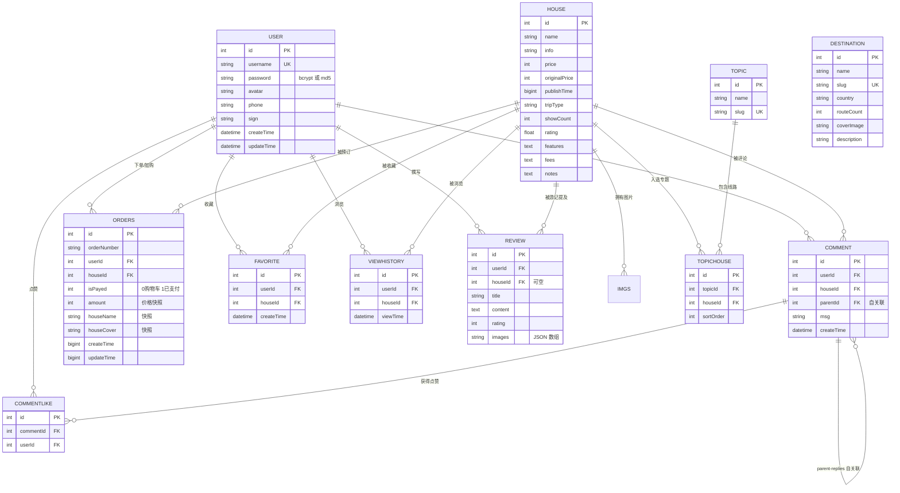

# 04-数据模型

> 项目：react-travel ｜ 版本：v1.0 ｜ 生成日期：2026-10-05 ｜ 依据：源码分析

## 1. 存储方案总述

项目使用 **PostgreSQL 单库**（连接串 `DATABASE_URL`，默认库名 `travel`），数据访问统一经 **Prisma 7**：`prisma/schema.prisma` 定义 11 个模型，`generator client` 使用新版 `prisma-client` 生成器，产物输出到 `generated/prisma/`（该目录在 `.gitignore`/`tsconfig.exclude` 语义上属生成物，由 `pnpm postinstall` 的 `prisma generate` 自动再生成，**禁止手改**）。运行时通过 `@prisma/adapter-pg` 驱动适配器连接：`lib/prisma.ts` 创建 `PrismaPg({ connectionString })` 并注入 `PrismaClient`，开发环境开启 `query/error/warn` 三级日志，生产仅 `error`；客户端实例以 `globalThis` 单例缓存，避免 dev 热重载反复建连。

建表方式为 `prisma db push`（`pnpm prisma:push`，项目未使用 migrations 目录）；历史数据从旧 Egg/MySQL 的 `egg_house` 库迁移由 `scripts/migrate-mysql-to-pg.ts` 完成（按 User→House→Imgs→Comment→Orders 依赖序迁移，保留原主键并重置 PG 自增序列，幂等可 `--force` 重灌）。演示数据由 `prisma/seed.ts` 灌入：8 个用户（bcrypt 哈希，密码 `123456`）、32 条线路（含 4 张图/条的 imgs、HTML 富文本 features/fees/notes）、每线 3-5 条评论、18 个目的地、若干专题（经 TopicHouse 关联线路）、游记、收藏与浏览历史、以及带快照的订单若干。

**命名与实体的对应关系**值得特别注意：数据库层沿用旧 Egg 时代的表语义——`House` 实际是"旅游线路"（前端概念 touristRoute）、`Orders` 表同时承担"购物车行（isPayed=0）"与"订单（isPayed=1）"两种角色、`Imgs` 是线路图库。这层"名实错位"是历史包袱，业务含义由 `lib/services/*` 与 `lib/vm.ts` 的转换函数翻译，维护者阅读 schema 时务必以此节为准。

时间字段分两类存储：旧字段（`House.publishTime/startTime/endTime`、`Orders.createTime/updateTime`）为 `BigInt` 毫秒时间戳（与旧 Sequelize getter 语义对齐，出 API 时靠 `serialize()` 转数字）；新字段（`User.createTime`、`Comment.createTime`、`Favorite.createTime` 等）为 `DateTime @default(now())`。两种形态在 `lib/utils.ts#serialize` 与各 service 的 `.getTime()` 中统一转毫秒输出。

## 2. Prisma 模型详解

### 2.1 User（用户）

| 字段 | 类型 | 约束 | 说明 |
|---|---|---|---|
| id | Int | PK，autoincrement | 用户 id，JWT payload 携带 |
| username | String | unique，VarChar(20) | 用户名（前端表单字段名叫 email，实存用户名） |
| password | String | VarChar(64) | bcrypt 哈希（新）或 md5(password+SALT)（存量）；对外永不出现在响应（`serializeUser` 剥离） |
| avatar | String? | Text | 头像 URL |
| phone | String? | VarChar(20) | 手机号 |
| sign | String? | VarChar(300) | 个性签名；入库存前 stripHtml |
| createTime / updateTime | DateTime | default(now()) / @updatedAt | 账户时间 |
| 反向关系 | — | — | comments / orders / favorites / viewHistories / commentLikes / reviews |

### 2.2 House（旅游线路，前端名 touristRoute）

| 字段 | 类型 | 约束 | 说明 |
|---|---|---|---|
| id | Int | PK | 线路 id（详情页路由参数） |
| name | String? | VarChar(100) | 线路标题，搜索主字段 |
| info | String? | VarChar(300) | 简介，搜索命中字段之一；VM 里作 description |
| address | String? | VarChar(200) | 目的地地址（搜索命中字段） |
| price / originalPrice | Int? | — | 现价 / 划线价；VM 据此算 discountPresent 折扣百分比 |
| publishTime / startTime / endTime | BigInt? | — | 上架/成团起止毫秒时间戳；newest 排序用 publishTime |
| cityCode | String? | — | 城市码（如 SYX/DLU），原 citys 接口遗留筛选字段 |
| showCount | Int? | default(0) | 浏览量；详情页按 IP+房源+自然日去重自增；recommended 排序与热词 Top10 依据 |
| travelDays | Int? | — | 行程天数（VM 转字符串） |
| tripType | String? | VarChar(30) | 行程类型：周末游/跟团游/自由行/私家团/酒店+景点/当地玩乐/定制游；分类导航精确匹配字段 |
| departureCity | String? | VarChar(30) | 出发城市（搜索命中字段） |
| rating | Float? | default(4.5) | 评分 |
| features / fees / notes | String? | Text | 详情页三个富文本区块（HTML）；出 API 前 `sanitizeRichText` 白名单净化 |
| 反向关系 | — | — | imgs / comments / orders / favorites / viewHistories / reviews / topicHouses |

### 2.3 Imgs（线路图片）

| 字段 | 类型 | 约束 | 说明 |
|---|---|---|---|
| id | Int | PK | — |
| url | String? | VarChar(500) | 图片地址（种子数据为 `/travel-img/<unsplash-id>.webp` 本地路径） |
| houseId | Int? | FK → House.id | 所属线路；列表场景一律 `take:1` 只取封面（`HOUSE_CARD_SELECT`/`CART_INCLUDE`） |
| createTime | DateTime? | — | — |

### 2.4 Comment（评论，支持两级回复）

| 字段 | 类型 | 约束 | 说明 |
|---|---|---|---|
| id | Int | PK | — |
| userId | Int? | FK → User.id | 评论人 |
| houseId | Int? | FK → House.id | 被评论线路；`@@index([houseId])` 支撑按房源查列表 |
| parentId | Int? | FK → 自身（"CommentReplies" 自关联） | 顶级评论为 null；`@@index([parentId])` 支撑查回复；service 层回复上限 take 20 防拖垮接口 |
| msg | String? | VarChar(500) | 纯文本内容，入库前 stripHtml（React 渲染时再转义，避免双重转义） |
| createTime | DateTime? | — | 列表按其倒序 |
| 反向关系 | — | — | replies / likes（CommentLike） |

### 2.5 Orders（购物车行 + 订单，一体两面）

| 字段 | 类型 | 约束 | 说明 |
|---|---|---|---|
| id | Int | PK | 行 id；结账后复合 id 由若干行 id 用 `-` 连接 |
| orderNumber | String? | VarChar(64) | 支付时生成（`lib/order.ts#genOrderNo`：前缀+时间戳+8 位随机 hex，消除同毫秒碰撞）；同一批支付行共享一个号 |
| userId / houseId | Int? | FK → User.id / House.id | 归属 |
| isPayed | Int | default(0) | 0=购物车行（待支付），1=已支付订单；`@@index([userId, isPayed])` 支撑购物车/订单 Tab 查询 |
| amount | Int? | — | 下单/支付时点价格快照（防房源改价污染历史订单） |
| houseName | String? | VarChar(100) | 房源名快照 |
| houseCover | String? | VarChar(500) | 封面图快照 |
| createTime / updateTime | BigInt? | — | 毫秒时间戳（加购/支付时 `BigInt(Date.now())` 手工写入） |

并发控制说明（来自 `lib/services/cart.ts` 注释）：Orders 无法用 `(userId, houseId, isPayed)` 唯一约束防重复加购——会阻断同一房源的"再次购买"；因此 `addCartItem` 用 `pg_advisory_xact_lock(userId)` 把同一用户的"查重→插入"串行化。

### 2.6 Favorite / ViewHistory / CommentLike（三张用户行为表）

| 模型 | 字段 | 约束 | 说明 |
|---|---|---|---|
| Favorite | id, userId(Int, FK), houseId(Int, FK), createTime | `@@unique([userId, houseId])` | 收藏；唯一约束使重复收藏抛 P2002（接口幂等处理为"已收藏"） |
| ViewHistory | id, userId(Int, FK), houseId(Int, FK), viewTime(DateTime, default now) | `@@unique([userId, houseId])` | 浏览历史；`recordView` 用 upsert——已存在则刷新 viewTime，即"每用户每线路只留最近一次" |
| CommentLike | id, commentId(Int, FK→Comment), userId(Int, FK→User) | `@@unique([commentId, userId])` | 评论点赞；Comment 端 `_count.likes` 统计数，`likedByMe` 按 userId 过滤 likes 判定 |

### 2.7 Destination / Topic / TopicHouse / Review（内容运营四表）

| 模型 | 关键字段 | 约束/索引 | 说明 |
|---|---|---|---|
| Destination | name(VarChar 50), slug(unique, VarChar 50), coverImage, description(VarChar 500), country/province(VarChar 30), routeCount(default 0), sortOrder(default 0) | slug 唯一 | 目的地攻略页数据源；slug 与 `client/lib/slugMap.ts` 的映射表对应（sanya/yunnan…18 个） |
| Topic | name, slug(unique), coverImage, tagline(VarChar 200), description(Text), sortOrder | slug 唯一 | 旅游专题页数据源（亲子游/蜜月旅行…） |
| TopicHouse | topicId(FK→Topic), houseId(FK→House), sortOrder | `@@unique([topicId, houseId])` | 专题-线路多对多桥表，sortOrder 控制专题内展示顺序 |
| Review | userId(FK, 必填), houseId(FK, 可空), title(VarChar 100), content(Text), rating(Int, default 5), coverImage, images(Text，存 JSON 字符串数组), createTime | — | 用户游记；`listReviews` 输出时 createTime 转毫秒，前端 `JSON.parse(images)` 还原图组 |

## 3. ER 图

注：`Destination` 与上述模型无外键关系（纯运营内容，经 slug 与前端搜索联动）；图中重复列出的 DESTINATION 块仅为完整展示字段。Imgs 表因版面并入 House 关系说明（字段见 2.3 节表）。

## 4. 数据生命周期

- **产生**：线路/目的地/专题/游记由运营侧维护（当前以 `prisma/seed.ts` + `prisma/seed-data/*` 灌入，无后台管理界面 ⚠️ 待确认：源码中不存在任何线路 CRUD 管理端点，管理能力待确认是否走人工 SQL/脚本）；用户行为数据（收藏/浏览史/评论/点赞/订单）由各 API 在用户操作时产生。
- **更新**：`showCount` 在详情被访问时自增（IP 去重）；`ViewHistory.viewTime` 随重复浏览刷新（upsert）；`User` 资料经 `/api/user/edit` 更新（`@updatedAt` 自动）；订单行在支付事务中从 isPayed=0 → 1 并补齐快照。
- **终止/清理**：购物车行删除走 `removeCartItems`（仅本人未支付行）；订单取消即 `delOrder` 物理删除（`deleteMany` 带 userId 防越权）；收藏/点赞为物理删除（幂等）。**无任何软删除字段（deletedAt 等）与归档机制**——历史订单永久保留于 Orders 表。
- **一致性保障**：支付路径全部包在 `prisma.$transaction` 中（`payRows`/`payOrder`），updateMany 的 where 追加 `isPayed: 0` 保证并发下后到者不覆盖先到者写入的 orderNumber；快照补齐在事务内批量查 House 避免 N+1。
- **容量热点**：ViewHistory 每用户每线路仅一行（唯一约束 upsert），无膨胀风险；Comment.replies 单条上限 20 条由查询层防御；`lib/services/house.ts` 的浏览量去重 Map 上限 5 万条、`lib/rate-limit.ts` 桶上限 1 万条均为内存自清理，与 DB 无关。

## 5. 索引与查询路径对照

| 查询场景 | 服务函数 | 依赖的索引/约束 |
|---|---|---|
| 购物车列表 / 订单 Tab | `getCartRows` / `listOrders` | `Orders @@index([userId, isPayed])` |
| 我的订单分页计数 | `listOrders`/`countOrders` | `Orders @@index([userId, id])`（orderBy id desc） |
| 按线路查评论 | `listComments` | `Comment @@index([houseId])`；回复走 `@@index([parentId])` |
| 判断是否收藏 / 取消收藏 | `isFavorited` / `removeFavorite` | `Favorite @@unique([userId, houseId])`（复合唯一索引即查询路径） |
| 浏览史 upsert | `recordView` | `ViewHistory @@unique([userId, houseId])` |
| 点赞去重 | `likeComment`/`unlikeComment` | `CommentLike @@unique([commentId, userId])`（复合主键路径 `commentId_userId`） |
| 线路搜索/列表 | `searchHouses`/`countHouses` | 无专门索引（contains 全表扫描量级可控：种子 32 条 ⚠️ 待确认生产数据量下的索引策略） |
| 热词/推荐 | `hotKeywords`/`getHotHouses` | orderBy showCount desc（无索引，取 Top N 小表可接受） |

## 6. 维护注意事项

1. **勿改 `generated/prisma/`**：改模型一律改 `prisma/schema.prisma` 后执行 `pnpm prisma:push`（同步库结构）+ `pnpm prisma:generate`（重新生成，`postinstall` 也会自动跑）。
2. **BigInt 字段新增须过 `serialize()`**：凡是走 `json()`（内部调用 serialize）的响应自动转换；若像 `HOUSE_DETAIL_SELECT` 那样在投影里剔除 BigInt 字段（`app/api/touristRoutes/[id]/route.ts` 注释），则可免转换。
3. **快照字段是订单正确性的底线**：任何新的订单展示字段都应考虑写入 `Orders` 快照（amount/houseName/houseCover 模式），避免历史订单随 House 漂移。
4. **唯一约束与业务语义**：Favorite/ViewHistory/CommentLike 的复合唯一既是防重手段也是查询主路径；Orders 刻意**不设** (userId, houseId, isPayed) 唯一约束（允许再次购买），防重靠 advisory lock。
5. **种子脚本会清库**：`prisma/seed.ts` 的 `main()` 第一步按依赖序 `deleteMany` 全部 11 张表，生产环境严禁执行 `pnpm db:seed`。
