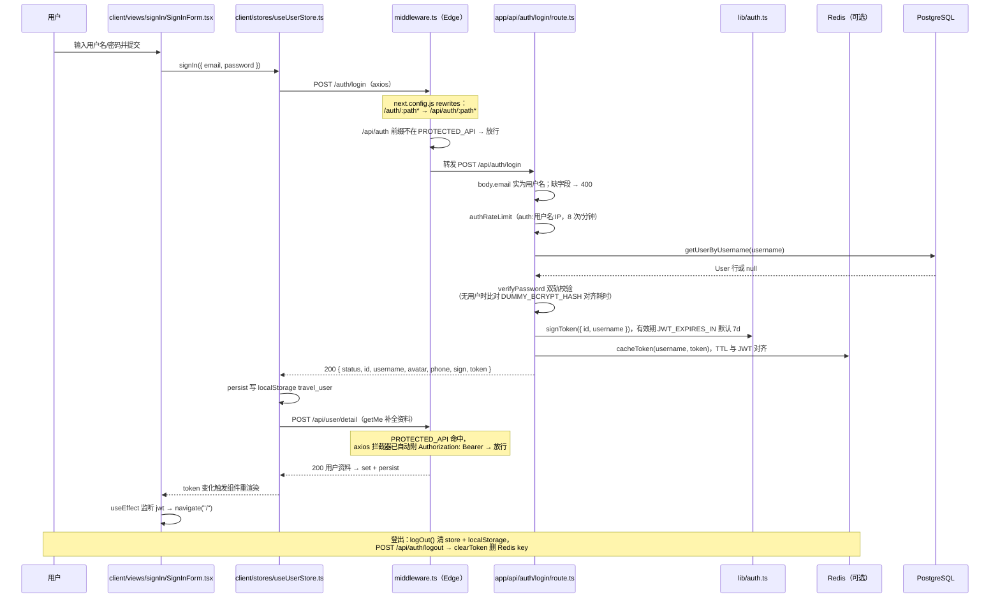
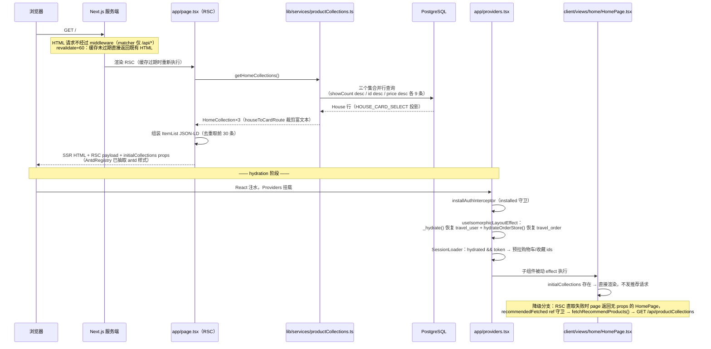
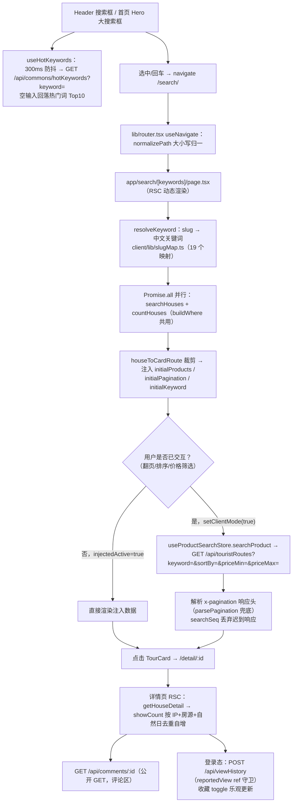
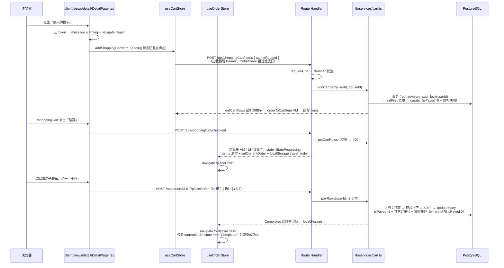
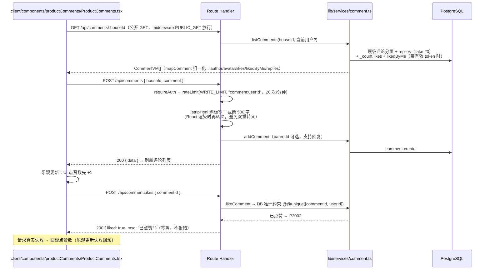

# 05-核心流程

> 项目：react-travel ｜ 版本：v1.0 ｜ 生成日期：2026-10-05 ｜ 依据：源码分析

## 1. 流程总览与贯穿性主线

前五篇文档描述的是静态结构：架构分层（《01-系统架构》）、页面与组件（《02-页面设计》）、接口契约（《03-接口设计》）、库表模型（《04-数据模型》）。本篇把这些静态零件串联成**动态行为**，选取五条覆盖全站的端到端流程，逐条给出时序图/流程图、分步说明与涉及文件清单。五条流程合计触达全部 28 个 route.ts 文件中的 18 个，剩余接口（注册、资料编辑、线路详情、收藏、订单列表/直接下单与目的地/专题/游记/城市等只读查询）链路简单，套用流程三的模式即可理解。

| # | 流程 | 核心链路 | 图型 |
|---|---|---|---|
| 一 | 登录与会话建立（含退出） | SignInForm → `/auth/login`（rewrite）→ JWT + Redis | 时序图 |
| 二 | SSR 数据获取与客户端 hydration | RSC 直取 → props 注入 → 水合 → 回退链路 | 时序图 |
| 三 | 线路浏览与搜索（含详情访问统计） | 热词联想 → slug 路由 → RSC 首屏 → 客户端接管 | 流程图 |
| 四 | 加购 → 结算 → 支付 → 订单（交易闭环） | advisory lock 加购 → 复合 id 结算 → 事务支付 | 时序图 |
| 五 | 评论与点赞互动（内容安全与幂等） | 限流 → stripHtml → 唯一约束幂等 | 时序图 |

无论哪条流程，都受三条**贯穿性主线**约束，读图前先建立这三个心智模型：

1. **双层鉴权**：`middleware.ts`（Edge Runtime）的 `config.matcher = ["/api/:path*"]` 决定它只拦 API 不拦页面；它按 `PROTECTED_API` 前缀列表做"是否携带 Bearer 头或 token Cookie"的粗过滤，真正的 JWT 签名校验与 Redis 存在性校验由各 Handler 内的 `requireAuth()`（`lib/auth.ts`）完成。登录/注册接口不在 `PROTECTED_API` 中，天然公开。
2. **双链路数据获取**：内容页由 RSC 在服务端直接 `await` 调用 `lib/services/*`，把结果以 props 注入客户端视图；一旦 RSC 直取失败（DB 不可用），页面不 500，而是降级为"不传 props"，由客户端 store 走 `/api/*` 回退链路——两条链路调用**同一个**服务函数，数据形状一致（见《01-系统架构》§3）。
3. **水合时序**：`app/providers.tsx` 在 `useIsomorphicLayoutEffect` 中调用 `useUserStore._hydrate()` 与 `hydrateOrderStore()` 从 localStorage 恢复登录态与结算单，并置位 `hydrated`；一切依赖登录态/订单态的判定（`AuthGuard`、`PlaceOrderPage`、`OrderSuccessPage`、`SessionLoader`）必须等 `hydrated === true`，否则首帧 null 会把已登录用户误踢回登录页（水合竞态，见《01-系统架构》§2.4）。

## 2. 流程一：登录 → 会话建立 → 受保护访问 → 退出

### 2.1 时序图

### 2.2 分步说明

1. **表单提交与字段名错位**：`SignInForm.tsx` 的表单字段名叫 `email`，但装入的是用户名——这是旧 imooc 前端的遗留约定，服务端以 `body.username ?? body.email` 兜底解析（`app/api/auth/login/route.ts` 第 12 行注释）。
2. **路径 rewrite**：请求打到 `/auth/login`，`next.config.js#rewrites` 透明转发到 `/api/auth/login`，旧前端 slice 零改动。`/api/auth` 前缀不在 `middleware.ts` 的 `PROTECTED_API` 列表里，登录请求不会被凭证粗过滤拦截。
3. **防爆破限流**：`authRateLimit(req, "login:用户名")` 以 `auth:<用户名>:<IP>` 为键做固定窗口限流（`AUTH_LIMIT` = 8 次/分钟，`lib/rate-limit.ts`）。用户名维度防单账号爆破，IP 维度防密码喷洒；命中返回 429 + `Retry-After`。
4. **密码双轨校验与防时序枚举**：`getUserByUsername` 查库后交给 `verifyPassword`（`lib/password.ts`）——存储哈希以 `$2` 开头走 bcrypt（12 轮，注册新账户），否则按存量 `md5(password + SALT)` 比对。关键防御：用户不存在时也对 `DUMMY_BCRYPT_HASH` 做一次真实 bcrypt 比较，使"账号不存在"与"密码错误"响应耗时一致，无法用时序差枚举用户名。
5. **签发与缓存 token**：`signToken({ id, username })` 产出 HS256 JWT（有效期读 `JWT_EXPIRES_IN`，默认 7d）；`cacheToken` 以 `username` 为 key 写 Redis，TTL 用 `parseExpiresToSeconds` 与 JWT 有效期严格对齐（注释解释：否则缓存先过期会导致 JWT 未到期却被强制重新登录）。未配置 `REDIS_URL` 时此步静默跳过。
6. **客户端会话落地**：`useUserStore.signIn` 先把 token 单独写入 localStorage 键 `travel_user`（此时资料字段为 null），随即调用 `getMe()`——POST `/api/user/detail` 显式携带 `Authorization: Bearer`，成功后把 username/avatar/phone/sign 补全进 store 并覆盖持久化。请求层面，`client/lib/http.ts#installAuthInterceptor` 已在 `app/providers.tsx` 挂载时给 axios 默认实例装好拦截器（`installed` 标志防 HMR 重复注册），此后所有客户端请求自动附带 token。
7. **登录后跳转**：`SignInForm` 的 `useEffect` 监听 jwt 从 null 变为有值，调 `navigate("/")` 回首页——`navigate` 来自 `lib/router.tsx` 垫片（大小写归一化等行为见《01-系统架构》§2.3）。同时 `SessionLoader`（`app/providers.tsx`）侦测到 `hydrated && token`，自动预拉购物车与收藏 id 集合，为后续页面免首载等待。
8. **受保护访问与登出**：此后每个受保护请求经历"middleware 粗过滤（有凭证即放行）→ `requireAuth` 细校验（验签 + Redis 存在性）"两道关卡。退出登录时 `useUserStore.logOut` 一次性完成四件事：清空自身 state、`useCartStore.setState({ items: [] })` 防止换账号瞬间闪现上一用户的购物车、删除 localStorage 键、POST `/api/auth/logout` 触发 `clearToken` 删 Redis key（失败静默，不阻塞本地登出）。Redis 在线的语义是**服务端即时注销**——旧 token 即使未过期也会在 `isTokenCached` 比对时被判"登录已失效"。

### 2.3 涉及文件清单

| 文件 | 角色 |
|---|---|
| `client/views/signIn/SignInForm.tsx` | 登录表单（字段名 email 实为用户名）、jwt 监听跳转 |
| `client/stores/useUserStore.ts` | signIn/getMe/logOut/_hydrate、localStorage `travel_user` 持久化 |
| `client/lib/http.ts` | axios 全局拦截器，自动附带 Bearer token |
| `next.config.js` | `/auth/:path*` → `/api/auth/:path*` rewrite |
| `middleware.ts` | PROTECTED_API 前缀粗过滤（auth 前缀放行） |
| `app/api/auth/login/route.ts` / `app/api/auth/logout/route.ts` | 登录（限流/双轨校验/签发/缓存）、登出（clearToken） |
| `app/api/user/detail/route.ts` | getMe 资料补全（serializeUser 剥离 password） |
| `lib/auth.ts` | signToken/verifyToken/requireAuth/cacheToken/clearToken |
| `lib/password.ts` | verifyPassword 双轨 + DUMMY_BCRYPT_HASH 时序对齐 |
| `lib/rate-limit.ts` | authRateLimit（8 次/分钟，用户名+IP 维度） |
| `lib/services/user.ts` | getUserByUsername |

## 3. 流程二：SSR/RSC 数据获取与客户端 hydration（以首页为例）

### 3.1 时序图

### 3.2 分步说明

1. **请求入口与缓存判定**：`GET /` 是 HTML 请求，`middleware.ts` 的 matcher 只含 `/api/:path*`，故不经过中间件。`app/page.tsx` 声明 `export const revalidate = 60`，Next 对该路由启用 ISR：60 秒内的请求直接复用已生成的静态 HTML（零 DB 查询）；过期后的第一个请求仍先返回旧 HTML，同时在后台重新执行 RSC 生成新版本（stale-while-revalidate 语义）。
2. **服务端直取**：RSC 内 `await getHomeCollections()`（`lib/services/productCollections.ts`）——该函数并行发起三个 `getCollectionHouses` 查询（爆款按 `showCount desc`、新品按 `id desc`、国内游按 `price desc`，各取 9 条），统一走 `HOUSE_CARD_SELECT` 投影（`lib/services/house.ts`）：只取卡片所需列，刻意排除 `publishTime` 等 BigInt 字段，从源头免掉 `serialize()` 转换；再经 `houseToCardRoute`（`lib/vm.ts`）裁剪富文本大字段，控制 RSC props 序列化体积。
3. **GEO 注入**：Page 组件把三个集合的线路去重后取前 30 条，生成 schema.org `ItemList` JSON-LD 随 HTML 输出，配合根布局的 Organization/WebSite 结构化数据（`lib/seo.ts#siteJsonLd`）供搜索引擎与 AI 助手抓取。
4. **响应形态**：浏览器收到完整 SSR HTML——`AntdRegistry`（`@ant-design/nextjs-registry`）已在服务端抽取 antd v5 的 CSS-in-JS 样式避免首屏闪烁；`initialCollections` 作为 props 序列化进 RSC payload， hydration 后客户端组件可零请求渲染。
5. **水合时序（本流程的精髓）**：React 注水时 `app/providers.tsx` 挂载，模块顶层先执行 `installAuthInterceptor()`；随后 `useIsomorphicLayoutEffect`（服务端降级为 `useEffect`，客户端用 `useLayoutEffect`）调用 `_hydrate()` 与 `hydrateOrderStore()`。选 layout effect 是刻意设计：它先于所有子组件的被动 effect 执行，保证任何子组件的 `useEffect` 读到的已是恢复后的登录态。
6. **会话续载**：`SessionLoader` 侦测 `hydrated && token`，自动调用 `getShoppingCart(jwt)` 与 `loadFavorites(jwt)`（`GET /api/shoppingCart`、`GET /api/favorites/ids`）——用户从别的页面带着登录态回到站点时，Header 购物车角标与卡片收藏红心无需等各页面自行拉取。
7. **客户端回退链路**：若第 2 步 DB 异常，`app/page.tsx` 的 try/catch 会 `console.warn` 后返回**不带 props** 的 `<HomePage />`，页面依然 200。此时 `HomePage` 检测 `initialCollections` 缺失，在 `recommendedFetched` ref 守卫（防 StrictMode 双跑重复请求）下调 `useRecommendStore.fetchRecommendProducts()` → `GET /api/productCollections`——该 Route Handler 与 RSC 调用同一个 `getHomeCollections()`，两条链路数据一致（见《03-接口设计》§2.2）。
8. **同模式的变体**：详情页（`app/detail/[touristRouteId]/page.tsx`）不设 revalidate 保持动态渲染，用 `React cache` 包装 `getDetailVM` 使 Page 与 `generateMetadata` 共享一次查询（浏览量只自增一次）；搜索页（`app/search/[keywords]/page.tsx`）注入 `initialProducts/initialPagination` 后由 `injectedActive` 判定客户端接管时机（流程三展开）。

### 3.3 涉及文件清单

| 文件 | 角色 |
|---|---|
| `app/layout.tsx` | 根布局：AntdRegistry + metadata + 站点 JSON-LD + Umami |
| `app/page.tsx` | 首页 RSC：revalidate=60、直取降级、ItemList JSON-LD |
| `lib/services/productCollections.ts` | getHomeCollections（RSC 与 API 共用的单一数据源） |
| `lib/services/house.ts` | getCollectionHouses、HOUSE_CARD_SELECT 投影 |
| `lib/vm.ts` | houseToCardRoute 视图模型裁剪 |
| `app/providers.tsx` | 拦截器安装、layout effect 水合、SessionLoader、antd 主题 |
| `client/views/home/HomePage.tsx` | initialCollections 直渲 / recommendedFetched 守卫回退 |
| `client/stores/useRecommendStore.ts` | fetchRecommendProducts（回退链路） |
| `app/api/productCollections/route.ts` | 客户端回退端点（同一服务函数） |
| `app/detail/[touristRouteId]/page.tsx`、`app/search/[keywords]/page.tsx` | 同模式变体：动态渲染 + React cache 共享查询 / 搜索首屏注入 |

## 4. 流程三：线路浏览与搜索（含详情页访问统计）

### 4.1 流程图

### 4.2 分步说明

1. **搜索联想**：Header 与首页 Hero 共用 `client/hooks/useHotKeywords.ts`——输入变化 300ms 防抖后请求 `/api/commons/hotKeywords?keyword=`（模糊 Top8，服务端剔除 `%_\` 通配符防 LIKE 退化）；输入为空时 `fetchHot()` 回落 showCount Top10 热词，下拉项统一加 "🔥 " 前缀。组件卸载时 `seqRef++` 丢弃在途响应。
2. **slug 路由**：确认搜索后跳转 `/search/<slug>`。URL 中只出现英文 slug（`weekend/group/sanya/japan` 等），由 `client/lib/slugMap.ts` 的 `resolveKeyword` 映射回中文关键词（`group → 跟团游` 走 tripType 精确匹配语义）；用户手动输入中文时原样 encodeURIComponent 进 URL，两向兼容。导航经 `lib/router.tsx` 垫片的 `useNavigate`，其 `normalizePath` 做大小写归一（`/signIn → /signin` 的坑位记录见 `next.config.js` 底部注释）。
3. **RSC 首屏**：搜索页是动态渲染（刻意不设 revalidate——搜索词多变，注释有说明）。Page 组件 `Promise.all` 并行调 `searchHouses`（默认推荐排序第 1 页，pageSize=10）与 `countHouses`，两者共用 `buildWhere`（`lib/services/house.ts`）：关键词限长 50、剔除 LIKE 通配符后对 name/info/address/departureCity 做大小写不敏感 contains、tripType 精确 equals、价格 gte/lte——列表与计数共用同一份 where 保证分页自洽。
4. **注入判定**：`Searchpage.tsx` 用 `injectedActive = !clientMode && initialKeyword === keywords && Array.isArray(initialProducts)` 判定数据源：URL 关键词与服务端注入一致且用户尚未交互时直接渲染注入数据（首屏零请求）；一旦翻页/排序/价格筛选，`setClientMode(true)` 后切到 `useProductSearchStore.searchProduct`。
5. **客户端接管后的搜索**：`searchProduct` 拼 `keyword/pageNumber/pageSize/sortBy/priceMin/priceMax` 请求 `GET /api/touristRoutes`，服务端按 `SORT_WHITELIST` 白名单收敛排序（非法值回落 recommended，防注入任意 orderBy），以裸数组 + `x-pagination` 响应头返回；客户端 `parsePagination` 对 JSON.parse 做兜底（异常返回 null），`searchSeq` 模块级序号丢弃快速操作下的迟到响应。
6. **进入详情页**：点击 `TourCard` 跳 `/detail/:id`（RSC 动态）。非法 id（非正整数）直接 `notFound()`；`getHouseDetail(id, viewerIp)` 先过 `shouldBumpShowCount` 去重（内存 Map，键 `房源:IP:自然日`，上限 5 万条清空重启）——命中则用一次 `house.update({ showCount: { increment: 1 } })` 合并"自增 + 读取"单往返，P2025（记录不存在）捕获后返回 null 走 404；当日已计则纯 `findUnique`。viewerIp 取 `x-forwarded-for` 首段（部署时反向代理必须覆写该头，见《06-部署运行》§6.2）。
7. **客户端补充请求**：详情页 HTML 直出后，评论区始终由客户端拉取（`GET /api/comments/:houseId`，点赞态依赖登录者所以不在 SSR 渲染）；登录态下 DetailPage 挂载时 POST `/api/viewHistory` 上报浏览史（`reportedView` ref 守卫同一房源只报一次）；收藏心形按钮走 `useFavoriteStore.toggle` 乐观更新（`pending` 合并并发、失败回滚）。
8. **SEO 元信息零额外开销**：`generateMetadata` 复用 React `cache` 包装的同一 `getDetailVM`——同一请求内 DB 只查一次、浏览量只自增一次，且 metadata 侧 catch 后回落通用标题，不因 DB 异常崩溃。

### 4.3 涉及文件清单

| 文件 | 角色 |
|---|---|
| `client/hooks/useHotKeywords.ts` | 搜索联想 hook（防抖 + seq 守卫） |
| `client/components/header/Header.tsx` | AutoComplete 搜索框与导航 |
| `client/lib/slugMap.ts` | slug ↔ 中文关键词映射与解析 |
| `lib/router.tsx` | useNavigate 垫片（normalizePath） |
| `app/search/[keywords]/page.tsx` | 搜索 RSC 首屏 + generateMetadata |
| `lib/services/house.ts` | buildWhere/searchHouses/countHouses/排序白名单 |
| `client/views/search/Searchpage.tsx` | injectedActive 双数据源判定 |
| `client/stores/useProductSearchStore.ts` | searchProduct + x-pagination 解析 + searchSeq |
| `app/api/touristRoutes/route.ts` | 搜索端点（裸数组 + x-pagination 头） |
| `app/detail/[touristRouteId]/page.tsx` | 详情 RSC（cache 共享查询、notFound、Product JSON-LD） |
| `lib/services/house.ts#getHouseDetail` | 浏览量去重自增（bumpKeys Map） |
| `app/api/comments/[houseId]/route.ts`、`app/api/viewHistory/route.ts` | 评论区与浏览史端点 |

## 5. 流程四：加入购物车 → 结算 → 支付 → 订单（交易闭环）

### 5.1 时序图

### 5.2 分步说明

1. **加购前置判定**：详情页预订卡的"放入购物车"按钮先看登录态——`useUserStore` 无 token 时 `message.warning("请先登录")` 并 `navigate("/signin")`；`adding` state 防止重复提交期间连点。
2. **服务端加购与并发防护**：`POST /api/shoppingCart/items` 经 requireAuth 后进入 `addCartItem`（`lib/services/cart.ts`）。先取房源快照（price/name/首图），房源不存在 throw "房源不存在"（Handler 对该文案白名单透传，其余异常脱敏为"加入购物车失败"）。核心事务内执行 `SELECT pg_advisory_xact_lock(${userId})` 把同一用户的"查重→插入"串行化——Orders 表刻意**不设** `(userId, houseId, isPayed)` 唯一约束（会阻断同一房源的再次购买），防双击重复加购只能靠锁（两处实现细节见注释：必须用 `$executeRaw` 而非 `$queryRaw`，因 `pg_advisory_xact_lock` 返回 void，Prisma 7 下 `$queryRaw` 反序列化会抛错）。
3. **购物车即未支付订单行**：加购落库为 Orders 表 `isPayed=0` 的行（购物车与订单一体两面，见《04-数据模型》§2.5），返回值是 `getCartRows` 的最新全量列表，经 `orderToCartItem`（`lib/vm.ts`）转成 imooc 形状的 `shoppingCartItem` 后整体回写 `useCartStore.items`。
4. **购物车页与清空**：`/shoppingCart` 左侧 `ProductList` 渲染 `items`，右侧 `Affix` 吸顶的 `PaymentCard` 展示合计。"清空"按钮调 `DELETE /api/shoppingCart/items/(1,2,3)`——路径段就是括号包裹的逗号 id 列表（imooc 约定），服务端 `removeCartItems` 的 `deleteMany` where 带 `userId, isPayed: 0` 双条件，仅删本人未支付行。
5. **结算（不落新表）**：`POST /api/shoppingCart/checkout` 只是**视图转换**：空车返回 400；否则 `ordersToCheckoutOrder(rows, "StateProcessing")` 把购物车行打包成结账单 VM——`id` 字段是各行 id 用 `-` 连接的复合串（如 `"3-5-7"`），供支付时拆回。客户端收到后做三件事：清空 `items`、`useOrderStore.setCurrentOrder(data)`（同步写 localStorage 键 `travel_order`）、`navigate("/placeOrder")`——持久化保证刷新 `/placeOrder` 不丢结算单。
6. **支付（状态机翻转）**：`POST /api/orders/3-5-7/placeOrder` 把复合 id 按 `[-,]` 拆回 `[3,5,7]` 交给 `payRows`。事务内五步：① `findMany` 读取本人行（空 → throw "订单不存在"，Handler 映射为 404 "订单不存在或已完成支付"——结账页停留期间被支付/清空属正常业务分支而非 500）；② 过滤 unpaid，全部已支付则幂等返回现有行；③ 订单号取"已有 orderNumber ?? `genOrderNo`"（`lib/order.ts`：时间戳 + 8 位随机 hex，消除同毫秒碰撞），同批次共享一个号；④ `updateMany` 的 where 追加 `isPayed: 0`——并发支付时后到的事务不会覆盖先到者写入的 orderNumber；⑤ 对快照缺失的行在事务内批量查 House 补齐 amount/houseName/houseCover（防 N+1，也修复历史数据）。
7. **成功页的状态校验**：`/orderSuccess` 没有用 AuthGuard 而是校验 `currentOrder.state === "Completed"`——非支付完成状态（含手动输入 URL、localStorage 被清）一律重定向回 `/placeOrder`，杜绝假成功页。页面渲染 Result 成功图标、订单号与逐项金额。
8. **旁路：待支付订单补支付**：`/orders` 列表对 `isPayed=0` 的历史行提供"去支付"，走 `POST /api/orders/pay`（原 Egg 形状，单行 `payOrder`），与 `payRows` 同套幂等/快照/并发防护逻辑；"取消订单"走 `DELETE /api/orders/:id`（`deleteMany` 带 userId 防越权，物理删除）。

### 5.3 涉及文件清单

| 文件 | 角色 |
|---|---|
| `client/views/detail/DetailPage.tsx` | 加购按钮（登录判定 + adding 防抖） |
| `client/stores/useCartStore.ts` | addShoppingCartItem/checkout/clearShoppingCartItem，401 联动登出 |
| `client/stores/useOrderStore.ts` | setCurrentOrder/placeOrder/localStorage `travel_order` |
| `app/api/shoppingCart/items/route.ts` | 加购端点（业务文案白名单透传） |
| `app/api/shoppingCart/route.ts`、`app/api/shoppingCart/items/[ids]/route.ts` | 购物车列表/删除（括号逗号 id 列表） |
| `app/api/shoppingCart/checkout/route.ts` | 结算（视图转换，不落新表，空车 400） |
| `app/api/orders/[id]/placeOrder/route.ts` | 支付端点（复合 id 拆分、404 语义） |
| `lib/services/cart.ts` | addCartItem（advisory lock）/payRows（事务五步） |
| `lib/services/orders.ts` | payOrder/addOrder/delOrder/listOrders（旁路与订单管理） |
| `lib/order.ts` | genOrderNo（时间戳 + 8 位随机 hex） |
| `lib/vm.ts` | orderToCartItem/ordersToCheckoutOrder（复合 id 组装） |
| `client/views/shoppingCart/ShoppingCart.tsx`、`client/views/placeOrder/PlaceOrder.tsx`、`app/orderSuccess/page.tsx` | 三个交易页面（PaymentCard/PaymentForm/状态校验） |

## 6. 流程五：评论与点赞互动（内容安全与幂等）

### 6.1 时序图

### 6.2 分步说明

1. **评论列表（公开读）**：详情页 `ProductComments` 组件挂载即拉 `GET /api/comments/:houseId`。该路径被 `middleware.ts` 的 `PUBLIC_GET` 正则 `/^\/api\/comments\/[^/]+$/` 显式放行——评论列表是公开内容，未登录也可读；但 `POST /api/comments` 仍会被中间件拦下要求凭证。服务层 `listComments` 一次组装：顶级评论按 `createTime` 倒序分页、每条的 replies 走 `@@index([parentId])` 查询且 `take 20` 防拖垮接口、`_count.likes` 统计点赞数；请求携带有效 token 时逐条标注 `likedByMe`（服务端按登录者判定，避免客户端重置后点赞态丢失）。
2. **客户端归一化**：`useProductDetailStore.mapComment` 把接口数据转成 `CommentVM`（author 兜底"匿名用户"、createTime 转本地日期、replies 递归映射），`commentsSeq` 序号守卫防止从详情 A 快速切到 B 时 A 的评论串页（fetch 前先清空旧评论）。
3. **发评论的三道内容安全闸**：`POST /api/comments` 依次经过 ① `requireAuth`（userId 一律取 token payload，杜绝伪造他人身份）；② `rateLimit(WRITE_LIMIT, "comment:<userId>")` 每用户 20 条/分钟防刷量；③ `stripHtml`（`lib/sanitize.ts`）剥离全部 HTML 标签并截断 500 字——评论是纯文本字段，React 渲染时自会转义，若存储侧再做转义会造成双重转义显示乱码（源码注释原意）。富文本是另一条链路：详情页 features/fees/notes 出库前已走 `sanitizeRichText` 白名单净化（`lib/vm.ts#houseToTouristRoute`），与评论的 stripHtml 策略互补（见《00-项目总览》§3"内容安全"行）。
4. **点赞的乐观更新与幂等**：前端点击后 UI 立即 +1（乐观更新），再发 `POST /api/commentLikes`；服务端 `likeComment` 插入 CommentLike 行，若已点过则触发 `@@unique([commentId, userId])` 唯一约束抛 P2002——Handler 捕获后**返回 200 "已点赞"**而非报错（幂等语义，见《03-接口设计》§1）。取消点赞同理：`DELETE` 遇 P2025（本就未点赞）返回 200 `{ liked: false }`。真实故障（非 P2002/P2025）才返回 500 并 `console.error` 留痕，前端回滚乐观 UI。
5. **浏览史/收藏同族**：本流程与"浏览史 upsert"（`ViewHistory @@unique([userId, houseId])`，重复浏览只刷新 viewTime）与"收藏 toggle"（`Favorite @@unique` + P2002 幂等）共用同一套"唯一约束兜底 + 幂等响应"模式，理解此流程即可举一反三。

### 6.3 涉及文件清单

| 文件 | 角色 |
|---|---|
| `client/components/productComments/ProductComments.tsx` | 评论区 UI（乐观更新 + 失败回滚 + 未登录提示） |
| `client/stores/useProductDetailStore.ts` | fetchProductComments/mapComment/commentsSeq 守卫 |
| `middleware.ts` | PUBLIC_GET 放行评论列表 GET |
| `app/api/comments/route.ts`、`app/api/comments/[houseId]/route.ts` | 发评论（限流/stripHtml）、评论列表 |
| `app/api/commentLikes/route.ts` | 点赞/取消点赞（P2002/P2025 幂等） |
| `lib/services/comment.ts` | addComment/listComments/likeComment/unlikeComment |
| `lib/sanitize.ts` | stripHtml（纯文本）/sanitizeRichText（富文本白名单） |
| `lib/rate-limit.ts` | WRITE_LIMIT（20 次/分钟） |
| `prisma/schema.prisma` | Comment 自关联、CommentLike/ViewHistory/Favorite 复合唯一约束 |

## 7. 流程共同防线小结

五条流程反复出现的横切机制，汇总如下（细节均已在前文展开，此处便于回查）：

- **鉴权**：Edge 粗过滤（`middleware.ts`）+ Node 细校验（`requireAuth`），userId 永远取自 token payload。
- **防刷**：`AUTH_LIMIT` 8 次/分钟（登录/注册，用户名+IP）、`WRITE_LIMIT` 20 次/分钟（评论/点赞/收藏）。
- **防竞态**：客户端序号守卫（`detailSeq`/`searchSeq`/`commentsSeq`/`myOrdersSeq`/`seqRef`）丢弃迟到响应；服务端 advisory lock（加购）与 `isPayed: 0` 条件更新（支付）保证并发正确。
- **防丢/防漂移**：localStorage 持久化 + `hydrated` 位（登录态与结算单）；订单快照字段（amount/houseName/houseCover）保证历史订单不随房源改价漂移。
- **防崩**：RSC 直取失败一律 try/catch 降级为客户端回退链路；`parsePagination`/`safeDecode` 等对异常输入兜底。
- **防注入/防 XSS**：排序白名单、LIKE 通配符剔除、关键词限长；stripHtml 与 sanitizeRichText 双策略内容净化。
