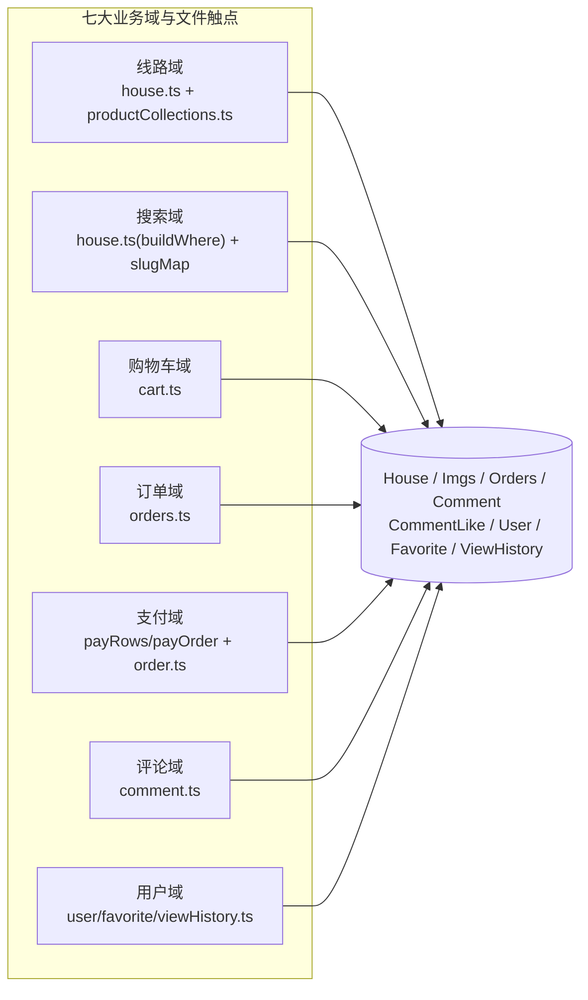

# 07-模块详解

> 项目：react-travel ｜ 版本：v1.1 ｜ 生成日期：2026-10-06 ｜ 依据：源码分析

## 1. 模块地图与阅读方式

本篇按业务域对项目做"逐域深读"：每个域给出页面层、API 层（Route Handler）、服务层（lib/services）与数据访问的完整清单表格，再对该域的核心机制做源码级走读。与既有各篇的分工是：《00-项目总览》《01-系统架构》讲全景与分层，《02-页面设计》讲组件树与交互，《03-接口设计》讲请求/响应契约，《04-数据模型》讲库表，《05-核心流程》讲端到端时序——本篇则是"以业务域为经、以四层文件为纬"的横切手册，读者想改动某个域时，可以从对应小节一次拿到该域全部触点文件。

业务域划分以源码实际形态为准，共七域：

| 业务域 | 页面（app/ 壳 → client/ 视图） | Route Handlers | 服务层 | 主数据表 |
|---|---|---|---|---|
| 线路（内容主干） | `app/detail/[touristRouteId]/page.tsx` → `client/views/detail/DetailPage.tsx`；`app/page.tsx` 首页推荐部分 | `/api/touristRoutes`、`/api/touristRoutes/[id]`、`/api/productCollections` | `lib/services/house.ts`、`lib/services/productCollections.ts` | House、Imgs |
| 搜索 | `app/search/[keywords]/page.tsx` → `client/views/search/Searchpage.tsx` | `/api/touristRoutes`（GET/POST）、`/api/commons/hotKeywords` | `lib/services/house.ts`（buildWhere/searchHouses/countHouses） | House |
| 购物车 | `app/shoppingCart/page.tsx` → `client/views/shoppingCart/ShoppingCart.tsx` | `/api/shoppingCart`、`/api/shoppingCart/items`、`/api/shoppingCart/items/[ids]`、`/api/shoppingCart/checkout` | `lib/services/cart.ts` | Orders（isPayed=0） |
| 订单 | `app/orders/page.tsx`、`app/orders/[orderId]/page.tsx` → `client/views/orders/*` | `/api/orders`、`/api/orders/[id]`、`/api/orders/has` | `lib/services/orders.ts` | Orders |
| 支付 | `app/placeOrder/page.tsx`、`app/orderSuccess/page.tsx` → `client/views/placeOrder/PlaceOrder.tsx` | `/api/orders/[id]/placeOrder`、`/api/orders/pay` | `lib/services/cart.ts#payRows`、`lib/services/orders.ts#payOrder`、`lib/order.ts` | Orders（isPayed=1） |
| 评论互动 | DetailPage 的评价 Tab → `client/components/productComments/ProductComments.tsx` | `/api/comments`、`/api/comments/[houseId]`、`/api/commentLikes` | `lib/services/comment.ts` | Comment、CommentLike |
| 用户与个人行为 | `app/signin`、`app/register`、`app/personal`、`app/favorites` | `/api/auth/*`、`/api/user/*`、`/api/favorites*`、`/api/viewHistory` | `lib/services/user.ts`、`favorite.ts`、`viewHistory.ts` | User、Favorite、ViewHistory |

说明两点口径：其一，全仓后端实际为 28 个 `route.ts` 文件、39 个 HTTP 方法处理函数（《03-接口设计》§1 原记"22 个目录、31 个端点文件"为早期统计，已同步修正为同一口径）；其二，"支付域"在本项目没有第三方支付网关——`PaymentForm` 是演示用信用卡表单（不采集真实卡信息），"支付"的业务实质是把 Orders 行从 `isPayed=0` 翻转为 `1` 并固化快照，这一点在走读支付域时会展开。

## 2. 线路域：House 即线路，一条数据的四副面孔

### 2.1 文件清单

| 层 | 文件 | 职责 |
|---|---|---|
| 页面 | `app/page.tsx` | 首页 RSC，`revalidate=60`，直取三个推荐集合并生成 ItemList JSON-LD |
| 页面 | `app/detail/[touristRouteId]/page.tsx` | 详情 RSC（动态渲染），`cache` 包装 `getDetailVM` 供 Page 与 `generateMetadata` 共享 |
| 页面 | `app/detail/[touristRouteId]/layout.tsx` | 刻意直通的 layout，注释禁止在 layout 里重复查库 |
| 页面 | `app/detail/[touristRouteId]/loading.tsx` | 路由切换骨架（antd Spin） |
| 视图 | `client/views/detail/DetailPage.tsx` | 画廊/预订卡/Tabs 富文本/评论/加购/收藏（269 行） |
| 视图 | `client/views/home/HomePage.tsx` | 消费 `initialCollections`，缺失时走 `useRecommendStore` 回退 |
| 视图 | `client/components/productCollection/ProductCollection.tsx`、`productList/TourCard.tsx` | 集合区块与线路卡片 |
| API | `app/api/touristRoutes/route.ts` | GET 搜索列表（裸数组 + x-pagination 头）；POST 旧 Egg 形状 |
| API | `app/api/touristRoutes/[id]/route.ts` | GET/POST 详情（浏览量按 IP 去重自增） |
| API | `app/api/productCollections/route.ts` | 首页三集合的客户端回退端点 |
| 服务 | `lib/services/house.ts` | 投影常量、排序白名单、buildWhere、searchHouses/countHouses、getHouseDetail、getCollectionHouses、getHotHouses |
| 服务 | `lib/services/productCollections.ts` | `getHomeCollections()` 单一数据源（爆款/新品/国内游各 9 条） |
| 服务 | `lib/vm.ts` | `houseToTouristRoute`（完整 VM）、`houseToCardRoute`（卡片裁剪） |
| 数据 | `prisma/schema.prisma` 的 House/Imgs | 见《04-数据模型》§2.2/§2.3 |

### 2.2 机制走读：一条线路数据的"四副面孔"

同一个 House 行在系统中以四种形状流转，理解它们是读懂线路域的钥匙。**第一副面孔是库行本身**：`House` 表承载名称/简介/地址/价格/行程类型/富文本三区块与 `Imgs` 图库，这是存储真相（《04-数据模型》§2.2）。**第二副面孔是列表投影**：`HOUSE_CARD_SELECT`（`lib/services/house.ts` 第 8-21 行）只取卡片需要的 11 个标量字段加 `imgs: { take: 1 }` 首图，刻意排除 `publishTime/startTime/endTime` 三个 BigInt 字段——注释写明动机："列表接口 QPS 最高，省一次 serialize 转换 + 网络传输"。**第三副面孔是完整详情 VM**：`houseToTouristRoute`（`lib/vm.ts`）把库行翻译成前端期望的 imooc 形状 `touristRoute`：`name→title`、`info→description`、按现价/划线价计算 `discountPresent` 折扣百分比、`travelDays` 数字转字符串、图库 URL 兜底 `/logo192.png`；`features/fees/notes` 在此出口处统一过 `sanitizeRichText` 白名单净化（`lib/sanitize.ts`），为空时还用 `stripHtml` 处理过的 info/address/价格拼出兜底段落——净化发生在 VM 层意味着无论数据来自 RSC 直取还是 API 回退，到达浏览器的富文本都已消毒。**第四副面孔是卡片裁剪 VM**：`houseToCardRoute` 从完整 VM 再裁掉三个富文本大字段，专供 RSC 首屏 props 注入（首页/搜索），注释强调"客户端 store 回退数据仍为完整 VM，二者卡片字段一致、可混用"。

机制走读之二：**浏览量自增的"单往返"设计**。`getHouseDetail(id, viewerIp)`（`lib/services/house.ts` 第 160-177 行）先过 `shouldBumpShowCount` 内存去重（键 `房源id:IP:自然日`，`bumpKeys` Map 上限 5 万条，超限整体清空）；若当日首次访问，则用一次 `prisma.house.update({ data: { showCount: { increment: 1 } }, select: HOUSE_DETAIL_SELECT })` 把"自增 + 读取"合并为单次 DB 往返——update 自带返回更新后的行，记录不存在时 Prisma 抛 P2025，被捕获后返回 null 由上层 `notFound()` 转 404；若当日已计入，则退化为纯 `findUnique`。该函数被三处消费：详情 RSC（经 React `cache` 包装的 `getDetailVM`，保证 Page 与 generateMetadata 同请求只触发一次自增）、`app/api/touristRoutes/[id]/route.ts`（客户端回退链路）、以及隐含的首页 `getCollectionHouses`（不触达）。`viewerIp` 的取值链路是 `x-forwarded-for` 首段（RSC 里经 `headers()`，Handler 里直接读请求头），其信任链问题见《08-安全与权限设计》§5。

机制走读之三：**首页推荐集合的确定性组装**。`getHomeCollections()`（`lib/services/productCollections.ts`）并行三个 `getCollectionHouses` 查询——爆款按 `showCount desc`、新品按 `id desc`、国内游按 `price desc`，各取 9 条——随后在前端把结果装进固定 id（1/2/3）与固定标题（"爆款推荐/新品上市/国内游推荐"）的集合骨架。集合的 id 与标题写死在服务层而非数据库，意味着运营想改栏目必须改代码；这是刻意的简化（原 imooc 数据库有 productCollection 表，迁移时收敛为常量组装）。该函数同时被 `app/page.tsx`（ISR 60s）与 `app/api/productCollections/route.ts`（客户端回退）调用，两个消费端共享同一份 `HOUSE_CARD_SELECT` 投影与 `houseToCardRoute` 裁剪，保证 SSR 与 CSR 数据形状逐字节一致。

## 3. 搜索域：buildWhere 一元化与 slug 双向翻译

### 3.1 文件清单

| 层 | 文件 | 职责 |
|---|---|---|
| 页面 | `app/search/[keywords]/page.tsx` | RSC 首屏：resolveKeyword → 并行 search/count → 注入 initialProducts/initialPagination |
| 页面 | `app/search/[keywords]/loading.tsx` | 搜索骨架 |
| 页面 | `app/search/layout.tsx` | 静态 metadata（"搜索结果 - 小叶旅游网"） |
| 视图 | `client/views/search/Searchpage.tsx` | injectedActive 双数据源判定、FilterArea/Segmented/ProductList 编排 |
| 视图 | `client/components/filter/FilterArea.tsx` | 价格区间筛选（InputNumber ×2 + 确定/重置） |
| 状态 | `client/stores/useProductSearchStore.ts` | searchProduct + x-pagination 解析 + searchSeq 守卫 |
| 工具 | `client/lib/slugMap.ts` | slug↔中文关键词双向映射、safeDecode、resolveKeyword、toSlug |
| Hook | `client/hooks/useHotKeywords.ts` | 联想（300ms 防抖 + seqRef 丢弃在途响应） |
| API | `app/api/touristRoutes/route.ts` | GET 主搜索端点（SORT_WHITELIST 收敛 + x-pagination） |
| API | `app/api/commons/hotKeywords/route.ts` | 热词 Top10 / 联想 Top8（历史遗留：直接 import prisma） |
| 服务 | `lib/services/house.ts` | buildWhere/searchHouses/countHouses/SORT_WHITELIST |

### 3.2 机制走读：一条关键词的完整旅程

用户在 Header 输入"丽江"并回车，`Header.tsx` 调 `toSlug("丽江")`——slugMap 的反向映射查不到中文词，走 `encodeURIComponent` 兜底，URL 变为 `/search/%E4%B8%BD%E6%B1%9F`；若用户点的是导航分类"跟团游"，则命中反向映射得到干净 slug `/search/group`。请求进入 `app/search/[keywords]/page.tsx`，`resolveKeyword` 先 `safeDecode`（解码失败原样返回，绝不抛 URIError）再查正向映射：`group → 跟团游`（该词将走 tripType 精确匹配语义，因为 buildWhere 的 OR 分支里 `tripType: { equals: keyword }`），`丽江`则原样作为 contains 关键词。RSC 以 `Promise.all` 并行 `searchHouses`（recommended 排序第 1 页，pageSize=10）与 `countHouses`，两者都走 `buildWhere`——这是搜索域最重要的不变量：**列表与计数共用同一份 where（与 orderBy），从根上杜绝"固定 8 条 + 全表总数"式分页错乱**（`app/api/touristRoutes/route.ts` 第 39-41 行注释）。`buildWhere` 的构造规则值得逐条记住：关键词先 `trim`、再 `replace(/[%_\\]/g, " ")` 剔除 LIKE 通配符（Prisma contains 不转义它们，`%` 会退化成全表 LIKE）、再 `slice(0, 50)` 限长防超长串 DoS；随后对 name/info/address/departureCity 四字段做 `mode: "insensitive"` 的 contains（注释解释 PostgreSQL 默认 contains 区分大小写，易漏匹配），外加 tripType equals 一支；价格区间收敛为 `AND: [{ price: { gte, lte } }]`；cityCode/startTime/endTime 是 POST 旧形状才用到的遗留参数。

首屏结果经 `houseToCardRoute` 裁剪后以三个 props 注入 `SearchPage`。客户端组件用 `injectedActive = !clientMode && !!initialKeyword && initialKeyword === keywords && Array.isArray(initialProducts)` 决定数据源：URL 词与注入词一致且用户未交互时渲染注入数据（首屏零请求、loading 恒 false）；一旦 `onPageChange/onSortChange/onFilterChange` 触发 `setClientMode(true)`，视图整体切到 `useProductSearchStore`——`searchProduct` 组装 `keyword/pageNumber/pageSize/sortBy/priceMin/priceMax` 请求 GET `/api/touristRoutes`，服务端 `parseParams` 把 sortBy 过一遍白名单（非法值静默回落 recommended，防止任意 orderBy 注入），响应以裸数组 + `x-pagination` 头返回，客户端 `parsePagination` 对 `JSON.parse` 全兜底（异常返回 null），`searchSeq` 模块级序号丢弃快速操作下的迟到响应。另一个细节：路由关键词变化时 `useEffect` 会重置 `clientMode=false`，但若新关键词恰好等于注入关键词则直接复用注入——`filtersRef`（第 74-75 行）用 ref 始终读取最新 filters，避免 useEffect 闭包捕获旧值的 stale closure 问题。

联想链路则由 `useHotKeywords` 承担：输入变化 300ms 防抖后请求 `/api/commons/hotKeywords?keyword=`，服务端同样剔 `%_\` 通配符、限长 30，对 `name` 做 insensitive contains 按 `showCount desc` 取 8 条；输入为空时 `fetchHot()` 回落全表 `showCount desc` Top10。该端点是全仓两处"绕过 services 层直接 import prisma"之一（另一处是 `app/sitemap.ts`），属于历史遗留风格，《01-系统架构》§5 已明确新代码不建议效仿。

## 4. 购物车域：Orders 表的一体两面

### 4.1 文件清单

| 层 | 文件 | 职责 |
|---|---|---|
| 页面 | `app/shoppingCart/page.tsx` + `layout.tsx` | AuthGuard 薄壳 + 静态 metadata |
| 视图 | `client/views/shoppingCart/ShoppingCart.tsx` | 左 16/24 清单 + 右 8/24 Affix 吸顶 PaymentCard |
| 视图 | `client/components/paymentCard/PaymentCard.tsx` | 合计原价/折后价、清空与结算按钮 |
| 状态 | `client/stores/useCartStore.ts` | getShoppingCart/addShoppingCartItem/checkout/clearShoppingCartItem；401 联动登出 |
| API | `app/api/shoppingCart/route.ts` | GET 购物车列表（orderToCartItem VM） |
| API | `app/api/shoppingCart/items/route.ts` | POST 加购（事务 + advisory lock + 快照；业务文案白名单透传） |
| API | `app/api/shoppingCart/items/[ids]/route.ts` | DELETE 删除（路径段 `(1,2,3)` 括号逗号列表） |
| API | `app/api/shoppingCart/checkout/route.ts` | POST 结算（视图转换，空车 400） |
| 服务 | `lib/services/cart.ts` | getCartRows/addCartItem/removeCartItems/getRowsByIds/payRows |
| 服务 | `lib/vm.ts` | orderToCartItem、ordersToCheckoutOrder |
| 数据 | Orders 表（isPayed=0 的行）+ `@@index([userId, isPayed])` | 见《04-数据模型》§2.5 |

### 4.2 机制走读：没有购物车表的购物车

购物车域的存在性宣言写在 `lib/services/cart.ts` 第 4 行："购物车 = Orders 表中 isPayed=0 的行（与原 imooc shoppingCart 语义对齐）"。这个建模决定了全域的四条行为。**加购**（`addCartItem`）：先在事务外取房源快照（price/name/首图，`getHouseSnapshot`），房源不存在直接 throw "房源不存在"——Handler 捕获后只透传这一条业务文案，其余异常一律脱敏为"加入购物车失败"（`app/api/shoppingCart/items/route.ts` 第 23 行注释："只透传明确的业务文案……避免泄漏内部信息"）。核心事务内第一步 `tx.$executeRaw`SELECT pg_advisory_xact_lock(${userId})`` ——以 userId 为粒度的 PG 顾问锁把同一用户的"查重→插入"串行化；为什么不能用唯一约束？注释给出了反例：`(userId, houseId, isPayed)` 唯一会阻断同一房源的"再次购买"（买过一次、支付后再想买第二次是合法业务）。为什么用 `$executeRaw` 而非 `$queryRaw`？注释同样实测过：`pg_advisory_xact_lock` 返回 void，Prisma 7 下 `$queryRaw` 反序列化 void 列会抛错。查重命中则 return（幂等），否则 create 出 `isPayed=0` 且带价格快照的行。**返回值即最新全量购物车**：`addCartItem` 末尾 `return getCartRows(userId)`，Handler 把它转成 `shoppingCartItems` 数组整体回写，客户端 `useCartStore.addShoppingCartItem` 直接 `set({ items: data.shoppingCartItems })`——一次请求同时完成"插入"与"刷新列表"，无第二次 GET。**删除**：`removeCartItems` 的 `deleteMany` where 是 `{ id: { in: ids }, userId, isPayed: 0 }` 三条件——"仅删本人未支付行"把越权删除与误删已支付订单都挡在 SQL 层。**结算**：`POST /api/shoppingCart/checkout` 不写任何新数据，`ordersToCheckoutOrder(rows, "StateProcessing")` 做纯视图转换，`id` 字段是各行 id 用 `-` 连接的复合串（如 `"3-5-7"`），空车返回 400"购物车为空"。

`CART_INCLUDE`（`lib/services/cart.ts` 第 7-9 行）是本域的投影细节：`house: { include: { imgs: { take: 1, select: { url: true } } } }`——购物车卡只需首图，注释说明避免把每套房全量 imgs（含 createTime）捞出来。与 HOUSE_CARD_SELECT 不同的是这里用 include 而非 select（要保留 Orders 自身全列，含快照三字段），序列化靠 `serialize()` 深度转换 BigInt 的 createTime/updateTime——Handler 里 `serialize(rows) as any[]` 再 map 的双段写法正为此。

## 5. 订单域与支付域：状态机翻转与快照底线

### 5.1 文件清单

| 层 | 文件 | 职责 |
|---|---|---|
| 页面 | `app/orders/page.tsx`、`app/orders/[orderId]/page.tsx` | AuthGuard 薄壳 ×2 |
| 页面 | `app/placeOrder/page.tsx`、`app/orderSuccess/page.tsx` | 结算页（AuthGuard）与成功页（状态校验而非 AuthGuard） |
| 视图 | `client/views/orders/OrdersPage.tsx`（180 行）、`OrderDetailPage.tsx`（168 行） | Tabs 全部/待支付/已支付 + 分页 + 取消/再次预订；详情含完整图库 |
| 视图 | `client/views/placeOrder/PlaceOrder.tsx`、`client/components/paymentForm/PaymentForm.tsx`、`checkOutCard/CheckOutCard.tsx` | 演示卡表单 + 结账单表格 + 支付按钮 |
| 状态 | `client/stores/useOrderStore.ts` | placeOrder/getMyOrders/removeOrder/setCurrentOrder/resetOrder；localStorage `travel_order` + hydrated 位 + myOrdersSeq |
| API | `app/api/orders/route.ts` | GET 列表（type 收敛 0/1/其他=全部）+ POST 直接下单 |
| API | `app/api/orders/[id]/route.ts` | GET 详情 / DELETE·POST 删除（deleteMany 带 userId 防越权） |
| API | `app/api/orders/has/route.ts` | GET/POST 是否已有订单 |
| API | `app/api/orders/[id]/placeOrder/route.ts` | POST 支付主链路（复合 id 拆分；"订单不存在"→404 而非 500） |
| API | `app/api/orders/pay/route.ts` | POST 支付（原 Egg 单行形状，幂等） |
| 服务 | `lib/services/orders.ts` | addOrder/delOrder/listOrders/countOrders/getOrderDetail/hasOrder/payOrder |
| 服务 | `lib/services/cart.ts#payRows` | 批量支付事务（五步） |
| 服务 | `lib/order.ts` | genOrderNo（时间戳 + 8 位随机 hex） |

### 5.2 机制走读：支付是"一次条件更新"而非外部调用

订单查询侧的四件事都平凡但有细节：`buildOrderWhere` 对 `type` 做 `0/1` 白名单（"其余值一律视为全部，避免注入非法 isPayed"）；`listOrders` 用 `parsePage` 钳制分页后 `orderBy id desc`（配合 `@@index([userId, id])`）；`getOrderDetail` 用 `findFirst({ where: { id, userId } })` 而非 findUnique——把"越权访问他人订单"与"订单不存在"合并为同一个 404，不向探测者泄露订单号存在性；`delOrder` 用 `deleteMany({ where: { id, userId } })` 返回删除条数，同样物理删除、同样带 userId。

支付域的实质是 `payRows`（批量，imooc 主链路）与 `payOrder`（单行，原 Egg 形状）两个事务，两者共享同一组防御，以 `payRows`（`lib/services/cart.ts` 第 99-161 行）为准展开，事务内五步：① `findMany` 读取本人行（where 带 userId），空则 throw "订单不存在"——`app/api/orders/[id]/placeOrder/route.ts` 捕获该文案映射为 404"订单不存在或已完成支付"，注释点明理由："结账页停留期间订单被他人支付/购物车行已清空：正常业务分支，返回 404 而非 500"；② 过滤 unpaid，全部已支付则幂等返回现有行（不刷新订单号）；③ 订单号取"已有 orderNumber ?? genOrderNo(unpaid[0].id)"——`lib/order.ts` 的实现是 `prefix + Date.now() + randomBytes(4).hex`，注释记载了演进史：原"id + Date.now()"方案在批量支付共享前缀时会同毫秒碰撞，随机串消除之；④ `updateMany` 的 where 追加 `isPayed: 0`——并发支付时后到事务的 updateMany 影响 0 行，不会覆盖先到者写入的 orderNumber；⑤ 对 `amount == null || !houseName` 的行在事务内批量查 House 补齐快照（`[...new Set(...)]` 去重 houseId 防 N+1，注释说明这也顺带修复历史缺快照数据）。值得强调的架构含义：**订单金额的正确性不依赖支付时的实时查价，而依赖下单/支付时点写入 Orders 行的 amount/houseName/houseCover 三快照**——房源事后改价或下架都无法污染历史订单，《04-数据模型》§6 第 3 条把它列为"订单正确性的底线"。

客户端侧的编排：结算成功后 `useCartStore.checkout` 清空 items 并 `useOrderStore.setCurrentOrder(data)`（同步写 localStorage `travel_order`，刷新 `/placeOrder` 不丢）；`PlaceOrder.tsx` 有两个守卫分支——未水合（`hydrated === false`）渲染骨架防误判，无 currentOrder 渲染 Empty 引导回购物车；支付按钮调 `placeOrder`（POST `/api/orders/3-5-7/placeOrder`），失败经 `messageApi.error(e?.response?.data?.errMsg)` 显式反馈；成功页 `app/orderSuccess/page.tsx` 校验 `order.state === "Completed"` 才渲染，非完成态重定向回 `/placeOrder`，杜绝手动输 URL 看假成功页。实付总额在该页按 `originalPrice × discountPresent` 求和——而 `ordersToCheckoutOrder` 把每行的 `discountPresent` 恒置 1（注释："CheckOutCard 直接相乘，不能为 null"），即当前快照价就是实付价，折扣字段是给未来营销留的槽位。

## 6. 评论域：两级结构、点赞幂等与内容安全三闸

### 6.1 文件清单

| 层 | 文件 | 职责 |
|---|---|---|
| 视图 | `client/components/productComments/ProductComments.tsx`（173 行） | 评论列表/回复框/点赞（乐观更新 + 失败回滚） |
| 状态 | `client/stores/useProductDetailStore.ts` | fetchProductComments + mapComment 归一化 + commentsSeq 守卫 |
| API | `app/api/comments/route.ts` | POST 发评论（requireAuth → 限流 → stripHtml） |
| API | `app/api/comments/[houseId]/route.ts` | GET 公开列表（带 token 时标注 likedByMe） |
| API | `app/api/commentLikes/route.ts` | POST 点赞 / DELETE 取消（P2002/P2025 幂等） |
| 服务 | `lib/services/comment.ts` | addComment/listComments/likeComment/unlikeComment + CommentVM 转换 |
| 数据 | Comment（自关联 parentId + `@@index([houseId])`/`@@index([parentId])`）、CommentLike（`@@unique([commentId, userId])`） | 见《04-数据模型》§2.4/§2.6 |

### 6.2 机制走读

`listComments`（`lib/services/comment.ts` 第 64-106 行）是本域的核心：只查 `parentId: null` 的顶级评论按 `createTime desc` 分页，include 四件套——user（avatar/username 两列）、`_count.likes`（点赞总数）、`likes: { where: { userId } }`（仅当请求带有效 token 时才注入这个 select，注释"未登录时不查点赞明细，省一次 join"）、replies（`createTime asc` 排序、`take: 20` 防御性上限，注释写明"当前前端无加载更多回复，若业务需要可在此扩展分页返回"）。`toVM` 转换时只暴露 likeCount 不暴露点赞用户列表（注释："不泄露点赞用户列表"），`likedByMe` 由 `likes` 数组非空判定。Handler 侧（`app/api/comments/[houseId]/route.ts`）对该接口的定位是公开读：`verifyToken(getTokenFromHeader(req))` 直接校验而不走 requireAuth——token 无效不报 401，只是退化为"未登录视角"（likedByMe 全 false），这让评论区对游客完全可用。

写路径的三道闸（限流、净化、归属）在《05-核心流程》§6 已有时序展开，这里补充服务层细节：`addComment` 的 `parentId: params.parentId || null` 把 0/undefined 归一为 null（顶级评论），Handler 侧还追加 `Number.isFinite(parentId)` 校验；点赞的幂等语义完全建立在 `@@unique([commentId, userId])` 之上——`likeComment` 是裸 create，重复点赞抛 P2002，Handler 捕获后返回 200 `{ liked: true, msg: "已点赞" }`；取消是裸 delete（走 `commentId_userId` 复合唯一主键路径），本就未点赞抛 P2025 返回 200 `{ liked: false }`；其余真实故障在 DELETE 分支会 `console.error("[api:commentLikes:DELETE]", e)` 留痕再返回 500——注释强调"不能静默吞掉让用户误以为已取消"。前端 `ProductComments.tsx` 与之配套的乐观更新在《02-页面设计》§6 已述。内容安全上，评论走 `stripHtml` 纯文本路线（`lib/sanitize.ts` 的 decodeEntities 还原实体，防止"面包&黄油"存成双重转义），与线路富文本的 `sanitizeRichText` 白名单路线互补，两者的威胁模型差异见《08-安全与权限设计》§4。

## 7. 用户域：账号、资料与个人行为数据

### 7.1 文件清单

| 层 | 文件 | 职责 |
|---|---|---|
| 页面 | `app/signin/page.tsx`、`app/register/page.tsx` | 客户端页（UserLayout 品牌卡） |
| 页面 | `app/personal/page.tsx` + `layout.tsx`、`app/favorites/page.tsx` + `layout.tsx` | AuthGuard 薄壳 ×2 |
| 视图 | `client/views/signIn/SignInForm.tsx`、`register/RegisterForm.tsx` | 表单（字段名 email 实存用户名）+ jwt 监听跳转 |
| 视图 | `client/views/personal/PersonalPage.tsx`（224 行）、`favorites/FavoritesPage.tsx`（131 行） | 资料表单 + 浏览史 Tabs；收藏网格 + 分页 + 删除 |
| 状态 | `client/stores/useUserStore.ts`、`useFavoriteStore.ts` | 登录态持久化/登出四件事；收藏集合的乐观 toggle |
| API | `app/api/auth/{login,register,logout}/route.ts` | 登录/注册/登出 |
| API | `app/api/user/{detail,edit}/route.ts` | 资料读取/编辑（serializeUser 剥离 password） |
| API | `app/api/favorites/route.ts`、`app/api/favorites/ids/route.ts` | 收藏 CRUD + id 集合 |
| API | `app/api/viewHistory/route.ts` | 浏览史列表/上报（upsert） |
| 服务 | `lib/services/user.ts`、`favorite.ts`、`viewHistory.ts` | 数据访问与 serializeUser |
| 服务 | `lib/auth.ts`、`lib/password.ts` | JWT/Redis 与密码双轨（本域只列触点，机制详解见《08-安全与权限设计》） |

### 7.2 机制走读

用户域有三个贯穿性细节。**其一是字段名错位的兼容**：登录/注册表单字段名叫 `email` 但装的是用户名（imooc 遗留），两个 Handler 都以 `String(body.username ?? body.email ?? "").trim()` 兜底；注册侧还有 `confirmPassword != null` 才校验一致性的宽容处理（允许旧客户端不传确认字段）。**其二是登出的"四件事"原子编排**（`useUserStore.logOut`）：清空自身 state → `useCartStore.setState({ items: [] })`（注释："防止换账号登录的瞬间闪现上一个用户的购物车条目"）→ 删 localStorage `travel_user` → POST `/api/auth/logout` 触发 Redis 删 key（失败静默，不阻塞本地登出）。调用方 `Header.tsx` 的 Dropdown 还会串联 `resetOrder()` 与 `resetFavorites()`，把订单结算单与收藏集合一并清场。**其三是收藏态的全局单源**：`useFavoriteStore.ids` 登录后由 `SessionLoader` 统一拉取一次（`GET /api/favorites/ids`），列表卡片与详情页按钮都订阅 `useIsFavorited(houseId)` 派生布尔，`toggle` 用 `pending` 字典合并同一房源的并发请求、乐观更新失败回滚（`client/stores/useFavoriteStore.ts` 第 37-67 行）——TourCard 注释点破了旧实现的问题："不再每张卡片各自 useState(false)——旧实现会显示错误状态且可能反向操作"。浏览史则是另一个极端的简洁：`recordView` 用 upsert（`@@unique([userId, houseId])` 冲突时只刷新 viewTime），每用户每线路永远只有一行，DetailPage 的 `reportedView` ref 守卫保证同一房源一次挂载只上报一次。

## 8. client/ 兼容层关键垫片逐个说明

兼容层的"三根支柱"在《01-系统架构》§2.3 已有概述，本节按文件逐个展开签名与行为，作为维护时的权威参考。

**垫片一：路由 API（`lib/router.tsx`，84 行）**。导出七个符号，逐个说明：`NavigateFunction` 类型——签名 `(to: string | number, options?: { replace?: boolean }) => void`，兼容 react-router 的数字导航语义（负数 `router.back()`，其余 `router.forward()`）；`useNavigate`——返回闭包，字符串目标先过 `normalizePath`：剥尾斜杠（长度大于 1 时）并把 `/^\/signin$/i` 归一为 `/signin`，随后按 options.replace 分派 `router.replace/push`；`useParams`——遍历 `useNextParams()` 的键值，逐值过 `safeDecode`（从 `client/lib/slugMap` 导入），注释解释"Next App Router 的 params 已解码过一次，safeDecode 仅兜底畸形 URL 且解码失败不抛错"；`useLocation`——pathname 来自 `usePathname()`，而 search **刻意不用** `useSearchParams()`，直接读 `window.location.search`（服务端为空串），注释给出理由："避免 build 时的 Suspense 边界要求"；hash/state/key 恒空，仅满足解构兼容。`Link`——把 `to` prop 映射为 `NextLink href`，其余 anchor 属性透传（Omit href 防冲突）；`Navigate`——useEffect 里 replace（默认）或 push，渲染 null；`BrowserRouter/Routes/Route`——三个空占位（BrowserRouter 直通 children，Routes/Route 渲染 null），防止旧引用崩溃，注释标注"Next 下不应再被使用"。

**垫片二：静态资源 CRA 语义（`next.config.js` + `types/assets.d.ts`）**。两处协同：`images.disableStaticImages: true` 关闭 Next 对静态图片导入的增强，配合 webpack 追加规则 `test: /\.(png|jpe?g|gif|svg|ico)$/i, type: "asset/resource", generator.filename: "static/media/[name].[hash:8][ext]"`，使 `import bg1 from "xxx.jpg"` 返回 URL 字符串（对齐 CRA 的 file-loader 语义）；`types/assets.d.ts` 为六个图片扩展名声明 `const src: string; export default src` 的模块类型。`remotePatterns` 放行全部 http/https 主机名——这在严格生产环境偏宽（《13-技术债务与演进建议》§2 评估）。

**垫片三：路径 rewrite（`next.config.js#rewrites`）**。单条规则 `/auth/:path* → /api/auth/:path*`，服务对象是 `SignInForm`/`RegisterForm` 与 `useUserStore.signIn`（axios POST `/auth/login`）。同文件底部注释记录了一个不可用替代方案：不能用 `redirects()` 做 `/signIn → /signin`——Next 的 redirects 匹配大小写不敏感，会命中 `/signin` 自身造成无限重定向，所以大小写归一化只能在 `lib/router.tsx` 的 `normalizePath` 内做。

**垫片四：axios 鉴权拦截器（`client/lib/http.ts`，27 行）**。`installAuthInterceptor` 用模块级 `installed` 布尔防 HMR 重复注册、`typeof window === "undefined"` 防服务端执行；拦截器每次请求从 `useUserStore.getState().token` 同步读取 token（非 hook，无重渲染耦合）写入 `Authorization: Bearer`。它被 `app/providers.tsx` 在模块顶层调用（第 16 行），保证任何客户端组件发请求前拦截器已就位。注意各 store 里大量 `{ headers: { Authorization: \`bearer ${jwt}\` } }` 是显式携带（"bearer" 小写也能工作，因为 `getTokenFromHeader` 用 `scheme.toLowerCase() === "bearer"` 判定），拦截器是兜底而非唯一通道。

**垫片五：水合基础设施（`app/providers.tsx` 的 `useIsomorphicLayoutEffect` + 各 store 的 `hydrated` 位）**。严格说这不是"垫片"而是迁移基础设施，但它与垫片同属"让旧代码在 SSR 下不崩"的支撑层：服务端降级为 useEffect、客户端用 useLayoutEffect，保证 `_hydrate()`/`hydrateOrderStore()` 早于所有子组件被动 effect；`AuthGuard`、`PlaceOrder`、`orderSuccess` 三处消费方都必须等 `hydrated` 信号（《01-系统架构》§2.4）。

垫片的退役路线与风险在《13-技术债务与演进建议》§5 专项展开；此处只强调一条铁律：**在垫片彻底退役前，不要删除其任何导出**——包括看似无用的 `BrowserRouter/Routes/Route` 占位与 `useLocation` 的空字段（《01-系统架构》§5 第 5 条）。

## 9. 域间依赖与改动影响速查

七域并非孤岛，跨域触点集中在四处：`lib/vm.ts` 被线路/搜索/购物车/订单/支付五域共享（改 touristRoute VM 字段需全量回归卡片与详情视图）；`lib/services/house.ts` 被线路/搜索/首页推荐三域共享（改 HOUSE_CARD_SELECT 影响所有列表接口的响应形状）；`useUserStore` 被所有带登录态的视图订阅（token 变化会触发 Header/收藏红心/购物车角标联动）；`Orders` 表被购物车与订单两域按 `isPayed` 分治（任何加列都必须同时考虑两域的 include/select）。改动前建议先翻《05-核心流程》对应时序确认受影响链路，再按本篇清单逐文件核对这些触点。
