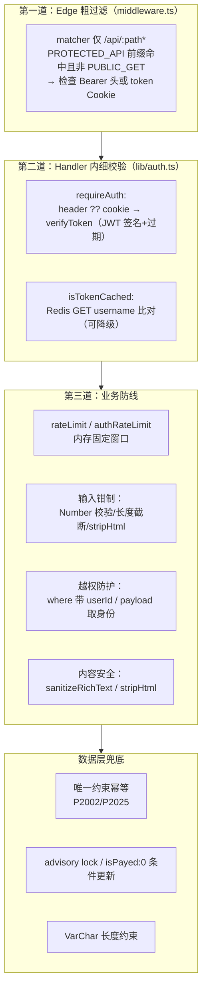

# 08-安全与权限设计

> 项目：react-travel ｜ 版本：v1.1 ｜ 生成日期：2026-10-06 ｜ 依据：源码分析

## 1. 安全模型总览

react-travel 是一个内容展示 + 轻交易的 C 端站点，它的安全设计不追求企业级纵深，而是围绕六类现实威胁布置了针对性的防线：凭证伪造（JWT 签名 + 可选 Redis 存在性校验）、暴力破解与刷量（内存固定窗口限流）、用户名枚举（DUMMY 哈希时序对齐）、注入与 XSS（排序白名单 / LIKE 通配符剔除 / 双轨内容净化）、越权访问（userId 一律取自 token payload + where 双条件）、以及密钥失守（生产运行时启动守卫）。本篇逐层拆解这些防线的源码实现、生效边界与已知弱点，并在结尾给出一份诚实的"已知隐患清单"。

与既有篇目的分工：《03-接口设计》§3 用时序图讲过"一次受保护请求"的流程，《05-核心流程》§2 讲过登录时序，《06-部署运行》§3 讲过密钥配置——本篇不重复流程，聚焦机制本体、威胁模型与边界条件。

## 2. 认证会话：bcrypt/md5 双轨 + DUMMY 防时序枚举 + JWT + Redis

### 2.1 密码双轨（lib/password.ts）

密码校验的核心决策是**渐进迁移而非一刀切**：`verifyPassword(password, stored)` 按存储哈希的前缀分流——`isBcryptHash` 判定 `$2` 开头（bcryptjs 的 `$2a/$2b/$2y` 族）则走 `bcrypt.compare`，否则按存量方案 `md5Password(password) === stored` 比对（`md5Password` 在 `lib/utils.ts`，`createHash("md5").update(password + SALT)`，与旧 Egg 时代逐字节一致）。新账户一律 `hashPassword`（bcrypt 12 轮，`SALT_ROUNDS = 12`），注册（`lib/services/user.ts#createUser`）与种子脚本（`prisma/seed.ts` 第 51-53 行注释："明文密码 → bcrypt 哈希，保证与 lib/password.ts 的校验逻辑一致"）共用这一入口。方案取舍写在 `verifyPassword` 的注释里："不强制改密，避免破坏现有测试账号"——代价是 md5 存量账户长期暴露在弱哈希风险下（md5 无盐单轮、GPU 可暴力），这是《13-技术债务与演进建议》§6 列明的待清偿项。值得肯定的细节是双轨判定不依赖额外字段（如 passwordVersion 列），而以哈希形态自描述，使新旧账户可以在同一列中共存。

### 2.2 DUMMY_BCRYPT_HASH 与时序对齐（lib/password.ts + app/api/auth/login/route.ts）

登录 Handler 的第 25 行是全项目最精巧的一行防御：`const ok = await verifyPassword(password, user?.password ?? DUMMY_BCRYPT_HASH)`。`DUMMY_BCRYPT_HASH` 是一个对固定明文预生成的真实 bcrypt 哈希（`$2b$12$xSym...`），注释说明其存在动机："用户不存在时也执行一次 bcrypt.compare，使'账号不存在'与'密码错误'的响应耗时一致，防用户名时序枚举"。威胁模型：bcrypt.compare 的耗时与轮数（12 轮约 100-300ms 量级）远高于 md5 直接比对，如果用户不存在分支提前 return，攻击者测量响应时间差即可批量枚举有效用户名，再对有效账号做定向爆破。时序对齐后，两条失败路径都执行了一次同轮数的 bcrypt 比较，耗时差异被抹平。需要指出的残留边界：md5 存量账户的比对耗时本身远低于 bcrypt（`verifyPassword` 的 md5 分支是同步哈希），因此"账号存在但密码是 md5 存储"与"账号不存在（走 bcrypt DUMMY）"之间仍有可测时序差——不过在 12 轮 bcrypt 的主导耗时与网络抖动面前，这个差值的可利用性很低，属于理论性弱点而非可实操攻击面 ⚠️ 待确认（需实测环境验证差值幅度）。

### 2.3 JWT 签发与 Redis 存在性校验（lib/auth.ts）

会话凭证是 HS256 JWT，payload 仅 `{ id, username }`（`JwtPayload` 接口），有效期读 `JWT_EXPIRES_IN`（默认 `"7d"`，`parseExpiresToSeconds` 支持 s/m/h/d/w/y 单位、解析失败回落 7 天）。签发后 `cacheToken(username, token)` 写 Redis——**key 是 username、value 是 token、TTL 与 JWT 有效期严格对齐**，注释解释了对齐的原因："否则缓存先过期会导致 JWT 未到期却被强制重新登录"。`requireAuth` 的校验链是两段式：`verifyToken`（验签 + 过期）通过后，`isTokenCached(username, token)` 从 Redis 取该 username 的缓存值做**全等比对**——不是"存在即有效"，而是"与缓存值相同才有效"。这个设计实现了两个语义：其一，服务端即时注销（`/api/auth/logout` 调 `clearToken` 删 key，旧 token 立即失效）；其二，单值覆盖带来**同账号互踢**——后登录者覆盖 key，先登录者的 token 在下一次校验时因不相等被判 401"登录已失效"（《06-部署运行》§6.4）。降级路径同样明确：未配置 `REDIS_URL` 时 `getRedis()` 返回 null，`isTokenCached` 直接返回 true（跳过存在性校验）；Redis 命令失败时 catch 后返回 true 并 `console.error`——注释称之为 fail-open："Redis 故障时降级为只信 JWT 签名（fail-open），避免全部受保护接口 500/挂起"。连接参数 `maxRetriesPerRequest: 1, connectTimeout: 5000` 保证 Redis 宕机时命令快速失败而非排队挂起。**安全语义的代价**：fail-open 意味着注销能力在 Redis 故障期间失效（攻击者持旧 token 仍可访问），这是可用性优先的取舍。

### 2.4 token 的传输通道

token 走 `Authorization: Bearer` 头（主要）或 `token` Cookie（备用，`getTokenFromCookie` 读名为 `token` 的 cookie）。`getTokenFromHeader` 的解析对 scheme 做 `toLowerCase() === "bearer"` 判定，容忍客户端小写（各 store 里实际混用 `bearer`/`Bearer` 两种写法）。值得注意的安全边界：**项目没有把 token 写入 Cookie 的代码**——`getTokenFromCookie` 只读不写，Cookie 通道是为"方案 B"预留的备用读取（`lib/auth.ts` 第 66 行注释），因此当前不存在 CSRF 主要攻击面（无自动附带的会话 Cookie），但若未来启用 Cookie 方案，必须补 CSRF 防御 ⚠️ 待确认（现状仅预留读取，无写入方）。

## 3. 接口鉴权：Edge 粗过滤 + Handler 细校验 + userId 取自 payload

### 3.1 middleware.ts 的边界与局限

`middleware.ts`（45 行）运行在 Edge Runtime，`config.matcher = ["/api/:path*"]` 决定它只拦 API 不拦 HTML 页面。逻辑：pathname 命中 `PROTECTED_API` 八个前缀（user/detail、user/edit、orders、shoppingCart、comments、commentLikes、favorites、viewHistory）且不满足"GET + PUBLIC_GET 正则"时，要求请求携带 Bearer 头或 token Cookie，否则 401。三个明确的局限（源码注释自认）：其一，它**不验 JWT 签名**——"这里只做'是否携带凭证'的粗过滤，避免在 Edge Runtime 跑 jsonwebtoken"（Edge 无 Node crypto），伪造 token 能过 middleware 但会在 Handler 内被 `verifyToken` 拦下；其二，`PUBLIC_GET = [/^\/api\/comments\/[^/]+$/]` 只放行评论列表，但注意 `/api/touristRoutes`、`/api/destinations` 等公开读接口根本不在 PROTECTED_API 列表里，天然放行；其三，**前缀匹配的精确性依赖列表维护纪律**——例如未来新增 `/api/orders-export` 这类前缀重叠的公开接口会误伤（`startsWith("/api/orders")` 命中），新增接口时需检查该列表（见《11-扩展开发指南》§3 的 SOP）。页面级访问控制完全不在 middleware 职责内：受保护页面（/shoppingCart 等）靠客户端 `AuthGuard` 跳转，HTML 层无服务端守卫——这不算漏洞（数据仍在 API 层保护），但要清楚"未登录直接 curl 页面 URL 能拿到页面骨架 HTML"是设计行为。

### 3.2 Handler 层的统一三件套与越权防线

受保护 Handler 的标准开场三件套：`requireAuth` → `rateLimit` → 参数钳制。鉴权返回值用 TypeScript 联合类型 `JwtPayload | Response` 表达分支（`if (auth instanceof Response) return auth` 是全仓统一写法）。**越权防护的黄金法则在源码中执行得很彻底：业务身份永远取 `auth.id`（token payload），从不信任 body/query 里的 userId**——全部 39 个 Handler 中没有任何一处把客户端传入的 userId 用于归属判定。数据访问侧配套两条：查询/删除的 where 一律带 userId（`delOrder` 的 `deleteMany({ where: { id, userId } })`、`removeCartItems` 的三条件 where）；`getOrderDetail` 用 `findFirst({ where: { id, userId } })` 而非先查后判，把"存在但不是你的"与"不存在"合并为同一 404，避免资源枚举。

### 3.3 各域鉴权口径速查

| 资源 | 读（GET） | 写（POST/DELETE） | 说明 |
|---|---|---|---|
| 线路/集合/目的地/专题/游记/城市/热词 | 公开 | 无写接口 | 内容型全公开 |
| 评论列表 | 公开（middleware PUBLIC_GET + Handler 只 verifyToken 不 401） | requireAuth + 20/min | 游客可读，likedByMe 降级 false |
| 收藏 | requireAuth（含 /api/favorites/ids） | requireAuth + 20/min | GET 不在 PUBLIC_GET，middleware 会拦无凭证请求 |
| 浏览史/购物车/订单/用户资料 | requireAuth | requireAuth（加购/评论/点赞/收藏限流） | orders 的 type 参数白名单收敛 |

## 4. 输入校验与内容安全

**参数钳制的三种模式**覆盖全部入口：其一，数值型——`Number()` 后判 `Number.isFinite`（收藏/点赞/订单的 id、houseId 等），非法值视为未传返回 400 或回落默认；分页统一过 `parsePage`（`lib/utils.ts`，pageNum 钳到 ≥1、pageSize 钳到 [1,100]，注释写明防"超大 pageSize 拉全表、负数 skip 触发 Prisma 异常"）。其二，字符串型——`optionalStr(v, max)` 模式（register/user/edit：非字符串忽略 + `slice(0, max)` 截断，avatar ≤2000、phone ≤20、sign ≤300），注释点明动机"防止超长/异型数据打穿 DB 约束"。其三，搜索型——关键词在 `buildWhere` 与 hotKeywords 两处独立做 `trim → 剔除 [%_\] → slice(0, 50/30)`（前者 50 后者 30），剔除 LIKE 通配符的理由在注释里非常具体："Prisma contains 不转义它们，'%' 会退化成全表 LIKE"；排序参数经 `SORT_WHITELIST` 白名单收敛（两处：`lib/services/house.ts#resolveOrderBy` 与 `app/api/touristRoutes/route.ts` 的数组），注释："防止注入任意 orderBy"；订单 `type` 参数只认 0/1 其余视为全部。

**内容安全双轨制**是本项目的 XSS 防线核心，两条路线按字段的渲染方式划分。富文本路线（`sanitizeRichText`）：详情页 features/fees/notes 通过 `dangerouslySetInnerHTML` 渲染（`client/views/detail/DetailPage.tsx` 第 237/242/247 行），必须在服务端出口净化——`lib/sanitize.ts` 的白名单只保留排版标签（h1-h6/p/br/hr/ul/ol/li/行内强调/table 族），`allowedAttributes: {}` 丢弃全部属性（注释："本项目富文本不使用任何属性，这样 img onerror、a javascript:、script 之类的载体全部失效"），`allowedSchemes: []` 且 `disallowedTagsMode: "discard"`；净化点在 `lib/vm.ts#houseToTouristRoute`（VM 出口），意味着种子数据、未来的后台写入、DB 手工修改三条来源统一被覆盖。纯文本路线（`stripHtml`）：评论 msg、个性签名、注册 sign 等字段以文本节点渲染（React 自动转义），存储侧剥离全部标签并把 sanitize-html 转义的实体还原回原文（自定义 `decodeEntities`，只还原合法且安全码点，排除控制字符）——注释解释了为什么要"还原"："存储侧转义会造成双重转义"（'面包&黄油' 会显示成 '面包&amp;黄油'）。两条路线的选择标准一句话：**渲染时转义的存纯文本，渲染时不转义的（innerHTML）存白名单净化后的 HTML**。

**JSON body 解析的统一防御**：所有 Handler 对 `req.json()` 一律 `.catch(() => ({}))`——非法 JSON 不会抛 500，而是落入"缺字段 → 400"的正常校验分支。**客户端渲染兜底**：评论以 `c.msg` 文本节点渲染、用户昵称/签名经 antd 组件文本渲染，无第二处 dangerouslySetInnerHTML（除详情富文本与 SEO JSON-LD 的 `JSON.stringify` 输出——后者由服务端控制内容、序列化转义由 React 处理）。

## 5. 限流与 X-Forwarded-For 信任链

### 5.1 内存固定窗口限流（lib/rate-limit.ts）

实现是教科书式的固定窗口：`buckets: Map<string, Bucket>`，key 形如 `${extra ?? clientIp(req)}|${windowMs}|${max}`；窗口内首次请求建桶（count=1, resetAt=now+windowMs），超阈值返回 429 + `Retry-After` 头（文案"请求过于频繁，请 Ns 后重试"）。两条策略常量：`WRITE_LIMIT = { 60_000, 20 }`（评论 comment:userId、点赞 like:userId、收藏 fav:userId——全部按用户维度）、`AUTH_LIMIT = { 60_000, 8 }`（登录按 `auth:login:<username>:<IP>`、注册按 `auth:<IP>`）。`authRateLimit` 注释解释了双维度的分工："IP 维度防密码喷洒，用户名维度防单账号爆破"。内存治理有三层：`MAX_KEYS = 10_000` 上限；超限时先清过期桶；仍超限则按插入序淘汰最旧桶——注释解释了为什么不用 `clear()`："避免被攻击者用伪造 key 一次性清空所有人的计数"。**单实例边界**（模块头注释原话"内存实现，单实例够用；多实例部署需换 Redis"）：其一，多实例部署时各进程各有一份 buckets，攻击者的请求被负载均衡打散后实际限流阈值变成 N 倍；其二，进程重启窗口归零；其三，限流的 key 里用户名取自请求 body（登录场景），意味着攻击者可以用海量随机用户名撑桶数——MAX_KEYS + 淘汰机制就是为这个场景准备的，但代价是可能误淘汰正常用户的桶。横向扩展前的完整改造清单见《06-部署运行》§6.3。

### 5.2 X-Forwarded-For 信任链（lib/rate-limit.ts#clientIp + house.ts#getHouseDetail）

`clientIp` 的取值优先级：`x-forwarded-for` 首段 → `x-real-ip` → `cf-connecting-ip` → `"unknown"`。源码注释把部署要求写成了强约束："反向代理（nginx/CDN）必须覆写 x-forwarded-for，否则客户端可自带伪造头绕过 IP 维度限流"。这条信任链的风险结构值得完整理解：XFF 是可伪造的请求头，直接暴露给应用的取首段策略等于**信任客户端申报的 IP**；只有当链路上每一跳代理都"追加而非透传、且最左侧由可信代理写入"时，首段才是真实客户端。本项目有两个消费方：限流的 IP 维度（`clientIp`）与详情页浏览量去重（`getHouseDetail` 的 viewerIp，同样取 XFF 首段）。配置正确时，前者防单 IP 爆破、后者防同一 IP 刷 showCount 操纵爆款推荐排序（`shouldBumpShowCount` 的注释："防止爬虫/刷新无限刷 showCount"）；配置错误（Nginx 未覆写）时，两类防护同时失效——所有用户共享代理 IP 一个桶（限流误伤，见《06-部署运行》§8 的故障条目），且攻击者可通过轮换伪造头无限刷量。Nginx 参考配置：`proxy_set_header X-Forwarded-For $remote_addr;`（覆写而非 `$proxy_add_x_forwarded_for` 追加，除非信任链可控）。拿不到 IP 时（`"unknown"`/null）的行为也有明确定义：限流所有请求并入同一桶（保守），浏览量"保持旧行为"即不去重（`shouldBumpShowCount` 第 151 行注释）。

## 6. 密钥治理与存储层兜底

**密钥守卫**（`lib/auth.ts` 第 7-14 行与 `lib/utils.ts` 第 5-12 行，两段对称）：判定条件 `NODE_ENV === "production" && NEXT_PHASE !== "phase-production-build"`——build 阶段不校验（构建机无需密钥），运行时严格校验：`JWT_SECRET` 或 `SALT` 缺失、或仍是示例值 `"xiaoye"`，直接 throw 拒绝启动（错误信息里附 `openssl rand` 命令）。SALT 守卫的理由注释得很清楚："只影响老 md5 账户校验，配置错误意味着所有老账户都无法登录，宁可启动失败及早暴露"。开发环境回退 `"xiaoye"` 并 console.warn。`.gitignore` 覆盖 `.env` 与 `.env*.local`，密钥不入库。这套"启动即失败"哲学把配置错误从运行期事故提前到部署期阻断，是小型项目里少见的完整实践。

**存储层兜底**与安全的关系：三张行为表的复合唯一约束（Favorite/ViewHistory/CommentLike）让"重复操作"从业务校验问题变成约束冲突的幂等处理（P2002 → 200"已收藏/已点赞"）；`VarChar` 长度约束是输入钳制的最后防线（即使 Handler 层遗漏 slice，超长数据也只是 DB 报错而非静默入库）；`pg_advisory_xact_lock` 与 `isPayed: 0` 条件更新保证资金相关字段（金额快照、订单号）在并发下不被重复写入。Prisma 参数化查询天然免疫 SQL 注入——项目里唯一的 raw SQL 是 `$executeRaw`SELECT pg_advisory_xact_lock(${userId})``，且 userId 来自已验签的 token payload（int 型），模板标签语法走参数绑定。

## 7. 已知隐患清单（诚实版）

以下各项均为源码可证的弱点，按影响排序；修复建议与优先级在《13-技术债务与演进建议》同步收录：

1. **限流/浏览量去重的单实例边界**（§5.1）：多实例即失效；重启即清零。低危（当前单实例部署），扩容前必须改造。
2. **md5 存量账户无强制迁移机制**（§2.1）：`verifyPassword` 的 md5 分支命中后不升级重哈希（没有"登录时顺便 bcrypt 化"的逻辑），弱哈希账户将长期存在。建议在 md5 校验成功后透明调用 `hashPassword` 回写。
3. **`images.remotePatterns` 放行所有主机**（`next.config.js`）：当前 `` 直用 URL 字符串、未启用 next/image 优化器，该配置暂无实际攻击面；但一旦引入 next/image，等于允许把站点当任意来源图片的代理（SSRF/热链风险）。前瞻性收紧项。
4. **XFF 信任链依赖部署纪律**（§5.2）：代码无法自证代理配置正确，只能靠部署清单约束。
5. **JWT 无吊销时的注销窗口**：未配 Redis 的部署里，"退出登录"只清浏览器本地态，旧 token 在 7 天有效期内始终可用（`isTokenCached` 无 Redis 时恒 true）。单用户设备场景可接受，多用户/公共设备场景建议必配 Redis。
6. **middleware 的前缀匹配维护风险**（§3.1）：新增前缀重叠接口可能被误拦或漏拦，属流程性风险。
7. **seed 账号弱口令**：8 个 `123456` demo 账号（`prisma/seed-data/users.ts#DEMO_PASSWORD`）是公开文档知晓的凭据，生产库严禁保留（《06-部署运行》§5.2）。
8. **Umami 统计脚本硬编码第三方域名**（`app/layout.tsx` 第 82-86 行）：供应链面（第三方脚本 defer 加载，无 SRI）；自托管/内网时应移除或替换。 ⚠️ 待确认：该脚本域名与 data-website-id 的归属与有效性。

总体评价：本项目在"个人/小型团队可维护"的约束下，把 OWASP 常见 Top 风险（注入、XSS、爆破、枚举、越权、密钥管理）逐一落到了可审计的源码级防御上，注释普遍记载了威胁模型与取舍理由——这在同等规模的项目中相当少见；弱点集中在"分布式扩展不兼容"与"存量数据（md5 账户、种子账号）的清偿计划缺失"两处，均不构成当前部署形态下的紧急风险。
