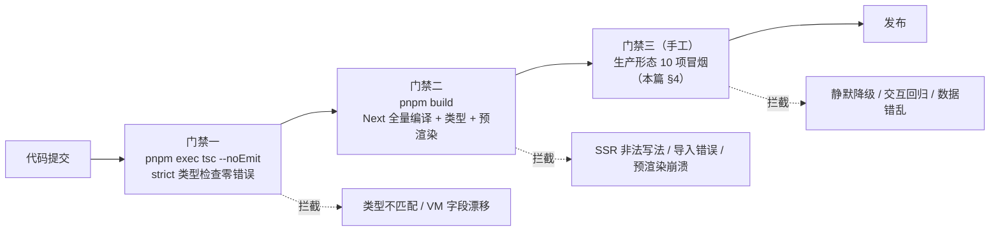

# 09-测试与质量保障

> 项目：react-travel ｜ 版本：v1.1 ｜ 生成日期：2026-10-06 ｜ 依据：源码分析

## 1. 测试现状全景：零自动化测试的诚实起点

先把结论说透：**本项目没有配置任何自动化测试框架，也没有一行测试代码**。证据链完整且可复核：`package.json` 的 scripts 只有 `dev/build/start/postinstall/prisma:generate/prisma:push/prisma:studio/db:seed` 八条，无 test 相关条目；dependencies 与 devDependencies（共 24 个包）中没有 Jest、Vitest、Mocha、Playwright、Cypress、Testing Library 中的任何一个；仓库根目录没有 `jest.config.*`、`vitest.config.*`、`playwright.config.*`、`__tests__/`、`*.test.*`、`*.spec.*` 文件（全仓文件清单可证）；`tsconfig.json` 的 include 也未包含任何测试目录；`.gitignore` 里虽有 CRA 时代遗留的 `/coverage` 条目，但那是模板残留而非测试痕迹。因此本篇的定位不是"测试使用手册"，而是三件事：讲清项目**事实上在依赖什么**保证质量（§2 双门禁 + 防御式设计）、给出**可立即执行的手工冒烟规程**（§4 十项清单逐项展开）、以及给出**按性价比排序的补测路线图**（§5，从补齐 E2E 到分层单测）。

这个现状并不意外，它是迁移项目的理性选择：`NEXT_MIGRATION_PLAN.md` 的八个 Phase 验收标准全部以"构建零错误 + 手工冒烟关键路径"为口径，从未承诺自动化测试。但维护者必须清醒：零测试意味着每一次改动的回归成本都由人工承担，而本项目的跨层耦合面（VM 字段、垫片导出、store 状态）恰恰是"改一处、崩三处"的高危地形——《07-模块详解》§9 列出的域间触点就是未来测试应该优先钉住的位置。



## 2. 双门禁详解

### 2.1 门禁一：tsc --noEmit 严格类型检查

```bash
pnpm exec tsc --noEmit
```

该命令以 `tsconfig.json` 为准做全量类型检查但不产出文件。项目的类型防线有三个支撑点：**其一，`strict: true`**（含 strictNullChecks/noImplicitAny 等全家桶），这对本项目的价值尤其大——Prisma 查询返回的 House 行大量可空字段（name/price/tripType 均为 `String?/Int?`），strict 模式强制 VM 转换层（`lib/vm.ts`）显式处理 null（`h.name ?? ""`、`h.price ?? 0` 遍布全文件），漏掉一处就会在编译期暴露。**其二，include 面收口了全部手写代码**：`app/**`、`lib/**`、`client/**`、`prisma/**`、`scripts/**`、`types/**` 与 Next 生成的 `.next/types/**`，同时 `exclude: ["node_modules", "generated"]` 把 Prisma 生成产物隔离——生成物自身由 `prisma generate` 保证与 schema 一致，纳入检查只会拖慢速度。**其三，`@/*` 路径别名**（`paths: { "@/*": ["./*"] }`）让跨层引用全部走可解析的别名，`tsc` 能完整追踪 `app/ → lib/ → generated/prisma` 的类型链；Playwright 未引入的今天，这条链是"改了 schema 忘改 service、改了 service 忘改 VM、改了 VM 忘改视图"这类跨层漂移的唯一自动拦截器。执行经验：该命令冷跑约需十几秒（增量缓存 `tsconfig.tsbuildinfo` 已在 .gitignore 中，本地可复用），建议作为提交前固定动作；它**不能**捕获的问题包括运行时逻辑错误、async 时序问题与 SSR/CSR 差异——那是门禁二与门禁三的辖区。

### 2.2 门禁二：next build 全绿

`pnpm build` 是比 tsc 更强的门禁，因为它在类型检查之外叠加四层验证：**代码编译层**——SWC 编译全部页面与 Route Handler，能暴露 tsc 查不出的打包问题（坏导入、循环依赖极端情形）；**预渲染层**——构建时实际执行静态生成：首页（ISR 60s）与目的地/专题/游记（ISR 3600s）四条路由会真正跑一遍 RSC 数据获取并产出 HTML，`app/sitemap.ts` 也在构建期执行（`revalidate = 3600`）——这意味着这五个文件里的任何"构建期就该崩"的错误（非法 JSX、导入错模块、Prisma 调用写法错误）都会让 build 失败；**App Router 规范层**——Next 15 会校验 params 是 Promise 必须 await、客户端组件不能非法 import 服务端模块等框架级约定；**类型层**——Next 内部会再跑一遍类型检查（含 `.next/types` 的路由类型校验）。一个必须理解的细节（《06-部署运行》§4.1 已提及）：由于五个 ISR/静态入口的 RSC 直取全部 try/catch 降级（`app/page.tsx` 第 47-51 行的 catch 只 console.warn 后返回空 props 版本），**构建环境数据库不可用时 build 仍能通过**，但产物里首页是空壳——所以"build 全绿"必须与"构建环境连了可用库"这个前提绑定，否则发布会带着空态 ISR 页上线。标准姿势是构建前 `DATABASE_URL` 指向可用库，构建日志里确认四条路由都是生成静态页而非报 warning。

## 3. 防御式设计：为什么"没有测试也没怎么崩"

零测试项目能保持稳定，靠的是把大量"测试才会暴露的错误类"在编码期系统性消除。复盘源码，有六类可归纳的防御模式，它们等价于一组"内建测试"：

1. **响应序号守卫**（对抗竞态回归）：`detailSeq/commentsSeq`（`useProductDetailStore`）、`searchSeq`（`useProductSearchStore`）、`myOrdersSeq`（`useOrderStore`）、`seqRef`（`useHotKeywords`）——快速切换上下文时迟到响应被丢弃。这类 bug 极难用单测复现（要 mock 网络时序），守卫把它变成了结构性不可能。
2. **水合时序协议**（对抗 SSR 水合错位）：`hydrated` 位 + `useIsomorphicLayoutEffect` + 三处消费方（AuthGuard/PlaceOrder/orderSuccess）的等待约定，把"首帧 localStorage 未恢复"这个 SSR 迁移最典型的崩溃源变成显式状态机。
3. **双链路数据同源**（对抗一致性回归）：RSC 直取与 API 回退调用同一个 `lib/services` 函数（《01-系统架构》§3 铁律），"两条链路数据不一致"在结构上不可表达。
4. **异常降级而非崩溃**：RSC 全部 try/catch、`req.json().catch(() => ({}))`、`parsePagination` 的 JSON.parse 兜底、`safeDecode` 不抛 URIError——错误输入/故障依赖被收敛为"空态 + 可用页面"而非白屏。
5. **约束即断言**：DB 层复合唯一约束 + P2002/P2025 幂等处理、`pg_advisory_xact_lock`、`isPayed: 0` 条件更新——并发正确性交给数据库而非前端时序。
6. **StrictMode 双跑防御**：`reactStrictMode: true`（`next.config.js`）下开发期 effect 双跑，项目用 `recommendedFetched`/`reportedView`/`installed` 三个 ref 守卫把重复请求/重复上报/重复注册拦截，等于免费获得了"effect 幂等性"的日常演练。

这些模式的共同点是：**作者已经把历史上踩过的坑固化成了代码结构**（《01-系统架构》§2.4 与 `next.config.js` 底部注释都是坑位记录）。测试缺位的最大风险因此不在"已知坑复发"，而在"新改动绕过这些防御时无告警"——例如新组件不等 hydrated 直接读 token，现有门禁全部无感。

## 4. 手工冒烟规程：十项清单逐项展开

以下十项是发布前的最小充分验证集（《06-部署运行》§7 已列表，本节逐项展开操作细节与判定标准）。前置条件：`pnpm build && pnpm start` 的**生产形态**（不是 dev——两者在 ISR、antd 样式抽取、错误边界上行为有差异，历史上 react-payment-inputs 的 CSS 就只在生产构建下出错）；种子数据已灌入（`pnpm db:seed`，8 个账号密码 123456）；建议以无痕窗口执行避免 localStorage 残留干扰。

**项 1：数据链路探活**。`curl -s http://localhost:3000/api/productCollections | head -c 200`，判定：返回三个集合对象（id 1/2/3，标题爆款推荐/新品上市/国内游推荐）且每集合 touristRoutes 长度 9。它一次验证了 DB 连接、Prisma 适配器、HOUSE_CARD_SELECT 投影与 VM 转换四个环节，是最便宜的探活针。

**项 2：鉴权链路**。`curl -s -X POST http://localhost:3000/auth/login -H 'Content-Type: application/json' -d '{"email":"旅行达人小王","password":"123456"}'`——注意走 `/auth/*`（验证 rewrite）与字段名 email（验证字段错位兼容）。判定：200 含 token 与用户资料；再用 token `curl -X POST http://localhost:3000/api/user/detail -H "Authorization: Bearer $TOKEN"` 应返回资料（password 字段必须不存在，验证 serializeUser）。补一个反向用例：错误密码应 401"用户名或密码错误"且耗时与正确用户名不存在时接近（时序对齐生效）。

**项 3：SSR 内容直出**。浏览器查看源代码（View Source，非 DevTools DOM）访问 `/`、`/destinations`、`/topics`、`/reviews`，判定：源码中可搜索到线路标题/目的地名称文本与 JSON-LD 脚本（首页应有 ItemList，根布局有 Organization/WebSite）——证明 RSC 直取生效而非客户端回退；若源码里只有空容器，说明 RSC 直取失败走了降级（查服务端日志 `[page:/]` 前缀警告）。

**项 4：搜索三态**。依次访问 `/search/group`（slug → tripType 精确匹配语义，应返回跟团游线路）、`/search/丽江`（中文直搜）、`/search/%E4%B8%BD%E6%B1%9F`（编码中文），判定：三态结果一致且正确；然后在页面内翻页/切排序/设价格区间，判定：进入客户端模式后列表刷新且分页总数正确（x-pagination 链路）；回退/前进浏览器按钮后视图正确重置。

**项 5：详情页四联动**。访问 `/detail/1`（种子首条），判定：① 图廊主图/缩略图切换正常；② View Source 含线路标题与 Product JSON-LD；③ 刷新两次后 `GET /api/touristRoutes/1` 场景下 showCount 只在首次访问 +1（同 IP 当日去重，可用 `pnpm prisma:studio` 直接看库核对）；④ 评论区加载出种子评论，带登录态时点赞红心与 likeCount 正确。

**项 6：交易闭环**。登录 → 详情页加购（重复点击"放入购物车"验证 adding 防抖与幂等——同一房源不重复入车）→ 购物车页核对合计金额 → 结算跳 `/placeOrder` → 中途刷新页面验证 localStorage 恢复结算单 → 支付 → `/orderSuccess` 显示订单号与逐项金额 → `/orders` 已支付 Tab 可见该单且展示快照字段。再验证异常分支：清空购物车后直接访问 `/placeOrder` 应显示"暂无结算订单"引导。

**项 7：评论与收藏幂等**。发一条评论（刷新后仍在，内容含 `&`/`<` 等字符时显示不乱码——stripHtml 实体还原生效）；对同一评论连点两次点赞（第二次应提示"已点赞"且 likeCount 不再增加）；取消点赞后再取消（幂等无报错）。收藏同理：toggle 两次后列表与红心状态一致。

**项 8：登出与守卫**。退出登录后：Header 恢复未登录态、`localStorage.travel_user` 与 `travel_order` 已删除；手动访问 `/shoppingCart`、`/orders`、`/favorites` 应被 AuthGuard 重定向 `/signin`（验证 hydrated 等待逻辑——若闪一下就跳走反而说明没等水合，属缺陷）。

**项 9：SEO 基础设施**。`curl -s http://localhost:3000/sitemap.xml` 应含首页、内容页、7 个分类 slug 与全部线路详情 URL（DB 可用时）；`/robots.txt` 应含 disallow 列表与 sitemap 指向；分享预览用 opengraph 检测工具验证 `/opengraph-image` 生成的 1200×630 PNG。

**项 10：外部依赖容灾**。`curl -s http://localhost:3000/api/commons/citys`：外网可达时应 200 返回城市数组；不可达时应 500"获取城市数据失败"（而非挂起）——两种结果都算通过，**挂起不通过**（验证 fetch 失败快速返回）。若配置了 `CITYS_API`，顺带验证应急切换生效。

## 5. 测试缺口与补测路线图

按"投入产出比"排序的四阶段补测建议，供演进决策；每阶段都设计为可独立落地、不需要先补齐前一阶段。

**阶段一（最高性价比）：Playwright E2E 冒烟自动化**。把 §4 的十项冒烟固化为 3-5 条 E2E 用例（登录 → 搜索 → 详情 → 加购 → 结算 → 支付 → 订单；登出 → 守卫重定向；SEO 元素断言）。理由：本项目交互闭环复杂（水合时序、双数据源、复合 id 支付），恰恰是 E2E 最擅长、单测最无力的形态；Playwright 可直连真实 PostgreSQL（docker 或本机），用 seed 数据做固定夹具；预计 1-2 天工作量即可把发布回归从人工 30 分钟压缩到 3 分钟。关键设计约束：测试必须跑生产构建（`next start`）而非 dev，理由同 §4 前置条件。

**阶段二：服务层单测（Vitest）**。对 `lib/` 纯函数与低依赖模块补单测，优先级排序：`lib/vm.ts`（discountPresent 边界：原价缺失/相等/为零、imgs 空数组兜底、ordersToCheckoutOrder 复合 id 组装）→ `lib/utils.ts#serialize/parsePage`（BigInt/Date/嵌套、pageSize=100 边界）→ `lib/sanitize.ts`（XSS 载荷样本表：script/img onerror/javascript:/实体还原）→ `lib/password.ts`（双轨分流 + DUMMY 常量形态）→ `lib/order.ts`（订单号不碰撞）。这五个模块全部是纯函数或近纯函数，无需 mock 数据库，一天可完成，且它们是 §3 所述"结构防御"的核心承重墙——单测把防御意图固化为可执行规格。`lib/services/*` 的集成测试（需真库）建议只挑三个最高危函数：`payRows`（并发幂等：两请求同付一批 id 只生成一个订单号）、`addCartItem`（同用户并发加购不重复）、`getHouseDetail`（P2025 → null 路径）。

**阶段三：契约快照测试**。对 `x-pagination` 响应头结构、`touristRoute` VM 字段集、`CommentVM` 形状做 schema/快照断言——本项目前端与后端靠"VM 形状"耦合（《07-模块详解》§9），快照测试能在"改 VM 忘改视图"时提供比类型检查更早的信号（类型检查管编译期，快照管实际响应字节）。可用 Vitest + 真库跑一条 `GET /api/touristRoutes?keyword=` 断言响应头可 JSON.parse 且含四字段。

**阶段四（可选）：组件测试与视觉回归**。antd 组件树的 Testing Library 测试投入产出比偏低（组件逻辑薄、多为展示），仅建议对两个复杂状态组件补测：`Searchpage` 的 injectedActive 判定矩阵（关键词一致/不一致 × clientMode × initialProducts 有无）与 `useFavoriteStore.toggle` 的乐观回滚。视觉回归（Chromatic/Playwright screenshot）在 UI 仍在演进的阶段不建议引入，噪音大于收益。

补测之外的零成本改进：其一，把 §2 的双门禁写进 `package.json` 的 `check` 脚本（`tsc --noEmit && next build`）并在 README 声明为提交前标准动作，目前两条命令只存在于文档口径；其二，若未来引入 CI（《13-技术债务与演进建议》§3），双门禁 + 阶段一 E2E 就是流水线的最小骨架——`pnpm install → prisma:generate → db:push + seed（测试库）→ build → playwright test`。 ⚠️ 待确认：CI 环境的 PostgreSQL 服务选型（service container 或自托管）需随 CI 方案一并决策。
