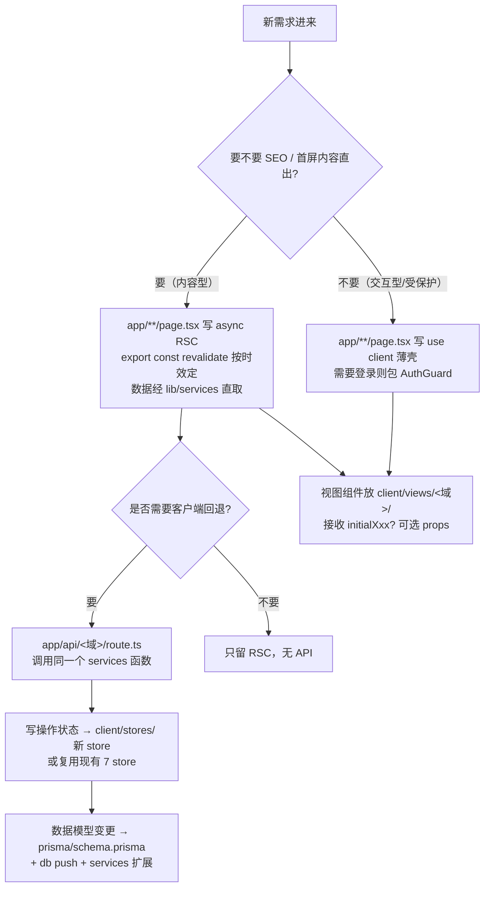

# 11-扩展开发指南

> 项目：react-travel ｜ 版本：v1.1 ｜ 生成日期：2026-10-06 ｜ 依据：源码分析

## 0. 使用说明与全局决策树

本篇是"照着做就能落地"的标准作业程序（SOP）合集，覆盖六个最高频的扩展场景。每个 SOP 都给出：决策点、分步操作、必须遵守的项目铁律、以及验收清单。动手前先建立两个全局心智：**其一，三层放置法则**——《00-项目总览》§4 的边界约定是新代码去哪的唯一判据：需要 SEO/首屏直出的内容放 `app/` 的 RSC 页 + `client/` 展示组件；纯交互页放 `app/` 薄壳（AuthGuard）+ `client/` 视图；任何数据访问只进 `lib/services/`，`app/` 页面与 Handler 禁止直接 import prisma（现存两处历史例外：`app/api/commons/hotKeywords/route.ts` 与 `app/sitemap.ts`，不要效仿）。**其二，双链路同源铁律**——《01-系统架构》§3：RSC 直取与 API 回退必须调用同一个 `lib/services` 函数，这是数据一致性的结构性保证。

## 1. SOP 一：新增一个业务页面

**场景**：例如新增"攻略社区"页 `/guides`，需要服务端直出列表并支持客户端交互。**第一步，判断页面类型**（用 §0 决策树）：攻略列表要被搜索引擎收录 → 内容型 RSC。**第二步，建数据访问**（若数据已有 services 则跳过）：在 `lib/services/` 新建 `guide.ts`，只写 Prisma 查询，投影遵循两条既有惯例——列表用常量投影并排除 BigInt/Date 字段（参照 `lib/services/destination.ts` 的 select 写法与"刻意不取 createTime"注释），图片 `take: 1`。**第三步，建 RSC 页面**：`app/guides/page.tsx`，模板照抄 `app/destinations/page.tsx` 的四段式——`export const revalidate`（内容更新频率决定，参考分级：分钟级 60 / 小时级 3600）、`export const metadata`（标题+描述，勿写 canonical/og:url，原因见 `app/layout.tsx` 第 31-33 行注释）、async Page 函数内 try/catch 直取（catch 里 `console.warn("[page:/guides] RSC 直取失败，回退客户端拉取", e)` 并返回无 props 版本）、把数据以 `initialGuides?` 可选 props 传给视图组件。若需要动态元信息（如按参数生成标题），照抄 `app/search/[keywords]/page.tsx` 的 `generateMetadata` 写法。

**第四步，视图组件**：`client/views/guides/GuidesPage.tsx` + 同名 `module.css` + `index.ts` 桶导出——目录三件套是 client 层的既定结构（全部 16 个视图均如此）。组件必须实现 `initialGuides?` 双数据源模式：有注入直接渲染（可参照 `DestinationsPage` 的简化版），无注入走 store 拉取；布局需要 Header/Footer 时自行组装（内容页惯例，参照 `DestinationsPage`，不套 MainLayout——MainLayout 是交易类页面用的，首页/内容页都是自行组装以获得布局自由度）。**第五步，若需要客户端回退**：`app/api/guides/route.ts` 一条 GET，调用与 RSC 相同的 services 函数，store 的 fetch 动作请求它（参照 `useRecommendStore` 的极简写法）。**第六步，登记三处全局触点**：需要入口就在 `client/components/header/Header.tsx` 的导航数组或 Footer 加链接；要被搜索引擎收录就检查 `app/sitemap.ts`（静态路由加进 `STATIC_ROUTES`，动态数据照房源的 try/catch 模式追加）；受保护页才需要 `app/robots.ts` 的 disallow（公开内容页不要加）。**验收**：`pnpm exec tsc --noEmit` 零错误 → `pnpm build` 全绿且该路由出现在构建输出的静态路由列表（ISR 页）→ View Source 能看到内容文本（SSR 生效）→ 拔掉 DB 重启后页面仍 200 且客户端回退加载（降级生效）。**铁律回顾**：页面禁止直接查库；视图禁止 import prisma；`client/` 新文件用 `@/client/...` 或相对路径与既有代码保持一致。

**归属决策的灰色地带**：若页面主体是纯交互但需要少量 SEO 元信息（如登录页），照 `app/signin/page.tsx` 模式——客户端 page + 独立 `layout.tsx` 放静态 metadata（注意 signin/register 目前没有独立 layout，标题走根布局默认值；`/about`、`/help`、`/personal` 等用 layout.tsx 提供标题是标准做法）。若需要在服务端取数但页面要登录（如"我的收藏"想 SSR），当前架构不支持——AuthGuard 是客户端组件，服务端无法拿到 localStorage token；此时保持客户端薄壳模式即可（数据接口本身有鉴权，无泄露风险）。

## 2. SOP 二：新增一个 Route Handler

**场景**：例如为攻略页增加"按城市筛选"的 GET 端点。**第一步，鉴权定位**：接口需要登录吗？需要则 Handler 第一行 `const auth = await requireAuth(req); if (auth instanceof Response) return auth;`，并同步检查 `middleware.ts`——若路径前缀不在 `PROTECTED_API` 列表则中间件不会拦无凭证请求（Handler 的 requireAuth 仍会拦，middleware 只是提前 401 的优化），所以**新受保护域必须把前缀加进 PROTECTED_API**；是公开读接口则确认不进该列表，且若同前缀下有公开 GET 混写操作（像 comments 那样），在 `PUBLIC_GET` 加对应正则。**第二步，写 Handler**：路径 `app/api/guides/route.ts`（集合）或 `app/api/guides/[city]/route.ts`（动态段——Next 15 的 params 是 Promise，必须 `const { city } = await params`，参照 `app/api/orders/[id]/route.ts`）。写法四件套：`req.json().catch(() => ({}))` 解析 body；参数用 `Number() + Number.isFinite` 校验、字符串按需 stripHtml/slice 钳制（抄 `optionalStr` 模式）；业务查询调 services；响应一律走 `lib/utils.ts` 的 `json()/errMsg()/apiError()`——成功 `json({ status: 200, data })`，参数错 `errMsg("xxx", 400)`，尾部 catch `return apiError(e)`（自动打 `[api:500]` 日志并对客户端脱敏）。**第三步，按需叠加横切能力**：写接口加限流 `rateLimit(req, WRITE_LIMIT, "guide:" + auth.id)`；分页过 `parsePage`；列表若需要分页元数据走 `x-pagination` 响应头模式（照抄 `app/api/touristRoutes/route.ts` 的手工 `new Response(JSON.stringify(...), { headers })` 写法，注意此时 BigInt 须自行 serialize）；涉及排序输入必须白名单收敛（抄 SORT_WHITELIST 双层模式：services 里 resolveOrderBy 兜底 + Handler 里收敛入参）。**第四步，幂等语义**：若写操作落在有唯一约束的表上，catch 里处理 `e?.code === "P2002"`（重复创建 → 200 幂等）与 `"P2025"`（删除不存在 → 200 幂等），参照 `app/api/commentLikes/route.ts`；业务性失败文案若需要透传给用户（如"房源不存在"），在 catch 里白名单判断 `e.message` 后返回，其余一律脱敏，参照 `app/api/shoppingCart/items/route.ts`。**验收**：curl 各错误分支（缺参 400/未登录 401/限流 429/正常 200）文案与状态码符合《03-接口设计》§4 约定；新前缀在 middleware 的行为符合预期（用无凭证 curl 验证）。**注意**：不要导出与业务无关的 HTTP 方法（Next 会为 route.ts 注册全部导出）；同一文件内多个方法共享的私有函数放模块顶层（参照 touristRoutes/[id] 的 handle 模式）。

## 3. SOP 三：新增 Prisma 模型与迁移

**场景**：例如新增 Guide（攻略）模型。**第一步，改 schema**：`prisma/schema.prisma` 追加模型，遵守项目的五条建模惯例——①主键 `id Int @id @default(autoincrement())`；②时间字段用 `DateTime @default(now())`（新表不要再引入 BigInt 时间戳，那是旧表兼容产物，`《04-数据模型》§1`）；③外键可空时关系与字段都可空（参照 Comment 的 userId/houseId），必填时双侧必填（参照 Favorite）；④高频查询路径显式建 `@@index`（如 `@@index([guideId])`）或复合唯一 `@@unique([userId, guideId])`——唯一约束同时是幂等写入的兜底（见 SOP 二第四步）；⑤命名风格与现有一致（PascalCase 模型、camelCase 字段、无软删除字段——若业务需要"已删除"语义，用状态列而非 deletedAt，与现有 Orders.isPayed 风格一致）。**第二步，同步数据库**：项目无 migrations 目录，建表走 `pnpm prisma:push`——执行前三条纪律（《06-部署运行》§5.5）：先在本地/staging 演练并读 prisma 输出的变更摘要（删列/改类提示要逐条确认）；生产执行前 `pg_dump` 快照；push 后跑 `pnpm prisma:generate`（或直接依赖 postinstall）刷新 `generated/prisma`。⚠️ 待确认：若团队化需要迁移审计，引入 `prisma migrate` 的基线方案见《13-技术债务与演进建议》§7，当前仓库无 migrate 配置。**第三步，建 services**：`lib/services/guide.ts` 封装全部查询；若新表与 House/User 关联，include 投影遵守 take 1 图片惯例。**第四步，种子数据**（可选）：`prisma/seed-data/guides.ts` 定义样例，`prisma/seed.ts` 的 main() 里追加灌入段（注意 seed 第一步就是全表 deleteMany，新模型也要加进清空序列，否则二次 seed 会因唯一约束冲突失败——清空顺序遵守外键依赖：先子后父）。

## 4. SOP 四：新增 Zustand store

**场景**：例如攻略页需要独立的筛选状态与请求管理。**第一步，判断是否真的需要新 store**：优先复用——数据能塞进现有 7 store 的语义就别开新店（比如攻略列表若是"另一种卡片集合"，用 `useRecommendStore` 式的简单 store 就够；登录态相关一律挂 `useUserStore`）。确需新建时，**第二步，抄最近的模板**：读数据 store 抄 `useRecommendStore.ts`（最简形态：state + 一个 async action + loading/error）；带持久化的抄 `useUserStore.ts`（STORAGE_KEY 常量、persist 函数、`_hydrate`、**必须带 `hydrated` 布尔位**且在 `app/providers.tsx` 的 `useIsomorphicLayoutEffect` 里注册水合调用——漏掉这步，依赖该 store 的 AuthGuard 类组件会永远停在 loading，这是水合协议的强制契约）；带列表请求的抄 `useProductSearchStore.ts`（`seq` 模块级序号守卫丢弃迟到响应 + `hasSearched` 区分未开始/加载中）。**第三步，桶导出**：`client/stores/index.ts` 追加 export（全站消费方约定从桶导入，虽然现有代码也有直接路径导入，新代码建议走桶）。**第四步，登出联动**：若 store 含用户私有数据，在 `useUserStore.logOut` 或 Header 的 logout 分支里调用其 reset（现有先例：logOut 清 cart items，Header 里 resetOrder/resetFavorites）——漏掉会导致换账号后闪现上一用户数据。**验收**：开发模式（StrictMode 双跑）下反复进出页面无重复请求（Network 面板确认）；快速切换参数时无旧数据闪现；登出再登录状态干净。

## 5. SOP 五：为现有页面接入一个新的内容区块（以"详情页增加相似推荐"为例）

**场景**：详情页底部增加"相似线路"横排。这个 SOP 演示如何在**不动交易主链路**的前提下做增量。**第一步，服务端**：`lib/services/house.ts` 新增 `getSimilarHouses(houseId, take = 4)`（简单实现：同 tripType 随机/同出发地，orderBy rating desc，select 用 HOUSE_CARD_SELECT）——放 house.ts 而非新建文件，因为它是 House 域的查询。**第二步，RSC 注入**：`app/detail/[touristRouteId]/page.tsx` 的 `getDetailVM` cache 函数里并行追加该查询（放进同一个 cache 包装保证仍然单请求一次执行），Page 里把 `similar: HouseCardRoute[]` 一并注入 `<DetailPage initialSimilar={...} />`；catch 分支保持"降级为不传"。**第三步，视图**：DetailPage 增加 `initialSimilar?` prop，非空时在 Tabs 下方渲染 `<ProductList data={initialSimilar} />`（复用现有组件，不写新轮子）；为空时隐藏区块（不回客户端拉取——低价值区块不值得为它多发一次请求，这是"注入即渲染、缺失即隐藏"的轻量模式，与必达数据（详情本体）的"注入即渲染、缺失即回退"区分开）。**验收重点**：`generateMetadata` 与 Page 仍共享单次查询（Network/日志确认 DB 查询次数未翻倍）；浏览量自增次数不变（cache 包装未破坏）；RSC props 体积增量可控（用 houseToCardRoute 裁剪）。

## 6. SOP 六：新增一个导航分类（slug）

**场景**：增加"邮轮游"分类。这是跨层改动最多的小需求，典型演示"slugMap 是全站搜索的枢纽"。**第一步，映射表**：`client/lib/slugMap.ts` 的 `SLUG_TO_KEYWORD` 追加 `cruise: "邮轮游"`——注释强调该表必须覆盖导航与目的地全部 slug，否则"点击后把英文 slug 当中文关键词搜，必然 0 结果"（KEYWORD_TO_SLUG 反向映射自动生成，无需手改）。**第二步，导航**：`client/components/header/Header.tsx` 的 NAV_ITEMS 数组追加 `{ key, label: "邮轮游", slug: "cruise" }`——active 高亮逻辑按 pathname === /search/cruise 自动生效，无需额外代码。**第三步，数据**：该分类依赖 `House.tripType = "邮轮游"` 的精确匹配（buildWhere 的 OR 分支里 tripType equals），所以要么改种子数据/库数据给线路打上新 tripType，要么确认已有数据含该值；分类是 tripType 语义（精确匹配）还是目的地语义（模糊匹配）取决于关键词与字段的对应，决定权在数据。**第四步，SEO 登记**：`app/sitemap.ts` 的 `CATEGORY_SLUGS` 数组追加 "cruise"（该数组与导航数组、slugMap 是三处独立清单，新增分类务必三处同步——建议在 PR 描述里列检查表）。**验收**：导航点击进入 `/search/cruise` 且 SSR 直出正确结果；`/sitemap.xml` 含新 URL；中文词"邮轮游"手搜与 slug 路由结果一致。

## 7. 通用验收清单与禁区

每个 SOP 完成后统一过一遍通用门禁：`pnpm exec tsc --noEmit` 零错误；`pnpm build` 全绿（连库构建，ISR 页非空态）；`《09-测试与质量保障》§4` 冒烟清单中受影响的项复测（新页面至少跑项 3 SSR 直出 + 项 1 探活；动交易链路必跑项 6）。项目禁区（历史教训固化为规则，违反前先读对应注释）：不删 `lib/router.tsx` 的任何导出与 `client/App.module.css`（`《01-系统架构》§5.5`）；不做 `/signIn → /signin` 的 redirects（无限重定向坑，`next.config.js` 底部）；不在根 layout 写 canonical/og:url（canonical 全站指向首页的 SEO 事故，`app/layout.tsx` 第 31-33 行）；不在 layout 层写 generateMetadata 查库（双查询 + 绕过去重，`app/detail/[touristRouteId]/layout.tsx`）；不在 app/ 页面与 Handler 直接 import prisma（两处历史例外除外）；不改 `generated/prisma/`（生成物）；不在生产跑 `pnpm db:seed`（第一件事就是清库）。遵循本篇 SOP + 既有篇目的机制文档，新需求的绝大多数实现路径都能在仓库里找到可直接照抄的先例——这是迁移项目留给后续维护者最值钱的资产。
