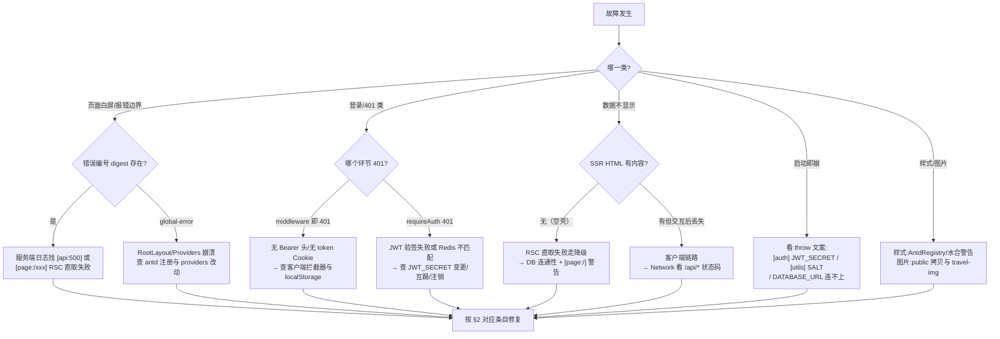

# 12-FAQ与故障排查

> 项目：react-travel ｜ 版本：v1.1 ｜ 生成日期：2026-10-06 ｜ 依据：源码分析

## 1. 本篇定位与排查准备工作

本篇是排障手册：按"高频报错与坑（含根因级解释）→ 排查决策树 → 日志入口与观测点"三段组织。区别于《06-部署运行》§8 的速查表（一句话级），本篇对每类问题给出**症状/根因/诊断动作/修复**四要素，并解释为什么代码会走到这一步——知道根因才能在没见过的变体上举一反三。动手排查前的三件准备：其一，确认运行形态（`pnpm dev` 还是 `next start`/standalone），两者在 ISR、样式抽取、错误边界上行为不同，dev 独有的问题（StrictMode 双跑、query 日志噪音）不应带到生产判断里；其二，打开两个日志面——服务端进程 stdout（`[api:500]`/`[page:/...]`/`[auth]`/`[sitemap]` 前缀都在这）与浏览器 Console/Network（hydration 警告、401/429 响应体）；其三，数据库侧备好 `pnpm prisma:studio`（直接看 11 张表的行级真相），很多"前端显示错"最终是"库里就没有对的数据"。

## 2. 高频报错与坑（按域分组）

### 2.1 启动与部署类

**坑 1：生产启动立即抛 `[auth] 生产环境必须通过环境变量 JWT_SECRET 设置强随机密钥…`（或 `[utils] …SALT…`）**。症状：`next start` 或 `node .next/standalone/server.js` 进程秒退，堆栈指向 `lib/auth.ts` 第 10 行或 `lib/utils.ts` 第 7 行。根因：两处模块加载期守卫在"生产运行时"（`NODE_ENV=production` 且非 `phase-production-build`）检测到密钥缺失或仍是示例值 `xiaoye` 就 throw。最隐蔽的变体是"构建机配了、运行机没配"——守卫刻意在 build 阶段不生效，所以 build 成功不代表运行环境就绪。诊断与修复：在**运行目录**注入强密钥（`openssl rand -hex 32` / `-hex 16`），既可写运行目录 `.env` 也可用进程环境变量；standalone 形态注意 server.js 加载的是其所在目录的 .env，不是仓库根的。**坑 2：`pnpm install` 后类型报错找不到 `generated/prisma`**。根因：postinstall 的 `prisma generate` 未执行成功——常见于 pnpm < 9（engines 约束）或 `pnpm-workspace.yaml#allowBuilds` 未放行 `@prisma/engines`/`prisma` 的构建脚本。修复：corepack 启用 pnpm 9+，必要时手动 `pnpm prisma:generate`；切分支后遇到指向 generated 的类型错误，第一反应都是先 generate 再排查。**坑 3：standalone 部署详情页/卡片图片全部 404 但文本正常**。根因：Next standalone 产物默认不含静态资源，漏拷 `public/`（或 `.next/static`）。修复按《06-部署运行》§4.2：`cp -r public .next/standalone/public && cp -r .next/static .next/standalone/.next/static`。**坑 4：`pnpm db:seed` 在生产执行导致清库**。这不是"故障"而是事故——seed.ts 的 main() 第一步按依赖序 deleteMany 全部 11 张表且无任何环境护栏。唯一防线是运维纪律（生产机不提供该入口）；事后只能从 pg_dump 恢复。**坑 5：构建成功但首页/内容页是空壳**。根因：构建环境 `DATABASE_URL` 不可用，五个 ISR 入口的 RSC 直取 try/catch 降级为空 props，build 不报错（这是设计），产物带空态上线。修复：构建环境连可用库重新 build；已上线的空态页面等第一个 revalidate 周期（60s/3600s）自动重建，或重启进程后 curl 预热。

### 2.2 登录与会话类

**坑 6：登录返回 401"用户名或密码错误"但密码确定正确**。按概率排查三步：① 查库确认账号存在且密码列形态——bcrypt 哈希以 `$2` 开头、md5 存量是 32 位 hex；若曾手工改过 password 列或换过 SALT，md5 账户全员失效（SALT 参与 `md5Password`，`lib/utils.ts` 第 16 行）；② 种子账号场景确认跑过 `pnpm db:seed` 且连接的是目标库（dev 库与"以为在用"的库不是同一个是最常见真相）；③ 服务端日志无限流记录（`authRateLimit` 命中不会打日志，但 429 响应可辨——文案是"请求过于频繁"而非"用户名或密码错误"）。**坑 7：登录成功后几分钟/几小时后突然全员"登录已失效"**。根因定位在 `requireAuth` 的第二段（`isTokenCached`）："登录已失效"这个文案只会由 Redis 缓存比对失败产生（`lib/auth.ts` 第 123 行），JWT 验签失败走的是"未登录或 token 失效"。三个可能：同用户名在别处重新登录（单值覆盖互踢，设计行为）；Redis 被重启/清空但 JWT 仍有效（缓存丢了 → cached=null ≠ token → 401，这是该方案的已知边界：**Redis 数据丢失等于强制全员重登** ⚠️ 待确认是否为可接受运维代价）；运维改过 `JWT_EXPIRES_IN` 导致 TTL 对齐错乱。**坑 8：接口返回 401"未登录或 token 失效"但浏览器里明明是登录态**。这是两段 401 里的第一段（JWT 验签失败或无 token）。排查顺序：Network 看请求头有没有 `Authorization`（没有 → 拦截器未生效：确认该请求走了 axios 默认实例而非裸 fetch，确认 `app/providers.tsx` 的 `installAuthInterceptor()` 未被改动）；有头但 still 401 → token 过期（默认 7d）或 `JWT_SECRET` 在两次部署间换过（旧 token 全部失效，属预期）；localStorage `travel_user` 里的 token 与 cookie 里同名残留冲突的场景极少（header 优先）。

### 2.3 渲染与水合类

**坑 9：Console 报 Hydration mismatch / "Hydration failed because the server rendered HTML didn't match the client"**。本项目已知的触发面与既有防御：任何"服务端与客户端渲染出不同内容"的字段都会触发——典型嫌疑是组件在渲染体内直接读 `localStorage`/`new Date()`/`Math.random()`（项目约定这类值只能出现在 effect 或 hydrated 之后的分支，参照 `useUserStore._hydrate` 的协议）；其次是懒加载三件套（useHotKeywords/HomePage 的 ref 守卫）被改动后破坏了 StrictMode 双跑假设。诊断动作：React 19/18.3 的警告会指出差异 DOM 位置，先看该组件是否读环境相关值；确认 `app/providers.tsx` 的 `useIsomorphicLayoutEffect` 水合未被绕过（新 store 直接在 useState 初始化器里读 localStorage 是最常见的新手违规——必须走 `_hydrate` + hydrated 位模式，`《11-扩展开发指南》§4`）。**坑 10：受保护页闪一下就被踢回 /signin（已登录用户）**。根因是水合竞态回归：`AuthGuard` 必须等 `hydrated === true` 再判 token（`app/_components/AuthGuard.tsx` 注释："子组件的 useEffect 先于父组件执行，若首帧就判定会把已登录用户误踢到登录页"）。若有人"优化"掉了 hydrated 判断或在新页面自写守卫直接读 token，就会复现。同理 `/orderSuccess` 必须等 `useOrderStore` 的 hydrated。**坑 11：刷新 `/placeOrder` 或 `/orderSuccess` 后空白/跳走**。先分清三类：无结算单跳回购物车引导（Empty 分支，设计行为）；非 Completed 状态跳回 /placeOrder（防假成功页，设计行为）；两者都不符合但仍异常 → 查 localStorage `travel_order` 是否被浏览器隐私策略清除（无痕模式/禁存储），以及 `hydrateOrderStore()` 是否仍在 providers 的水合序列里。

### 2.4 数据与接口类

**坑 12：搜索结果总数与列表条数对不上 / 翻页丢数据或重复**。根因模式：任何人改搜索逻辑时破坏了"列表与计数共用同一份 where/orderBy"的铁律——例如给 `searchHouses` 加了 orderBy 但 `countHouses` 没同步，或在 Handler 里另外构造了一份 where。`app/api/touristRoutes/route.ts` 第 39-41 行注释记载的正是修过的历史 bug（"固定 8 条 + 全表总数"式分页错乱）。诊断：对比两函数入参是否来自同一个 `buildWhere(params)` 输出；修复原则是永不复制 where 构造逻辑。**坑 13：`/api/touristRoutes` 返回 200 但分页组件不显示**。`x-pagination` 头缺失或非法时 `parsePagination` 返回 null（`useProductSearchStore.ts` 第 29-37 行），前端表现为有列表无分页。排查：curl -i 看响应头；若直连了 POST 形状（返回 `{status,data}` 包装、无该头），那是旧 Egg 兼容端点，客户端分页只认 GET 形状。**坑 14：垫片导出误删导致整站编译失败或运行时 undefined**。高发操作：有人觉得 `BrowserRouter/Routes/Route`"没人用了"就从 `lib/router.tsx` 删掉，或把 `useLocation` 的 search 改回 `useSearchParams()`。前者若仍有旧组件引用会在 tsc 门禁报错（这是好事），后者会触发 Next 构建期 "useSearchParams() should be wrapped in a suspense boundary" 报错——`lib/router.tsx` 第 55 行注释记载了这个坑。修复即恢复导出；预防见《13-技术债务与演进建议》§5 的退役规程（退役是"逐组件替换后再删导出"，不是直接删）。**坑 15：详情页 showCount 不增长（或疯长）**。不增长：`shouldBumpShowCount` 按 `房源id:IP:自然日` 去重，同 IP 当日只计一次（内存 Map，重启清零后重新可计）；拿不到 IP（XFF 缺失）时才每次都计。疯长：反向代理未覆写 `X-Forwarded-For`，攻击者可伪造首段绕过去重（《08-安全与权限设计》§5.2）。**坑 16：评论发布后列表不刷新/点赞数回退**。前者查 `ProductComments` 的 `onReplyAdded` 回调链（DetailPage 里应重新 `fetchProductComments`）；后者是乐观更新失败回滚生效——说明真实请求失败（Network 看 429/401/500），不是前端 bug。**坑 17：`/api/commons/citys` 500**。外部慕课接口不可达或 icode 失效，属已知容灾设计（500 而非挂起）；应急用 `CITYS_API` 环境变量切换数据源（《14-配置与环境详解》§2）。**坑 18：改了 VM 字段前端显示 undefined**。`lib/vm.ts` 是前后端的形状契约——服务端加了字段但 `houseToTouristRoute`/`houseToCardRoute` 没透出（卡片数据走的是裁剪版），或前端读的字段名是库列名而非 VM 名（`name` vs `title`）。对照《07-模块详解》§2.2 的"四副面孔"定位数据当前处于哪一形状。

## 3. 排查决策树（文字版操作序列）

按症状入口走以下序列（图示见 §1 mermaid）：**入口 A，启动即崩** → 读 throw 文案：`[auth]`/`[utils]` 前缀走坑 1；`DATABASE_URL` 连接拒绝 → 确认 PG 运行、库已创建（createdb）、连接串拼写；`Cannot find module .../generated/prisma` 走坑 2。**入口 B，页面级异常** → ① 整站白屏且看到"网站出现严重错误"（global-error）→ RootLayout/Providers/AntdRegistry 链路被改坏，回退最近改动；② 单路由"页面出错了"+digest（error.tsx）→ 服务端日志找同时间戳的 `[api:500]` 或 `[page:/xxx] RSC 直取失败`——前者是 API 异常（堆栈完整在服务端），后者确认是 DB 故障降级（页面应该仍可用，若页面也白屏说明降级分支被破坏）；③ 404"页面去火星了" → 路由文件不存在或 notFound() 主动触发（详情页非法 id/房源不存在）。**入口 C，接口级异常** → Network 看状态码：401 走坑 8/7 的两段定位法（文案是分界线）；429 检查限流维度与代理 XFF（大量用户同时 429 = 代理未覆写，单人 429 = 正常防刷）；500 的响应体只有脱敏文案，真相在服务端 `[api:500]` 日志。**入口 D，数据不对** → 三分法：SSR HTML 里就没有（RSC 链路：services→DB，用 prisma:studio 验证库）；HTML 有交互后丢（客户端链路：store→API，看请求参数与响应体）；只有个别字段错（VM 链路：坑 18）。

## 4. 日志入口与观测点清单

服务端日志（进程 stdout/stderr）的**约定前缀索引**是本项目的观测主通道：`[api:500]`（`lib/utils.ts#apiError`——所有未捕获 API 异常的唯一留痕点，带完整堆栈）；`[page:/...]`（五个 RSC 页面的直取失败降级警告，如 `[page:/] 首页推荐 RSC 直取失败，回退客户端拉取`）；`[sitemap] 房源列表获取失败，降级为静态路由`；`[auth]`（JWT_SECRET 缺失警告、Redis 缓存/校验/清除失败三类错误——**Redis 相关错误不影响可用性但意味着注销能力降级**）；`[api:commentLikes:DELETE]`（取消点赞真实故障专项）；`[app/error]`（客户端 error.tsx 边界，打在浏览器 Console 而非服务端）。**Prisma 日志分级**（`lib/prisma.ts`）：开发环境 `query/error/warn` 三级全开（控制台可见每条 SQL，是数据问题排查的第一利器），生产仅 `error`——生产查 SQL 需临时改级别或用 prisma:studio。**浏览器侧观测点**：React hydration 警告（Console）；Network 面板三个关键字段——请求头 Authorization、响应头 x-pagination、响应体 `{status, errMsg}` 形状；localStorage 两个键 `travel_user`/`travel_order`（会话与结算单的客户端真相）。**数据库侧**：`pnpm prisma:studio`（5555 端口，生产勿对外暴露）；`showCount`/`viewTime`/`isPayed`/`orderNumber` 四个字段是行为数据的对账锚点。**当前没有**的观测能力（补齐建议见《13-技术债务与演进建议》§8）：集中式日志收集、请求链路 ID、错误上报（Sentry 类）、性能指标——多实例或生产用户量上来之前，进程 stdout + 手工核对就是全部可观测性。
