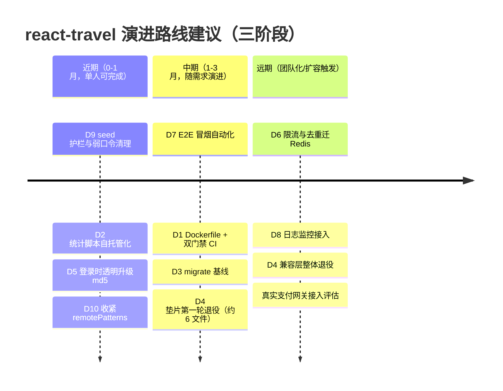

# 13-技术债务与演进建议

> 项目：react-travel ｜ 版本：v1.1 ｜ 生成日期：2026-10-06 ｜ 依据：源码分析

## 1. 债务清单总览与评级方法

本篇把散落在前文的 ⚠️ 项与走读中识别的短板汇总为一份可执行的债务台账。评级口径：**影响**（安全/可用性/效率/可维护性四维，取最高）× **紧迫度**（现在就会咬人 / 扩容时咬人 / 长期腐蚀）× **清偿成本**（人日级估算）。总原则与项目现状一致：这是一个单实例、个人维护的迁移完成态项目，债务清单的价值不在于"全部清零"，而在于**知道每一笔欠的是什么、什么时候必须还**。

| # | 债务项 | 影响 | 紧迫度 | 成本 | 详见 |
|---|---|---|---|---|---|
| D1 | Docker/CI 配置缺失 | 效率/可用性 | 扩容时 | 2-3 人日 | §2 |
| D2 | Umami 自建 id 与第三方脚本硬编码 | 效率/合规 | 现在就会咬人（内网） | 0.5 人日 | §2 |
| D3 | Prisma 无 migrations 基线 | 可维护性 | 团队化时 | 1 人日 | §2/《06》§5.5 |
| D4 | client/ 兼容层滞留 | 可维护性 | 长期腐蚀 | 分阶段 | §2 + §3 |
| D5 | md5 存量密码无迁移机制 | 安全 | 长期腐蚀 | 0.5 人日 | §2/《08》§7 |
| D6 | 限流/去重内存态（单实例边界） | 可用性 | 扩容时 | 1-2 人日 | §2/《06》§6.3 |
| D7 | 零自动化测试 | 可维护性 | 长期腐蚀 | 分阶段 | §2/《09》§5 |
| D8 | 无集中日志/监控/错误上报 | 可用性 | 扩容时 | 2-4 人日 | §2/《12》§4 |
| D9 | seed 无护栏 + 种子弱口令 | 安全 | 现在就会咬人 | 0.5 人日 | §2/《06》§5.2 |
| D10 | images.remotePatterns 全放行 | 安全（潜伏） | 启用 next/image 前 | 0.1 人日 | §2/《08》§7 |

在逐项拆解之前，先回答一个维护者都该问的问题：**这些债务从哪来、为什么当时合理**。清单里的每一笔几乎都能在迁移决策中找到出处：D4 兼容层是"前端不重写"决策（《01-系统架构》§2.2）的直接产物，用一次性兼容成本换来了迁移窗口内的功能零回退；D3 无迁移目录是单人快速迭代期的理性取舍，把 schema 演进的速度放在了审计之上；D6 内存态限流是"单实例部署"前提下的最简实现，源码注释在写下它的同时就预告了它的边界；D7 零测试是迁移期"以构建门禁为验收"策略的遗留。看清这一点有两个用处：其一，不要用"代码质量差"来误判这些位置——它们大多带着解释动机的注释，属于**知情的取舍**而非无知的技术债；其二，清偿每一笔时都应先确认当初的取舍前提是否已经变化（例如接了第二个维护者、第二台实例），前提未变时提前清偿是负收益。这份台账因此按"触发条件"而非"严重程度"组织执行顺序：有些低危项（D2/D9）现在就该做，有些高危项（D6）反而可以等。

## 2. 债务明细：位置 / 证据 / 影响 / 建议

**D1 Docker 与 CI 配置不存在**。位置：仓库根目录（全仓文件清单可证无 `Dockerfile`、`docker-compose*.yml`、`.github/`、`.gitlab-ci.yml`、`ecosystem.config.js`）。证据：`next.config.js` 第 4 行注释"便于 NAS 容器直接运行"表明 standalone 产物是容器化的意图，但容器化的最后一公里（镜像定义）没有落地；《06-部署运行》§1 已将其标为 ⚠️ 待确认。影响：部署依赖手工步骤（build → 拷贝 public/static → node server.js），人工遗漏正是《12-FAQ》坑 3（图片 404）这类事故的温床；质量门禁（tsc + build）全靠自觉执行，无机器强制。建议：三件套最小实现——① 多阶段 Dockerfile（builder 阶段 `pnpm install && pnpm build`，runner 阶段基于 `node:20-slim` 只拷 `.next/standalone` + `public` + `.next/static`，`CMD ["node", "server.js"]`，ENV 注入 `PORT/HOSTNAME`）；② CI 流水线（push 触发 `pnpm install → tsc --noEmit → build（连测试库）→ Playwright 冒烟`，见《09-测试与质量保障》§5 阶段一）；③ compose 文件编排 app + postgres + 可选 redis 一键起本地全栈。

**D2 Umami 自建 id 与第三方脚本硬编码**。位置：`app/layout.tsx` 第 81-86 行。证据：script 标签硬编码 `https://analytics.zhangzhengyang.com/script.js` 与 `data-website-id="f03a0a08-b377-4050-8ed4-47314ba65938"`，均为作者个人环境绑定值，未抽环境变量。影响：其一，他人/他环境部署时该统计指向不可达或无权的站点（自托管/内网时纯噪音，好在 defer 不阻塞）；其二，第三方分析脚本属于供应链面（无 SRI、无 CSP 约束）；其三，id 与目标站点绑定，自建 Umami 后旧 id 无效（《06-部署运行》§6.5 标注 ⚠️ 待确认）。建议：抽成 `NEXT_PUBLIC_UMAMI_SRC`/`NEXT_PUBLIC_UMAMI_ID` 两个构建期内联变量，未配置时不渲染 script 标签；自托管时重新注册站点获取新 id；若追求合规可换自托管 Plausible/Umami 并补 CSP。

**D3 Prisma migrate 基线为演进建议**。位置：`prisma/` 目录（无 `migrations/` 子目录）；`package.json#scripts` 无 migrate 相关命令。证据：建表与变更只走 `prisma db push`，《06-部署运行》§5.5 已完整记录该取舍的操作纪律（staging 演练 / pg_dump 快照 / generate 同步）并明确"若后续团队化需要迁移审计，可评估引入 Prisma 的 migrate 工作流并以 migrate diff 生成基线（当前仓库未包含任何 migrate 相关配置，此为演进建议而非现状）"。影响：无迁移历史意味着无法回答"生产库结构对应哪版 schema"、无法可回放地升级、多人协作时 push 是相互覆盖式的。建议（团队化触发时执行一次）：`prisma migrate diff --from-empty --to-schema-datamodel prisma/schema.prisma --script > migrations/0_init/migration.sql` 生成基线，`prisma migrate resolve --applied 0_init` 标记已应用（生产库结构已与 schema 一致的场景），此后一律 `migrate dev/deploy`；单人阶段维持现状即可，不值得预付。

**D4 垫片与兼容层的退役路线**（详见 §5 专节）。**D5 md5 存量密码无透明升级**：位置 `lib/password.ts#verifyPassword` 第 37 行——md5 分支命中后直接返回，不回写 bcrypt。证据与影响见《08-安全与权限设计》§7.2。建议一行式修复：md5 比对成功后 fire-and-forget 调 `hashPassword` 更新该用户 password 列（旧 Egg 账户在首次成功登录时无痛迁移），配合时间表（如 90 天后未登录的存量账户锁定）彻底退役 md5。

**D6 内存态限流与浏览量去重**。位置：`lib/rate-limit.ts`（buckets Map，头注释"单实例够用；多实例部署需换 Redis"）与 `lib/services/house.ts#shouldBumpShowCount`（bumpKeys Map，《06-部署运行》§6.3 列为水平扩展三改造点之一）。建议：触发条件出现时（第二实例上线），把两者迁到同一 Redis（限流用 INCR+EXPIRE 原子窗口，去重用 SETEX 键 `bump:<house>:<ip>:<day>`）；`lib/auth.ts` 已有 Redis 封装可复用连接管理。

**D7/D8/D9/D10**：测试缺口与补测路线全案见《09-测试与质量保障》§5；观测能力入口清单见《12-FAQ与故障排查》§4、补齐建议见《09-测试与质量保障》§5 阶段四与《08》§7；seed 护栏建议（NODE_ENV 检查 + 连接串含 production 关键字时拒绝 + 交互确认三选一）与种子账号清理纪律见《06-部署运行》§5.2；`next.config.js` 的 remotePatterns `{ hostname: "**" }` 当前无攻击面（未用 next/image），但启用图片优化前必须收敛为具体域名白名单（`travel-img` 本地路径不受影响）。

**补充一笔易被忽视的债务：文档漂移（D11，成本 0.5 人日）**。位置：仓库根 `NEXT_MIGRATION_PLAN.md`。证据：这份迁移计划写于动工前，与最终落地存在多处已知偏差——计划保留 Redux Toolkit + redux-persist（实际落地 Zustand，`《01-系统架构》§2.2` 已记录该差异）、计划使用路由组 `(main)/(auth)` 做布局（实际沿用手工 MainLayout/UserLayout 组件包裹）、计划保留 react-i18next（实际未迁移，现状纯中文）、计划 Phase 7 引入 next/image（实际走 disableStaticImages 的 CRA 语义）、计划中 `cra:dev/cra:build` 回退脚本（实际 package.json 无 CRA 残留）。影响：新维护者以计划文档为地图会在上述五处迷路（好在文档 00-06 系列均"以源码为准"重述过事实）；随时间推移偏差还会扩大。建议：在 `NEXT_MIGRATION_PLAN.md` 顶部加一段"历史文档声明"，注明其规划性质、列出与落地的五处差异并指向《01-系统架构》§2 与本篇；不必重写正文（它的价值在于记录当时的决策上下文）。

## 3. client/ 兼容层退役计划（分四轮）

兼容层的存在成本是长期性的：双层数据源约定（initialXxx 可选 props）让每个视图都比必要状态多一个分支；垫片 API 与原生 API 并存让新人困惑；`BrowserRouter` 等死导出是持续的心智税。退役目标态：`client/` 的视图/组件改用原生 `next/navigation` 与 `next/link`，`lib/router.tsx` 删除，`/auth` rewrite 与 `disableStaticImages` 随最后一个消费方退场。原则（README 已载明方向）：**逐组件替换、每轮可发布、导出只减不增**。

判定现状的消费矩阵（依据对源码 import 的通读）：

| 垫片设施 | 当前消费方（client/ 内） | 退役难度 |
|---|---|---|
| `lib/router.tsx#useNavigate` | Header/HomePage/DetailPage/SearchPage/ShoppingCart/PlaceOrder/orderSuccess/SignInForm/RegisterForm/OrdersPage/PersonalPage/FavoritesPage/OrderDetailPage 等几乎全部视图 | 中（量大但机械：navigate(x) → router.push/replace，数字导航场景少） |
| `lib/router.tsx#useParams` | DetailPage、SearchPage（其余 app 页在 RSC 层已解 params） | 低 |
| `lib/router.tsx#useLocation` | SearchPage（读 pathname + search） | 低（usePathname 原生；search 需包 Suspense 或从 window 读，保持现策略） |
| `lib/router.tsx#Link` | UserLayout、Footer、TourCard 等 | 低（to → href 机械替换） |
| `BrowserRouter/Routes/Route` 占位 | ⚠️ 待确认：全仓 import 扫描未见实际消费（迁移中已拆除路由树），可第一时间验证后删除 | 极低 |
| `/auth` rewrite | `useUserStore.signIn`、SignInForm、RegisterForm | 极低（改 3 处 URL 为 /api/auth/*，rewrite 随后删除） |
| 静态资源 CRA 语义 | 各视图的图片 import（HomePage 轮播等）+ `types/assets.d.ts` | 高（涉及全部图片引用改 public 路径或 next/image，建议最后做或与 next/image 迁移合并） |

四轮退役节奏：**第一轮（随手做，半天）**：删除无消费的 `BrowserRouter/Routes/Route` 占位导出（先全局 grep 确认零引用）；`/auth/*` 调用点改直连 `/api/auth/*` 并删 rewrites——两项都在双门禁保护内，风险最低。**第二轮（一个专注 PR）**：useNavigate/useParams/useLink 机械替换，按视图逐个改（每改一个组件即跑该页冒烟），全部完成后 `lib/router.tsx` 缩减为只剩 useLocation；`normalizePath` 的 `/signin` 大小写归一逻辑此时改由调用方保证（或保留一个 util 函数）。**第三轮**：SearchPage 的 useLocation 替换（注意 Suspense 边界坑，`lib/router.tsx` 第 55 行注释），垫片文件删除，`client/` 从此无服务端兼容代码。**第四轮（与性能优化合并）**：图片语义迁移——CRA import 语义退场，统一 `/travel-img/...` 字符串路径或 next/image，删 `disableStaticImages`、webpack asset 规则与 `types/assets.d.ts`。每轮的验收即《09-测试与质量保障》§4 冒烟清单全量。**退役期铁律**（`《01-系统架构》§5.5`）：退役完成前不删任何垫片导出；一轮 PR 不跨两轮内容。

## 4. 架构演进候选项（按触发条件挂起）

以下各项**不建议现在做**，但应知道触发条件与方向：其一，**真实支付网关**——当前"支付"是状态翻转模拟，接入微信/支付宝时 `payRows/payOrder` 的事务骨架可复用，但需新增支付单表（不能继续让 Orders 一体两面）、异步回调端点（需处理幂等与中间态"支付中"）、以及对账任务；触发条件：真实交易需求立项。其二，**运营后台**——线路/目的地/专题/游记当前无任何管理端点（`《04-数据模型》§4` 已标注 ⚠️ 待确认人工 SQL 维护），数据量或运营角色出现时，最小方案是复用 Route Handler 体系加 `/api/admin/*` 域 + 独立角色字段（User.role）+ requireRole 守卫，不要为此引入第二个应用。其三，**多实例化**——D6 + Redis 共享 + ISR 缓存策略复查（多实例 ISR 各自重建可接受但浪费），触发条件：单实例容量或可用性不满足。其四，**i18n**——迁移计划里的 react-i18next 最终未迁移（现状纯中文硬编码），触发条件：多语言需求立项时直接评估 next-intl 而非复活旧方案。其五，**数据库规模治理**——`searchHouses` 的 contains 全表扫描、showCount 排序无索引，在万级线路前无感（`《04-数据模型》§5`），触发条件：数据量过万或搜索 P95 劣化。

## 5. 演进路线图汇总

把上文收敛为一张路线图（对应 §1 timeline）：**近期（0-1 月，全部单人日级）**：D9 seed 护栏、D2 统计脚本环境变量化、D5 登录透明升级 md5、D10 remotePatterns 收紧、D4 第一轮退役（死导出 + /auth rewrite）——这五项的共同点是零架构变更、纯收益。**中期（1-3 月，随功能需求顺路做）**：D7 阶段一 E2E 冒烟（《09》§5）、D1 Dockerfile 与 CI 双门禁、D3 migrate 基线（团队化前）、D4 第二轮垫片替换。**远期（由外部条件触发）**：D6 Redis 化与 D8 观测接入（多实例触发）、D4 第三四轮（重构窗口触发）、支付网关/后台/i18n（业务触发）。每阶段进入前重读本篇对应小节与关联篇目，避免在触发条件未满足时提前支付复杂度——这份"什么时候才需要做"的判断，与"怎么做"同等重要。
