# 15-接口全量参考

> 项目：react-travel ｜ 版本：v1.1 ｜ 生成日期：2026-10-06 ｜ 依据：源码分析

## 1. 全局约定与总览

本篇按业务域给出全部后端端点的速查详表。统计口径以源码为准：`app/api/` 下共 **28 个 route.ts 文件、39 个 HTTP 方法处理函数**（早期文档所记"31 个端点文件"为粗算，以本篇实数为准）。表格列的含义：**入参**列区分路径段/query/body 三类；**鉴权**列的三种取值——`公开`（middleware 不拦 + Handler 不校验）、`公开读+可选token`（仅 GET，带有效 token 时附加个性化标注，无效 token 不报 401）、`requireAuth`（双段校验）；**错误**列只列该端点**特有**的分支，通用分支不重复（全站通用：JSON body 非法按缺字段走 400；未捕获异常统一 500"服务器内部错误，请稍后重试"并打 `[api:500]` 日志；命中限流 429 + Retry-After；requireAuth 失败 401，文案两段式——验签失败"未登录或 token 失效"、Redis 比对失败"登录已失效"）。

响应形状有三族，调用方务必分辨：**A 族 `{status, ...}`**（Egg 风格，认证/用户/订单/内容类），错误形态 `{status, errMsg}`；**B 族裸数组/裸对象**（imooc 风格，`/api/touristRoutes` GET、`/api/touristRoutes/[id]`、`/api/shoppingCart*`、checkout/placeOrder 的结账单），分页元数据走 `x-pagination` 响应头；**C 族幂等布尔**（收藏/点赞的 `{favorited|liked: boolean}`）。所有响应经 `serialize()`（BigInt→Number、Date→毫秒）；`HOUSE_DETAIL_SELECT` 投影的详情响应因源头剔除 BigInt 免转换。

```mermaid
graph TB
    subgraph PublicRead["公开读（内容域）"]
        TR["GET /api/touristRoutes<br/>+x-pagination"]
        TRD["GET|POST /api/touristRoutes/:id"]
        PC["GET /api/productCollections"]
        DES["GET /api/destinations"]
        TOP["GET /api/topics"]
        REV["GET /api/reviews"]
        CITY["GET|POST /api/commons/citys"]
        HK["GET /api/commons/hotKeywords"]
        CML["GET /api/comments/:houseId<br/>（可选token→likedByMe）"]
    end
    subgraph AuthDomain["认证域（公开+限流8/min）"]
        LOGIN["POST /api/auth/login<br/>(rewrite /auth/login)"]
        REG["POST /api/auth/register"]
        OUT["POST /api/auth/logout<br/>（requireAuth）"]
    end
    subgraph Protected["受保护域（requireAuth）"]
        USR["POST /api/user/detail|edit"]
        CART["GET /api/shoppingCart<br/>POST items · DELETE items/:ids<br/>POST checkout"]
        ORD["GET|POST /api/orders<br/>GET|DELETE /api/orders/:id<br/>POST orders/:id/placeOrder<br/>POST orders/pay · orders/has"]
        SOC["POST /api/comments<br/>POST|DELETE /api/commentLikes<br/>GET|POST|DELETE /api/favorites<br/>GET /api/favorites/ids<br/>GET|POST /api/viewHistory"]
    end
    TR --> SVC[("lib/services/*")]
    TRD --> SVC
    PC & DES & TOP & REV & CITY & HK & CML --> SVC
    OUT --> JWT["lib/auth.ts<br/>requireAuth / clearToken"]
    USR & CART & ORD & SOC --> JWT --> SVC
    LOGIN & REG -.->|"签发+缓存 token"| JWT
```

## 2. 认证域（auth）

| 方法 | 路径 | 用途 | 入参 | 成功响应 | 鉴权/限流 | 特有错误 |
|---|---|---|---|---|---|---|
| POST | `/api/auth/login`（`/auth/login` 经 rewrite） | 登录签发 token | body：`username ?? email`（trim）、`password` | `{status:200,id,username,avatar,phone,sign,createTime,token}` | 公开；authRateLimit(`login:<用户名>:<IP>`) 8/min | 400"用户名和密码必填"；401"用户名或密码错误"（DUMMY 哈希时序对齐） |
| POST | `/api/auth/register`（`/auth/register` 经 rewrite） | 注册并签发 token | body：`username ?? email`(3-20 字符)、`password`(6-20)、`confirmPassword?`、`avatar?`(≤2000)、`phone?`(≤20)、`sign?`(stripHtml≤300) | `{status:200,...serializeUser,token}` | 公开；authRateLimit(IP) 8/min | 400"用户名长度需为 3-20 个字符"/"密码长度需为 6-20 个字符"/"两次密码不一致"/"用户已经存在"（预查 + P2002 双保险） |
| POST | `/api/auth/logout` | 服务端注销（删 Redis key） | 无 body | `{status:200,data:"ok"}` | requireAuth | —（Redis 未配置时空操作仍 200） |

## 3. 用户域（user）

| 方法 | 路径 | 用途 | 入参 | 成功响应 | 鉴权 | 特有错误 |
|---|---|---|---|---|---|---|
| POST | `/api/user/detail` | 当前登录者资料 | 无 body | `{status:200,id,username,avatar,phone,sign,createTime}`（serializeUser 剥离 password） | requireAuth | 404"用户不存在"（token 有效但用户已删） |
| POST | `/api/user/edit` | 改资料 | body：`avatar?`(≤2000)、`phone?`(≤20)、`sign?`(stripHtml≤300)；非字符串字段忽略 | `{status:200,data:userVM}` | requireAuth | — |

**域走读要点**：这一族接口是全仓"以 POST 读数据"最集中的地方（detail 是查询却用 POST），这是原 Egg 后端"13 个全 POST 接口"契约的直系遗产，客户端 `useUserStore.getMe/editUserInfo` 沿用至今——调用新客户端时不要"顺手改 GET"，middleware 的 PROTECTED_API 前缀匹配与现有调用方都按 POST 约定。另一个值得注意的响应细节：登录/注册的响应体把用户字段**平铺在顶层**（`{status:200, id, username, ..., token}`），而 user/detail 也用同样的平铺形状，唯独 user/edit 把结果包在 `data` 里——三处形状不完全一致是历史演进的活化石，前端两套取值路径（`data.username` 与 `data?.data?.username`，见 `useUserStore.editUserInfo` 第 99 行的 `data?.data ?? data` 双兜底）就是这么来的，对接时以本表"成功响应"列为准。

## 4. 线路域（touristRoutes / productCollections）

| 方法 | 路径 | 用途 | 入参 | 成功响应 | 鉴权 | 特有错误 |
|---|---|---|---|---|---|---|
| GET | `/api/touristRoutes` | 搜索/列表（主链路） | query：`keyword`、`tripType`、`pageNumber ?? pageNum`、`pageSize`(默认10)、`priceMin/priceMax`、`sortBy ∈ {recommended,price-asc,price-desc,newest}`（非法→recommended） | **裸数组** touristRoute VM[] + 响应头 `x-pagination:{currentPage,pageSize,totalCount,totalPages}`；列表与计数共用 buildWhere | 公开 | — |
| POST | `/api/touristRoutes` | 搜索（旧 Egg 形状） | body：`houseName ?? keyword`、`tripType`、`code`、`startTime/endTime`(BigInt 毫秒)、`priceMin/priceMax`、`pageNum/pageSize`、`sortBy` | `{status:200,data:rows}`（House 库行投影，**非** VM） | 公开 | — |
| GET、POST | `/api/touristRoutes/[id]` | 详情 | 路径 `id`；viewerIp 取 XFF 首段 | 裸对象 touristRoute VM（features/fees/notes 已净化）；浏览量按 IP+房源+自然日去重自增 | 公开 | 400"无效的房源 id"；404"房源不存在" |
| GET | `/api/productCollections` | 首页三推荐集合 | 无 | `[{id:1,title:"爆款推荐",touristRoutes:CardVM×9},{id:2,新品上市},{id:3,国内游推荐}]` | 公开 | — |

**域走读要点**：线路域的四个端点支撑着全站两条数据链路（RSC 直取与 API 回退共用 `lib/services/house.ts`，见《07-模块详解》§2），因此本域接口的响应形状稳定性是全站最高的契约——`touristRoute` VM 的字段集（title/price/originalPrice/discountPresent/rating/travelDays/tripType/departureCity/touristRoutePictures/features/fees/notes/coupons/points）由 `lib/vm.ts#houseToTouristRoute` 独家定义，任何字段增删都必须同时过《11-扩展开发指南》SOP 一的验收。POST `/api/touristRoutes` 与 GET 的形状差异（库行投影 vs VM）是本域最容易踩的坑：POST 返回的行没有 `title` 字段（叫 `name`）、富文本未净化、图片字段叫 `imgs` 而非 `touristRoutePictures`——它是给旧调用习惯保留的最小兼容，新代码一律走 GET。详情端点的 GET/POST 双导出内部是同一个 handle 函数，语义完全等价（含浏览量自增），选哪个只看调用方习惯；自增按 XFF 首段去重的副作用是本接口**不适合做压力测试**（同 IP 当日只计一次），压测前请知悉。

## 5. 内容运营域（destinations / topics / reviews）

| 方法 | 路径 | 用途 | 入参 | 成功响应 | 鉴权 | 特有错误 |
|---|---|---|---|---|---|---|
| GET | `/api/destinations` | 目的地列表 | 无 | `{status:200,data:Destination[]}`（sortOrder asc；无 createTime） | 公开 | — |
| GET | `/api/topics` | 专题列表（含线路卡） | 无 | `{status:200,data:Topic[]}`，topicHouses 按 sortOrder，house 仅 id/name/price/首图 | 公开 | — |
| GET | `/api/reviews` | 游记列表 | query：`pageNum`、`pageSize`（默认 100，钳 [1,100]） | `{status:200,data:Review[]}`（user 含 username/avatar/sign；createTime 毫秒；images 为 JSON 字符串） | 公开 | — |

**域走读要点**：内容三域（destinations/topics/reviews）加上 commons 是"RSC 与 API 共用服务函数"模式的另一半样本：三个 GET 端点各自与对应内容页的 RSC 直取调用同一个 `lib/services` 函数（`《07-模块详解》`§1 的域清单），因此响应体形状与 RSC 注入 props 完全一致——前端在服务端注入缺失时回退调用这些端点是无缝的（`DestinationsPage/TopicsPage/ReviewsPage` 的 initialXxx 模式）。三者的数据源是纯运营内容（Destination/Topic/Review 表），当前唯一写入渠道是种子脚本（`prisma/seed.ts`），接口层没有写端点——这意味着内容更新后最长要等对应页面的 ISR 周期（3600s）才对外可见，运营时效要求高于一小时时需要先补管理端点（《13-技术债务与演进建议》§4 候选项二）。commons 域的 citys 端点是全仓唯一的外部转发接口，它的 500 是"外部依赖失败"而非本站故障，监控告警应区别对待；hotKeywords 的两个分支（联想/热词）共用一个端点，以 keyword 参数有无切换，绕过 services 直查 prisma 的历史遗留风格见 `《01-系统架构》§5`。

## 6. 公共域（commons）

| 方法 | 路径 | 用途 | 入参 | 成功响应 | 鉴权 | 特有错误 |
|---|---|---|---|---|---|---|
| GET、POST | `/api/commons/citys` | 城市数据（转发外部） | 无 | `{status:200,data:citys[]}` | 公开 | 500"获取城市数据失败"（外部不可达/status≠200；`CITYS_API` 可切换源，fetch 缓存 1 天） |
| GET | `/api/commons/hotKeywords` | 热词/联想 | query：`keyword?`（trim + 剔 `%_\` + 限长 30） | `{status:200,data:[{id,name}]}`；有 keyword→name insensitive contains 取 8 条（showCount desc），无→Top10 热词 | 公开 | — |

## 7. 评论域（comments / commentLikes）

| 方法 | 路径 | 用途 | 入参 | 成功响应 | 鉴权 | 特有错误 |
|---|---|---|---|---|---|---|
| GET | `/api/comments/[houseId]` | 房源评论列表（公开读） | 路径 `houseId`；query `pageNum/pageSize` | `{status:200,data:CommentVM[]}`：顶级 createTime desc 分页 + replies（asc，≤20）+ likeCount；带有效 token 时 `likedByMe` | 公开读+可选token | — |
| POST | `/api/comments` | 发评论/回复 | body：`houseId`、`comment ?? msg`（stripHtml≤500）、`parentId?`（Number.isFinite 校验） | `{status:200,data}`（含 user avatar/username） | requireAuth + 20/min(`comment:<userId>`) | 400"houseId 和评论内容必填"；500"评论失败（房源不存在或数据异常）" |
| POST | `/api/commentLikes` | 点赞 | body：`commentId` | `{status:200,data:{liked:true}}` | requireAuth + 20/min(`like:<userId>`) | 400"缺少 commentId"；P2002→200 `{liked:true,msg:"已点赞"}`（幂等）；500"点赞失败" |
| DELETE | `/api/commentLikes` | 取消点赞 | body：`commentId`（DELETE 带 body） | `{status:200,data:{liked:false}}` | requireAuth | 400"缺少 commentId"；P2025→200 幂等；500"取消点赞失败"（服务端留痕 `[api:commentLikes:DELETE]`） |

**域走读要点**：评论域是唯一"读公开、写受限"的混血域，其鉴权三态值得单独说明——`GET /api/comments/:houseId` 在 middleware 层被 PUBLIC_GET 正则放行，在 Handler 层只做 `verifyToken` 且失败不拒：token 缺失/过期时返回的仍是完整评论列表，只是 `likedByMe` 全 false（`app/api/comments/[houseId]/route.ts` 的设计意图是"评论区对游客完全可用"）。这带来一个集成提示：该接口**永远不会 401**，客户端不要为它写 401 处理分支；反之 POST `/api/comments` 即便 body 合法，middleware 就会把无凭证请求拦在门外（前缀 `/api/comments` 命中 PROTECTED_API 且 POST 不匹配 PUBLIC_GET）。点赞/取消的幂等语义完全建立在 `CommentLike @@unique([commentId, userId])` 之上，调用方对 P2002/P2025 的存在无感（都被翻译成 200 + 布尔），因此客户端可以放心做"双击防护失败也无害"的乐观更新——真实 500 只在 DB 层故障时出现，此时前端应回滚乐观 UI（`ProductComments.tsx` 的既有行为）。回复上限 20 条是查询层的防御值而非业务规则：第 21 条回复存在但不出现在列表里，若未来做"加载更多回复"需扩展该接口的分页参数（`lib/services/comment.ts` 的 take: 20 注释已预留此方向）。

## 8. 收藏与浏览史域（favorites / viewHistory）

| 方法 | 路径 | 用途 | 入参 | 成功响应 | 鉴权 | 特有错误 |
|---|---|---|---|---|---|---|
| GET | `/api/favorites` | 收藏列表 / 单查 | query：`houseId?`（正整数才视为单查，非法值走列表）、`pageNum/pageSize`(默认 10) | 单查 `{status:200,data:{favorited}}`；列表 `{status:200,data:{list,total}}`（createTime desc） | requireAuth | — |
| POST | `/api/favorites` | 收藏 | body：`houseId` | `{status:200,data:{favorited:true}}` | requireAuth + 20/min(`fav:<userId>`) | 400"缺少 houseId"；P2002→200 `{favorited:true,msg:"已收藏"}`；500"收藏失败" |
| DELETE | `/api/favorites` | 取消收藏 | body：`houseId` | `{status:200,data:{favorited:false}}` | requireAuth + 20/min(`fav:<userId>`) | 400"缺少 houseId"；P2025→200 幂等；500"取消收藏失败" |
| GET | `/api/favorites/ids` | 收藏 id 集合（批量判态） | 无 | `{status:200,data:{ids:[houseId]}}`（createTime desc） | requireAuth | — |
| GET | `/api/viewHistory` | 浏览史列表 | query：`pageNum/pageSize`(默认 20) | `{status:200,data:{list,total}}`（viewTime desc，含房源+首图） | requireAuth | — |
| POST | `/api/viewHistory` | 上报浏览（upsert 语义） | body：`houseId` | `{status:200,data:null}` | requireAuth | 400"缺少 houseId" |

## 9. 购物车域（shoppingCart）

存储语义：购物车 = Orders 表 `isPayed=0` 的行（`lib/services/cart.ts` 头注释）。

**域走读要点**：本域四个端点共享一个返回值约定——**除 checkout 外，列表、加购、删除的响应都是"操作后的最新全量购物车"**（`{shoppingCartItems}`），客户端拿到即整体回写 store，不存在"增量补丁"语义；这决定了调用方不应假设 POST/DELETE 的响应体与请求相关（加购两件不同房源得到的响应体长度可能相同——第二件命中查重幂等返回），要以内容为准而非操作意图。加购端点的 500 分支是全仓唯一的"业务文案白名单透传"实现：只有 `房源不存在` 这一条 message 会被原样返回，其余异常（含 advisory lock 冲突、连接池耗尽）一律脱敏——判断加购失败原因时应以该文案为唯一可信信号。删除端点的路径参数 `(1,2,3)` 是 imooc 时代的括号约定，`decodeURIComponent` 后剥括号再 split，手工构造请求时括号可省略也可带上（两种写法等价），id 含非数字会被 `filter(Boolean)` 静默丢弃——注意空数组的情形会显式 400。checkout 的 `discountPresent` 恒为 1 且 `state` 恒为 `StateProcessing`，这两个值是给前端 CheckOutCard/成功页的状态机消费的哨兵值，改任何一个都要联动 `app/orderSuccess/page.tsx` 的 Completed 判定。
|---|---|---|---|---|---|---|
| GET | `/api/shoppingCart` | 购物车列表 | 无 | `{shoppingCartItems:[{id,originalPrice,discountPresent,touristRoute}]}`（orderToCartItem VM） | requireAuth | — |
| POST | `/api/shoppingCart/items` | 加购 | body：`touristRouteId`；事务 + `pg_advisory_xact_lock(userId)` 防双击；写入价格快照 | `{shoppingCartItems}`（最新全量） | requireAuth | 400"touristRouteId 必填"；500"房源不存在"（唯一白名单透传文案）/其余脱敏"加入购物车失败" |
| DELETE | `/api/shoppingCart/items/(1,2,3)` | 删除条目 | 路径段为括号包裹的逗号 id 列表（decodeURIComponent 后剥括号） | `{shoppingCartItems}`（最新全量） | requireAuth | 400"无效的 id 列表"；删除范围 SQL 层限定本人未支付行 |
| POST | `/api/shoppingCart/checkout` | 结算（视图转换，不落新表） | 无 body | 结账单 VM：`{id:"3-5-7"(复合),orderNumber,state:"StateProcessing",orderItems:[{id,originalPrice,discountPresent:1,touristRoute}]}` | requireAuth | 400"购物车为空" |

## 10. 订单与支付域（orders）

| 方法 | 路径 | 用途 | 入参 | 成功响应 | 鉴权 | 特有错误 |
|---|---|---|---|---|---|---|
| GET | `/api/orders` | 我的订单列表 | query：`type`(0 待支付/1 已支付/其他=全部)、`pageNum/pageSize` | `{status:200,list,total}`（id desc；含 house+首图+快照字段） | requireAuth | — |
| POST | `/api/orders` | 直接下单 | body：`houseId ?? id` | `{status:200,data}`（isPayed=0 + 快照） | requireAuth | 400"houseId 必填"；500"下单失败（房源不存在或数据异常）" |
| GET | `/api/orders/[id]` | 订单详情 | 路径 `id` | `{status:200,data}`（含完整房源 imgs） | requireAuth | 400"无效的订单 id"；404"订单不存在"（findFirst id+userId，越权与不存在同形） |
| DELETE、POST | `/api/orders/[id]` | 删除订单 | 路径 `id` | `{status:200,data:删除条数}`（deleteMany id+userId） | requireAuth | 400"无效的订单 id" |
| POST | `/api/orders/[id]/placeOrder` | 支付主链路（imooc） | 路径为 checkout 返回的复合 id（按 `[-,]` 拆回 id 数组） | Completed 结账单 VM（同 checkout 形状，state="Completed"，orderNumber 已生成）；事务：读取→幂等过滤→共享订单号→updateMany 带 `isPayed:0`→快照补齐 | requireAuth | 400"无效的订单 id"；404"订单不存在或已完成支付"（业务分支非故障） |
| POST | `/api/orders/pay` | 支付（旧 Egg 单行形状） | body：`id` | `{status:200,data:{id,orderNumber}}`；已支付幂等返回不刷新订单号 | requireAuth | 400"订单 id 必填"；404"订单不存在" |
| GET、POST | `/api/orders/has` | 是否已有该房源订单 | GET query `?id=`；POST body `{id ?? houseId}` | `{status:200,data:order\|null}` | requireAuth | 400"houseId 必填" |

**域走读要点**：订单域是全仓错误语义最讲究的一族，三处设计值得调用方精确理解。第一，404 的两种成因不区分：`/api/orders/[id]` 与 placeOrder 都把"订单不存在"与"订单不是你的"合并为同一 404（findFirst where 带 userId / deleteMany 带 userId），调用方无法也无法需要分辨两者——这是防资源枚举的正确姿势。第二，placeOrder 的 404 文案"订单不存在或已完成支付"把**并发支付的正常业务分支**（结算页停留期间他人已支付/购物车行已清）与真异常归并，前端不应把该 404 当作系统故障上报，`app/api/orders/[id]/placeOrder/route.ts` 的注释明确记录了这个语义决策。第三，`orders/pay` 与 `orders/:id/placeOrder` 是**两套并存的支付端点**（旧 Egg 单行形状 vs imooc 批量复合 id 形状），底层分别是 `payOrder` 与 `payRows` 两个事务，防御机制同构（幂等/快照/条件更新）但请求形状完全不兼容——`/api/orders/pay` 的 body `id` 是单个订单行 id，placeOrder 的路径段是复合 id，混用会得到 404 或 400。订单列表的 `type` 参数只认 0/1，传 2、"all" 等任何其他值都安静地返回全部订单而非报错，集成方不要依赖"传非法值报错"来做参数校验探测。

## 11. 契约判读与集成注意事项

**响应形状三族的判别方法**：拿到任何一个端点，先看 URL 域——`touristRoutes`（GET）与 `shoppingCart` 系、`touristRoutes/[id]` 是 B 族（裸形状）；`favorites/commentLikes` 的写操作是 C 族（幂等布尔）；其余全部 A 族。判错形状的典型症状是"接口明明 200，前端却走了失败分支"——因为 A 族的成功也带 `status: 200` 字段，而部分前端代码（如 `useUserStore.signIn`）以 `data?.status && data.status !== 200` 判失败，B 族裸数组上这个表达式恒为 false 所以永远不触发；反之若把 B 族当 A 族解析（`data.data`）会得到 undefined。**错误处理的统一协议**：客户端只需要实现四个分支——HTTP 401（清本地登录态跳登录，`useCartStore` 的 401 联动登出是标准实现）、HTTP 429（读 Retry-After 提示等待）、HTTP 400/404/500（展示响应体 `errMsg`，它恒为可直接展示的中文文案）、网络层异常（axios 的 `e?.response?.data?.errMsg || e?.message` 双兜底是全仓惯用写法）。**分页协议的两面**：A 族接口（orders/favorites/viewHistory/reviews）的页码元数据在 body 里（`{list,total}` 或 reviews 的整数页大小语义）；B 族搜索接口在 `x-pagination` 响应头——两者字段名也不同（body 侧 total，头侧 totalCount/totalPages），封装 HTTP 层时建议按端点族分别适配（参考 `useProductSearchStore#parsePagination` 对头的容错解析）。**时序字段的两种形态**：旧表字段（House.publishTime、Orders.createTime）是毫秒数字（BigInt 序列化产物），新表字段（Comment.createTime、Favorite.createTime）原本是 Date、经 `serialize()` 同样输出毫秒数字——所以全站时间字段在 JSON 里统一是毫秒数，`new Date(毫秒)` 即可还原，唯一的例外是 reviews 的 `images`（JSON 字符串需二次 parse）。

## 12. 鉴权与限流矩阵（横切速查）

把 39 个 handler 的横切属性压成一张矩阵，Code Review 时对照用：

| 维度 | 端点集合 | 机制 |
|---|---|---|
| 完全公开（11 handler） | touristRoutes×2 文件4 handler、productCollections、destinations、topics、reviews、citys×2、hotKeywords | 无鉴权无限流；搜索类有参数钳制（关键词限长/通配符剔除/排序白名单） |
| 公开读+可选token（1） | GET /api/comments/[houseId] | 只 verifyToken 不 401；middleware PUBLIC_GET 放行 |
| 公开+AUTH 限流（2） | login、register | 8 次/分钟（login 按 用户名+IP，register 按 IP） |
| requireAuth 无业务限流（16） | logout、user/detail、user/edit、orders 列表/直接下单/详情/删除/has、shoppingCart 列表/删除条目、favorites 列表/ids、viewHistory 列表/上报（上报属读旁路写） | 读类接口不加写限流 |
| requireAuth + WRITE 限流（5） | comments 发表、commentLikes POST/DELETE、favorites POST/DELETE | 20 次/分钟，key 按业务前缀+userId |
| 事务型写（4） | shoppingCart/items（advisory lock）、orders/:id/placeOrder 与 orders/pay（isPayed:0 条件更新+快照）、（checkout 为纯视图转换不落库） | 并发正确性在 DB 层 |

**端点盘点校验**：§2-§10 各表行数合计覆盖 28 个文件（auth 3、user 2、touristRoutes 2 文件、productCollections 1、destinations 1、topics 1、reviews 1、commons 2、comments 2、commentLikes 1、favorites 2、viewHistory 1、shoppingCart 4、orders 5 文件），方法数合计 39（GET 16、POST 19、DELETE 4，按导出函数计，一文件多方法分开数）——与 §1 口径一致，可作为后续增删接口后本文档的回归基准。

**调用方速记三条**：其一，前端主要消费 B 族的四个形状锚点——搜索（裸数组+x-pagination）、详情（裸 VM 对象）、购物车/结账单（shoppingCartItems / 复合 id 结账单）；其余接口一律 A 族 `{status,...}`，错误一律看 `errMsg` 字段。其二，写操作 DELETE 带 body（commentLikes/favorites）是刻意的 imooc 兼容约定，自研客户端（curl/fetch）需注意 DELETE 请求体在部分代理下的兼容性。其三，新增接口时按《11-扩展开发指南》SOP 二同步更新本篇对应域表格与 §12 矩阵，保持"文档即契约"。本篇所有路径、参数与文案均可在 `app/api/` 下逐行对源验证，与《03-接口设计》的流程视角互为表里。
