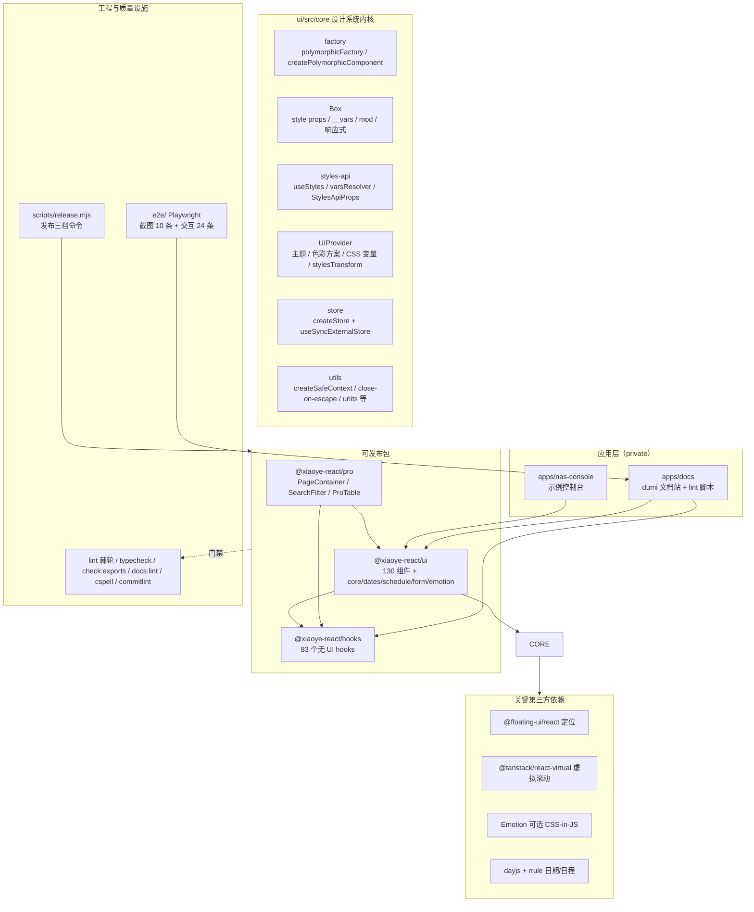
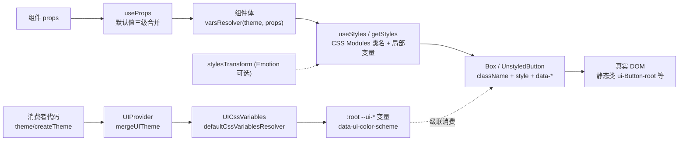

# 01 系统架构
> 项目：react-ui ｜ 版本：v1.0 ｜ 生成日期：2026-10-06 ｜ 依据：源码分析

## 1. 整体架构图



分层逻辑一目了然：`hooks` 是零 UI 依赖的底层；`ui` 依赖 `hooks`（peer）并内含 `core` 内核；`pro` 同时依赖 `ui` 与 `hooks`，只做模式组合不造新组件；文档站与示例应用只消费发布面。`@xiaoye-react/tests` 内部包为 `ui`/`pro` 提供共享测试资产。

## 2. monorepo 工程架构详解

### 2.1 包拓扑与依赖方向

`pnpm-workspace.yaml` 声明三个 glob：`apps/*`、`packages/*`、`packages/@xiaoye-react/*`，共 13 个 workspace 包，其中只有 3 个非 private（`hooks`、`ui`、`pro`）。依赖方向被严格约束为单向：

- `packages/hooks/package.json`：`peerDependencies` 仅 `react`、`react-dom`（`^18 || ^19`），`sideEffects: false`，完全不知道 `ui` 的存在；
- `packages/ui/package.json`：`peerDependencies` 为 `react ^19`、`react-dom ^19`、`@xiaoye-react/hooks ^1.4.0`；`dependencies` 全部是第三方运行时库（floating-ui、virtual、dayjs、rrule、emotion 等）；开发时经 `devDependencies` 的 `workspace:*` 引用 hooks；
- `packages/@xiaoye-react/pro/package.json`：peer 指向 `ui`、`hooks`（workspace:^ 协议，发布时由 `pnpm publish` 重写为真实版本区间）与 React 19。

发布顺序因此固定为 **hooks → ui → pro**（根 README 论证：被依赖者先发，否则 peer 会短暂指向注册表上不存在的版本）。

### 2.2 内部包的角色

`packages/@xiaoye-react/` 下 9 个 private 包各有明确职责：`tests`（共享单测工具与 core/dates 测试资产，`package.json` 名为 `@xiaoye-react/tests`）、`carousel`（基于 embla 的轮播封装，供文档站与组件复用）、`dev-icons`、`docs-styles-api`、`header`、`logo`、`meta`、`notifications`、`store`（文档站的状态/骨架件）。它们不发布，但被 `pnpm check:exports` 一并纳入导出一致性检查范围（`scripts/validate-package-exports.mjs`）。

### 2.3 构建架构：为什么是 preserveModules

三个可发布包共用同一种 Vite 库模式构建形态（`packages/ui/vite.config.ts`、`packages/hooks/vite.config.ts`）：

1. **双格式产物**：`formats: ['es', 'cjs']`，ESM 输出 `es/index.js`、CJS 输出 `es/index.cjs`（`type: module` 包内 `.cjs` 才会被 Node 当 CommonJS）；
2. **preserveModules**：不把上千个源模块压成单文件。`ui` 配置注释给出实测数据——单文件产物会让 `import { Button }` 从 12KB gzip 涨到 327KB gzip，且把 `rrule`/`react-dropzone` 等未用实现拖进消费方产物；
3. **外部化运行时依赖**：`ui` 的 `isExternal` 按包名段匹配 `dependencies + peerDependencies + react/react-dom`，注释解释了原因——打进产物等于下游装两份实例，而 `dayjs` 的 extend/locale 与 `@emotion/cache` 的插入点都是全局状态，双实例即 bug；
4. **'use client' 序言**：rollup 不保留入口 directive，ESM 输出用 `output.banner` 补回（每个模块都带）；CJS 输出不加，否则会挤掉开头的 `'use strict'`；
5. **dts 校验**：`vite-plugin-dts` 发射 `.d.ts` 到 `es/`，`afterDiagnostic` 遇到类型错误直接抛异常（声明产物不完整必须失败），`beforeWriteFile` 修复 `__` 前缀标识符被加下划线的上游 bug；ui 构建后还有 `check:published-types`——对产物 `es/index.d.ts` 用 `--skipLibCheck false` 再编译一遍。

`ui` 的 `prebuild` 钩子是 `pnpm --filter @xiaoye-react/hooks build`：单测与类型检查要读 hooks 的构建产物类型，保证干净克隆也能过。

## 3. 组件通用机制

### 3.1 五层组件标准结构

以 `packages/ui/src/components/Button/` 为范本，每个组件目录遵循固定形状：

1. `Button.tsx`：组件本体，用 `polymorphicFactory<ButtonFactory>(...)` 创建；
2. `Button.module.css`：CSS Modules 样式，内部消费 `--button-*` 等局部 CSS 变量；
3. `ButtonGroup.tsx` / `ButtonGroupSection.tsx`：静态子组件（经 `Button.Group` 挂载）;
4. `index.tsx`：re-export 公出面（组件 + 类型 + namespace）。

`Button.tsx` 尾部的静态属性与 namespace 是库级约定：

```ts
Button.classes = classes               // StylesApi 探测用
Button.varsResolver = varsResolver     // 主题层覆盖 CSS 变量用
Button.Group = ButtonGroup             // 静态子组件
Button.displayName = '@xiaoye-react/ui/Button'
export namespace Button { ... }        // Props/StylesNames/CssVariables/Factory 类型出口
```

### 3.2 工厂机制（factory）

`packages/ui/src/core/factory/` 是所有组件的出生地，两个核心文件：

- **`create-polymorphic-component.ts`**：纯类型层。`PolymorphicComponentProps<C, Props>` 让组件根据 `component` prop 动态切换渲染元素/组件并继承其原生属性（`InheritedProps = ExtendedProps<PropsOf<C>, Props>`，用户 props 覆盖原生属性）；`PolymorphicRef<C>` 排除 string ref。还定义了 `renderRoot?: (props) => any`——允许完全接管根元素渲染。
- **`polymorphic-factory.tsx`**：运行时层。`polymorphicFactory<Payload>(ui)` 把 `forwardRef` 渲染函数包装成「多态组件」，并附加四个静态能力：
  - `withProps(fixedProps)`：高阶封装固定 props（如 `Button.withProps({ variant: 'light' })`），并透传 `extend`/`classes`/`varsResolver` 静态属性（注释说明：依赖 `Paper.classes` 做样式探测的消费者在 withProps 产物上不应失效）；
  - `extend`：恒等函数（`identity`），类型层面允许第三方基于工厂类型扩展；
  - `classes`、`varsResolver` 静态成员；
  - `StaticComponents`：把 `Group` 等子组件类型并入组件自身类型。

`factory.tsx` 定义 `FactoryPayload`（props/ctx/ref/stylesNames/vars/variant/staticComponents/compound/signature），其中 `compound: true` 标记复合组件——复合组件**不能**在 UIProvider 的 `theme.components` 上设置 classNames/styles/vars（只能 extend 自己），这是刻意的约束。

### 3.3 StylesApi：样式定制的统一接口

`packages/ui/src/core/styles-api/` 实现「选择器化」的样式覆盖体系。每个组件声明自己的 `StylesNames`（如 Button 的 `'root' | 'inner' | 'loader' | 'section' | 'label'`），消费者可以按选择器注入类名、样式或 CSS 变量：

```tsx
<Button
    classNames={{ root: 'my-root', label: 'my-label' }}
    styles={{ root: { borderRadius: 16 } }}
    vars={{ root: { '--button-height': '48px' } }}
/>
```

`useStyles()`（`use-styles/use-styles.ts`）是中枢：输入组件名、classes（CSS Modules 对象）、props、classNames/styles/vars/varsResolver/attributes，返回 `getStyles(selector, options?)` 函数。内部组装 8 个类名辅助函数（`get-global-class-names`、`get-theme-class-names`、`get-variant-class-name`、`get-static-class-names`、`get-selector-class-name`、`get-root-class-name`、`get-options-class-names`、`get-resolved-class-names`）与 `getStyle`（合并 styles 属性、vars、varsResolver、主题 vars）。两个值得注意的性能设计：

- **按选择器缓存**：同一次渲染内对同一 selector 的重复 `getStyles` 调用直接命中 Map 缓存（注释：DataTable 虚拟滚动下每帧会重复解析上百个 tr/td 选择器）；
- **静态类名关断**：`withStaticClasses`（UIProvider 提供）可整体关闭 `ui-Button-root` 这类静态类，服务 SSR 体积。

### 3.4 主题系统（UIProvider / ThemeProvider）

`packages/ui/src/core/UIProvider/` 分工：

- **`UIProvider.tsx`**：最外层上下文。props 含 `theme`、`colorScheme`（受控，`'auto'` 跟随系统）、`localStorageKey`（默认 `ui-color-scheme-value`）、`classNamesPrefix`（默认 `'ui'`）、`withStaticClasses`、`headless`、`cssVariablesSelector`（默认 `:root`）、`cssVariablesResolver`、`stylesTransform`、`getStyleNonce`（CSP）、`env`。色彩方案是「受控/非受控双模」：传 `colorScheme` 即受控；否则内部 state 初始化为父 context 方案（嵌套 Provider 不劫持全局），`setColorScheme`/`clearColorScheme` 仅在非受控时生效。只有**根 Provider**（`parentContext === null`）向 `document.documentElement` 写 `data-ui-color-scheme` 属性并订阅系统偏好变化（`matchMedia('(prefers-color-scheme: dark)')`），注释详细论证了嵌套实例互覆盖问题；
- **`UIThemeProvider/`**：`useSafeUITheme()`（无 Provider 时回落 `DEFAULT_THEME`）与 `useUITheme()`（无 Provider 抛错）双 API；`mergeUITheme` 深合并父主题与 override；`inherit=false` 可从默认主题重新开始；
- **`default-theme.ts`**：`DEFAULT_THEME` 全量定义——`colors`（`DEFAULT_COLORS`，每色 10 阶）、`primaryShade: { light: 6, dark: 8 }`、`primaryColor: 'blue'`、`fontSizes/radius/spacing/shadows/breakpoints` 五套尺寸刻度（rem 单位）、`headings` 六级排版、`focusRing: 'auto'`、`autoContrast`、`luminanceThreshold: 0.3`、`variantColorResolver`（variant→颜色解析策略，可整体替换）、`defaultGradient`、`respectReducedMotion` 等；
- **`UICssVariables/`**：`defaultCssVariablesResolver` 把主题对象整体翻译为 `--ui-*` CSS 变量：通用变量（`--ui-z-index-*` 分层、`--ui-scale`、字体族、`--ui-radius-default`）、primary 派生变量、以及 **light/dark 两套语义变量**（`--ui-color-text/body/error/success/placeholder/default/dimmed/disabled...`）。`UICssVariables.tsx` 把结果注入 `cssVariablesSelector`（默认 `:root`），`light`/`dark` 分组随 `data-ui-color-scheme` 切换生效——**主题切换零 JS 重渲染**，纯 CSS 变量级联；
- **`create-theme.ts`**：`createTheme(override)` 是恒等函数，作用是给用户侧 `UIThemeOverride` 提供类型收窄入口；
- **`color-functions/`**：`variantColorResolver`（filled/light/outline/gradient 等 variant 到背景/边框/文字色的映射）、`getPrimaryShade`、`getPrimaryContrastColor`、`virtual-color`（亮色/暗色各自取色的虚拟色）。

### 3.5 类型体系与全局约定

- **尺寸/颜色/圆角类型**：`UISize`、`UIColor`、`UIRadius`、`UIGradient`、`UIBreakpoint` 等从 core 导出；size 通常形如 `UISize | \`compact-${UISize}\` | (string & {})`（Button.tsx 的 `ButtonSize`）——字面量保提示、字符串保扩展；
- **CSS 变量白名单**：每个组件用 `XxxCssVariables` 联合类型声明自己拥有的 `--xxx-*` 变量（如 `ButtonCssVariables` 的 `root: '--button-justify' | ... | '--button-bd'`），varsResolver 的返回与 `vars` prop 都被类型约束；
- **store**：`packages/ui/src/core/store/store.ts` 提供 `createStore` + `useStore`（`useSyncExternalStore` 实现，闭包而非 `this`，注释解释防解构丢上下文），供需要的组件做外部 store（如 Notifications 队列）；
- **utils**：`core/utils/` 汇集 20+ 个小工具——`create-safe-context`（Context 未包裹时抛中文错误）、`close-on-escape`、`create-scoped-keydown-handler`（复合组件 roving tabindex 用）、`create-use-external-events`、`deep-merge`、`get-breakpoint-value`/`get-sorted-breakpoints`（响应式 props）、`units-converters`（rem/px）、`get-default-z-index`、`get-safe-id`、`find-element-in-shadow-dom` 等。

### 3.6 全局环境组件：Direction、InlineStyles 与 Activity

除主题外，core 还提供三个全局性组件，补全「应用级环境」的最后一角：

- **DirectionProvider**（`core/DirectionProvider/`）：维护 `dir: 'ltr' | 'rtl'` 上下文，`detectDirection`（默认 true）经 `useMutationObserverTarget` 监听根元素 `dir` 属性变化自动跟随；源码用模块级常量 `DIR_MUTATION_OPTIONS` 固定 `attributeFilter: ['dir']`，注释说明这是为了避免内联字面量每次渲染进入依赖导致 observer 反复重连——又一处「引用稳定」纪律的落点；
- **InlineStyles**（`core/InlineStyles/`）：把样式对象序列化为 CSS 文本注入 `<style data-ui-styles="inline">`，nonce 走 `useUIStyleNonce`。它是 Box 响应式 style props 的承载者（见第 3.3 与第 05 篇主题四），也是库内唯一的动态样式注入点之一；
- **Activity**（`core/utils/Activity/`）：React 19 `<Activity>` 的 fallback 实现——React stable 尚未导出该实验性 API，这里用 `display: none` 的 div 实现 keepMounted 语义（保留 DOM 与组件 state、仅视觉隐藏），源码注释明确「待 React 正式导出 Activity 后可替换为原生实现」，是库内兼容策略的一个缩影。

这三者与 UIProvider、store 共同构成 core 的「环境层」：主题、方向、样式注入、外部 store 各管一维，任何一维都可以被单独替换（`cssVariablesResolver`、`stylesTransform`、`initialDirection`、`createStore` 自定义初始态）。

## 4. 样式方案：CSS Modules + CSS 变量为主，Emotion 为可选

`CONTRIBUTING.md` 把样式路线写成铁律：新增组件用「组件 + `<Name>.module.css`（CSS Modules + `--ui-*` 变量），**不引入 CSS-in-JS**」。运行时链路是：

1. `varsResolver`（组件静态，读 theme+props → 产出 `--button-*` 局部变量）；
2. `useStyles` 把局部变量放到根元素 inline style 的 `__vars`；
3. `*.module.css` 的规则只消费变量（如 `height: var(--button-height)`），组件变体用 `data-variant`、状态用 `data-*`/mod 属性选择器表达（Box 的 `getBoxMod` 把 `mod` 翻译成 data 属性）；
4. 响应式 props（`hiddenFrom`/`visibleFrom`/`lightHidden`/`darkHidden` 及 sx 中的媒体查询对象）由 `Box` 的 `useRandomClassName` + `InlineStyles` 组件注入 `<style>` 标签实现（`packages/ui/src/core/Box/Box.tsx`、`core/InlineStyles`）。

可选的 CSS-in-JS 通道位于 `packages/ui/src/emotion/`：`UIEmotionProvider` + `create-styles.ts` + `emotion-transform.ts`，作为 `stylesTransform` 注入 UIProvider 后，Box 的 `sx` 与组件 `styles` 会先经 Emotion 编译成类名再参与合并（`merge-sx.ts`、`use-css.ts`）。这条路径是纯增量能力，默认关闭，`ssr.tsx` 处理服务端关键样式抽取。

## 5. 关键设计决策与设计模式

| 决策/模式 | 位置 | 动机（源码注释/文档佐证） |
| --- | --- | --- |
| 多态组件（Polymorphic Component） | `core/factory/create-polymorphic-component.ts` | `component` prop 让 Button 可渲染为 `a`/`Link`，类型自动继承目标元素属性 |
| 工厂 + 静态成员（Factory + Statics） | `core/factory/polymorphic-factory.tsx` | withProps/extend/classes/varsResolver 四件套让二次封装成为一等公民 |
| 选择器化样式 API（StylesApi） | `core/styles-api/` | 按内部结构选择器覆盖类名/样式/变量，是主题之外的第三层定制 |
| CSS 变量主题（Design Tokens as CSS Vars） | `core/UIProvider/UICssVariables/` | 主题即变量注入，明暗切换零重渲染，headless 可整体去样式 |
| 受控/非受控统一（useProps） | `core/UIProvider/use-props/use-props.ts` | 主题层 defaultProps + 组件 defaultProps + 传入 props 三级合并，且无默认值时走快路径原样返回以保引用稳定 |
| 外部 Store + useSyncExternalStore | `core/store/store.ts` | 跨组件队列型状态（通知、Modals 命令式调用）不进 React 树 |
| Provider 嵌套语义 | `UIProvider.tsx` 注释 | 嵌套 Provider 继承而非劫持色彩方案；只有根 Provider 写全局属性，消除竞态 |
| 棘轮式门禁 | 根 `package.json`（`--max-warnings=57`）、`eslint.config.mjs` | lint 警告数只许调低不许回涨，豁免必须留注释（CONTRIBUTING「债务政策」） |
| 导出面零幻觉 | `scripts/validate-package-exports.mjs` + `docs:lint` | exports 必须指向真实文件；文档 API 表逐行核对类型（跨包继承依赖 hooks 构建产物） |

## 6. 数据与控制流总览



两条正交的链路在此交汇：**主题链**（Provider 自上而下注入变量，DOM 级联消费）与**实例链**（props → useProps → varsResolver → useStyles → Box 渲染）。任何一层都可以被替换：换主题传 `theme`，换变量解析传 `cssVariablesResolver`，换样式引擎传 `stylesTransform`，换 DOM 元素传 `component`——这正是整套架构「可定制但不失约束」的核心思路。

## 7. 架构上的取舍与已知边界

1. **CSS Modules 无法跨包覆盖任意内部规则**：库对外承诺的是 StylesApi + CSS 变量两层接口，内部类名哈希不可预测（静态类 `ui-Button-root` 仅为调试/探测用）。深度魔改需走 `styles`/`classNames`/`vars` 或 fork varsResolver。
2. **Emotion 层是平行通道**：与 CSS Modules 并存但非替换；`sideEffects: ["*.css"]` 保证样式不被摇树，而 emotion 注入的样式跟随运行时。
3. **React 19 门槛**：`ui` 与 `pro` 的 peer 都要求 React 19；只有 `hooks` 兼容 18/19。源码使用了 React 19 的类型与行为（forwardRef 双参约定在 factory 注释中被强调）。
4. **复合组件约束**：`compound: true` 的组件（如 Tabs 的 Tab/List 的 Item 一类子件）不允许在 UIProvider 主题上配置 classNames/styles/vars，只能 `extend`，避免主题面爆炸。
5. **发布面的强校验**：`check:exports`、`check:published-types`、消费者侧 ESM 复验（根 README 第 4 步）构成「发布面零幻觉」三道闸，配合 `docs:lint` 让文档 API 表与类型定义强制同步——架构上把「文档即测试」落到了 CI。
