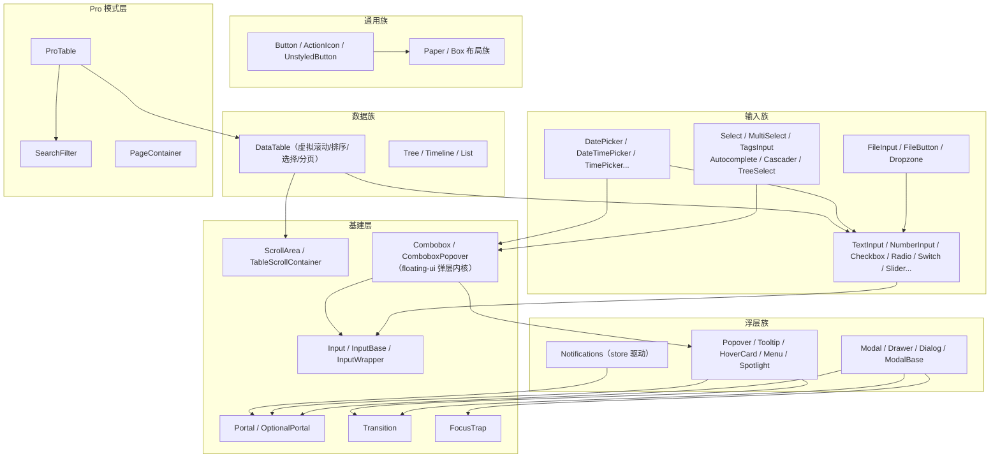

# 02 组件设计
> 项目：react-ui ｜ 版本：v1.0 ｜ 生成日期：2026-10-06 ｜ 依据：源码分析

## 1. 组件分类体系与关系

全库组件共享同一套内核契约（`polymorphicFactory`/`factory` + `useStyles` + `*.module.css`），在此之上按职责分为八个族。下图描述族与族之间的复用关系（箭头表示「构建于其上」）：



设计上的三条铁律（贯穿全部组件）：

1. **统一出生流程**：`factory/polymorphicFactory` 创建 → `useProps` 合并默认值 → `useStyles` 解析样式 → `Box`/具体元素渲染 → 静态成员（`classes`/`varsResolver`/静态子组件）+ `displayName`（`@xiaoye-react/ui/Xxx`）；
2. **状态一律 `useUncontrolled` 双模**：受控传 `value`、非受控传 `defaultValue`，加 `finalValue` 兜底与 `onChange` 转发（见第 04 篇）；
3. **样式三层定制**：`classNames`/`styles`（按 StylesNames 选择器）→ `vars`/`varsResolver`（CSS 变量）→ 主题（`theme.components`、CSS 变量注入）。

## 2. 核心组件详解

### 2.1 Button（按钮，polymorphicFactory 范本）

**文件**：`packages/ui/src/components/Button/Button.tsx`（+ `ButtonGroup.tsx`、`ButtonGroupSection.tsx`、`Button.module.css`）

**API 表**：

| Prop | 类型 | 默认值 | 说明 |
| --- | --- | --- | --- |
| `variant` | `'filled' \| 'light' \| 'outline' \| 'transparent' \| 'white' \| 'subtle' \| 'default' \| 'gradient'` | `'filled'` | 视觉变体，写入 `data-variant` |
| `size` | `UISize \| \`compact-${UISize}\` \| string` | `'sm'` | 控制高度/字号/水平内边距 |
| `color` | `UIColor` | `theme.primaryColor` | 主题色键或任意 CSS 颜色 |
| `radius` | `UIRadius` | `theme.defaultRadius` | 圆角 |
| `gradient` | `UIGradient` | `theme.defaultGradient` | 仅 `variant="gradient"` |
| `justify` | `CSSProperties['justifyContent']` | `'center'` | 内部元素对齐（→ `--button-justify`） |
| `leftSection` / `rightSection` | `ReactNode` | — | 标签左右插槽 |
| `fullWidth` | `boolean` | `false` | 宽度 100%（mod `block`） |
| `disabled` / `loading` | `boolean` | — | 禁用；loading 时禁用并显示 Loader、`aria-busy` |
| `loaderProps` | `LoaderProps` | — | 传给内置 Loader |
| `autoContrast` | `boolean` | `theme.autoContrast` | 按背景亮度自动反色 |
| `data-disabled` | `boolean` | — | 仅样式态禁用（不设 HTML disabled） |
| StylesApi | `classNames/styles/vars/varsResolver/unstyled/attributes` | — | 继承自 `StylesApiProps<ButtonFactory>` |

**实现要点**：

- 渲染基座是 `UnstyledButton`（而非裸 `<button>`），从而自动获得 reset 样式与焦点处理；
- **颜色解析外置**：`varsResolver` 调 `theme.variantColorResolver({ color, theme, gradient, variant, autoContrast })` 拿到 `{ background, hover, color, border, hoverColor }`，再写入 `--button-bg/--button-hover/--button-color/--button-bd/--button-hover-color` 等 10 个 CSS 变量（`ButtonCssVariables` 白名单）——variant 差异全部落在 CSS 变量层，CSS Modules 只消费变量；
- Loader 用 `Transition` 包裹（150ms，`loaderTransition` 三段式），尺寸从变量计算：`size="calc(var(--button-height) / 1.8)"`，颜色 `var(--button-color)`；
- 状态类 mod：`disabled/loading/block/with-left-section/with-right-section` 全部经 `Box` 的 `mod` 转 data 属性，CSS 侧用属性选择器；
- 静态子组件：`Button.Group`（`ButtonGroup`）、`Button.GroupSection`（`ButtonGroupSection`）。

**使用示例**：

```tsx
import { Button } from '@xiaoye-react/ui';

<Button variant="gradient" gradient={{ from: 'blue', to: 'cyan', deg: 45 }} loading={submitting}>
    保存
</Button>
<Button.Group>
    <Button variant="default">取消</Button>
    <Button>确定</Button>
</Button.Group>
```

### 2.2 DataTable（管理端数据表格，旗舰组件）

**文件**：`packages/ui/src/components/DataTable/DataTable.tsx`（+ `types.ts`、`sort.ts`、`DataTable.module.css`；单测 `DataTable.test.tsx`；e2e `e2e/interactions/virtual-table.spec.ts`）

**列模型**（`types.ts` 的 `DataTableColumn<T>`）：

| 字段 | 类型 | 说明 |
| --- | --- | --- |
| `accessor` | `Extract<keyof T, string> \| ((record: T) => any)` | 取值字段；**可排序列必须用字符串**（函数 accessor 本地排序取不到值，开发态 console.warn） |
| `title` | `ReactNode` | 表头标题，缺省回退 accessor 字段名 |
| `render` | `(record, index) => ReactNode` | 自定义单元格 |
| `width` / `minWidth` | `number \| string` | 参与固定列宽分配；固定列偏移只认 px 数值 |
| `textAlign` / `ellipsis` | 枚举 / `boolean` | 对齐；ellipsis 时 td 加 `title` 提示完整内容 |
| `sticky` | `'left' \| 'right'` | 固定列，偏移量按可见列顺序累计（`stickyState` useMemo） |
| `sortable` / `hidden` | `boolean` | 排序开关；静态隐藏 |
| `thProps` / `tdProps` | 原生属性 | 透传 |

**组件级 API**（`DataTableProps<T>`，节选）：

| Prop | 类型 | 默认值 | 说明 |
| --- | --- | --- | --- |
| `columns` | `DataTableColumn<T>[]` | 必填 | 列定义 |
| `records` | `T[]` | — | 行数据；远端分页传当前页即可 |
| `rowKey` | `(record, index) => string` | `String(index)` | 行唯一 key |
| `virtualized` + `estimatedRowHeight` | `boolean` + `number` | `false` + `42` | @tanstack/react-virtual 行虚拟滚动 |
| `sortStatus` / `defaultSortStatus` / `onSortStatusChange` | `DataTableSortStatus \| null` | — | 排序三件套；**受控时不排数据**，非受控本地 `sortRecords` 稳定排序 |
| `selectionMode` | `'checkbox' \| 'radio'` | 不启用 | 行选择；首列出现选择列（宽 40px） |
| `selectedKeys` / `defaultSelectedKeys` / `onSelectedKeysChange` | `string[]` 系 | `[]` | 行选择三件套 |
| `renderExpanded` + `expandedRows` 系 | 函数 + `string[]` 系 | — | 提供后首列出现展开控件，展开行是独立 `<tr>` |
| `withColumnSettings` + `hiddenColumnKeys` 系 | `boolean` + `string[]` 系 | `false` | 列设置 Popover 面板，控制列显隐 |
| `total` + `page` 系 + `pageSize` 系 | `number` 系 | `1` / `10` | 提供即渲染分页底栏（`Pagination` + `NativeSelect` 每页条数） |
| `loading` / `empty` | `boolean` / `ReactNode` | — | `LoadingOverlay` 遮罩；空态默认 `<EmptyState title="暂无数据" />` |
| `stickyHeader` / `minWidth` / `maxHeight` | `boolean` / 尺寸 | — | 吸顶表头、横向/纵向滚动 |
| `striped` / `highlightOnHover` / `withTableBorder` / `withRowBorders` | `boolean` | 边框两个为 `true` | 均以 mod（data 属性）驱动 CSS |

**StylesNames**：`root/table/thead/tbody/tr/th/td/footer/footerTotal/selectionCell/emptyCell/columnSettingsBar/columnSettingsPanel`；**CSS 变量**：`--datatable-horizontal-spacing`、`--datatable-vertical-spacing`。

**实现要点**：

- 五组状态（列显隐、展开、排序、选择、分页）全部走 `useUncontrolled`，各自带受控/非受控双模与 `finalValue`；
- 热路径优化：`selectedKeysSet`/`rowKeysSet`/`expandedKeysSet` 三个 `useMemo` Set 索引（注释：数组 includes 在万级数据全选时近 O(n²)）；全选实现为 `selectedKeysState.filter(key => !rowKeysSet.has(key))` 的差集，保留跨页选中；
- 虚拟滚动细节：`useVirtualizer` 始终调用（`getScrollElement` 返回 null 即不生效）保证 hooks 顺序稳定；`measureElement` 直接传引用而非内联箭头（注释：内联箭头导致每帧 detach/attach ref 强制重测）；展开行用独立 `ResizeObserver` 把「主行+展开行」合成高度上报 `resizeItem`，收起时恢复主行高度（`getExpandedMeasureRef` + 两级 ref 缓存 Map）；
- 可访问性：`aria-sort` 表头方向、行 `aria-selected` + `tabIndex=0`、方向键在行间移动焦点、Enter/Space 触发 `onRowClick` 但对行内 BUTTON/A/INPUT/SELECT/TEXTAREA/contentEditable 事件源放行（避免吞掉子元素键盘激活）。

**使用示例**：

```tsx
const columns: DataTableColumn<User>[] = [
    { accessor: 'name', title: '姓名', sortable: true, width: 160 },
    { accessor: 'email', title: '邮箱', ellipsis: true },
    { accessor: 'role', title: '角色', render: u => ROLE_LABELS[u.role] },
    { accessor: 'actions', title: '操作', render: u => <Button size="xs">编辑</Button>, sticky: 'right', width: 80 },
];

<DataTable<User>
    columns={columns}
    records={users}
    rowKey={u => u.id}
    selectionMode="checkbox"
    virtualized maxHeight={480} estimatedRowHeight={44}
    withColumnSettings
    total={total} page={page} pageSize={pageSize}
    onPageChange={setPage} onPageSizeChange={setPageSize}
    sortStatus={sortStatus} onSortStatusChange={setSortStatus}
    highlightOnHover striped
/>
```

### 2.3 Tabs（复合组件 + Context 范本）

**文件**：`packages/ui/src/components/Tabs/`：`Tabs.tsx`（根）、`Tabs.context.ts`、`TabsList.tsx`、`TabsTab.tsx`、`TabsPanel.tsx`、`Tabs.module.css`、`Tabs.test.tsx`

**API**（`TabsProps`）：`value`/`defaultValue`/`onChange`（受控双模）、`orientation`（`'horizontal' | 'vertical'`，默认 horizontal）、`color`、`variant`（`'default' | 'outline' | 'pills'`）、`radius`、`keepMounted`（非活动面板保留在 DOM）、`keepMounted:false` 默认卸载。静态子组件 `Tabs.List` / `Tabs.Tab` / `Tabs.Panel`（`TabsFactory` 的 `staticComponents`）。

**实现要点**：

- `Tabs` 根组件解析 `useUncontrolled` 得到 `activeValue`，连同 `orientation/variant/color/radius/keepMounted` 等打包进 `TabsProvider`（`Tabs.context.ts`）；`TabsTab` 点击调 `onChange`，`TabsPanel` 据此决定挂载/`Transition` 显隐——**根管状态、子件消费**是全库复合组件的标准姿势（Menu、Accordion、Stepper 同构）；
- `varsResolver` 里有个巧妙设计：`pills` 变体复用 `light` 的 variantColorResolver 结果（`resolverVariant = variant === 'pills' ? 'light' : 'outline'`），产出 `--tabs-radius/--tabs-color/--tabs-bg/--tabs-bd`；
- `FloatingIndicator`（浮动指示条）在 `default/outline` 变体下滑动到活动 Tab 下方，`TabsTab` 的激活样式由 `getStyles('tab', { active })` 传入。

**使用示例**：

```tsx
<Tabs defaultValue="posts" variant="pills">
    <Tabs.List>
        <Tabs.Tab value="posts">文章</Tabs.Tab>
        <Tabs.Tab value="comments">评论</Tabs.Tab>
    </Tabs.List>
    <Tabs.Panel value="posts">…</Tabs.Panel>
    <Tabs.Panel value="comments" keepMounted>…</Tabs.Panel>
</Tabs>
```

### 2.4 Select 与 Combobox 家族（弹层内核复用）

**文件**：`packages/ui/src/components/Select/Select.tsx`、`packages/ui/src/components/Combobox/`（`Combobox.tsx` + 13 个子件 + `use-combobox/`）、`ComboboxPopover/`（`getParsedComboboxData`、`defaultOptionsFilter`、`ComboboxItem` 等纯逻辑层）

**Select 关键 API**（`SelectProps`）：

| Prop | 类型 | 说明 |
| --- | --- | --- |
| `data` | `(string \| SelectItem \| SelectGroupData)[]` | 三种形态混填；`SelectItem = ComboboxItem & { group?: string }` |
| `value` / `defaultValue` / `onChange` | `string \| null` 系 | `null` 表示未选中（`''` 是合法选项值，故不用 `''` 当空态） |
| `searchable` / `clearable` | `boolean` | 搜索与清除 |
| `label` / `description` / `error` / `required` / `placeholder` | `ReactNode` 系 | 表单化包装（`InputWrapper` 提供） |
| `maxDropdownHeight` / `position` / `checkIconPosition` | 尺寸 / `FloatingPosition` / `'left'\|'right'` | 弹层表现 |
| `renderOption` | `({ option, checked }) => ReactNode` | 自定义选项渲染 |

**实现要点**：

- **分层**：`Combobox` 只管「弹层 + 选项列表 + 搜索框」的组合机制（基于 @floating-ui/react 定位、`ComboboxProvider` context、`use-combobox` 管理打开态/高亮索引/键盘导航）；`ComboboxPopover` 放纯函数（数据解析 `getParsedComboboxData` 把 string/分组展平、过滤 `defaultOptionsFilter`）；`Select/MultiSelect/Autocomplete/TagsInput/Cascader/TreeSelect` 各自是基于同一内核的「策略封装」——单选、多选、可搜索输入、标签化、级联、树形；
- 值语义：Select 的受控值是 `string | null` 而非 `''`，源码注释明确「`''` 是合法选项值」；
- 表单包装：label/description/error 由 `Input` 模块的 `InputWrapper` 统一处理，错误态自动设 `aria-invalid`（与全库输入类一致）。

**使用示例**：

```tsx
<Select
    label="所属部门"
    placeholder="选择部门"
    data={[
        { value: 'rd', label: '研发部', group: '技术线' },
        { value: 'qa', label: '测试部', group: '技术线' },
        { value: 'hr', label: '人事部', group: '职能线' },
    ]}
    searchable clearable
    value={dept} onChange={setDept}
/>
```

### 2.5 Modal / Drawer / ModalBase（浮层三层架构）

**文件**：`packages/ui/src/components/ModalBase/`（`ModalBase.tsx`、`use-modal.ts`、`ModalBase.context.ts`、`modal-stack.ts` 及 Title/Body/Header/Overlay/Content/CloseButton 子件）、`packages/ui/src/components/Modal/`（`Modal.tsx`、`ModalRoot.tsx`、`ModalStack.tsx`、`use-modals-stack.ts`、`Modal.test.tsx`、`ModalStack.test.tsx`）、`Drawer/`（同构）

**分层**：

1. **ModalBase（内核）**：`opened/onClose` 驱动；`OptionalPortal` 传送（`withinPortal` 可关）、`Transition` 进出场（`transitionProps` 可覆盖，`onEnterTransitionEnd/onExitTransitionEnd` 回调）、`FocusTrap`（`trapFocus`）、`react-remove-scroll` 锁滚动（`lockScroll`、`removeScrollProps` 透传）、Esc 关闭（`closeOnEscape`）、点遮罩关闭（`closeOnClickOutside`）、焦点归还（`returnFocus`）、`keepMounted`（隐藏不卸载）、`zIndex` 默认取 `getDefaultZIndex('modal')`（对应 `--ui-z-index-modal: 200` 分层）；
2. **Modal（表现层）**：`ModalRoot` 组装 ModalBase + `ModalOverlay` + `ModalContent`（Header/Body/CloseButton），`use-modal.ts` 的 `useModal` 用 context 连接 title/body 的 id（`${id}-title` / `${id}-body`）供 `aria-labelledby`/`aria-describedby`；
3. **ModalStack（多模态栈）**：`modal-stack.ts` + `use-modals-stack.ts` 管理 `closeOnEscape` 只关栈顶、下层模态延迟渲染等栈语义。

**实现要点**：`RemoveScroll` 的 props 类型用 `React.ComponentProps<typeof RemoveScrollRaw>` 从真实类型推导而非 `[key: string]: any`（源码注释：消除类型逃逸）；`ModalBase` 把 `opened/closeOnClose/transitionProps` 等打包进 `ModalBaseProvider` 供 Overlay/Content 子件消费。

**使用示例**：

```tsx
<Modal opened={opened} onClose={close} title="编辑用户" size="lg" centered>
    <Modal.Body>…表单…</Modal.Body>
</Modal>
```

### 2.6 DatePicker 与日期家族（dates 模块）

**文件**：`packages/ui/src/dates/components/DatePicker/DatePicker.tsx` 及同目录 32 个组件、`packages/ui/src/dates/hooks/`（`useDatesState` 等）、`packages/ui/src/dates/types`、`DatesProvider`

**API 特点**（`DatePickerBaseProps<Type>`）：

- **泛型按类型分化值形态**：`DatePickerType = 'default' | 'multiple' | 'range'`——`value` 在 `range` 时是 `[DateStringValue | null, DateStringValue | null]`、`multiple` 时是 `DateStringValue[]`、默认是 `DateStringValue | null`（TS 条件类型写在 `DatePickerProps` 的 value 定义里）；preset 的值形态也随 Type 分化（`DatePickerPreset<Type>`）；
- **层级受控**：`level`/`defaultLevel`/`onLevelChange`/`maxLevel` 控制日历 decade→year→month 层级导航（`clampLevel` 校验）；
- `presets`：预定义快捷值列表（渲染为 `presetsList`/`presetButton` 选择器）；
- 输入型变体（`DatePickerInput`、`DateTimePicker`、`MonthPickerInput`、`YearPickerInput`）复用 Combobox 内核做「输入框 + 弹层日历」，纯面板变体（`DatePicker`、`MiniCalendar`、`TimeGrid`）直接渲染。

**实现要点**：全部日期运算走 `dayjs`（`dates/utils`）；`useDatesState` 集中维护选中值/悬停范围（range 选择的第一/第二段）逻辑；`DatesProvider` 注入 locale、firstDayOfWeek、周末定义、label 格式等本地化配置；`schedule/AgendaView` 基于 `rrule` 解析重复事件。⚠️ 值格式 `DateStringValue` 为 `YYYY-MM-DD` 字符串（`dates/types` 与入口 `toDateString` 导出约定一致）。

### 2.7 Notifications（命令式 API + 外部 Store）

**文件**：`packages/ui/src/components/Notifications/`：`Notifications.tsx`（宿主）、`notifications.store.ts`、`NotificationContainer.tsx`、`get-auto-close.ts`、`get-grouped-notifications.ts`、`Notifications.test.tsx`

**API**：渲染一次 `<Notifications position="top-right" limit={5} />`，业务侧经 store 方法命令式调用：`notifications.show(data)`、`hide(id)`、`update(id, data)`、`clean()`、`cleanQueue()`（方法名以 `notifications.store.ts` 导出为准）。`NotificationData` 携带 `message`（必填）、`title`、`color`、`position`（单条覆盖默认）、`autoClose`（`boolean | number` 毫秒）、`priority`（超出 limit 时高优先级先展示）、`allowClose`、`onOpen`/`onClose` 生命周期。

**实现要点**：状态是模块级 `createStore`（`core/store` 同款 `useSyncExternalStore` 方案），`NotificationsState = { notifications, queue, defaultPosition, limit }`——**不进 React 树**，任意模块 import 即用；超过 `limit` 的通知进入 `queue`；按 `position` 分组渲染（`getDistributedNotifications` 用 `Map<position, item[]>` 分桶 + 自增序列号稳定排序）。

**使用示例**：

```tsx
import { notifications } from '@xiaoye-react/ui';

notifications.show({ title: '保存成功', message: '配置已更新', color: 'teal', autoClose: 3000 });
```

### 2.8 ProTable（pro 模式层：请求驱动表格）

**文件**：`packages/@xiaoye-react/pro/src/pro-table/ProTable.tsx`、`ProTable.module.css`、`ProTable.test.tsx`

**API**：

| Prop | 类型 | 说明 |
| --- | --- | --- |
| `columns` | `DataTableColumn<T>[]` | 透传 DataTable |
| `request` | `(params: ProTableRequestParams) => Promise<ProTableRequestResult<T>>` | 参数 `{ page, pageSize, search?, sortStatus? }`，返回 `{ records, total }` |
| `search` | `SearchFilterProps \| false` | 内嵌查询区；`false` 关闭 |
| `defaultSearchValues` | `Record<string, any>` | 查询区初始值 |
| `toolbar` | `ReactNode` | 工具栏左侧（新建/批量操作） |
| `actionsRef` | `MutableRefObject<{ refresh: () => void } \| null>` | 命令式刷新句柄 |
| `onRequestError` | `(error, params) => void` | 默认仅 console.error 并结束 loading |
| `dataTableProps` | 剔除数据/分页/排序后的 `DataTableProps` | 表现属性透传 |

**实现要点**：内部 state 持有 `records/total/loading/page/pageSize/searchValues/sortStatus/refreshKey`；**竞态保护**：`requestIdRef` 自增编号，仅采纳最后一次响应（源码注释明确「切换 request 函数即重新请求」是测试编码的语义，内联函数需消费方自行 useCallback）；`refresh` 通过 `refreshKey` 状态触发 effect 重放；分页/排序/搜索变化都汇聚到 `fetchRecords`。它展示了 pro 层的定位：**不造新 UI，只把 ui 组件编排成管理端模式**。

**使用示例**：

```tsx
const tableRef = useRef<{ refresh: () => void } | null>(null);

<ProTable<User>
    ref={tableRef}
    columns={columns}
    request={async ({ page, pageSize, search, sortStatus }) => {
        const res = await api.listUsers({ ...search, page, pageSize, sort: sortStatus });
        return { records: res.list, total: res.total };
    }}
    search={{ fields: [{ name: 'keyword', label: '关键词' }] }}
    toolbar={<Button>新建用户</Button>}
    rowKey={u => u.id}
/>
```

### 2.9 复合组件的组装范式（从 Tabs 到 Menu）

Tabs 展示的「根管状态、子件消费」模式在库内有三个变体，理解它们等于掌握了大多数复合组件：

- **值驱动型**（Tabs、Accordion、Stepper）：根组件持有 `useUncontrolled` 的当前值，子件（Tab/Panel、Item、Step）通过 context 读取激活态并回调 `activateTab` 一类的 setter。id 关联（`getTabId/getPanelId`）也在 context 上，保证 `aria-controls`/`aria-labelledby` 全库一致；
- **注册表驱动型**（Combobox、Menu、Spotlight）：子件挂载时向根注册自身（value/label/DOM node），根维护注册表并 memo 出索引 Map；键盘导航是纯函数索引计算（跳过 disabled、按 loop 回绕），选中结果经 `onOptionSelect` 上抛；
- **几何协作型**（AppShell、Splitter）：子件声明区域语义（header/aside/section），根组件负责布局与固定定位；Splitter 依赖 hooks 包的 `use-splitter` 做拖拽几何。

三种变体共享同一条纪律：**子件永远不直接操作兄弟组件**，一切协作经根组件的 context 或 store 中转。这使任意子件可以被条件渲染、重排、甚至单独抽用而不破坏整体。

### 2.10 日期与日程层的设计

`dates/` 模块的三层拆分值得注意：`components/`（33 个组件）、`hooks/`（`useDatesState` 等，把「选中值 + 悬停范围 + 层级」的交互状态从组件里抽出来）、`utils/` + `types`（dayjs 封装与 `DateStringValue` 等值类型）。设计上有两个鲜明选择：

1. **值统一为字符串**：`DateStringValue`（`YYYY-MM-DD`）作为通用货币，而不是 Date 对象——避免时区歧义，且与入口消歧导出 `toDateString` 的约定（`toDateString(new Date(...)) === 'YYYY-MM-DD'`）互为印证；
2. **面板与输入分离**：`DatePicker` 是纯面板，`DatePickerInput` = 输入框（Combobox 内核）+ 面板，`DateTimePicker` = 日期面板 + `TimePicker` 组合，`HiddenDatesInput` 则给完全自定义 UI 的场景留了「隐形 input」逃生口。同一套 `useDatesState` 驱动所有形态，行为天然一致。

`schedule/` 模块（`AgendaView` 等）依赖 `rrule` 表达重复事件规则（RFC 5545 RRULE 语义），与 dates 层共享 `getStartOfWeek/getEndOfWeek/getMonthDays/isSameMonth` 等工具——这些函数因与 dates 模块重名，在包入口被显式消歧为 schedule 版（见 `packages/ui/src/index.ts` 注释）。

### 2.11 无障碍设计清单

从源码可直接核对的 a11y 机制：Modal/Drawer 的角色化结构（title/body 的 aria id 关联、`FocusTrap` + `returnFocus: true` 默认开启）、Escape 的栈顶仲裁（嵌套模态不误关）与 `data-ui-stop-propagation` 逃生标记、Tabs 的 roving tabindex 与方向键导航、DataTable 的 `aria-sort`/`aria-selected`/`aria-busy` 与行方向键导航（Enter/Space 对行内交互元素放行）、表单输入的 label/description/error 自动关联与 `aria-invalid`、Box 的 `VisuallyHidden` 组件、主题层的 `focusRing: 'auto'`（仅键盘导航显示焦点环）与 `respectReducedMotion`（尊重系统减少动画偏好）。ADMIN-ROADMAP 的 P3 里程碑专门补齐了管理端交互的键盘路径（Cascader 面板方向键、Transfer 列表键盘导航），说明无障碍在该库是持续投资项而非一次性合规。

## 3. 组件设计的共性约定（跨组件 Checklist）

| 约定 | 落点 | 代表实现 |
| --- | --- | --- |
| displayName 规范 | 每个组件 | `@xiaoye-react/ui/Button` |
| 静态类型出口 | namespace | `Button.Props` / `DataTable.Column` 等 |
| StylesApi 全覆盖 | 组件每个内部节点 | DataTable 12 个选择器、Button 5 个 |
| CSS 变量白名单 | `XxxCssVariables` | 只有声明的变量才能被 vars 覆盖 |
| 状态双模 | `useUncontrolled` | DataTable 五组状态、Tabs、Select… |
| 表单输入统一包装 | `Input/__BaseInputProps` + `InputWrapper` | label/description/error/required 一致 |
| 中文默认文案 | 组件内置 | DataTable「共 N 条/暂无数据/全选」、ProTable「刷新」 |
| 可访问性 | aria + 键盘 | Tabs roving tabindex、Modal 焦点陷阱、DataTable 方向键 |
| 浮层统一引擎 | @floating-ui/react + OptionalPortal | Popover/Tooltip/Menu/Combobox/Modal 全家 |
| 单测随组件 | 同目录 `*.test.tsx` | 全库 129 个组件目录中 92 个有相邻单测（37 个无，见《09》第 2 节） |

## 4. 新增组件的标准动作（源自 CONTRIBUTING.md）

1. 在 `packages/ui/src/components/<Name>/` 建：组件 + `<Name>.module.css` + factory/StylesApi，形状对齐 `Button`；
2. 导出进 `components/index.ts`，跑 `pnpm check:exports` 确认公开面没有「只有类型没有运行时」的导出；
3. 同目录写 `*.test.tsx`；触及 jsdom 盲区（pointer 命中、事件顺序、transitionend）的补 `e2e/interactions` 用例；
4. 文档站 `apps/docs/components/<name>/index.zh-CN.md` + `demo/`；**API 表每一行必须能在类型里找到**（`docs:lint` 逐行核对）。
