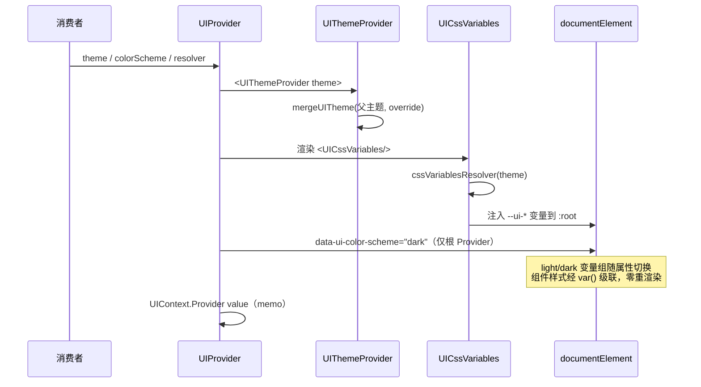
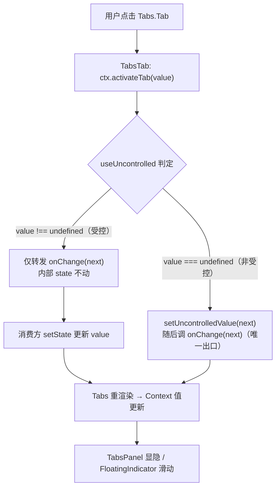
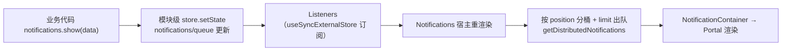
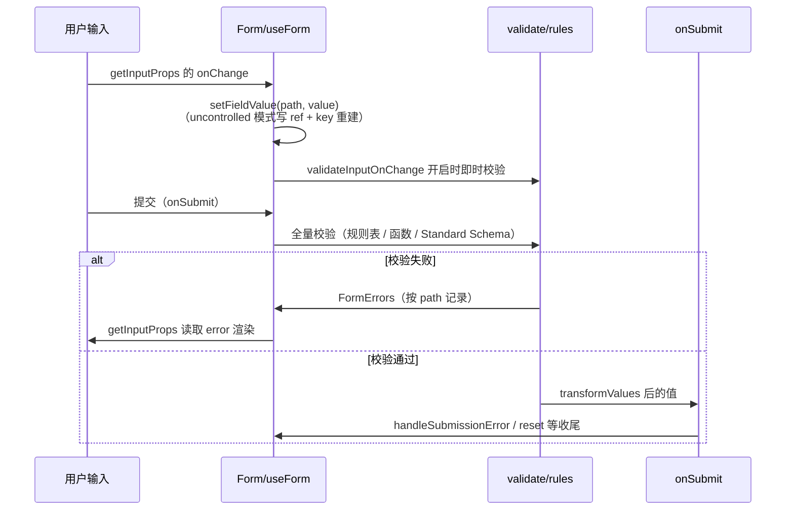

# 04 数据模型（组件状态与 Context）
> 项目：react-ui ｜ 版本：v1.0 ｜ 生成日期：2026-10-06 ｜ 依据：源码分析

## 1. 状态模型总纲

组件库的状态按「存放位置」分四类：

| 状态类别 | 存放位置 | 代表 | 适用特征 |
| --- | --- | --- | --- |
| 组件实例状态 | `useUncontrolled`（内部 useState + 受控短路） | Tabs 活动页、DataTable 五组状态、Select 选中值 | 单组件生命周期内的交互态 |
| 表单状态 | `useForm` 的 `$values/$status/$errors/$validating/$watch` 子状态机 | 整个 form 模块 | 字段树、校验、脏检查 |
| 跨组件/命令式状态 | `core/store` 的外部 store（`useSyncExternalStore`） | Notifications 队列、Modals 命令式调用 | 绕过 React 树的 imperative API |
| 全局配置状态 | Context（UIContext / UIThemeContext / DatesProvider…） | 主题、色彩方案、本地化 | 自上而下的只读配置 |

## 2. 受控/非受控的实现：`useUncontrolled`

**文件**：`packages/hooks/src/use-uncontrolled/use-uncontrolled.ts`（注意：它住在 hooks 包，被 ui 全线消费）

签名与语义：

```ts
useUncontrolled<T>({ value, defaultValue, finalValue, onChange })
  → [当前值, setter(稳定引用), 是否受控 boolean]
```

实现要点（源码逐条对应）：

1. **受控判定是渲染期短路**：`if (value !== undefined) return [value, handleChange, true]`——内部 `useState` 只在非受控分支生效，初始值取 `defaultValue ?? finalValue`；
2. **setter 是 `useCallback` 稳定引用**：源码注释给出两个理由——「下游以其为依赖的 useCallback/useMemo 会每帧失效（Combobox contextValue、use-splitter 的 ref 回调缓存等大面积击穿）」；`onChange` 与 `value` 经 ref 转发最新值（`onChangeRef.current = onChange`），稳定闭包不固化过期回调；
3. **双 onChange 陷阱**（源码 JSDoc 用「⚠️ 重要」标注并给出正反示例）：非受控模式下 setter 内部会先 `setUncontrolledValue(val)` 再调 `onChange(val)`。因此组件把 `onChange` 交给 `useUncontrolled` 后**只能调 setter**，不得再显式调 `onChange`。注释记载了历史：组件层审计（commit 9347c9fd）发现 5 处组件因此双触发；
4. **受控模式语义**：setter 只转发 `onChange`、不更新内部状态（注释「与既有受控语义一致」）。

**DataTable 的五组状态实例**（`components/DataTable/DataTable.tsx`）：列显隐（`hiddenColumnKeys`，`finalValue: []`）、行展开（`expandedRows`）、排序（`sortStatus`，额外返回 `isSortControlled` 决定是否本地 `sortRecords`）、行选择（`selectedKeys`）、分页（`page`/`pageSize`）。每组都是 `value + defaultValue + finalValue + onChange` 四件套——这是全库可复制的状态声明模板。

**使用示例**（组件作者视角）：

```ts
const [activeValue, setActiveValue] = useUncontrolled({
    value, defaultValue, finalValue: undefined, onChange,
});
// 事件里只调 setActiveValue，不碰 onChange（防双触发）
```

### 2.1 为什么是这套模型：三条设计取向

**取向一：受控优先、非受控兜底。** 全库没有「只支持受控」或「只支持非受控」的组件——连 Pagination 这种传统上纯非受控的控件也提供 `page/defaultPage/onPageChange` 三件套。这让「把状态上提到业务层」永远是一条平滑路径：先用 `defaultValue` 快速起步，需要服务端联动时把 `defaultValue` 改成 `value` 即可，事件回调签名不变。

**取向二：setter 是唯一出口。** `useUncontrolled` 的「双 onChange 陷阱」注释值得再强调一次：受控与否的差异被封装在 setter 内部（受控时只转发、非受控时先落内部 state 再转发），组件事件处理器永远只写 `setValue(next)` 一行。这把「受控模式要不要调 onChange」「非受控要不要 setState」两个易错判断收敛到了一个 hook 里，审计发现的 5 处双触发缺陷正是绕过该模式直接调 `onChange` 造成的。

**取向三：能离开 React 树的状态就离开。** 模态栈（`modal-stack.ts`）与通知队列（`notifications.store.ts`）是典型的跨组件、命令式、生命周期不与单个组件绑定的状态，它们住在模块级闭包 store 里，React 组件只通过 `useSyncExternalStore` 订阅快照。对比把队列放进 Context 的做法：外部 store 让 `notifications.show()` 可以在任何模块（包括非组件代码，如请求拦截器）调用，且订阅粒度是整个 store 而非组件树深度。

### 2.2 hooks 库中的其他状态原语

`@xiaoye-react/hooks` 提供的状态原语族与 `useUncontrolled` 组合使用：`use-disclosure`（`{ opened, open/close/toggle }` 的布尔状态包，Modal/Popover 类交互的标准起手式）、`use-toggle`、`use-counter`、`use-list-state`（数组增删改查的 setter 集）、`use-map`/`use-set`/`use-queue`（集合容器）、`use-set-state`（对象式 patch 更新）、`use-state-history`（undo/redo）、`use-pagination`（分页计算）、`use-validated-state`（带校验的本地状态）、`use-debounced-state`/`use-throttled-state`（频率受控状态）、`use-form-status` 系（表单域）。这些原语让组件作者几乎不需要裸写 `useState` 组合逻辑。

## 3. useForm 表单状态机

**文件**：`packages/ui/src/form/`：`use-form.ts`（入口）、`hooks/`（`use-form-values`、`use-form-status`、`use-form-errors`、`use-form-list`、`use-form-validating`、`use-form-watch`）、`paths.ts`（字段路径工具）、`validate/`、`validators/`（is-email/is-url/is-json-string/matches-field…10 个内置规则）、`actions.ts`、`schema-resolver.ts`（Standard Schema/zod 适配）。

**核心类型**（`form/types.ts`）：`FormMode = 'controlled' | 'uncontrolled'`、`FormStatus = Record<string, boolean>`（dirty/touched）、`FormErrors = Record<string, ReactNode>`、`FormRulesRecord<Values>`（字段→规则表）、`FormValidateInput<Values>`（规则表或整体校验函数或 Standard Schema）、`OnSubmit<Values, TransformedValues>`、`GetInputPropsReturnType`（`getInputProps` 的产物，按 `mode` 展开 `value/defaultValue`、`checked/defaultChecked`、onChange/onBlur/onError）。

**双模式数据流**（`use-form.ts` 源码事实）：

- `mode='controlled'`（默认）：值是 React state，`setValues` 带 `updateState: true`，输入经 `getInputProps` 全受控；
- `mode='uncontrolled'`：值存 ref（DOM 是唯一事实源），`setValues`/`reset` 后通过 `setFormKey(key + 1)` **重建表单子树**同步 UI（源码第 97/104/113 行三处 `mode === 'uncontrolled' && setFormKey(...)`）；
- 校验时机配置：`validateInputOnChange`（默认 false）、`validateInputOnBlur`（默认 false）、`clearInputErrorOnChange`（默认 true）、`onValuesChange`、`transformValues`（提交前形变）。

** validators 契约**：`FormRule<Value, Values>` 支持 `(value, values) => string | null` 与正则；`schema-resolver.ts` 接受任意实现 `@standard-schema/spec` 的校验库（devDependencies 用 zod 做验证）。

### 3.1 子状态机与路径系统

`use-form.ts` 把表单状态拆给 `form/hooks/` 下六个子 hook，各管一段：

- `use-form-values`：值的仓库，暴露 `initialize/setValues/setFieldValue/getFieldValue/getTransformedValues`；uncontrolled 模式下值存 ref（DOM 是事实源），`updateState` 参数决定是否同步 React state；
- `use-form-status`：dirty/touched 记录（`FormStatus = Record<string, boolean>`），依 `$values` 派生、`reset` 时回到 `initialDirty/initialTouched`；
- `use-form-errors`：`FormErrors = Record<string, ReactNode>`——错误值是 ReactNode 而非 string，允许直接放 JSX 链接/富文本；
- `use-form-list`：动态表单项（`lists/` 实现字段数组的 insert/remove/reorder，`ReorderPayload` 类型配合 dnd 场景）；
- `use-form-validating`：异步校验进行中的标志位（配合 schema resolver 的 Promise 流）；
- `use-form-watch`：受控订阅值变化（`onValuesChange` 与 `watch` 两种观察方式）。

**路径系统**（`form/paths.ts` + `paths.types.ts`）是字段寻址的基石：字段键支持点路径（`user.profile.email`）与数组索引（`items.0.qty`），`getInputProps`、`setFieldValue`、错误记录、校验规则全部用同一套路径寻址，`validators/matches-field` 还支持「与另一字段比对」（密码确认场景）。`get-input-on-change.ts` 与 `get-status.ts` 是 `getInputProps` 产出物与表单状态之间的粘合层——按 `GetInputPropsType`（input/checkbox/radio）分别展开 `value/defaultValue`、`checked/defaultChecked`，再挂 onChange/onBlur/onError。

### 3.2 校验管线

校验入口有三层：单字段规则（`FormRulesRecord` 的 `rule`/`validate` 字段，支持同步函数、正则、内置 `validators/` 十件套）、整体校验函数（`FormValidateInput` 的函数形态）、Standard Schema（`schema-resolver.ts` 适配 zod/valibot 等兼容 `@standard-schema/spec` 的库）。执行时机由 `validateInputOnChange`/`validateInputOnBlur` 两个开关与提交时全量校验共同决定；异步校验经 `use-form-validating` 暴露进行中状态，竞态由结果按字段覆盖的顺序保证（后到先写）。提交路径上 `transformValues` 先形变（如字符串转数字），`OnSubmit<Values, TransformedValues>` 收到的已是形变后类型——这个泛型链路让「提交值 ≠ 表单值」在类型层可见。

## 4. Combobox 的内部状态剖面

Combobox 是全库状态密度最高的组件之一，其状态剖面值得单独记录（`Combobox.context.ts` + `use-combobox.ts`）：

1. **打开态**：`dropdownOpened`（store）+ 事件来源标注（`ComboboxDropdownEventSource = 'keyboard' | 'mouse' | 'unknown'`）——来源会影响浮层行为（键盘打开时不做 blur 关闭等）；
2. **高亮态**：`selectedOptionIndex`（数字，-1 表示无）+ DOM 侧 `data-combobox-selected` 属性，双通道供不同消费方式（aria 与 CSS）；
3. **注册表**：`options: ComboboxOptionData[]` 由子件挂载注册产生，`optionIndexMap` memo 成索引；`node` 字段存 DOM 引用，用于「把注册表顺序对齐到视觉顺序」；
4. **选中态**：`selectedValues`（数组，供渲染）与 `selectedValuesSet`（Set，供判定）双份共存，注释明说这是性能取舍；
5. **搜索态**：`searchValue/setSearchValue` 与过滤逻辑解耦在消费方（Select 用 `defaultOptionsFilter`，Autocomplete 交还给用户输入）；
6. **浮层几何**：floating-ui 计算产物（`x/y/placement/arrowX/arrowY/floatingHeight`）经 context 下发，`floatingHeight: 'viewport'` 时取实测可用高度限制下拉高度。

这个剖面的启示是：复合组件的 context 不是「把 props 搬下去」那么简单，而是要为子件重新设计一份**面向消费的视图**——父件持有真相，子件拿到的是带索引、带缓存、带几何的成品数据。

## 5. Context 结构总表

| Context | 文件 | 载荷（关键字段） | Provider 创建方式 |
| --- | --- | --- | --- |
| `UIContext` | `core/UIProvider/UI.context.ts` | `colorScheme`、`setColorScheme`、`clearColorScheme`、`getRootElement`、`classNamesPrefix`、`localStorageKey`、`getStyleNonce`、`cssVariablesResolver`、`cssVariablesSelector`、`withStaticClasses`、`headless`、`stylesTransform`、`env` | `createContext<UIContextValue \| null>(null)`；`useUIContext()` 未找到即抛 `[@xiaoye-react/ui] UIProvider was not found in tree`；另拆出 10 个细粒度消费 hook（`useUIClassNamesPrefix` 等） |
| `UIThemeContext` | `core/UIProvider/UIThemeProvider/` | 合并后的 `UITheme` | `createContext<UITheme \| null>(null)`；双读法：`useSafeUITheme()`（回落 DEFAULT_THEME）与 `useUITheme()`（抛错） |
| `TabsContext` | `components/Tabs/Tabs.context.ts` | `activeValue`、`activateTab`、`getStyles`、`unstyled`、`variant`、`color`、`radius`、`orientation`、`keepMounted`、`getTabId`/`getPanelId`（aria-controls/labelledby 关联） | `createSafeContext<TabsContext>('Tabs component was not found in the tree')` |
| `ComboboxContextValue` | `components/Combobox/Combobox.context.ts` | 打开态（`opened/setOpened`）、floating-ui 定位（`x/y/targetRef/dropdownRef/placement`）、高亮（`activeIndex/setActiveIndex`）、选中（`selectedValues` + **Set 视图** `selectedValuesSet`）、选项注册表（`options`、`registerOption/unregisterOption`、`optionIndexMap`）、搜索（`searchValue`）、键盘/焦点（`onTargetKeyDown/onTargetClick/onTargetBlur`）、下拉浮层配置（`transitionProps/keepMounted/withArrow/arrowX/arrowY/floatingHeight` 等） | `createSafeContext`；注释解释两个 Map/Set 索引把选项判定从 O(n²) 降为 O(1) |
| `ModalBaseContextValue` | `components/ModalBase/ModalBase.context.ts` | `opened/onClose`、`titleMounted/bodyMounted`（aria id 联动）、`getTitleId/getBodyId`、`transitionProps`、进出过渡回调、`zIndex`、`closeOnEscape/trapFocus/closeOnClickOutside` | `createSafeContext` |
| `ModalContext`（Modals 命令式） | `components/Modal/Modal.context.ts` + `modal-stack.ts` | 模态栈状态与确认框 API | 同族方案 |
| `DatesProvider` | `dates/components/DatesProvider/DatesProvider.tsx` | `locale`（默认 `'en'`）、`firstDayOfWeek`（默认 1）、`weekendDays`（默认 `[0, 6]`）、`consistentWeeks`（默认 false） | 普通 createContext + 默认值回落 |
| `FormProvider` | `form/FormProvider/FormProvider.tsx` | 跨组件消费 form 实例（配合 `Form` 组件渲染 `<form>`） | createSafeContext 族 |

`createSafeContext`（`core/utils/create-safe-context/create-safe-context.tsx`）是全库复合组件的标准起手式：返回 `[Provider, useContext]`，消费端找不到 Provider 时抛出**带组件名的中文错误**——错误信息即调试入口。

## 6. 典型数据流

### 5.1 主题配置流（Provider → DOM）



### 5.2 受控/非受控切换流（以 Tabs 为例）



### 5.3 外部 Store 命令流（Notifications）



### 5.4 表单提交流（useForm）



## 7. 状态设计的三条性能纪律（源码注释归纳）

再补充第四条贯穿性的纪律：**响应式状态收敛在 Provider 层**。断点感知（`get-breakpoint-value`/`get-sorted-breakpoints` + Box 的 `useRandomClassName` 媒体查询注入）、系统色彩方案（`matchMedia` 订阅仅在根 Provider 存在）、方向（DirectionProvider 的 MutationObserver）全部由环境层统一订阅，业务组件拿到的永远是已解析的静态结果——组件树不为窗口 resize 或系统换肤整体重渲染，重渲染面被压到「真正消费这些值的那几个节点」。这套设计与 CSS 变量主题互相配合：能交给 CSS 级联的（颜色、尺寸刻度）绝不过 React 状态，React 只维护「无法用 CSS 表达」的交互语义。

1. **引用稳定优先**：`useProps` 无默认值时原样返回 props（保住下游 memo/useMemo）；`useUncontrolled` 的 setter 用 useCallback + ref 转发；Combobox 把 `selectedValuesSet`/`optionIndexMap` memo 进 context 值——一切都是为了避免「每帧新建对象击穿 memo 链」；
2. **Set/Map 化热路径**：DataTable 的 `selectedKeysSet`/`rowKeysSet`/`expandedKeysSet`、Combobox 的两个索引结构、Notifications 的 position 分桶 Map，都在把 `includes`/`findIndex` 的 O(n²) 换成 O(1)；
3. **缓存有明确边界**：`useStyles` 的按选择器缓存只对「不带 options 的调用」生效（带 options 时结果依赖入参不可复用）——缓存注释里写清了失效条件，这是全库性能注释的共同风格。

## 8. 状态边界与已知约束

1. **受控判定只认 `value !== undefined`**：传 `value={null}` 也算受控（Select 明确用 `null` 表示未选中），传空字符串同样受控——消费方必须真正「不传」才进入非受控；
2. **非受控 + `onChange` 的唯一出口是 setter**：绕开 setter 直调 `onChange` 是审计确认过的缺陷模式；
3. **uncontrolled 表单的 reset 是子树重建**（formKey 递增），依赖组件 identity 的副作用会随重建执行——`use-form.ts` 把这一点做成了显式机制而非隐藏行为；
4. **Context 拆分消费**：UIContext 虽是单一大对象，但对外提供 10 个细粒度 hook（`useUIWithStaticClasses` 等），且 Provider 侧 `value` 经 `useMemo` 收敛，重渲染面被控制在色彩方案或配置真实变化时；消费侧还应优先使用细粒度 hook 而非直接 `useUIContext()`，让未来按字段拆分 context 时消费代码无需改动——这是库为 context 演进预留的兼容缝。
