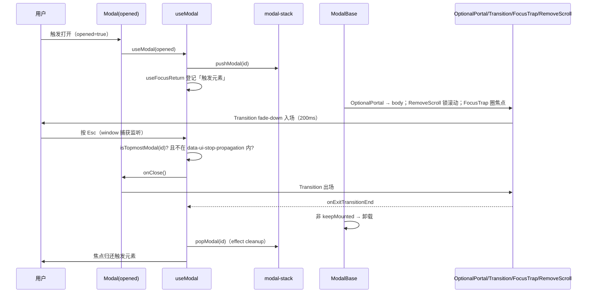
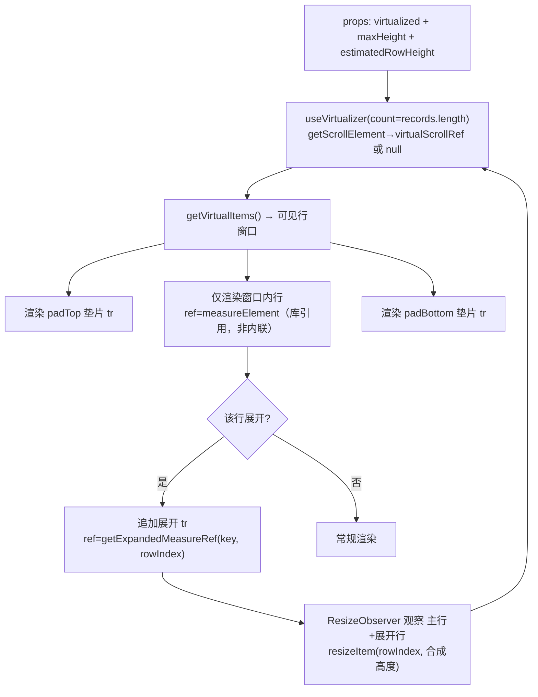
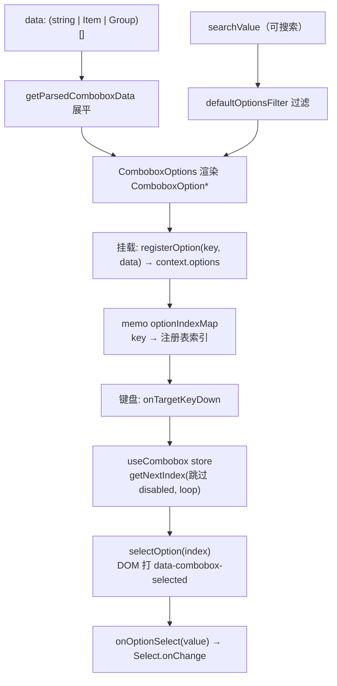
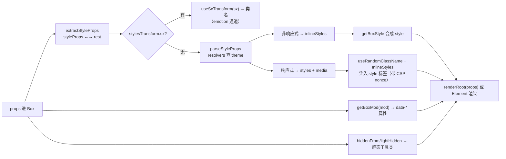

# 05 核心实现流程
> 项目：react-ui ｜ 版本：v1.0 ｜ 生成日期：2026-10-06 ｜ 依据：源码分析

本章选取五个最能代表该库工程水准的实现主题，逐个给出流程图、分步说明与涉及文件清单。

## 主题一：Modal 打开/关闭全链路（浮层基建的 assembly）

**涉及文件**：`packages/ui/src/components/ModalBase/use-modal.ts`、`ModalBase.tsx`、`modal-stack.ts`、`ModalBase.context.ts`、`ModalBaseOverlay.tsx`、`ModalBaseContent.tsx`、`packages/ui/src/components/Modal/Modal.tsx`、`ModalRoot.tsx`、`packages/ui/src/components/Portal/Portal.tsx`、`OptionalPortal.tsx`、`packages/ui/src/components/Transition/`、`packages/ui/src/components/FocusTrap/`、`packages/hooks/src/use-focus-return/`、`core/utils/close-on-escape`（对照实现）

**分步说明**：

1. **默认值装配**：`Modal.tsx` 的 `defaultProps` 用 `satisfies Partial<ModalProps>` 声明安全默认：`withinPortal: true`、`lockScroll: true`、`trapFocus: true`、`closeOnEscape: true`、`returnFocus: true`、`zIndex: getDefaultZIndex('modal')`（→ CSS 变量层 `--ui-z-index-modal: 200`）、`transitionProps: { duration: 200, transition: 'fade-down' }`。注释强调 `returnFocus` 缺省时「键盘用户关掉 Modal 焦点落在 body」的无障碍后果；
2. **`useModal` 钩子**（ModalBase 内部调用）：a) `useId(id)` 生成稳定 id，派生 `${id}-title`/`${id}-body` 供 aria 关联；b) `useFocusReturn({ opened, shouldReturnFocus })` 在关闭后把焦点还给触发元素（注释记载这是修复——此前 returnFocus 只是透传未生效）；c) **模态栈登记**：`opened` 期间 `pushModal(_id)`，卸载/关闭 `popModal(_id)`（模块级栈，`modal-stack.ts`）；d) `window.addEventListener('keydown', …, true)` 捕获阶段监听 Escape，响应条件为 `event.key === 'Escape' && closeOnEscape && !event.isComposing && opened && isTopmostModal(_id)`——**只有栈顶模态响应**，避免嵌套模态一按 Esc 全关；且目标在 `[data-ui-stop-propagation="true"]` 元素内（Popover/Menu 下拉）时不响应，避免「Modal+Popover 嵌套双关」；
3. **ModalBase 组装**：`ModalBase.tsx` 把上述状态打包进 `ModalBaseProvider`，然后按 `opened`/`keepMounted` 决定渲染：`OptionalPortal`（`withinPortal` 决定是否 createPortal 到 `document.body`，Portal 实现还支持共享容器节点与 className/style/id/data-*/aria-* 属性同步——`pickPortalNodeAttrs`/`syncPortalNodeAttrs`）；`RemoveScroll`（react-remove-scroll）在 `lockScroll` 时锁页面滚动；`Transition` 承载进出场（默认 200ms，`onEnterTransitionEnd/onExitTransitionEnd` 转发）；`FocusTrap` 在 `trapFocus` 时圈住 Tab 循环；
4. **表现层分件**：`Modal.tsx` 组合 `ModalRoot`（ModalBase 的壳）+ `ModalOverlay`（遮罩，点击调 `ctx.onClose`，`closeOnClickOutside`）+ `ModalContent`（含 `ModalHeader/ModalTitle/ModalBody/ModalCloseButton`，内容区用 `ScrollArea` 处理长内容溢出）；title/body 挂载时 `setTitleMounted/setBodyMounted` 置位，aria-labelledby/describedby 才指向真实存在的节点；
5. **关闭收尾**：`onClose` 触发 → `opened=false` → Transition 出场动画播完 → `onExitTransitionEnd` → 条件卸载（非 keepMounted）→ `popModal`（effect 清理）→ 焦点归还。

## 主题二：DataTable 虚拟滚动与展开行高度测量

**涉及文件**：`packages/ui/src/components/DataTable/DataTable.tsx`（`rowVirtualizer`、`getExpandedMeasureRef`、`renderBody` 虚拟分支）、`packages/ui/src/components/Table/TableScrollContainer`、依赖 `@tanstack/react-virtual`；e2e 验证 `e2e/interactions/virtual-table.spec.ts`

**分步说明**：

1. **无条件初始化**：`useVirtualizer` 无论 `virtualized` 与否都调用，`getScrollElement: () => (virtualized ? virtualScrollRef.current : null)`——hooks 顺序稳定（注释原话「保证 hooks 顺序稳定」），非虚拟时 hooks 空转；`initialRect` 用 `maxHeight` 数值或 400 兜底，`getItemKey` 复用 `rowKeys`（与 `rowKey` prop 一致）；
2. **主行测量**：虚拟分支中 `renderRow(record, index, rowVirtualizer.measureElement)` 把库自带的 `measureElement` 直接作为 tr 的 ref；源码注释解释了为什么不能写内联箭头——「内联箭头会让每行 ref 在每次渲染时 detach/attach，虚拟滚动下等于每帧对每个可见行强制重测 + 回流」；
3. **上下垫片**：`getVirtualItems()` 之后，顶部渲染 `height: padTop` 的隐形 `<tr aria-hidden>`、底部渲染 `padBottom` 垫片，把滚动总高撑到 `getTotalSize()`，表格原生滚动条由此产生；
4. **展开行合成测量**（难点）：展开行是与主行平行的另一个 `<tr>`，`measureElement` 只挂在主行上，展开行高度不进测量就会滚动错位。`getExpandedMeasureRef(key, rowIndex)` 返回一个**按 key+rowIndex 缓存的 ref 回调**（`expandedRefCacheRef: Map<key, {rowIndex, fn}>`）：节点挂载时找到 `previousElementSibling`（主行），立即上报一次「主行高+展开行高」，再挂 `ResizeObserver` 同时观察两个行节点持续修正（存入 `expandedObserversRef`）；节点卸载（收起）时断开观察器并把该项高度恢复为主行自身高度；
5. **选择/全选热路径**：`selectedKeysSet`/`rowKeysSet`/`expandedKeysSet` 三个 `useMemo` Set 支撑每行的 O(1) 判定；全选是差集/并集运算（保留跨页选中，注释明确数组 includes 在万级全选时近 O(n²)）；
6. **a11y**：行 `tabIndex=0` + 方向键移焦 + Enter/Space 触发 onRowClick，但对行内 BUTTON/A/INPUT/SELECT/TEXTAREA/contentEditable 放行（防吞子元素键盘激活）。

## 主题三：Combobox 选项注册表与键盘导航

**涉及文件**：`packages/ui/src/components/Combobox/Combobox.context.ts`、`use-combobox/use-combobox.ts`、`use-combobox/get-index/get-index.ts`、`ComboboxOptions.tsx`、`ComboboxOption.tsx`、`ComboboxEventsTarget.tsx`、`ComboboxDropdown.tsx`；消费方 `Select/Select.tsx`、`MultiSelect`、`Autocomplete`、`dates/components/PickerInputBase`

**分步说明**：

1. **store 形态**：`useCombobox` 返回命令式 store——`openDropdown/closeDropdown/toggleDropdown(eventSource)`、`selectOption(index)`、`selectNextOption/selectPreviousOption`（循环受 `loop` 控制）、`clickSelectedOption`、`resetSelectedOption` 等；高亮索引选中时会给对应选项 DOM 打 `data-combobox-selected`，索引重置为 -1 时移除——**高亮态既有 React 态也有 DOM 态**，后者供 aria-activedescendant 类消费；
2. **索引计算**：`get-index/get-index.ts` 的 `getFirstIndex/getNextIndex/getPreviousIndex` 只做纯函数运算（跳过 disabled 项、按 `loop` 回绕）；
3. **选项注册表**：每个 `ComboboxOption` 挂载时经 context 的 `registerOption(key, data)` 注册（`ComboboxOptionData` 含 value/label/disabled/group/key/DOM node），卸载时 `unregisterOption`；DOM node 的用途在类型注释里写明——「把注册表顺序对齐到视觉顺序（键盘导航依赖一致顺序）」；根组件 `memo` 出 `optionIndexMap`，让每个选项 O(1) 查自己的索引（避免逐实例 findIndex 的 O(n²)）；
4. **键盘事件汇流**：`ComboboxEventsTarget` 把目标元素的 `onKeyDown/onTargetClick/onTargetBlur` 接到 context；方向键/Enter/Escape 经 store 转发到 `selectNextOption` 等方法；`onTargetBlur` 实现 closeOnBlur——「焦点离开目标与下拉时关闭」；
5. **选中值判定**：context 携带 `selectedValues`（数组）与 `selectedValuesSet`（Set 视图，注释：判定 O(1)，避免逐选项 includes 的 O(n×m)）；`onOptionSelect(value)` 上抛给 Select 等消费方落成自己的受控值；
6. **数据预处理**：`ComboboxPopover` 的 `getParsedComboboxData` 把 `(string | Item | Group)[]` 展平、`defaultOptionsFilter` 按 `filter`（默认 `'contains'`）过滤——Select 的 `searchable` 即基于 searchValue + 过滤器实现。

## 主题四：Box 的 style props 解析与响应式注入管线

**涉及文件**：`packages/ui/src/core/Box/Box.tsx`、`style-props/extract-style-props/`、`style-props/parse-style-props/`、`style-props/style-props-data.ts`、`style-props/resolvers/`、`get-box-style/`、`get-box-mod/`、`use-random-classname/`、`core/InlineStyles/`（`styles-to-string`）、`core/utils/responsive-value`

**分步说明**：

1. **抽取**：`extractStyleProps(others)` 按白名单字典把 Box 风格的缩写 style props（`m/mx/my/mt/…/bg/c/ff/fz/fw/w/h/pos/top/…` 共 50+ 个，见源文件解构列表）从普通 DOM props 里分离，返回 `{ styleProps, rest }`——rest 继续透传给真实元素，避免自定义属性泄漏到 DOM；
2. **sx 转换**：若 UIProvider 配置了 `stylesTransform.sx`（如 emotion 的 `useSxTransform`），`useSxTransform?.()?.(styleProps.sx)` 把 `sx`（对象或 `(theme, helpers) => 对象` 函数）先编译成类名；未配置则为空（默认 CSS Modules 路径不碰 sx）；
3. **解析**：`parseStyleProps({ styleProps, theme, data: STYLE_PROPS_DATA })` 遍历各 style prop 的解析器（`resolvers/`：如 `getSpacing/getFontSize/getRadius` 类的 theme 键→rem 值换算），产出两类结果——`inlineStyles`（非响应式，直接进 style）与 `styles/media`（带媒体查询的响应式值，如 `w={{ base: 100, sm: 200 }}`）；
4. **响应式注入**：存在响应式值时，`useRandomClassName()` 生成随机类名挂在元素上，同时渲染 `<InlineStyles selector={`.${random}`} styles media>`——`InlineStyles` 经 `stylesToString` 序列化成 CSS 文本、带 `getStyleNonce()` 提供的 CSP nonce、`dangerouslySetInnerHTML` 注入 `<style data-ui-styles="inline">`；
5. **主题感知 style**：`getBoxStyle({ theme, style, vars, styleProps })` 合并最终 style——`style` 支持对象或 `(theme) => 对象` 函数（`UIStyleProp`）、`__vars` 直接是 CSS 变量对象；
6. **mod → data 属性**：`getBoxMod(mod)` 把 `Mod | Mod[]`（嵌套数组递归展开）转成 `{ 'data-xxx': value }`，假值剔除（`undefined` 不渲染属性）；Box 级快捷属性 `variant/size` 写 `data-variant`/`data-size`（数值 size 例外：`isNumberLike(size)` 时走原生 `size` 属性，见 `__size`）；
7. **断点隐藏族**：`hiddenFrom/visibleFrom/lightHidden/darkHidden` 翻译成 `ui-hidden-from-{bp}`/`ui-visible-from-{bp}`/`ui-light-hidden`/`ui-dark-hidden` 静态类（规则来自全局 `ThemeProvider/global.css`）。

## 主题五：DataTable 排序管线（受控/非受控分流 + 本地稳定排序）

**涉及文件**：`packages/ui/src/components/DataTable/DataTable.tsx`（`sortStatusState`、`handleSortClick`、`displayRecords`）、`sort.ts`、`types.ts`；测试 `DataTable.test.tsx`

**分步说明**：

1. **状态声明**：`useUncontrolled<DataTableSortStatus | null>({ value: sortStatus, defaultValue: defaultSortStatus ?? null, onChange: 收窄回传 })`——setter 只会产出非 null 状态，`onChange` 里做了 `as DataTableSortStatus` 收窄（源码注释：「setter 只会产出非 null 状态，收窄回传」）；
2. **点击表头**：`column.sortable` 时渲染 `<button class=thButton>`，点击进 `handleSortClick(column)`。**函数 accessor 直接拒绝排序**：开发态 `console.warn` 提示「函数 accessor 无法本地排序，请提供字符串 accessor 或外部受控排序」（受控模式下函数还会被当 accessor 回传给消费方，同样危险）；
3. **方向循环**：`getNextSortDirection`——当前 `asc` → `desc`，其余（含未排序）→ `asc`，即「无 → asc → desc → asc」循环；
4. **受控分流**：`displayRecords` 的 useMemo 依 `isSortControlled` 分流——受控时**不排数据**（注释：由使用方处理，服务端排序场景）；非受控时 `sortRecords(records, sortStatus)`；
5. **排序实现**（`sort.ts`）：`[...records].sort(...)` 复制后排序保证不变异；比较器 `compareSortValues`——null/undefined 恒排最后；`Date` 先转时间戳；数字按大小、布尔按真假；其余 `String.localeCompare('zh-Hans-CN', { numeric: true, sensitivity: 'base' })` 中文本地化 + 数字感知比较（`'第2章' < '第10章'`）；方向系数 `direction === 'desc' ? -1 : 1`；
6. **表头 aria**：当前排序列写 `aria-sort="ascending" | "descending"`，排序图标 `SortIcon` 以 `data-direction` 表达方向供 CSS 翻转。

**值得注意的一致性设计**：主题五与主题二共用同一套「受控分流」骨架（`useUncontrolled` 返回的第三个元素 `isControlled`），主题一、三则在命令式 store/模块级栈上解决跨组件协作——五条主题合起来即该库「状态局部化、行为可预测」的实现观。

## 六个主题之外的通用手法

把五个主题横向对齐，能提炼出一批反复出现的实现手法，它们是读懂其余 100+ 组件的钥匙：

1. **ref 回调缓存**：主题二的 `expandedRefCacheRef`、`useUncontrolled` 的稳定 setter、Splitter 的 ref 回调缓存（Combobox 注释里点名）都是同一思想——React 的 ref 回调在每次渲染若以新函数身份出现会 detach/attach，凡是昂贵或带副作用的 ref 回调都要按 key 缓存并在依赖变化时干净地重建/清理；
2. **开发态守卫**：`handleSortClick` 对函数 accessor 的 `console.warn`、`useProps` 的快路径、`assert-harness.ts` 的端口校验，都遵循「生产零开销、开发早暴露」——守卫统一用 `process.env.NODE_ENV !== 'production'` 包裹，不会进入发布产物的热路径；
3. **注释即档案**：几乎每个非显然的实现旁边都有解释「为什么」的中文注释，且大量引用实测数据（Button 摇树 12KB vs 327KB、文档站冷启动 21 分钟）与历史 commit（9347c9fd）。读这个库的源码时，**先读注释再读代码**的收益远高于常规仓库；
4. **纯函数下沉**：排序（`sort.ts`）、索引计算（`get-index`）、数据解析（`getParsedComboboxData`）、方向循环（`getNextSortDirection`）全部是无副作用纯函数，天然可单测、可复用、可被 e2e 之外的层面验证；
5. **逃生口设计**：`renderRoot`（接管根元素）、`data-ui-stop-propagation`（Escape 事件豁免）、`HiddenDatesInput`（隐形 input）、`removeScrollProps`（滚动锁透传）——每个强约束组件都留了一个不破坏默认行为的旁路，这是「库不让用户 fork」的关键。

## 阅读实现源码的建议路径

新手路径建议按依赖深度递进：`Box.tsx`（约 140 行，多态渲染与 style props 管线）→ `Button.tsx`（工厂 + StylesApi + varsResolver 的完整范本）→ `use-styles.ts`（样式解析中枢与缓存策略）→ `UIProvider.tsx` + `default-css-variables-resolver.ts`（主题与变量链）→ `useUncontrolled`（状态双模）→ 任选一个复合组件（推荐 Tabs，体量最小）顺藤摸瓜到 context 与子件。每一步都能在前一步找到概念锚点。进阶路径则建议带着 e2e 用例读实现：`e2e/interactions/modal.spec.ts` 对照 `use-modal.ts`、`virtual-table.spec.ts` 对照 `getExpandedMeasureRef`——测试用例就是实现意图的可执行说明书。

## 主题独立性与复用小结

| 主题 | 核心机制 | 可复用资产 |
| --- | --- | --- |
| Modal 链路 | 模块级栈 + 全局捕获监听 + Portal/Transition/FocusTrap/RemoveScroll 组合 | `modal-stack.ts`、`use-modal.ts`（Drawer 同构复用） |
| 虚拟滚动 | tanstack virtual + 合成测量 | `getExpandedMeasureRef` 的 ref 缓存模式 |
| Combobox | 注册表 + 纯函数索引 + DOM 态高亮 | `use-combobox`（Select 家族与日期输入家族共用） |
| Box 管线 | props 抽取 + 解析器表 + 动态类名/style 注入 | `style-props` 全目录（所有组件经 Box 受益） |
| 排序管线 | 受控分流 + 中文 localeCompare | `sort.ts`（纯函数，可单测/复用） |
