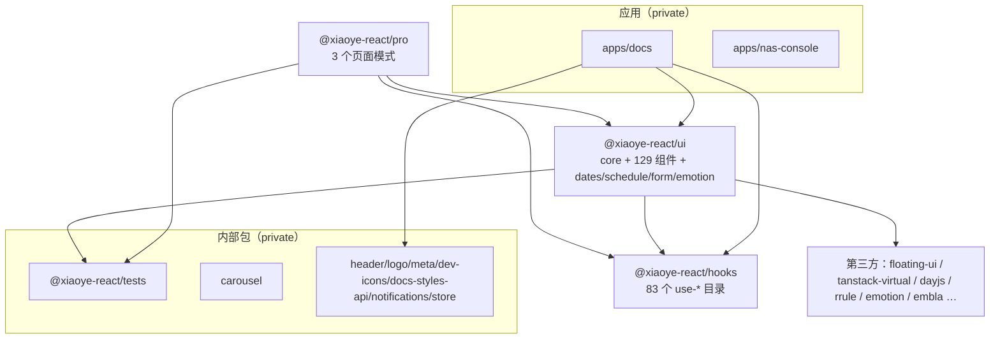

# 07 模块详解（monorepo 各包逐包深读）
> 项目：react-ui ｜ 版本：v1.1 ｜ 生成日期：2026-10-06 ｜ 依据：源码分析

本篇是「包级深读」：把 monorepo 里的每一个包按目录逐个走读，给出职责边界、关键文件与导出清单、机制说明与包间依赖。第 00～06 篇已经从全景、架构、组件设计、接口、状态模型、实现流程、部署运行七个维度建立了整体认知，本篇不再重复那些结论（凡已展开的机制一律以「见《0X-xxx》」引用），只做两件旧篇没做的事：一是把三个可发布包（hooks、ui、pro）各自**内部**的模块清单和文件级职责一次列全；二是对 `styles` 系统与 9 个内部包做专项走读。组件逐个的 API 细节不在本篇展开，统一收录在第 15 篇《接口全量参考》。

## 1. 模块总览与依赖图

13 个 workspace 包（`pnpm-workspace.yaml` 声明 `apps/*`、`packages/*`、`packages/@xiaoye-react/*` 三个 glob）中，3 个对外发布、9 个 private 内部包、外加 2 个应用。依赖方向严格单向，被依赖者层次更低：

依赖的「形」在三个 `package.json` 里各有体现：hooks 的 `peerDependencies` 只有 `react`/`react-dom`（`^18 || ^19`），`sideEffects: false`；ui 的 `dependencies` 全部是第三方运行时库、`devDependencies` 里以 `workspace:*` 引用 hooks 与 tests、`peerDependencies` 锁 `react ^19` 与 `@xiaoye-react/hooks ^1.4.0`；pro 的 peer 用 `workspace:^` 协议指向 ui 与 hooks（发布时由 `pnpm publish` 重写）。发布顺序因此固定 hooks → ui → pro，论证见《06-部署运行》第 4 节。

## 2. packages/hooks：83 个无 UI 原语

### 2.1 包形态与入口

`packages/hooks/src/` 下共 83 个 `use-*` 目录（另有 `utils/` 与入口 `index.ts`、`test-setup.ts`）。每个 hook 目录的标准形状是 `use-xxx/use-xxx.ts`（实现）+ 可选 `use-xxx.test.ts(x)`（30 个目录带同目录测试）。入口 `index.ts` 约百条导出语句：顶部 `'use client'` 序言之后逐目录具名导出，每个 hook 同时导出实现函数与 `UseXxxOptions/UseXxxReturnValue` 类型对；少数目录还导出纯函数副产物（如 `use-hotkeys` 的 `getHotkeyHandler`/`getHotkeyMatcher`、`use-local-storage` 的 `readLocalStorageValue`、`use-move` 的 `clampUseMovePosition`、`use-radial-move` 的 `normalizeRadialValue`、`use-collapse` 的 `getElementHeight`/`getElementWidth`、`use-pagination` 的 `DOTS`）与工具集（`utils/` 的 `clamp`、`lowerFirst`、`randomId`、`range`、`shallowEqual`、`upperFirst`）。

包描述自述「60+ 个 hooks」（`packages/hooks/package.json` 的 description 与 `packages/hooks/README.md` 第 7 行），实测目录为 83 个——口径差已在第 13 篇列入技术债。构建侧与 ui 同构：`packages/hooks/vite.config.ts` 用 `preserveModules` 保留模块边界（注释明言：压成单文件会让「只 import 一个 use-hotkeys 也要背上全部 hook」），ESM 输出补 `'use client'` banner，外部化仅 `react`/`react-dom`/`react/jsx-runtime`。

### 2.2 按功能域分组走读

**状态原语域**（14 个）：`use-uncontrolled`（受控/非受控双模内核，ui 全线消费，语义见《04-数据模型》第 2 节）、`use-disclosure`（`{ opened, open, close, toggle }` 布尔状态包，Modal/Popover 类交互的标准起手式）、`use-toggle`、`use-counter`、`use-list-state`（数组增删改查 handler 集）、`use-map`、`use-set`、`use-queue`（带 `cleanupTimerTimeout` 的队列容器）、`use-set-state`（对象式 patch）、`use-state-history`（undo/redo）、`use-pagination`（页码序列计算，`DOTS` 表示省略段）、`use-validated-state`（带校验回调的本地状态）、`use-previous`、`use-input-state`。这一域的共性是「把 useState 的组合逻辑封装成稳定 setter」，全部经过同目录单测验证的占 12 个。

**时序与频率控制域**（10 个）：`use-debounced-callback`/`use-debounced-state`/`use-debounced-value` 三件套、`use-throttled-callback`（含 `useThrottledCallbackWithClearTimeout` 变体）/`use-throttled-state`/`use-throttled-value` 三件套、`use-interval`、`use-timeout`、`use-effect-event`（把「事件回调读最新 props/state 但不进依赖」收敛成一个稳定函数，是 eslint 棘轮治理注释里反复点名的工具）、`use-shallow-effect`（浅比较依赖的 effect）、`use-did-update`（跳过首次的 didUpdate）、`use-is-first-render`、`use-mounted`。其中 debounced/throttled 六个 hook 全部有同目录测试，是 hooks 包测试密度最高的域。

**DOM 交互域**（14 个）：`use-click-outside`、`use-event-listener`（含 `useWindowEvent` 窗口特化）、`use-hotkeys`（热键注册 + `parse-hotkey.ts` 纯函数解析器，`getHotkeyHandler` 供静态绑定）、`use-long-press`、`use-drag`、`use-move`/`use-radial-move`（拖拽位移与角度，Slider/Rating/ColorPicker 的几何底座）、`use-focus-trap`、`use-focus-return`、`use-focus-within`、`use-roving-index`（roving tabindex 索引管理）、`use-selection`（键盘/鼠标一致的集合选择 handler）、`use-splitter`（分栏拖拽几何，Splitter 组件依赖）、`use-text-selection`、`use-mouse`/`use-mouse-position`。ui 组件对这一域的复用关系在《02-组件设计》第 1 节的复用图中可见。

**观测器域**（9 个）：`use-intersection`、`use-in-viewport`、`use-resize-observer`/`use-element-size`、`use-mutation-observer`/`use-mutation-observer-target`、`use-scroller`（滚动容器状态机）、`use-scroll-spy`、`use-scroll-into-view`、`use-scroll-direction`、`use-viewport-size`、`use-window-scroll`。共性是「一次性建立 observer/监听，输出已解析的快照值」，把 ResizeObserver 的 ref 回调缓存纪律（《05-核心实现流程》手法一）封装在 hook 内部，组件侧不再各自处理。

**浏览器环境域**（16 个）：`use-media-query`（+ 模块级 `attachMediaListener`，这个导出是 ui peer 下限锁 `^1.4.0` 的直接原因，见《03-接口设计》第 7 节）、`use-color-scheme`、`use-reduced-motion`、`use-os`、`use-orientation`、`use-network`、`use-idle`、`use-hash`、`use-clipboard`、`use-local-storage`/`use-session-storage`（共享 `create-storage.ts` 底座，`UseStorageOptions` 类型同源）、`use-fullscreen`（`useFullscreenDocument`/`useFullscreenElement` 双变体）、`use-eye-dropper`、`use-favicon`、`use-document-title`、`use-document-visibility`、`use-page-leave`、`use-headroom`。

**工程基建域**（7 个）：`use-id`（含 `useReactId` 双实现，SSR 安全）、`use-merged-ref`（+ `assignRef`/`mergeRefs` 纯函数）、`use-callback-ref`、`use-isomorphic-effect`、`use-force-update`、`use-logger`、`use-floating-window`（浮动窗口几何，FloatingWindow 组件依赖）、`use-file-dialog`、`use-fetch`（请求状态机）、`use-mask`（掩码解析，MaskInput 依赖）。基建域是 ui 包的「隐形依赖」——`createSafeContext`、工厂体系、虚拟滚动全都踩在它们肩上。

### 2.3 消费关系小结

hooks 包对 ui 的价值在两处最集中：一是 `use-uncontrolled` 等状态原语成为全库状态模型的法定实现；二是 `use-move`/`use-splitter`/`use-floating-window`/`use-mask` 这类几何与解析原语让交互组件不必自带数学。反向依赖为零——hooks 目录内检索不到任何对 `@xiaoye-react/ui` 的引用，这正是它可独立发布、可摇树的根基。

## 3. packages/ui：core 内核逐个详解

`packages/ui/src/` 一级结构为 `core/`、`components/`（129 个组件目录）、`dates/`、`schedule/`、`form/`、`emotion/`、`colors-generator/` 与入口 `index.ts`。组件族的整体设计见《02-组件设计》，本节把 **core 内核**拆到文件级。

### 3.1 core/factory：组件的出生地

四个文件构成完整闭环。`create-factory.ts` 定义最基础的 `Factory<Payload>` 类型与 `factory()`：把 forwardRef 渲染函数包成单组件，附 `classes`/`varsResolver` 静态成员，适合非多态组件（如 PageContainer 在 pro 包里就是用它创建的）。`factory.tsx` 定义 `FactoryPayload` 载荷类型（props/ctx/ref/stylesNames/vars/variant/staticComponents/compound/signature），`compound: true` 标记复合组件的主题约束见《01-系统架构》第 5 节。`create-polymorphic-component.ts`（61 行）是纯类型层：`PolymorphicComponentProps<C, Props>` 让 `component` prop 动态继承目标元素属性，`PolymorphicRef<C>` 排除 string ref。`polymorphic-factory.tsx`（117 行）是运行时层：`polymorphicFactory<Payload>(ui)` 在 forwardRef 之上附加 `withProps`（高阶固定 props，透传 extend/classes/varsResolver）、`extend`（恒等函数，类型级扩展口）、静态子组件并入。多态机制的端到端示例见《02-组件设计》Button 一节。

### 3.2 core/Box：万物之基与 style props 管线

`Box.tsx`（139 行）本体只做三件事：调 `extractStyleProps` 拆分 style props 与 DOM props、调 `getBoxStyle` 合成最终 style、按 `renderRoot` 或多态元素渲染。周边目录各管一段：`style-props/`（白名单字典 `style-props-data.ts`、抽取器 `extract-style-props`、解析器 `parse-style-props` 与 `resolvers/` 主题换算）、`get-box-mod/`（mod → data 属性，假值剔除）、`get-box-style/`（style 对象/函数/CSS 变量合成）、`get-style-object/`、`use-random-classname/`（响应式媒体类名）。`Box.types.ts` 提供 `CssVarsProp`/`UIStyleProp`。完整管线图见《05-核心实现流程》主题四。

### 3.3 core/styles-api：样式解析中枢

目录结构：`styles-api.types.ts`（`StylesApiProps` 六件套与 `ClassNames`/`Styles`/`Vars`/`Attributes` 类型）、`create-vars-resolver/`、`use-resolved-styles-api/`（把 `getStyles` 挂到 context 供子件复用）、`use-styles/use-styles.ts`（145 行中枢）。`use-styles` 内部组合 `get-class-name/get-class-name.ts`（8 个类名辅助函数链：全局类名、主题类名、变体类名、静态类名、选择器类名、根类名、options 类名、resolved 类名）与 `get-style/get-style.ts`（styles 合并 + vars + varsResolver + 主题 vars），以及 `use-transformed-styles.ts`（stylesTransform 通道）。**按选择器缓存**是本文件的性能要点：同一次渲染内不带 options 的 `getStyles(selector)` 调用命中 `Map` 缓存，注释给出的动因是 DataTable 虚拟滚动下每帧重复解析上百个 tr/td 选择器（机制与边界见《10-性能设计与优化》第 2 节）。

### 3.4 core/UIProvider：主题与环境层

13 个子目录/文件各司其职。`UIProvider.tsx`（179 行）：受控/非受控色彩方案、根 Provider 判定（`parentContext === null` 才写 `documentElement` 属性）、`matchMedia` 订阅、`withStaticClasses`/`headless`/`stylesTransform`/`getStyleNonce` 下发。`UI.context.ts`：单一 context 对象 + 10 个细粒度消费 hook。`UIThemeProvider/`：`mergeUITheme` 深合并与 `useSafeUITheme`/`useUITheme` 双读法。`use-props/use-props.ts`（45 行）：主题 defaultProps 三级合并，**快路径**——组件与主题都无 defaultProps 时原样返回 props 保引用稳定（详见《10-性能设计与优化》第 3 节）。`UICssVariables/`：`default-css-variables-resolver.ts` 把主题翻译为 `--ui-*` 变量、`UICssVariables.tsx` 注入 `cssVariablesSelector`、`virtual-color/` 亮暗双值虚拟色。`ColorSchemeScript/`：SSR 防 FOUC 内联脚本（带 `data-ui-script` 去重标记）。`color-functions/`：`variantColorResolver`、`getThemeColor`、`getPrimaryShade`、`getPrimaryContrastColor` 等。`merge-ui-theme/`：合并语义由 5 个用例固化。`create-theme/`：恒等函数提供类型收窄入口。`use-matches/`：主题断点匹配。`use-ui-color-scheme/`：派生色彩方案读取。`default-colors.ts`/`default-theme.ts`：内置全色系与 `DEFAULT_THEME`。`theme.types.ts`：`UITheme` 全量键位（见《03-接口设计》第 9 节）。`convert-css-variables/`：主题对象到变量的转换辅助。

### 3.5 core 其余成员

`core/store/store.ts`（62 行）：`createStore` 闭包 store（`getState/setState/updateState/initialize/subscribe`）+ `useStore`（`useSyncExternalStore` 包装，第三个参数同取 `getState` 保证 SSR 快照一致）。`core/utils/` 下 25 个小工具目录，按用途归四组：**环境**（`Activity/` React 19 Activity fallback、`Floating/` floating-ui 辅助、`responsive-value`）、**context 与事件**（`create-safe-context`、`create-scoped-keydown-handler`、`create-use-external-events`、`close-on-escape`）、**查找与判定**（`find-element-ancestor`、`find-element-in-shadow-dom`、`get-single-element-child`、`is-element`、`is-number-like`、`find-closest-number`、`filter-props`、`get-base-value`）、**数值与样式**（`get-breakpoint-value`、`get-sorted-breakpoints`、`get-default-z-index`、`get-safe-id`、`get-size`、`units-converters`、`deep-merge`、`camel-to-kebab-case`、`keys`、`noop`、`primitive`）。`core/DirectionProvider/`：`dir` 上下文 + MutationObserver 自动跟随（模块级常量 `DIR_MUTATION_OPTIONS` 固定监听配置防 observer 反复重连）。`core/InlineStyles/`：`styles-to-string`/`css-object-to-string` 序列化 + `<style data-ui-styles="inline">` 注入（CSP nonce）。`core/Provider/`：无主题的裸 Provider。`core/ThemeProvider/global.css`：断点隐藏工具类（`ui-hidden-from-*` 等）与基础 reset 的寄居地。

## 4. packages/ui：组件与四个垂直模块

**components/**：129 个组件目录经 `components/index.ts` 的 129 条星导出对外暴露（既往文档口径「130 组件」与实测目录数的 1 个差额 ⚠️ 待确认，可能来自计数口径）。目录内部形状与命名约定见《02-组件设计》第 1 节与第 3 节的共性约定表。**dates/**：`components/`（33 个日期时间组件）、`hooks/`（`useDatesState` 系）、`utils/`（dayjs 封装）、`types/`（`DateStringValue` 值类型体系）。**schedule/**：`components/`（AgendaView 等日程视图，基于 rrule）、`hooks/`、`utils/`、`labels.ts`、`types.ts`；与 dates 重名的 4 个工具函数在包入口被显式消歧为 schedule 版（《03-接口设计》第 1 节）。**form/**：`use-form.ts` 入口 + `hooks/` 六个子状态机 + `paths/` 字段路径系统 + `validate/` + `validators/`（10 个内置规则）+ `lists/` 动态表单项 + `actions.ts` + `schema-resolver.ts`（Standard Schema 适配）+ `FormProvider/`；67 个测试文件集中在 `tests/` 与各子目录。**emotion/**：11 个文件的可选 CSS-in-JS 通道——`UIEmotionProvider.tsx`、`create-styles.ts`、`emotion-transform.ts`（stylesTransform 实现，`useSxTransform`/`useEmotionStylesTransform` 两个钩子式转换器）、`use-css.ts`、`merge-sx.ts`、`Global.tsx`、`ssr.tsx`（用 `html-react-parser` 处理服务端关键样式抽取）、`use-guaranteed-memo.ts`。**colors-generator/**：`generate-colors.ts` 用 chroma-js 从主色生成 10 阶色板（自带 `chroma-js.d.ts` 补充声明）。

## 5. packages/@xiaoye-react/pro：三个页面模式

pro 是「不造新 UI，只编排 ui 组件成管理端模式」的官方示范。`packages/@xiaoye-react/pro/src/` 仅 14 个文件：入口 `index.ts`（顶部 `'use client'`，三个模块的组件与类型成对导出）与 `global.d.ts`，加三个模块各 5 件套（组件、module.css、test、index.ts re-export）。

- **page-container/**：`PageContainer.tsx` 用 `factory`（非多态工厂）创建，`PageContainerProps` 含 `title/subtitle/breadcrumbs/extra/headerGap/contentGap`，7 个 StylesNames（`root/header/titleRow/title/subtitle/extra/content`）、2 个 CSS 变量（`--page-container-header-gap`、`--page-container-content-gap`，varsResolver 调 `getSpacing` 解析）；
- **search-filter/**：`SearchFilter.tsx` 渲染为 `<form>`，`SearchFilterField` 声明字段（`name/label/type/data/placeholder/colSpan/render`，type 内置 `text/number/select` 三种，`render` 可整体替换）；状态经 `useUncontrolled` 双模（`values/defaultValues/onChange`），`onSearch` 查询、`onReset` 重置回默认值；6 个 StylesNames、2 个 CSS 变量（`--search-filter-columns`、`--search-filter-grid-gap`）；
- **pro-table/**：`request` 驱动的表格页模式，在 DataTable 之上叠加搜索区、工具栏、分页/排序联动与 `requestIdRef` 竞态保护，语义与 API 表见《02-组件设计》第 2.8 节。

三个组件都带同目录 `*.test.tsx`，并经 `@xiaoye-react/tests` 共享测试资产。pro 的 `vite.config.ts` 只产 ESM（`formats: ['es']`，`require` 条件也指向同一 `es/index.js`，见 `packages/@xiaoye-react/pro/package.json` 的 exports），外部化 `react`/`react-dom`/`react/jsx-runtime` 与两个 peer 包。

## 6. styles 系统专项走读

「样式」在这个库里不是单个模块，而是一条贯穿四层的管线：

| 层 | 位置 | 职责 |
| --- | --- | --- |
| 全局变量层 | `core/UIProvider/UICssVariables/` | 把 `UITheme` 翻译成 `--ui-*` 变量注入 `:root`，亮暗两套语义变量随 `data-ui-color-scheme` 切换 |
| 全局工具类 | `core/ThemeProvider/global.css` | 断点隐藏（`ui-hidden-from-*`/`ui-light-hidden` 等）与基础样式 |
| 组件样式层 | 各组件 `*.module.css` | CSS Modules + `postcss-nested`（根 `postcss.config.cjs`），规则只消费组件局部变量与 data 属性选择器 |
| 实例样式层 | `core/styles-api/` + `core/InlineStyles/` | `classNames/styles/vars` 三通道 + 响应式值的动态 `<style>` 注入 |

样式变体的表达铁律是「差异进变量、状态进 data 属性」：varsResolver 读 theme+props 产出 `--组件-*` 局部变量（受 `XxxCssVariables` 白名单约束），CSS Modules 只写 `var()` 与属性选择器，这让主题切换与变体切换都不需要 JS 重新计算样式。可选的 Emotion 通道（`src/emotion/`）以 `stylesTransform` 注入方式平行存在，默认关闭，SSR 关键样式由 `emotion/ssr.tsx` 抽取——这条线的定位与取舍见《01-系统架构》第 4 节。

## 7. 内部包与共享测试资产

9 个 private 内部包（`packages/@xiaoye-react/`）分两类：**文档站基建**（`header`、`logo`、`meta`、`dev-icons`、`docs-styles-api`、`notifications`、`store`、`carousel`——最后一个基于 embla 的轮播封装同时被 ui 的 Carousel 组件复用）；**测试资产**（`tests`：`src/core/` 提供 axe 无障碍断言、`create-context-container` 等工具，`src/dates/` 提供 `it-supports-*` 系列可复用日期用例块与 `date-input-test-helpers.ts`，`src/setup.ts` 统一测试环境装配）。虽然 private，它们仍被 `pnpm check:exports` 纳入导出一致性检查（`scripts/validate-package-exports.mjs` 扫描 `packages/` 与 `apps/` 下全部含 package.json 的目录）。

## 8. 包间依赖与文件布局速查

最后给一张「包 → 一级模块 → 关键文件」的索引表，作为本篇目录级走读的收束：

| 包 | 一级模块 | 关键文件 | 职责一句话 |
| --- | --- | --- | --- |
| hooks | use-* × 83 | 各 `use-xxx/use-xxx.ts` | 无 UI React 原语 |
| hooks | utils | `src/utils/` | clamp/range/randomId 等纯函数 |
| ui | core/factory | `polymorphic-factory.tsx` 等 4 件 | 组件工厂与多态类型 |
| ui | core/Box | `Box.tsx` + style-props/ | 属性基座与 style props 管线 |
| ui | core/styles-api | `use-styles/use-styles.ts` | 样式解析中枢与缓存 |
| ui | core/UIProvider | `UIProvider.tsx` 等 13 件 | 主题/色彩方案/CSS 变量 |
| ui | core/store | `store.ts` | useSyncExternalStore 外部 store |
| ui | core/utils | 25 个子目录 | 跨组件小工具 |
| ui | components | 129 目录 + `index.ts` | 通用组件族 |
| ui | dates/schedule/form/emotion/colors-generator | 各模块目录 | 四个垂直域与色板生成 |
| pro | page-container/search-filter/pro-table | 各 5 件套 | 管理端页面模式 |
| tests（内部） | core/dates | `it-supports-*`、`axe.ts` | 共享单测资产 |

本篇覆盖到目录与文件级；每个 hook 的签名速查与每个组件的 props 概要见第 15 篇，构建产物与脚本层的配置细节见第 14 篇。

## 9. 按依赖深度递进的走读顺序

如果把本篇当作源码阅读的路线图，建议按「依赖深度」递进，每一步都踩在前一步的概念上。第一层读 `packages/hooks/src/`：先 `use-uncontrolled`（理解全库状态模型的地基，配合《04-数据模型》第 2 节），再 `use-id`/`use-merged-ref`/`use-callback-ref`（理解库对引用稳定与 SSR 一致性的执念），最后挑一个观测类（`use-resize-observer`）看 observer 生命周期管理的标准姿势。第二层读 `packages/ui/src/core/`：按 factory → Box → styles-api → UIProvider → store 的顺序，正好是「组件如何出生、如何消化 props、如何产出样式、如何接入主题、如何离开 React 树」五个问题依次作答；core/utils 不必通读，遇到再查（25 个目录全部是百行以内的纯函数）。第三层挑一个标准组件（Button，约百余行）和一个复合组件（Tabs，体量最小）对照读，验证前两层学到的机制在真实组件里如何组装。第四层才是垂直域：dates 读 `useDatesState` 与 `DatePickerInput`（理解「面板 + 输入」两层复用），form 读 `use-form.ts` 与 `paths.ts`（理解路径寻址），emotion 只需读 `emotion-transform.ts` 确认 stylesTransform 的边界。pro 最后读——它的价值恰恰在于「读起来毫无新东西」：全部由第一、二层学到的原语组装而成，读它是在检验你对整个内核的理解是否扎实。这条路径与《05-核心实现流程》篇尾的建议路径互为补充：那边按「实现主题」组织，这边按「包与模块」组织，两者交叉验证。
