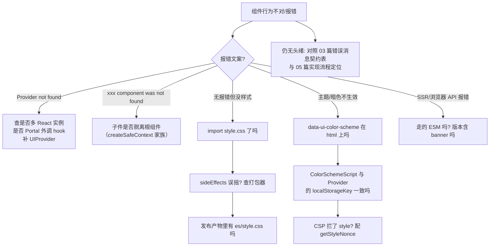
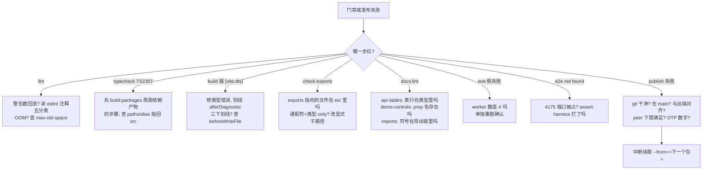

# 12 FAQ 与故障排查（高频报错、决策树与调试入口）
> 项目：react-ui ｜ 版本：v1.1 ｜ 生成日期：2026-10-06 ｜ 依据：源码分析

本篇按「症状 → 根因 → 处置」组织仓库已知的全部高频坑，每条都给出可定位的证据位置（源码文件、配置、脚本注释）。其中发布类坑的完整清单已收录在根 `README.md` 的「发布相关的坑」一节，故障速查表的一部分散见于《06-部署运行》第 9 节——本篇做两件旧篇没做的事：一是把**消费侧**的运行时报错（Provider 缺失、样式丢失、CSP 拦截等）补齐成同一张表，二是给出两张**排查决策树**，让「先查什么后查什么」不再依赖经验。每条处置都遵循同一原则：先核对证据位置，再动手改。

## 1. 运行时报错（消费侧）

**症状 1：抛出 `@xiaoye-react/ui: UIProvider was not found in component tree, make sure you have it in your app`。** 根因：`useUITheme()`（`packages/ui/src/core/UIProvider/UIThemeProvider/`）在无 Provider 的树里被调用；`useUIContext()`（`core/UIProvider/UI.context.ts`）的变体报 `[@xiaoye-react/ui] UIProvider was not found in tree`。处置：应用根部包 `<UIProvider>`；注意「确实包了还报」的两种情形——多 React 实例（检查是否经产物引入了第二份 react，`pnpm.overrides` 只在仓库内生效，消费侧要对齐 react 版本）与从 Portal 外部直接调用 hook（Portal 内容仍属 React 树，正常不会断）。复合组件的同类报错是 `'Tabs component was not found in the tree'`（`createSafeContext` 家族，同名模式适用于 Combobox/ModalBase/Menu 等）：子件（`Tabs.Tab` 等）脱离根组件单独使用，处置是把子件放回根组件作用域内。

**症状 2：组件渲染正常但完全没有样式。** 根因：样式在 `@xiaoye-react/ui/style.css` 子路径里，需要显式 import 一次（库不做自动样式注入）。处置：应用入口 `import '@xiaoye-react/ui/style.css'`；仍无效则按序查——打包器是否因 `sideEffects` 配置误摇 CSS（ui 的 sideEffects 是 `["*.css"]`，check:exports 会拦「导出 CSS 却声明 sideEffects: false」的包，见 `scripts/validate-package-exports.mjs`）、`files: ["es"]` 的发布版本里 `es/style.css` 是否存在（`npm view` 或解包核对）。

**症状 3：深色模式不生效或首屏闪白（FOUC）。** 根因三选一：`data-ui-color-scheme` 没被写到 documentElement（只有根 Provider 才写，嵌套 Provider 继承不劫持）；SSR 场景没用 `ColorSchemeScript` 或其 `localStorageKey` 与 `UIProvider` 的不一致（两者的 JSDoc 显式要求一致，默认键 `ui-color-scheme-value`）；CSP 拦掉了动态 `<style>`（表现为主题变量全部失效）——处置是给 `UIProvider` 传 `getStyleNonce` 返回 CSP nonce（`core/InlineStyles/InlineStyles.tsx` 与 `UICssVariables.tsx` 的 `<style nonce>` 都从这里取）。

**症状 4：Next.js/App Router 报「组件用了浏览器 API」。** 根因：消费方用的构建是 CJS 或旧版本，缺少 `'use client'` 序言。机制：rollup 默认丢弃入口的 directive 序言，`packages/ui/vite.config.ts` 用 `output.banner: "'use client'"` 只给 ESM 输出补回（`preserveModules` 下每个模块都带）；CJS 输出**故意不加**——注释明言再插一条指令序言会静默削弱 `'use strict'`。处置：确认走 ESM（`import` 条件指向 `es/index.js`）、版本不低于补 banner 的版本；不要手工在消费侧给库组件加 'use client'（会嵌套重复）。

## 2. 构建/类型报错（开发侧）

**症状 5：TS2307 找不到模块（典型于干净克隆）。** 根因：`docs:lint` 的 api-tables 与 `check:exports` 依赖 hooks 的**构建产物**类型；本地 es/ 常驻所以从没暴露（CI 注释原话）。处置：先 `pnpm build:packages` 再跑这两项。镜像坑：apps/docs 的 workspace 解析——`tsconfig.json` 的 paths 与 `apps/docs/.dumirc.ts` 的 alias 必须把包指回 `src`，漏一个的包只在「本地恰好留着旧 es/」时看着是绿的（README 原话）。

**症状 6：构建报 `[vite:dts] N 个类型错误，声明产物不完整`。** 根因：`vite-plugin-dts` 发射声明时遇到类型错误会把对应文件**静默跳过**，产物 import 变 TS2307，所以 `afterDiagnostic` 钩子把错误升级为构建失败（`packages/ui/vite.config.ts` 注释）。处置：修复类型错误而不是绕过钩子。相关的历史事故要记住：`packages/ui/tsconfig.typecheck.json` 头注释记录 2026-09-21 实测——把 `@xiaoye-react/hooks` 的 paths 加回构建用 tsconfig.json 会把 TS 推断的 rootDir 抬到 packages/，vite-plugin-dts 把全部 1013 个 .d.ts 发射到 `es/ui/src/` 下、`es/index.d.ts` 直接消失，发布产物的类型全废；paths 只允许出现在 typecheck 专用配置里。另有一处上游 bug 的修复痕迹：vite-plugin-dts 会给 `__` 前缀标识符再加下划线（`__BaseInputProps` → `___BaseInputProps`），`beforeWriteFile` 里用正则归一化回来——若升级插件版本后出现三下划线标识符，先查这个 workaround 是否仍然命中。

**症状 7：`pnpm lint:es` 被 OOM 杀或警告数超 57 失败。** 前者根因：monorepo 全量解析吃内存，根脚本已设 `NODE_OPTIONS=--max-old-space-size=8192`，Story 文件被 eslint ignores 排除也是同因；后者是**棘轮**（`--max-warnings=57` 只许调低不许回涨）。处置：新警告就地修复，确属误报按 CONTRIBUTING 债务政策在 `eslint.config.mjs` 留注释豁免（五类存量的分类与「不能照提示改」的 TDZ 案例都在该文件长注释里，先读再动，见《09-测试与质量保障》第 6 节）。

**症状 8：cspell 报拼写错误。** 根因：词不在词典（含中文项目自定义词典）。处置：专有名词加入 `.cspell/custom-words.txt`（`cspell.json` 的 dictionaryDefinitions 指向它），不要改词或加内联豁免——门禁的本意是防 typo 顺手混入标识符。

## 3. 测试与 e2e 故障

**症状 9：单测大面积假失败/超时。** 根因：`packages/ui/vitest.config.ts` 注释实测——336 个测试文件即 336 次 jsdom 环境，默认按核数开 11 个 worker 时本机可用内存不足，全量拖到 105 分钟并伪造 5 条失败 + 4 处超时（单独重跑那 6 个文件 45 秒全绿）。处置：确认 `poolOptions.threads.maxThreads: 4` 未被改动；本地资源紧张时用 `--filter` 单包跑。

**症状 10：`pnpm e2e:interactions` 满屏 `element(s) not found`。** 根因：4175 端口被其他程序占用，Playwright 的 `webServer.reuseExistingServer` 只看端口有无 HTTP 响应、不认是谁（README 记录本机曾被另一个项目的 http.server 占口）。处置：`e2e/interactions/assert-harness.ts` 已在 globalSetup 比对 harness 的 `<title>` 拦一道；若仍中招，杀掉占口进程重跑。

**症状 11：截图基线大面积差异。** 根因：字体反锯齿等跨平台渲染差异（`maxDiffPixelRatio: 0.02` 只容忍轻微差异）。处置：基线按平台生成（`pnpm e2e:update-snapshots`）；这也是截图 e2e 暂不入 CI 的原因（CI 注释原话），不要试图用 CI 的 linux 基线比对本地产物。

## 4. 发布与依赖类坑（对照 README「发布相关的坑」）

1. **peer 下限**：ui 产物 `import { attachMediaListener } from '@xiaoye-react/hooks'`，该导出 hooks 1.4.0 才有，peer 留 `^1.0.0` 会让 npm 解析到旧版并在 ESM 下报错。处置：升 hooks 时同步核对 ui 的 peer（`release:preflight` 会自动核，`satisfiesCaret` 不跨 major）；
2. **workspace: 协议**：只有 `pnpm publish` 重写为真实范围；pro 的 peer 是 `workspace:^`，裸 `npm publish` 直接坏；
3. **ERR_PNPM_GIT_UNCLEAN**：pnpm 把未跟踪文件也算不干净；`git status --porcelain` 必须为空；
4. **CJS/ESM 双入口依赖（rrule）**：Node 报缺具名导出、webpack 报缺 default 时，产物侧写法必须是「命名空间取值 → 取不到回退 default → default 用计算键访问」；消费者侧复验（`release.mjs` 的 `consumerVerify`，`/tmp/verify` 纯 Node ESM）是唯一能拦住它的步骤——vitest/Vite/webpack 都挑 module 构建，只有纯 Node ESM 走 main 的 CJS；
5. **注册表核对超时**：不要盲目重发。pnpm 打印过 `+ 包名@版本` 即已入库（CDN 同步实测可超 12 秒），`npm view <包> version --prefer-online` 核对后 `--from=<下一个包>` 断点续跑；
6. **回滚窗口**：npm 仅发布后 72 小时内允许 unpublish，之后只能 `npm deprecate`。

## 5. 排查决策树

**树 A：消费侧「组件行为不对」通用排查**

**树 B：仓库侧「门禁/构建/发布失败」排查**

## 6. 调试入口速查

按「想看清什么」列入口：**看组件默认值从哪来**——`useProps`（`core/UIProvider/use-props/use-props.ts`）+ 组件文件尾部的 `defaultProps`；**看样式类名/变量怎么算出来**——`useStyles`（`core/styles-api/use-styles/use-styles.ts`）与组件 `varsResolver`；**看主题变量最终值**——浏览器 DevTools 查 `:root` 的 `--ui-*` 与 `data-ui-color-scheme` 属性；**看模态栈/通知队列状态**——`components/ModalBase/modal-stack.ts` 与 `components/Notifications/notifications.store.ts` 的模块级 store（可在控制台直接 import 后调 `getState`）；**看发布清单**——`pnpm release:check` 的 dry-run 输出（会先重新 build 并列出将上传文件）；**看导出面**——`packages/*/package.json` 的 exports + `scripts/validate-package-exports.mjs` 的输出；**看文档 API 表是否与类型漂移**——`pnpm docs:lint` 三脚本的逐行报错。

## 7. 通用排查工作法与升级路径

把前面十几条个案收敛成一套通用工作法，按固定顺序执行可以覆盖绝大多数未列出的症状。第一步**复现最小化**：库的问题要能在一个不含业务代码的入口里复现（消费方用 `/tmp/verify` 式最小工程，仓库内问题用 e2e harness 或单测），复现不出来多半是业务侧叠加状态（多实例、双 Provider、自定义打包配置）。第二步**读报错原文**：这个库的运行时错误全部是带包名前缀的中文消息（错误消息契约见《03-接口设计》第 5 节），`createSafeContext` 的错误文案与组件文件放在一起——报错文案本身就能 grep 到抛出点，从抛出点沿调用链向上看一层通常就是根因。第三步**查注释档案**：本仓把事故复盘写进源码注释（惯例见《05-核心实现流程》手法三），`eslint.config.mjs`、三个 `vite.config.ts`、`tsconfig.typecheck.json`、`vitest.config.ts` 这五个文件的注释覆盖了构建与工具链的绝大多数历史坑。第四步**核对口径**：涉及数量的说法（组件数、hook 数、警告数）以实测为准（本仓存在 60+/83/87、129/130 等历史口径差，见《13-技术债务与演进建议》D4/D10），涉及行为语义以测试为准（CONTRIBUTING 裁决原则）。第五步**升级路径**：确认是库缺陷后，最小复现 + 预期语义（最好连测试用例一起）提交——这个仓库的裁决机制是「测试显式编码的行为 > 审查者直觉」，带用例的缺陷报告会被直接采纳为接口契约；确认是文档缺口的按《13》台账机制回写；仍无法定位的记「待裁决」，不要臆改。遇到本文未覆盖的症状，除上述入口外再查 `apps/docs/MIGRATION-ANTD-TO-REACTUI.md` 与根 README——大部分已知坑都有成文记录。

## 8. 环境与工具链杂症

最后补三条不属于上述任何一节、但实际出现过（或高度可能遇到）的环境类杂症。其一，**新 shell 里命令全找不到或 pnpm 报版本不符**：本机 Node 走 nvm，每次新 shell 需要 `export PATH="$HOME/.nvm/versions/node/v22.15.0/bin:$PATH"`（CONTRIBUTING 开篇第一条）；pnpm 版本不符时根 `packageManager` 字段会直接拦截——这是保护而非故障，按字段锁定的 9.12.3 对齐即可。其二，**lockfile 冲突或 CI 安装失败**：CI 一律 `--frozen-lockfile`，本地改了依赖但没提交 `pnpm-lock.yaml` 的更新会直接红；合并冲突解 lockfile 的正解是重跑 `pnpm install` 让它重建，而不是手工编辑 YAML（dumi 补丁经 `pnpm.patchedDependencies` 管理，lockfile 里哈希联动，手工编辑极易解出不一致）。其三，**工具自身吃内存**：eslint 已在脚本层配 `NODE_OPTIONS=--max-old-space-size=8192`，tsc 大程序与 336 个 jsdom 环境同样吃内存——本机可用内存不足时（vitest 注释实测过 0.1GB 可用内存的极端情况），先关大程序再跑门禁，不要先怀疑代码。三条的共同背景是：这个仓库的门禁设计假设了一个资源充裕的开发环境，资源受限时表现的「假失败」优先归因到环境而不是代码——先按《09-测试与质量保障》第 1 节的复现口径（单独重跑失败文件）确认真假，再决定下一步。
