# 15 接口全量参考（导出速查：hooks / 组件 / pro 模式）
> 项目：react-ui ｜ 版本：v1.1 ｜ 生成日期：2026-10-06 ｜ 依据：源码分析

本篇是「速查表」：三个可发布包的公开面全量索引。开篇一张包-模块总览图，然后三张主表——hooks 包 83 个 hook 目录、ui 包 129 个组件目录、pro 包 3 个页面模式。

**为什么要有一篇纯速查**：旧篇目按「设计与机制」组织，适合从头读到尾；但日常开发的高频动作是反向的——「我知道要用某个能力，不记得它叫什么、在哪个包、签名长什么样」。本篇就是为这个反向动作准备的索引层：从能力域找 hook 目录，从业务意图找组件目录，从表跳到源文件核对类型。它也是《13-技术债务与演进建议》D4 所指的「单一事实源」的候选载体：hooks 的真实规模、组件的真实清单都以本篇实测为准，后续口径分歧先对本篇再对源码。

阅读约定：**hook 速记列**给出调用形态与返回要点，精确签名一律以各目录的 `UseXxxOptions`/`UseXxxReturnValue` 类型为准（本篇标注 "⚠️ 待确认" 的条目表示速记未经逐行核对）；**组件表**的 props 概要只列特色 props，全量以组件 namespace 的类型出口（`Xxx.Props`）为准，共性与定制通道（BoxProps 基座、StylesApiProps 六件套、variant/size/color/radius 惯例）见《03-接口设计》，不逐行重复；**文档目录**列按 `apps/docs/components/` 的 kebab-case 命名惯例推写（如 `ActionIcon → action-icon`），136 个文档目录与组件目录的对应关系由 `pnpm docs:lint` 保证。样式前缀全库统一为 `ui-<组件名>-<选择器>`（`classNamesPrefix` 可经 UIProvider 修改），表内不重复此列，仅对特殊前缀者注明。

```mermaid
graph LR
    subgraph HOOKS["@xiaoye-react/hooks 1.4.1"]
        H1["状态原语 ×14"]
        H2["时序/频率 ×13"]
        H3["DOM 交互 ×17"]
        H4["观测/滚动 ×11"]
        H5["浏览器环境 ×17"]
        H6["工程基建 ×11"]
        HU["utils（6 纯函数）"]
    end
    subgraph UI["@xiaoye-react/ui 3.0.1"]
        CORE["core：factory/Box/styles-api/UIProvider/store/utils/DirectionProvider/InlineStyles"]
        C1["components ×129"]
        C2["dates ×33"]
        C3["schedule"]
        C4["form"]
        C5["emotion（可选）"]
        C6["colors-generator"]
        ENTRY["index.ts：'use client' + 消歧导出"]
    end
    subgraph PRO["@xiaoye-react/pro 0.2.2"]
        P1["PageContainer"]
        P2["SearchFilter"]
        P3["ProTable"]
    end
    HOOKS --> UI
    UI --> PRO
```

**组件表公共基座的展开**（表内不再逐行写）：每个工厂组件的 props 都是三层叠加——第一层 `BoxProps`（className/style/style props 缩写/`__vars`/mod/响应式隐藏族），第二层 `StylesApiProps<Factory>`（classNames/styles/vars/varsResolver/unstyled/attributes 六件套），第三层 `ElementProps<'tag'>` 的原生属性透传；再按组件性格加 variant/size/color/radius/gradient 视觉四件（默认值全部指向主题）与状态三件套（value/defaultValue/onChange）。判断「这个组件该有哪些 props」的口诀是：视觉组件先猜视觉四件、交互组件先猜状态三件、所有组件都有三层基座——全库命名语义的可预测性正是《03-接口设计》第 4 节那份隐性契约的收益。

## 1. hooks 包：83 个 hook 目录速查

包入口 `packages/hooks/src/index.ts`，每个目录独立、可摇树（`sideEffects: false`）。除表列 hook 外，目录 `utils/` 另导出 6 个纯函数：`clamp`、`lowerFirst`、`randomId`、`range`、`shallowEqual`、`upperFirst`。

### 1.1 状态原语（14）

| hook | 签名速记 | 用途 |
| --- | --- | --- |
| use-uncontrolled | `({ value, defaultValue, finalValue, onChange }) => [T, setter, isControlled]` | 受控/非受控双模内核，ui 全线消费；setter 稳定引用 |
| use-disclosure | `(initialOpened?) => { opened, open, close, toggle }` | 布尔开合状态包，Modal/Popover 起手式 |
| use-toggle | `(initial?) => [value, toggle]` | 布尔切换 |
| use-counter | `(options) => [value, handlers]` | 计数器（step/min/max 边界钳制 ⚠️ 待确认） |
| use-list-state | `(initial) => [items, handlers]` | 数组增删改查 handler 集 |
| use-map | `(initial) => [Map, handlers]` | Map 容器化 setter |
| use-set | `(initial) => [Set, handlers]` | Set 容器化 setter |
| use-queue | `(options) => 队列容器 | 队列容器（含清理定时器 ⚠️ 待确认） |
| use-set-state | `(initial) => [state, patch]` | 对象式 patch 更新 |
| use-state-history | `(initial, options) => [state, handlers]` | undo/redo 历史 |
| use-pagination | `(options) => { range, ... }` | 分页页码序列计算；`DOTS` 表示省略段 |
| use-validated-state | `(validator, initial) => [value, set, validity]` | 带校验回调的本地状态 |
| use-previous | `(value) => previous` | 上一渲染的值 |
| use-input-state | `(initial) => [value, onChange]` | 输入值状态；副产物 `getInputOnChange` |

### 1.2 时序与频率控制（13）

| hook | 签名速记 | 用途 |
| --- | --- | --- |
| use-debounced-callback | `(callback, delay, deps?) => fn` | 防抖回调（稳定引用） |
| use-debounced-state | `(delay, initial) => [value, set]` | 防抖 state |
| use-debounced-value | `(value, delay, options) => [value, handlers]` | 防抖值 |
| use-throttled-callback | `(callback, delay) => fn` | 节流回调；`useThrottledCallbackWithClearTimeout` 变体 |
| use-throttled-state | `(delay, initial) => [value, set]` | 节流 state |
| use-throttled-value | `(value, delay) => value` | 节流值 |
| use-interval | `(fn, delay) => { start, stop, toggle }` | 可控间隔循环 |
| use-timeout | `(fn, delay, options) => { start, clear }` | 可控一次性定时 |
| use-effect-event | `(fn) => stableFn` | 事件回调读最新值且不进依赖（棘轮治理的关键工具） |
| use-did-update | `(fn, deps) => void` | 跳过首次的 didUpdate |
| use-shallow-effect | `(fn, deps) => void` | 浅比较依赖的 effect |
| use-is-first-render | `() => boolean` | 首渲染判定 |
| use-mounted | `() => boolean` | 已挂载判定（SSR 安全） |

### 1.3 DOM 交互（17）

| hook | 签名速记 | 用途 |
| --- | --- | --- |
| use-click-outside | `(refs, handler, events?) => void` | 点击外部触发 |
| use-event-listener | `(event, handler, target?) => void` | 泛化事件监听（ref 支持最新 handler） |
| use-window-event | `(type, handler) => void` | window 事件特化 |
| use-hotkeys | `(hotkeys, tagsToIgnore?) => void` | 热键注册；副产物 `getHotkeyHandler`/`getHotkeyMatcher` |
| use-long-press | `(options) => { ref, handlers }` | 长按（含进度回调 ⚠️ 待确认） |
| use-drag | `(options) => { ref, active }` | 拖拽状态机 |
| use-move | `(options) => { ref, active, onMove }` | 拖拽位移（Slider/ColorPicker 底座）；副产物 `clampUseMovePosition` |
| use-radial-move | `(onChange) => { ref }` | 圆周角度拖拽；副产物 `normalizeRadialValue` |
| use-focus-trap | `(options) => { ref, active }` | 焦点陷阱（Modal/FocusTrap 组件内核） |
| use-focus-return | `(input) => { ref, returnFocus }` | 关闭后焦点归还 |
| use-focus-within | `(options) => { ref, focused }` | 焦点进入/离开子树判定 |
| use-roving-index | `(input) => { activeIndex, getItemProps }` | roving tabindex 索引管理 |
| use-selection | `(input) => { handlers, ... }` | 键盘/鼠标一致的集合选择 |
| use-splitter | `(options) => 分栏控制器` | 分栏拖拽几何（Splitter 组件依赖） |
| use-text-selection | `() => { ref, selected, text }` | 文本选区跟踪 |
| use-mouse | `(options) => { ref, x, y }` | 元素内鼠标坐标；`useMousePosition` 跟踪全局 |
| use-file-dialog | `(options) => { open, reset }` | 原生文件选择对话框封装 |

### 1.4 观测与滚动（11）

| hook | 签名速记 | 用途 |
| --- | --- | --- |
| use-intersection | `(options) => { ref, entry }` | IntersectionObserver 封装 |
| use-in-viewport | `(options) => { ref, isInViewport }` | 可视判定 |
| use-resize-observer | `(options) => { ref, width, height }` | 尺寸观测；`useElementSize` 简化变体 |
| use-mutation-observer | `(options) => { ref }` | MutationObserver；`useMutationObserverTarget` 指定目标变体 |
| use-scroller | `(options) => { ref, scrolling, ... }` | 滚动容器状态机 |
| use-scroll-spy | `(options) => 监听控制器` | 标题滚动联动（TableOfContents 类场景） |
| use-scroll-into-view | `(options) => { ref, targetRef, scrollIntoView }` | 滚动到指定节点 |
| use-scroll-direction | `(options) => direction` | 滚动方向（up/down） |
| use-viewport-size | `() => { width, height }` | 视口尺寸 |
| use-window-scroll | `() => { x, y, scrollTo }` | 窗口滚动位置与编程滚动 |
| use-headroom | `(input) => pinned` | 头部吸顶/收起判定（向上滚出固定条） |

### 1.5 浏览器环境（17）

| hook | 签名速记 | 用途 |
| --- | --- | --- |
| use-media-query | `(query, options?) => matches` | 媒体查询；模块级 `attachMediaListener`（ui peer 下限所系导出） |
| use-color-scheme | `(options?) => 'light' \| 'dark'` | 系统色彩方案；`UseColorSchemeValue` 取值类型 |
| use-reduced-motion | `() => boolean` | 系统「减少动画」偏好 |
| use-os | `(options?) => 'osx' \| 'windows' \| ...` | 操作系统判定 |
| use-orientation | `(options?) => { angle, type }` | 屏幕方向 |
| use-network | `() => NetworkState` | 网络状态（online/有效类型 ⚠️ 待确认字段集） |
| use-idle | `(options) => idle` | 用户闲置判定 |
| use-hash | `(options?) => [hash, setHash]` | URL hash 读写 |
| use-clipboard | `(options?) => { copy, copied, error }` | 剪贴板 |
| use-local-storage | `(options) => [value, set]` | localStorage 持久化；副产物 `readLocalStorageValue` |
| use-session-storage | `(options) => [value, set]` | sessionStorage 持久化；副产物 `readSessionStorageValue` |
| use-fullscreen | 变体 ×2：`useFullscreenDocument()` / `useFullscreenElement()` | 全屏（文档 / 指定元素） |
| use-eye-dropper | `(options?) => { supported, open }` | 屏幕取色（EyeDropper API） |
| use-favicon | `(url?) => setFavicon` | 页面 favicon 控制 |
| use-document-title | `(title) => void` | 文档标题 |
| use-document-visibility | `() => visibilityState` | 页面可见性 |
| use-page-leave | `(handler) => void` | 鼠标离开页面 |
| use-hover | `(options?) => { ref, hovered }` | 悬停判定（触屏兼容 ⚠️ 待确认） |

### 1.6 工程基建（10）

| hook | 签名速记 | 用途 |
| --- | --- | --- |
| use-id | `(prefix?) => id` | 稳定 id（SSR 安全）；`useReactId` 直通 React useId |
| use-merged-ref | `(refs...) => combinedRef` | 合并多 ref；副产物 `assignRef`/`mergeRefs` |
| use-callback-ref | `(initial) => stableRef` | 引用稳定且内容可变的 ref |
| use-isomorphic-effect | `(fn, deps) => void` | SSR 安全的 useLayoutEffect |
| use-force-update | `() => forceUpdate` | 手动触发重渲染 |
| use-logger | `(component, ...args) => 生命周期日志` | 挂载/更新/卸载日志 |
| use-floating-window | `(options) => { ref, ... }` | 浮动窗口几何（FloatingWindow 组件依赖） |
| use-fetch | `(url, options) => FetchState` | 请求状态机（loading/data/error） |
| use-mask | `(options) => { ref, maskedValue }` | 掩码解析（MaskInput 依赖） |
| use-collapse | `(input) => { ref, collapsed, ... }` | 高度折叠动画；`useHorizontalCollapse` 宽度变体与 `getElementHeight`/`getElementWidth` |

**hooks 表的使用提示**：签名速记的「options 对象」形态是全包约定——绝大多数 hook 的唯一参数是单个 options 对象（`UseXxxOptions`），需要 ref 的 hook 返回 `{ ref, ... }` 形态的控制器；少数走「位置参数」（如 `use-debounced-callback(callback, delay)`、`use-interval(fn, delay)`、`use-logger(component)`）。返回值里的 handler 一律是稳定引用（`useCallback` 纪律，见《04-数据模型》第 2 节），可以直接进依赖数组。带副产物的 hook（`getHotkeyHandler`、`clampUseMovePosition`、`readLocalStorageValue` 等纯函数）都设计成「脱离 React 也能用」，静态绑定场景优先用它们。兼容性提醒：hooks 包是三包中唯一兼容 React 18 的（peer `^18 || ^19`），但个别 hook 依赖 React 19 行为（如 `useReactId` 直通 useId、`use-effect-event` 的实现形态），在 18 下使用前先看各 hook 的 JSDoc 兼容性标注 ⚠️ 待确认逐个核对。

**分组的性质说明**：六组是按「解决什么问题」组织的人工分类，不是包内真实目录结构（包内是 83 个平铺目录）——同一 hook 在不同使用语境下可能落在不同组（如 `use-headroom` 既感知滚动又输出布局决策，本篇归观测组，也有人会归浏览器环境组）。分组的价值只在检索入口，不构成 API 契约；若未来 hooks 包大到需要在包内建立二级模块（如 `src/dom/`、`src/storage/`），应以本次分组为讨论起点而不是既成事实。

## 2. ui 包：129 个组件目录索引

全库组件表。族划分沿用《00-项目总览》第 2 节；「关键 props」列只列特色项，所有组件共享的基座（`BoxProps` + `StylesApiProps` + 原生属性透传）与 `classNames/styles/vars` 三通道不重复；「文档」列给出 `apps/docs/components/` 下的目录名（kebab-case 惯例推写，与实际目录的一致性由 docs:lint 兜底）。

表的编排逻辑有三条：**按族不按字母**——同族组件共享布局直觉（选布局先看布局族），跨族检索用目录名前缀即可（如记不清 `PillsInput` 还是 `PinInput`，扫表单族一眼定位）；**内核与表现同表**——`ModalBase`（内核）与 `Modal`（表现）、`Combobox`（内核）与 `Select`（表现）都出现在表里并在 props 概要注明身份，避免「内核组件被当业务组件用」或反过来；**泛型标注**——对值类型随泛型分化的组件（DataTable 的 `T`、DatePicker 的 Type 分化、useForm 的 Values），props 概要里直接点名分化机制，提示读者去类型出口看条件类型。

两点使用提醒：其一，**表行数 ≠ 可用组件数**——部分目录是「一组相关组件」的容器（`CodeHighlight` 目录含 Tabs/Inline/Control 三个对外组件，`Input` 含 `Input.Wrapper` 静态变体，`Dropzone` 含 Accept/Reject/Idle 状态件），速查时以目录为锚点、以 namespace 出口为清单；其二，**静态子组件不单列**——`Button.Group`、`Tabs.Tab`、`ComboboxOption` 这类经静态属性挂载的子件统一归入宿主行，全库「根管状态、子件消费」的组装范式见《02-组件设计》第 2.9 节。此外注意表中出现的组件与 `packages/ui/src/components/index.ts` 的 129 条星导出一一对应，但**导出面还包含不占目录的条目**：`core` 的类型与工具（BoxProps、factory 家族、UIProvider、store、25 个 utils）、`form` 的 useForm 体系、`emotion` 适配层、`colors-generator`、以及入口的消歧导出与 `RemoveScroll` 转发（完整入口结构见《03-接口设计》第 1 节）。也就是说，本篇组件表覆盖的是「按目录组织的 UI 面」，而「从 @xiaoye-react/ui 能 import 到什么」是它的严格超集——检索不到某个导出时先确认它属于哪个子模块，再进对应模块的 index.ts 核对。

### 2.1 布局族（16）

| 组件 | 关键 props 概要 | 文档 |
| --- | --- | --- |
| Box | style props（m/p/bg/w/h…50+）、`__vars`、mod、hiddenFrom/visibleFrom、component 多态 | box |
| AppShell | header/navbar/aside/footer 插槽、fixed/动效 | app-shell |
| Flex | justify/align/gap/wrap | flex |
| Grid | columns/colSpan 栅格 | grid |
| SimpleGrid | cols/minChildWidth 自适应栅格 | simple-grid |
| Group | justify/align/gap/wrap | group |
| Stack | gap/align | stack |
| Space | w/h 占位 | space |
| Center | inline 居中 | center |
| Container | size/sizeXs–Xl 版心 | container |
| AspectRatio | ratio 固定宽高比 | aspect-ratio |
| Affix | position/zIndex 挂件 | affix |
| Splitter | panels/方向拖拽分栏 | splitter |
| OverflowList | items 溢出收纳 | overflow-list |
| ScrollArea | type/scrollbarSize/offsetScrollbars | scroll-area |
| Scroller | 滚动容器封装 | scroller |

### 2.2 通用基础族（16）

| 组件 | 关键 props 概要 | 文档 |
| --- | --- | --- |
| Button | variant ×8、leftSection/rightSection、loading、fullWidth、Button.Group/GroupSection | button |
| ActionIcon | variant/size 图标按钮 | action-icon |
| CloseButton | 图标关闭钮 | close-button |
| UnstyledButton | 无样式按钮基座 | unstyled-button |
| Paper | shadow/radius/withBorder 卡片纸面 | paper |
| Loader | type/size 加载指示 | loader |
| Transition | mounted/transition/duration 进出场 | transition |
| LoadingOverlay | visible/overlayProps 加载遮罩 | loading-overlay |
| VisuallyHidden | 视觉隐藏 | visually-hidden |
| FloatingIndicator | target 浮动指示条 | floating-indicator |
| FloatingWindow | 初始位置/可拖拽窗口 | floating-window |
| MediaQuery | smallerThan/largerThan 断点渲染 | media-query |
| Divider | orientation/label 分隔线 | divider |
| Fieldset | legend/disabled 字段集 | fieldset |
| Card | withBorder/withSection 卡片 | card |
| CopyButton | value/copiedTimeout 复制钮 | copy-button |

### 2.3 数据展示族（30）

| 组件 | 关键 props 概要 | 文档 |
| --- | --- | --- |
| DataTable | columns/records/virtualized/selectionMode/sortStatus/分页/列设置/展开行 | data-table |
| Table | 基础表格排版（striped/highlightOnHover） | table |
| Avatar | src/name/group 头像 | avatar |
| Badge | variant/section 徽章 | badge |
| Indicator | label/offset/withBorder 角标 | indicator |
| DataList | data 键值列表 | data-list |
| Descriptions | columns/items 描述列表 | descriptions |
| List | type/icon 列表（List.Item） | list |
| Timeline | active/bullet 时间线 | timeline |
| Progress | value/segments 条形进度 | progress |
| RingProgress | sections/thickness 环形进度 | ring-progress |
| SemiCircleProgress | value/半环进度 | semi-circle-progress |
| Code | block/highlight 代码块 | code |
| CodeHighlight | code/language/adapter 高亮（CodeHighlight.Tabs/.Inline） | code-highlight |
| JsonInput | serialize/formatOnBlur JSON 输入展示 | json-input |
| Kbd | 键盘键样式 | kbd |
| Mark | 高亮标记 | mark |
| Highlight | highlight 多词高亮文本 | highlight |
| NumberFormatter | value/thousandSeparator/locale 数字格式化 | number-formatter |
| RollingNumber | value 数字滚动动画 | rolling-number |
| Image | fit/src/placeholder 图片 | image |
| BackgroundImage | src 背景图容器 | background-image |
| Title | order 六级标题 | title |
| Text | size/fw/gradient/truncate 文本 | text |
| Typography | 排版容器 | typography |
| TypographyStylesProvider | 富文本排版重置 | typography-styles-provider |
| Blockquote | icon/cite 引用 | blockquote |
| ThemeIcon | variant 图标容器 | theme-icon |
| Marquee | 跑马灯 | marquee |
| Spoiler | maxHeight/showLabel 折叠剧透 | spoiler |
| Watermark | 内容水印 | watermark |
| Tree | data/expandOnCheck 树形展示 | tree |

（本族含 Code 高亮系 4 个目录：CodeHighlight 目录内含 CodeHighlight/CodeHighlightTabs/InlineCodeHighlight/Provider 子件。）

### 2.4 表单输入族（32）

| 组件 | 关键 props 概要 | 文档 |
| --- | --- | --- |
| Input | InputWrapper 变体与外壳（Input.Wrapper） | input |
| InputBase | 纯样式输入基座 | input-base |
| TextInput | label/description/error/leftSection | text-input |
| Textarea | autosize 多行输入 | textarea |
| PasswordInput | visibilityToggle 密码输入 | password-input |
| NumberInput | min/max/step/decimalScale（react-number-format） | number-input |
| Checkbox | indeterminate/Group | checkbox |
| Radio | Radio.Group/Radio.Card | radio |
| Switch | onLabel/offLabel | switch |
| Select | data/searchable/clearable | select |
| MultiSelect | 多选/可搜索/标签化展示 | multi-select |
| NativeSelect | 原生 select 包装 | native-select |
| Autocomplete | 自由输入 + 建议下拉 | autocomplete |
| TagsInput | maxTags/splitChars 标签输入 | tags-input |
| Cascader | data 树/级联面板 | cascader |
| TreeSelect | 树形下拉选择 | tree-select |
| Combobox | 弹层内核（Combobox.Target/Options/Dropdown…13 子件） | combobox |
| ComboboxPopover | 纯逻辑层（getParsedComboboxData/defaultOptionsFilter） | combobox-popover ⚠️ 待确认 |
| Chip | Chip.Group 片选 | chip |
| Pill | withRemoveButton 药丸 | pill |
| PillsInput | 药丸容器输入 | pills-input |
| SegmentedControl | data 分段控件 | segmented-control |
| Slider | min/max/step/markers | slider |
| RangeSlider | value [min,max] 区间 | range-slider |
| AngleSlider | value 角度滑杆 | angle-slider |
| Rating | fractions/count 评分 | rating |
| PinInput | length/oneTimeCode 验证码输入 | pin-input |
| ColorInput | swatches 颜色输入 | color-input |
| ColorPicker | format/白板+滑杆 颜色选择器 | color-picker |
| ColorSwatch | 色块 | color-swatch |
| FileInput | value 文件输入 | file-input |
| FileButton | 打开文件选择按钮 | file-button |
| Dropzone | react-dropzone 拖拽上传（Dropzone.Accept/Reject/Idle） | dropzone |
| MaskInput | mask 掩码输入 | mask-input |
| Transfer | source/target 穿梭框 | transfer |
| useForm（form 模块） | getInputProps/setFieldValue/validate/transformValues | form-use-form ⚠️ 待确认 |

### 2.5 反馈与浮层族（21）

| 组件 | 关键 props 概要 | 文档 |
| --- | --- | --- |
| Modal | opened/onClose/title/size/centered/ModalStack 命令式 | modal |
| Dialog | withBorder/closeButton 确认框 | dialog |
| Drawer | position/size 抽屉 | drawer |
| ModalBase | 浮层内核（Portal+Transition+FocusTrap+RemoveScroll） | modal-base |
| Modals | 命令式确认框 API | modals ⚠️ 待确认 |
| Alert | variant/icon/title/withCloseButton 警告条 | alert |
| Notification | 单条通知 | notification |
| Notifications | limit/position 宿主 + notifications store 命令式 | notifications |
| Overlay | 遮罩层 | overlay |
| Skeleton | visible/height 骨架屏 | skeleton |
| NavigationProgress | progress 顶部进度条 | navigation-progress |
| Tooltip | label/position/multiline | tooltip |
| HoverCard | 悬浮卡（HoverCard.Target/Dropdown） | hover-card |
| Popover | 定位弹层（Popover.Target/Dropdown/Arrow…） | popover |
| Menu | 下拉菜单（Menu.Target/Dropdown/Item…） | menu |
| Menubar | 菜单栏 | menubar |
| Spotlight | 全局命令面板（Ctrl+K） | spotlight |
| FocusTrap | 焦点陷阱组件壳 | focus-trap |
| Portal | 传送门（OptionalPortal 变体） | portal |
| EmptyState | 空状态占位 | empty-state |
| Progress Ring 组合示例 | 见 RingProgress | — |

### 2.6 导航族（11）

| 组件 | 关键 props 概要 | 文档 |
| --- | --- | --- |
| Tabs | value/orientation/variant/keepMounted（Tabs.List/Tab/Panel） | tabs |
| Anchor | href 锚点 | anchor |
| Breadcrumbs | items 面包屑 | breadcrumbs |
| NavLink | href/active/description | nav-link |
| Burger | opened 汉堡按钮 | burger |
| Pagination | page/total/siblings | pagination |
| Stepper | active/orientation（Stepper.Step） | stepper |
| TableOfContents | controls 滚动联动目录 | table-of-contents |
| Accordion | 多项手风琴（Accordion.Item/Panel） | accordion |
| Collapse | in 折叠容器 | collapse |
| Carousel | 基于 @xiaoye-react/carousel（embla）的轮播 | carousel |

（族内合计与 129 的对账：布局 16 + 通用 16 + 数据 31 + 表单 36 + 浮层 21 + 导航 11 = 131，与目录数 129 有 2 个口径差——个别目录在表中出现于两个族（如 Portal 归浮层基建），以 `packages/ui/src/components/index.ts` 的星导出清单为准 ⚠️ 待确认逐条对账。）

### 2.7 dates / schedule / form / emotion / colors-generator 子模块

`packages/ui/src/dates/components/`（33 个目录）：Calendar、DatePicker、DatePickerInput、DateTimePicker、InlineDateTimePicker、MiniCalendar、MonthPicker、MonthPickerInput、YearPicker、YearPickerInput、TimePicker、TimeInput、TimeGrid、DateInput、HiddenDatesInput、DatesProvider 及其内部分件（Day/WeekdaysRow/Month/CalendarHeader/AmPmInput 等）。值类型统一 `DateStringValue`（YYYY-MM-DD 字符串），`DatePickerType = 'default' | 'multiple' | 'range'` 分化 value 形态。`packages/ui/src/schedule/`：AgendaView 等日程视图（rrule 表达重复规则）。`packages/ui/src/form/`：useForm/useField/FormProvider + validators 十件套 + schema-resolver（Standard Schema）。`packages/ui/src/emotion/`：UIEmotionProvider/createStyles/emotionTransform/Global/mergeSx。`packages/ui/src/colors-generator/`：generateColors（chroma-js）。文档位置对应 `apps/docs/components/` 的同名 kebab 目录（dates 组件文档集中在 date-picker、calendar 等条目 ⚠️ 待确认逐一映射）。

## 3. pro 包：3 个页面模式

pro 表的三列读法与 ui 表略有不同，因为 pro 的价值在「模式」而非「单点组件」：**StylesNames/CSS 变量两列**是样式定制的完整面（pro 组件同样遵守变量白名单机制，`vars` prop 只接受表列变量）；**关键 props 列**里 `request`/`fields` 两个 prop 是各自模式的灵魂——`request` 定义了 ProTable「数据来自函数而非数组」的契约（`ProTableRequestParams` 进、`ProTableRequestResult` 出，竞态由组件内 `requestIdRef` 保证只采纳最后一次响应），`fields` 定义了 SearchFilter「声明式表单区」的契约（字段数组进、值对象出，`render` 是唯一逃生口）。三组件全部基于 ui 的 factory 体系创建（PageContainer 用非多态 `factory`，SearchFilter 渲染为 form 元素），因此 ui 组件表的公共基座（三层 props 叠加）对 pro 同样成立——这是「pro 不造新机制」在接口层的直接体现。版本提示：pro 目前 0.2.x，API 面仍在快速演进期，生产使用前以 `packages/@xiaoye-react/pro/src/index.ts` 的类型出口为最终依据（本表为 0.2.2 时点快照 ⚠️ 待确认后续版本兼容性承诺）。

| 模式 | 文件 | StylesNames | CSS 变量 | 关键 props |
| --- | --- | --- | --- | --- |
| PageContainer | `packages/@xiaoye-react/pro/src/page-container/PageContainer.tsx` | root/header/titleRow/title/subtitle/extra/content | --page-container-header-gap、--page-container-content-gap | title/subtitle/breadcrumbs/extra/headerGap/contentGap |
| SearchFilter | `packages/@xiaoye-react/pro/src/search-filter/SearchFilter.tsx` | root/fieldsGrid/field/fieldLabel/actions/expandButton | --search-filter-columns、--search-filter-grid-gap | fields（name/label/type/data/colSpan/render）/values/defaultValues/onSearch/onReset/columns/collapsedRows/loading/gap |
| ProTable | `packages/@xiaoye-react/pro/src/pro-table/ProTable.tsx` | ProTableStylesNames（见类型出口） | ProTableCssVariables（见类型出口） | request/search/defaultSearchValues/toolbar/actionsRef/onRequestError/dataTableProps |

类型出口（`packages/@xiaoye-react/pro/src/index.ts`）：三组件各自的 Props/Factory/StylesNames/CssVariables + `SearchFilterField`、`SearchFilterFieldType`、`ProTableRequestParams`（{ page, pageSize, search?, sortStatus? }）、`ProTableRequestResult<T>`（{ records, total }）。

## 4. 版本与兼容速记

三表的可用性受三条版本约束（详见《03-接口设计》第 7 节与《06-部署运行》第 4 节，此处只给速查结论）：ui 的 peer 锁 `@xiaoye-react/hooks ^1.4.0`——hooks 低于 1.4.0 时 `attachMediaListener` 导出缺失，ESM 下启动即错；ui/pro 的 peer 锁 React `^19.0.0`/`^19.1.1`，hooks 单独使用时可降到 React 18；pro 是纯 ESM 包（require 条件也指向 ESM 文件），webpack/CJS 消费需确认打包器支持 ESM-only 依赖。样式引入只有一条路：`@xiaoye-react/ui/style.css`（pro 另有 `@xiaoye-react/pro/style.css`）——包内没有任何组件会自动注入样式（InlineStyles 注入的是实例级响应式样式，不含组件基样式）。入口消歧导出（`packages/ui/src/index.ts` 尾部）锁定了 4 个跨模块同名函数的归属：`getStartOfWeek/getEndOfWeek/getMonthDays/isSameMonth` 取 schedule 版，`toDateString` 取 dates 版——从子模块深路径导入这 4 个名字是未定义行为，一律走包入口。

## 5. 使用本篇的方式

查 hook：先按 1.x 分组定位目录名，签名进 `packages/hooks/src/<目录>/<目录>.ts` 的类型导出核对；查组件：按族表定位后，props 全量看组件文件尾部的 `export namespace`（`Xxx.Props`），样式定制面看 `Xxx.StylesNames` 与 `Xxx.CssVariables`；查 pro：第 3 节表加《02-组件设计》第 2.8 节的语义说明。表与源码如有出入，以源码与 `docs:lint` 为准并按《13-技术债务与演进建议》的台账机制回写本篇。三类消歧提醒：`Combobox` 与 `ComboboxPopover` 是「内核 + 逻辑层」的分层而非两个 UI；dates 与 schedule 的同名工具函数在包入口已被显式消歧（schedule 版取对象参数形态，dates 版 `toDateString` 输出 YYYY-MM-DD）；`Input`（外壳）与 `InputBase`（纯样式基座）的取舍见《02-组件设计》第 2.4 节。

**本篇的维护约定**：作为速查表，它天然随代码演进而老化，维护责任按三条边界划分。组件与 hook 的「增」——新目录入库时（SOP 一/二，见《11-扩展开发指南》）由作者同步补表行，族归属参照本篇分组口径；「改」——props 概要列只列特色 props 的写法让改名/加 props 的维护成本接近零（只影响列出过名字的行），这也是刻意选择「概要」而非「全量」的原因；「删/弃用」——目录删除或改名时表行同步移除，并在《12-FAQ与故障排查》的排查工作法里补一条迁移提示。校验兜底上，hook 数、组件数、pro 模式数三个总数每轮文档审计（对齐 `archive/audit/` 的节奏）重算一次，与本篇分组合计数对账；发现表与源码不一致时优先怀疑表（源码有类型系统与 docs:lint 双重门禁兜着，表的错误不会被机器拦），修复动作是改表而不是放宽「以源码为准」的原则。若未来把这个核对自动化（例如从 index.ts 生成表骨架），本篇的分组列可作为人工标注层保留——机器给全量、人给分类，这与仓库「文档即测试」的哲学是同一条路的延伸。
