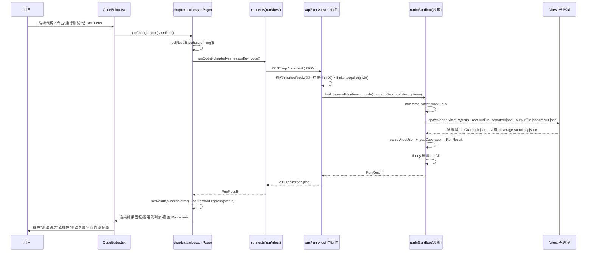

# 01 系统架构
> 项目：vitest-playground ｜ 版本：v1.0 ｜ 生成日期：2026-10-06 ｜ 依据：源码分析

## 1. 整体架构图

系统由三部分构成：浏览器端 SPA（编辑与展示）、Vite 服务器（静态资源 + 自定义 HTTP 中间件）、以及由中间件按请求 spawn 的 Vitest 子进程（真正的测试执行引擎）。没有独立的常驻后端进程，也没有数据库——所有"服务端"逻辑都寄生在 Vite 的 dev/preview 服务器内。

```mermaid
graph TB
    subgraph Browser["浏览器（SPA）"]
        FE["React 页面层<br/>index.tsx / chapter.tsx / progressPage.tsx"]
        ED["CodeEditor（Monaco）<br/>CodeEditor.tsx"]
        RC["runner.ts<br/>runVitest() / useRealVitest()"]
        LS[("localStorage<br/>进度 + 主题")]
        FE --> ED
        FE --> RC
        FE --> LS
    end

    subgraph ViteSrv["Vite 服务器（dev :8000 / preview :8000）"]
        MW["vitestRunnerMiddleware 插件<br/>vite.config.ts"]
        HR["handleRunVitest(req,res)<br/>vitestServerRunner.ts"]
        LIM["createRunLimiter<br/>2 并发 / 8 排队（满则 429）"]
        ASM["buildLessonFiles<br/>服务端装配（防篡改）"]
        MW --> HR --> LIM --> ASM
        STATIC["静态资源<br/>dist/ 或源码按需转换"]
        MW2["COEP/COOP 响应头"]
    end

    subgraph Sandbox["沙箱目录 .vitest-runs/run-&#60;rand&#62;/"]
        CFG["vitest.config.js + setup.ts"]
        LF["lesson.ts / lesson.spec.ts<br/>lesson.hidden.spec.ts / extraFiles"]
        VT["Vitest 子进程<br/>node node_modules/vitest/vitest.mjs<br/>（detached 进程组，60s 超时 kill）"]
        OUT["result.json / coverage/<br/>coverage-summary.json"]
        CFG --- LF
        LF --- VT
        VT --> OUT
    end

    RC -- "POST /api/run-vitest<br/>{chapterKey, lessonKey, code}" --> MW
    STATIC -.-> FE
    HR -- "spawn(cwd=runDir, 最小 env)" --> VT
    OUT -- "读取解析 parseVitestJson /<br/>readCoverage / parseBenchTable" --> HR
    HR -- "200 JSON: RunResult" --> RC
```

架构上最关键的三个事实：

1. **HTTP 层 = Vite 中间件**。`vite.config.ts` 定义了 `vitestRunnerMiddleware()` 插件，分别在 `configureServer`（dev 服务器）与 `configurePreviewServer`（preview 服务器）中把 `handleRunVitest` 挂载到路径 `/api/run-vitest` 上。因此开发模式与生产预览模式的测试能力完全同构，`pnpm preview` 即可验证生产链路。
2. **执行层 = 每请求一个 Vitest 子进程**。`vitestServerRunner.ts` 的 `runInSandbox()` 为每次请求创建独立临时目录 `.vitest-runs/run-<rand>/`，写入配置与课时文件后，以 `spawn('node', [node_modules/vitest/vitest.mjs, ...])` 起进程执行，结束后在 `finally` 中整目录删除。没有进程池、没有常驻 worker，牺牲了冷启动时间换取绝对隔离。
3. **课程数据前后端共享**。`vitestServerRunner.ts` 直接 `import { chapters } from './src/pages/vitest-learn/data'`，服务端以课时数据为唯一事实来源装配测试文件；客户端仅提交 `chapterKey / lessonKey / code` 三个字段，任何"由客户端指定文件内容/运行选项"的尝试都在协议层被排除。

## 2. 编辑 → 运行 → 结果回传数据流

下面用时序图描述一次完整运行的端到端数据流（以普通模式课时为例）：

三个值得注意的细节：

- **提交内容极简**：请求体只有三个字符串字段（`vitestServerRunner.ts` 的 `RunBody`）。`grader`、`hiddenGrader`、`extraFiles`、运行环境（node/jsdom）、coverage/benchmark 开关全部由服务端按课时数据推导（`resolveRunOptions`、`buildLessonFiles`）。
- **运行中状态是前端本地状态**：`chapter.tsx` 在发起请求前先 `setResult({ status: 'running', output: '准备运行环境...\n' })`，让"运行测试"按钮进入 loading；服务端没有任何会话概念，每次 POST 都是自足的。
- **成功即记进度**：`runResult.success === true` 时，`chapter.tsx` 调用 `setLessonProgress(chapterKey, lessonKey, { status: 'passed', lastRunAt: Date.now() })` 把通过状态写入 localStorage，驱动首页/导航栏的进度统计。

## 3. vitestServerRunner 机制详解

`vitestServerRunner.ts`（项目根，约 486 行）是整个产品的核心，同时承担 HTTP 处理器、装配器、执行器、解析器四重职责。下面按请求生命周期逐段拆解。

### 3.1 请求接入与校验（handleRunVitest）

入口函数 `handleRunVitest(req, res)` 的处理顺序是一条"快速失败链"：

1. 非 POST → 405；
2. `readBody` 读请求体：非 JSON 或超过 5MB → 400（超限时 `req.destroy()` 并丢弃后续 chunk，防止内存 DoS）；
3. 校验 `chapterKey / lessonKey / code` 三字段均为字符串，`body` 为普通对象（`null`、数组都会被拒）→ 400；
4. `findLesson(chapterKey, lessonKey)` 在 `chapters` 数据中查课时，查不到 → 400「未知课时」；
5. `limiter.acquire()`：并发信号量满且排队满 → 429「运行排队已满」；
6. 执行 `runInSandbox`，异常 → 500；`finally` 中 `limiter.release()`。

### 3.2 服务端装配（buildLessonFiles）——防篡改设计

`buildLessonFiles(lesson, userCode)` 决定了"沙箱里到底有哪些文件"。规则如下：

- **普通模式**（无 `grader`）：`lesson.spec.ts` = pragma + 用户代码；若有 `hiddenGrader`，另写 `lesson.hidden.spec.ts`。此时用户编辑的就是测试文件本身。
- **TDD 模式**（`grader` 存在且非纯空白）：`lesson.ts` = 用户实现代码，`lesson.spec.ts` = pragma + `grader`（可见测试，前端只读展示），`lesson.hidden.spec.ts` = pragma + `hiddenGrader`（隐藏校验，前端不可见）。此时用户编辑的是被测实现。
- **jsdom 课时**（`environment === 'jsdom'`）：扩展名改为 `.tsx`，并在 spec/hidden 文件顶部注入 `// @vitest-environment happy-dom\n` pragma，让 Vitest 用 happy-dom 环境执行（用于第十五章 React 组件测试）。
- **extraFiles**：`lesson.extraFiles`（如 `api.ts`、`database.ts`）原样并入文件表，供 `vi.mock` 等场景解析真实模块。

纯空白的 `grader/hiddenGrader` 被视为不存在（与前端旧版 trim 守卫等价），这一语义在 `tests/runner-security.test.ts` 中有专门用例锁定。

### 3.3 沙箱目录与配置写入

`runInSandbox(files, options)` 先做两道入口检查：文件数为 0 直接失败；文件数 > `MAX_FILES(20)` 直接失败；随后对每个文件名执行 `sanitizeEntryName`。然后 `makeRunDir()` 创建 `.vitest-runs/run-<rand>/`。

**为什么沙箱必须在项目根之下？** 源码注释给出了答案：vitest 需要**向上解析到项目的 `node_modules`** 才能找到自身与 `@testing-library/jest-dom` 等依赖。放在项目根下的 `.vitest-runs/` 里，`run-<rand>/` 的父链上恰好有 `node_modules`，裸导入（`vitest`、`react` 等）即可按 Node 解析规则向上命中。

`writeRunConfig()` 向沙箱写入两个文件：

- `vitest.config.js`：`globals: true`、`environment: 'node'`、`setupFiles: ['./setup.ts']`、`include: ['*.spec.ts', '*.spec.tsx', '*.test.ts', '*.test.tsx']`（扁平匹配，因为所有文件都在目录根部）、coverage 配置（`reporter: ['json-summary']`，enabled 按课时开关）、benchmark 课时追加 `benchmark.include`；`esbuild: { jsx: 'automatic' }` 支持 React JSX/TSX。
- `setup.ts`：仅一行 `import '@testing-library/jest-dom/vitest';`，为 jsdom 课时的 DOM 断言注入匹配器。

注意：这份配置是**运行器自己写的**，用户文件名若与之冲突会在 `sanitizeEntryName` 处被拒（见 3.5）。

### 3.4 子进程执行（spawnVitest）

执行参数按模式分叉：

- 普通运行：`node node_modules/vitest/vitest.mjs run --root <runDir> --reporter=json --outputFile.json=result.json`，开启覆盖率时追加 `--coverage`；
- 基准运行：`node ... vitest.mjs bench --root <runDir>`（bench 模式无 JSON reporter 可用，见 3.6）。

进程创建的关键参数与防线上各有出处：

- `detached: true`：子进程独立成进程组，超时用 `process.kill(-child.pid, 'SIGKILL')` **整组击杀**，避免 vitest 内部的 worker 进程变成孤儿继续占用 CPU；
- `env: buildChildEnv(runDir)`：子进程环境变量**白名单**，只含 `NODE_ENV:'test'`、`HOME:<runDir>`、`LANG`、`PATH`（Windows 追加 `SystemRoot`/`COMSPEC`），绝不继承 `process.env`——防止宿主机密钥经测试代码外泄，也让 `HOME` 指向沙箱目录；
- `stdio: ['ignore', 'pipe', 'pipe']` 且 stdout/stderr 只累计前 1MB（`out.length < 1_000_000` 才追加），防用户海量 `console.log` 打爆宿主内存；
- `setTimeout(RUN_TIMEOUT=60s)` 到点先 `killGroup()` 再以超时失败结果 resolve；`timeoutMs` 参数即便被调用方注入，也会被 `Math.min(timeoutMs, RUN_TIMEOUT)` 钳制，不得超过生产默认值；
- `close` 事件触发后（非超时分支）读取 result.json 与覆盖率并 resolve；`error` 事件（如 vitest 未安装）返回带「请确认项目已安装 vitest」提示的失败结果。

一个自然的疑问是"为什么不用常驻进程池来省掉每次 spawn 的冷启动"。源码的取舍可以从此处的组合推出：进程池意味着跨请求共享状态，而本产品的沙箱目录、进程组、超时与清理都以"单次调用自足"为纲；每请求冷启动换来的是零共享状态、零竞态、零残留（集成测试可以直接断言 `RUNS_ROOT` 为空）。在 60 秒超时、2 并发的教学场景负载下，数百毫秒级的 vitest 启动开销完全可接受——这是典型的"用可预测性换吞吐"的架构决策。

### 3.5 文件名白名单（sanitizeEntryName）

每个写入沙箱的文件名必须通过五重检查：`SAFE_NAME_RE`（`/^[A-Za-z0-9][A-Za-z0-9._-]*$/`，扁平名、无路径分隔符）；不含 `..`；小写化后不在 `PROTECTED_NAMES`（`vitest.config.js`、`setup.ts`、`package.json`、`result.json`、`tsconfig.json`——防止覆盖运行器自身配置或结果文件）；不匹配 `VITE_CONFIG_RE`（任意扩展名的 `vite.config.*` / `vitest.config.*`，Vitest 4 的配置解析覆盖 .ts/.mts/.cts/.js/.mjs/.cjs）；必须是字符串。大小写变体（如 `VITEST.CONFIG.JS`、`Setup.TS`）在小写化后比对，兼容不区分大小写的文件系统。非法名抛错——该校验发生在 `handleRunVitest` try 块内的 `runInSandbox` 调用中，异常落入 500 分支而非 400（报文「服务端错误: 非法文件名: …」，见《19-数据契约与示例集》§3.5）。

### 3.6 结果解析与回传

解析优先级体现了"免疫用户输出干扰"的设计：

1. **主路径**：优先读取 `--outputFile.json` 写出的 `result.json`（jest 兼容 JSON 格式），完全不依赖 stdout——用户在测试里 `console.log('{"fake":"json"}')` 不会污染解析（`tests/runner-security.test.ts` 有专门用例）；
2. **回退路径**：result.json 不存在时，用 `extractJson` 从 stdout 截取首个 `{` 到最后一个 `}` 的片段再解析；
3. **bench 路径**：`parseBenchTable` 先剥离 ANSI 颜色码，再用行正则解析 vitest bench 默认 reporter 的表格行（`· 名称 hz min max mean …`），提取 name/hz/mean。源码注释明确解释了原因：Vitest 4.1.8 的 bench 内置 reporter 只有 default/verbose，`--reporter=json` 会报 "Failed to load custom Reporter"。

`parseVitestJson` 把 JSON 报告转换为 `RunResult`：统计 `numPassedTests/numFailedTests/numPendingTests`；遍历 `testResults[].assertionResults[]` 生成 `tests[]`（名称、状态、毫秒耗时、文件名、行号）；对失败用例截取 `failureMessages[0]` 的首行（≤200 字符）生成 `markers[]`（行号取 `location.line`，缺省为 1），并拼接一份纯文本 `output`（含逐用例勾叉图标与耗时）。`readCoverage` 读取 `coverage/coverage-summary.json`，映射为 `CoverageSummary { total, files[] }`（行/语句/分支/函数四项百分比）。若进程退出码非 0 但无用例失败，`output` 会追加"（进程退出码非 0，可能存在配置/环境问题）"提示。

### 3.7 并发控制（createRunLimiter）

模块级信号量 `MAX_CONCURRENT_RUNS=2`、`MAX_QUEUE=8`。`createRunLimiter` 的实现有一个精妙的**所有权转移**语义：`release()` 时若队列中有等待者，直接唤醒它并**不减少** `active`（槽位所有权直接移交），消除了"先减一再让等待者加一"之间的微任务间隙可能导致的超订；无等待者才 `active--`。队列满时 `acquire()` 抛 `RUNNER_BUSY`，HTTP 层转 429。该语义在测试中以 `createRunLimiter(1,2)` 的时序用例验证（含冗余 release 不产生负计数）。

### 3.8 导出面：为可测试性而生的函数边界

`vitestServerRunner.ts` 的具名导出清单本身就是一个"设计文档"：`RUNS_ROOT`（临时目录根常量）、`sanitizeEntryName`（文件名白名单）、`findLesson`（课时寻址）、`resolveRunOptions`（运行模式推导）、`buildLessonFiles`（装配）、`buildChildEnv`（子进程环境白名单）、`createRunLimiter`（信号量工厂）、`runInSandbox`（单次执行）、`handleRunVitest`（HTTP 门面）、`parseBenchTable`（bench 解析）。除 `handleRunVitest` 外，每个导出都是无 IO 或可注入 IO 的纯逻辑单元，`tests/runner-security.test.ts` 因此能对每个环节单独断言，再以 `runInSandbox`/`handleRunVitest` 两级集成用例串起全链路——包括用 Node 的 `PassThrough` 流构造假的 `IncomingMessage/ServerResponse` 来测 HTTP 层，不需要真正起服务器。接手时若要新增防线（如请求签名、按课时白名单执行附加命令），正确姿势是：新增纯函数 + 导出 + 独立 describe 测试，再在 `handleRunVitest` 的快速失败链上挂载，而不是把逻辑内联进处理器。

一个同样重要的反面边界：`vite.config.ts` 对运行器的依赖是**单向且最小**的——只 import `handleRunVitest` 一个符号。这保证了构建配置与产品逻辑之间没有更深的纠缠；如果未来做容器化后端切换（`VITEST_RUNNER_BACKEND`），也应当保持这个唯一接缝不变。

## 4. 关键设计决策

| 决策 | 备选方案 | 选择理由（源码/文档依据） |
| --- | --- | --- |
| 本地 Vite 中间件 + 子进程跑真实 Vitest | WebContainer（浏览器内 Node 运行时） | `README.md` 记载早期用 `@webcontainer/api`，依赖 StackBlitz CDN 且需跨域隔离；现方案离线可跑、行为与本地 Vitest 完全一致（多文件、vi.mock、快照、覆盖率都真实可用） |
| 每请求独立临时目录，跑完即删 | 共享固定目录 | `docs/superpowers/plans/2026-09-27-runner-hardening.md` 记载的加固项：消除并发竞态与文件残留；`finally rm -rf` 保证生命周期归属本次调用 |
| 服务端装配测试文件 | 客户端上传完整文件表 | 防篡改：`grader/hiddenGrader` 不经客户端之手，隐藏测试不可被窃取或绕过；旧 `files` 形态请求被 400 拒绝（测试锁定） |
| 结果以 `--outputFile` 文件为准 | 解析 stdout | 免疫用户 `console.log` 输出的 JSON 片段污染 |
| `detached` 进程组 + SIGKILL 整杀 | 普通 spawn + 子进程自杀 | 死循环用例必须被外部强制终止；worker 孤儿问题靠进程组解决 |
| 并发 2 / 排队 8 / 超时 60s / 5MB 请求体 / 20 文件 / 1MB 输出 | 无限制 | 公网止血核心参数（源码注释原话"宁可拒绝不可拖垮宿主机"），配合 nginx 层 10r/m 限流形成双层防线 |
| COEP/COOP 响应头保留 | 删除（WebContainer 已移除） | `README.md` 说明：保留用于 Monaco Worker 同源加载与一致性，并非运行 Vitest 所必需 |

## 5. 设计模式与代码组织

- **插件模式**：`vitestRunnerMiddleware()` 是标准的 Vite 插件对象（`name` + `configureServer`/`configurePreviewServer` 钩子），把产品能力无侵入地挂进构建工具生命周期。
- **门面（Facade）**：`handleRunVitest` 对外是一个 `(req, res) => Promise<void>`，内部串起校验、限流、装配、执行、解析全部环节；`vite.config.ts` 只需一行 `handleRunVitest(req, res).catch(next)`。
- **策略分派**：`buildLessonFiles`（普通/TDD/jsdom 三种装配策略）与 `spawnVitest`（run/bench 两种命令行）都是按课时属性分派的策略族，新增课时形态（如未来加浏览器环境）只需扩展分派。
- **信号量（Semaphore）**：`createRunLimiter` 是手写的计数信号量，promise 队列 + 所有权转移。
- **纯函数化便于测试**：`sanitizeEntryName`、`buildLessonFiles`、`resolveRunOptions`、`findLesson`、`parseBenchTable`、`buildChildEnv`、`createRunLimiter` 全部具名导出，`tests/runner-security.test.ts` 因此可以在不 mock 的情况下对每个环节做单元测试，并另设真跑子进程的集成用例。
- **前端 Hook 封装**：`runner.ts` 的 `useRealVitest()` 把请求函数包装为 `runCode`，保持与历史（WebContainer 时代 `isReady` 异步就绪）兼容的 Hook 形态——如今 `isReady` 恒为 `true`，是一个保留的兼容垫片。

## 6. 演进路线与现状

`docs/superpowers/plans/` 保留了两份关键实施方案：`2026-09-27-runner-hardening.md`（运行器止血加固：白名单/最小 env/独立目录/并发上限/nginx 限流/CI）已全部落地在当前源码中；`2026-09-28-container-isolation.md`（Docker 一次性容器执行，`VITEST_RUNNER_BACKEND=local|docker` 双后端）**仅为方案，当前 `vitestServerRunner.ts` 中没有任何后端切换实现**，属于规划中的后续强化（⚠️ 待落地确认）。当前生产形态（`docs/deploy/runbook.md`）为 NAS Docker 容器托管整个应用（容器内含 Node 服务与中间件），而非"运行器容器化"，两者是不同层次的隔离。
