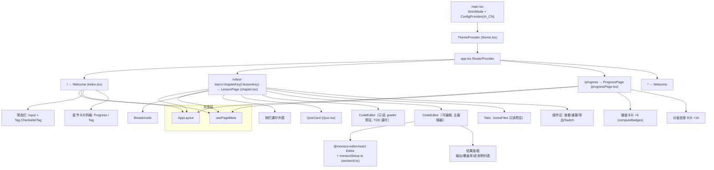
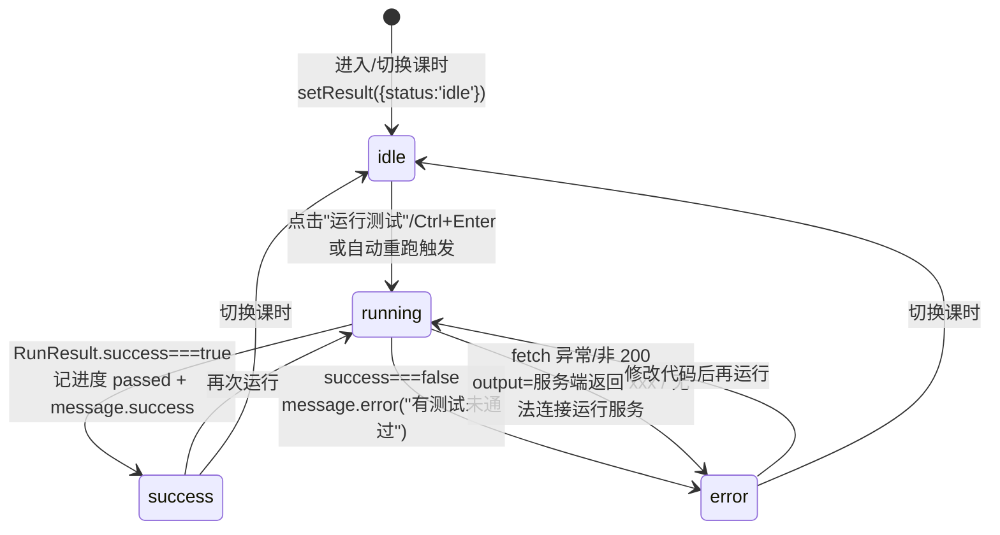
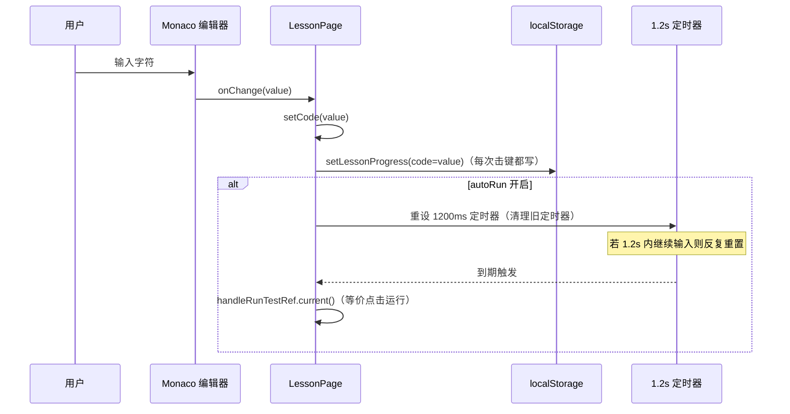

# 02 页面设计
> 项目：vitest-playground ｜ 版本：v1.0 ｜ 生成日期：2026-10-06 ｜ 依据：源码分析

## 1. 路由与页面总表

路由表定义在 `src/app.tsx`，使用 `createBrowserRouter` 声明式配置；整个应用被 `ThemeProvider`（`src/theme.tsx`）包裹，`src/main.tsx` 再外层包 antd `ConfigProvider`（中文 locale zh_CN）并启用 React `StrictMode`。

| 路径 | 页面组件 | 文件 | 职责 |
| --- | --- | --- | --- |
| `/` | Welcome（课程中心） | `src/pages/vitest-learn/index.tsx` | Hero 区 + 统计 + 搜索/标签筛选 + 章节卡片网格 + 学习特色 |
| `/vitest-learn/:chapterKey` | Chapter（课时工作台） | `src/pages/vitest-learn/chapter.tsx` | 省略 lessonKey 时自动取该章第一个课时 |
| `/vitest-learn/:chapterKey/:lessonKey` | Chapter（课时工作台） | `src/pages/vitest-learn/chapter.tsx` | 核心学习页面：导航 + 讲解 + 编辑器 + 运行结果 |
| `/progress` | ProgressPage（进度总览） | `src/pages/vitest-learn/progressPage.tsx` | 整体/分章进度 + 成就徽章 + 重置/导出 |
| `*`（未匹配） | Welcome | `index.tsx` | 兜底重渲染课程中心 |

所有页面共享 `AppLayout`（`src/components/AppLayout.tsx`）提供的骨架：顶部品牌栏（"Vitest 实验室"）+ 导航项（课程中心/学习进度/学习工作台高亮态）+ 右侧明暗主题切换按钮 + 全局进度 Tag 与进度条 + `<main>` 内容容器。`AppLayout` 在挂载时用 `useMemo` 一次性计算总课时数与已通过课时数（读取 localStorage），因此**导航栏的进度数字在其他页面标记通过后回到该页时才会刷新**（无跨页事件机制）。每个页面还通过 `usePageMeta`（`src/usePageMeta.ts`）设置独立的 `document.title` 与 meta description，零依赖实现逐路由 SEO。

## 2. 核心页面设计

### 2.1 课程中心（index.tsx）

页面自上而下分四段：

1. **Hero 区**：徽章式小标签"交互式 Vitest 教学平台"、大标题（"学会 Vitest，从零到实战"）、副标题，以及两个 CTA——"开始学习"（`navigate(/vitest-learn/${chapters[0]?.key})`，即跳到第一章）与"浏览课程大纲"（锚点平滑滚动）。下方是三个统计块：章节数、总课时数、已通关数——由 `useMemo` 从 `chapters` 与 `isLessonPassed` 计算，组件挂载时求值一次。
2. **课程大纲区**：顶部是筛选栏——`Input`（allowClear + 搜索前缀图标）绑定 `query` 状态；八个 `Tag.CheckableTag`（全部/React/异步/Mock/快照/覆盖率/测试替身/TDD）绑定 `activeTag`。筛选逻辑为纯前端 `useMemo`：章节 key 到标签的映射硬编码在 `TAG_MAP`（如 `react-testing → ['React']`、`tdd-practice → ['TDD']`、`timers → ['异步']`），未映射的章节只在"全部"下出现；关键词匹配章节标题/描述/任一课时标题（大小写不敏感）。无匹配时渲染空态提示文案。
3. **章节卡片网格**：每张卡片含轮换色系的渐变图标（`CHAPTER_STYLES` 四色循环）、章节标题与描述、"N 个课时"Tag、已通关 Tag（有通关才显示）、章节进度条与百分比；点击卡片导航到 `/vitest-learn/:chapterKey`。卡片带 `role="button"`、`tabIndex={0}` 与 Enter 键处理，具备基本可访问性。
4. **学习特色区**：三张静态卡片（浏览器内真实运行/循序渐进的学习路径/进度自动保存），内容为 `FEATURES` 常量。页面底部还有一条整体学习进度条。

### 2.2 课时工作台（chapter.tsx，产品核心页面）

这是学习者停留时间最长的页面，布局为"面包屑 → 章节总览 → 工作台（左导航 + 右内容）"。

- **面包屑**：课程中心（可点击回首页）/ 章节标题 / 课时标题。
- **章节总览区**：左侧章节大标题、描述、两个 Tag（"N 个课时"、"x/N 已通关"，全部通关时变绿）；右侧 72px 圆形进度环（渐变色 #2563eb→#7c3aed）。
- **左侧课时导航（sticky 侧栏）**：标题"课时进度" + 计数、细进度条、课时列表。列表项左侧是序号圆点——已通关课时显示绿色对勾图标（`CheckCircleOutlined`），当前课时高亮并带右箭头；点击导航到对应课时路由，同样支持 Enter 键激活。
- **右侧内容区**自上而下：
  1. **课时信息**：标题 + 徽章 Tag（"TDD 实战"金色 / "React + jsdom" 蓝色 / "Node 环境"默认色）+ 描述；
  2. **学习提示**（可选）：`Alert`（info）内渲染 `tips` 列表；
  3. **知识小测**（可选）：`QuizCard`（`Quiz.tsx`）；
  4. **动手练习卡片**：这是工作台核心。TDD 课时先渲染一块**只读**的 `CodeEditor` 展示 `grader`（文件名 `lesson.spec.ts` 或 jsdom 时的 `lesson.spec.tsx`，带"只读"标签，高度 240px，不显示结果面板）；随后渲染**可编辑**的 `CodeEditor`（文件名按模式为 `lesson.ts`/`lesson.tsx`/`lesson.spec.ts`，高度 360px）。若课时含 `extraFiles`，下方用 antd `Tabs` 渲染多个只读编辑器（如 `api.ts`、`database.ts`），让用户查看被 mock 的真实模块。操作区提供四个控件：查看/隐藏参考答案、重置代码、导出代码、"自动运行/手动" Switch；
  5. **上下节导航**：上一节/下一节按钮（边界禁用）+ "当前序号 / 总数"居中显示。

组件内状态一览（全部为 `useState` 本地状态 + localStorage 持久化的组合）：

| 状态 | 类型 | 来源与去向 |
| --- | --- | --- |
| `code` | string | 切换课时（`useEffect`）时恢复 `getLessonProgress().code`，无存档则用 `lesson.code`；每次编辑经 `handleCodeChange` 写回 localStorage |
| `result` | TestResult | `{status, output, passed, failed, tests, markers, coverage}`，由 `handleRunTest` 写入 |
| `showSolution` | boolean | 查看答案开关；打开时编辑器显示 `solution`，且**运行时提交的也是 solution 代码**（`handleRunTest` 中 `codeToRun` 的取值逻辑） |
| `autoRun` | boolean | 自动重跑开关（不持久化，刷新后回到手动） |

派生值：`isTDD = !!currentLesson?.grader`、`isJsdom = environment === 'jsdom'`、`editorFileName`/`graderFileName` 按 TDD/jsdom 组合取名；章节通过数与百分比由 `isLessonPassed` 逐课时统计（每次渲染重算，数据量小无性能问题）。

**自动重跑机制**值得单独说明：`handleRunTest` 存入 `handleRunTestRef`（ref 保证回调最新），当 `autoRun` 为真时，一个以 `[code, autoRun]` 为依赖的 `useEffect` 设置 1200ms 定时器，代码再次变化则清理重设——形成"停止输入 1.2 秒后自动运行一次"的 debounce 效果，是 watch 模式的轻量替代。

异常分支：`chapter` 查不到（如手输错误路由）时渲染"章节未找到"与返回首页按钮；`currentLesson` 为空（理论上仅当章节数据为空）时右侧内容区不渲染。

### 2.3 进度总览页（progressPage.tsx)

- 顶部标题区显示"已完成 x/y 课时 · z%"；`Progress` 进度条 + 两个按钮：**重置进度**（`clearProgress()` 清空 localStorage 后通过 `setVersion(v => v+1)` 强制 `useMemo` 重算——依赖数组为 `[version]`）与**导出进度**（把 `vitest-playground-progress-v1` 的原始 JSON 下载为 `vitest-playground-progress.json`）。
- **成就徽章区**：五张徽章卡片，数据来自 `computeBadges`（`progress.ts`）。已解锁卡片高亮带"已获得"绶带与彩色图标；未解锁显示锁图标与进度条（`current/goal`，或 `hint` 文本如"已通关 3/16 章"）。
- **分章进度区**：十六张章节卡片（已通关数/总数、"全部通关 🎉"标记、进度条），点击跳转对应章节。

## 3. 组件树

组件职责高度单一：`CodeEditor` 是唯一的"编辑器 + 结果面板"复合组件，通过 props（`value/onChange/onRun/result/isReady/fileName/language/readOnly/errorMarkers`）在可编辑、TDD 只读预览、extraFiles 只读预览三种形态间复用。

## 4. 状态管理设计

本项目**没有引入任何全局状态管理库**（无 Redux/Zustand/Context 总线），采用三层分工：

1. **服务端事实**：课程内容（题目/测试/答案）全部来自 `data.ts`，前后端同源共享，前端不需要缓存或同步——任何页面直接 `chapters.find(...)`。
2. **localStorage 持久层**：两个独立 key——`vitest-playground-progress-v1`（学习进度，`progress.ts` 读写，结构见 04 篇）与 `vitest-playground-theme`（主题，`theme.tsx` 读写）。`progress.ts` 故意设计为纯函数集合（`loadProgress/saveProgress/getLessonProgress/setLessonProgress/isLessonPassed/clearProgress/computeBadges`），不依赖 React，因此在 `tests/progress.test.ts` 中可以被 happy-dom 环境直接单测。
3. **组件本地状态**：运行结果 `result`、编辑器代码 `code`、答案/自动运行开关等都停留在 `LessonPage` 内部；`Quiz.tsx` 的作答状态（`answers`/`submitted`）也只在组件内，不持久化。

跨组件通信只有一条 Context 通道：`ThemeContext`（`theme + toggle`），供 `AppLayout` 的切换按钮与 `CodeEditor` 的 Monaco 主题（`vs-dark`/`vs`）消费。这种"极简状态层"与产品形态匹配：无登录、无协作、单浏览器单用户，localStorage 足以承载全部持久化需求。

跨组件通信只有一条 Context 通道：`ThemeContext`（`theme + toggle`），供 `AppLayout` 的切换按钮与 `CodeEditor` 的 Monaco 主题（`vs-dark`/`vs`）消费。这种"极简状态层"与产品形态匹配：无登录、无协作、单浏览器单用户，localStorage 足以承载全部持久化需求。

### 4.1 组件 props 契约（CodeEditor 为例）

`CodeEditor` 是全站复用度最高的组件，其 props 即三种使用形态的完整契约：`value/onChange` 受控代码；`onRun` 触发运行（内部经 `onRunRef` 转发，避免 Monaco 命令闭包过期）；`result: TestResult` 驱动结果面板；`isReady` 控制运行按钮禁用（现恒 true）；`fileName` 同时用作 Monaco 模型 `path` 与工具栏文件名（`lesson.spec.ts`/`lesson.ts` 等）；`language` 默认 `typescript`；`readOnly` 关闭运行/复制按钮、隐藏结果面板、固定 240px 高度（可编辑态 360px）；`errorMarkers` 仅可编辑态由父组件选择性下发。只读形态在页面中出现三次：TDD grader 预览、extraFiles 的 Tabs 内容——三者与可编辑主编辑器共用同一组件实现，保证主题、字体、行高等体验完全一致。

`QuizCard` 的 props 更简单：`quizzes: Quiz[]`，作答状态（`answers`、`submitted` 两个 Record）自持，提交后锁定该项并即时反馈对错（答错显示正确答案文本）。`AppLayout` 无 props，仅以 `children` 组合页面内容。

### 4.2 反馈与消息约定

页面级的瞬时反馈统一走 antd `message`：运行成功 `message.success('测试全部通过！')`、运行失败 `message.error('有测试未通过')`、重置代码 `message.info('已重置为初始代码')`、复制代码 `message.success('代码已复制')`、进度重置 `message.success('学习进度已重置')`、进度导出 `message.success('进度已导出为 JSON')`。持久反馈则落在页面元素上：课时通过后侧栏序号变对勾、章节 Tag 变绿、导航栏进度数字上涨。导出功能（代码导出与进度导出）共用同一实现模式：`Blob` + `URL.createObjectURL` + 动态 `<a download>` 点击 + `revokeObjectURL` 清理。

可访问性方面有一个贯穿性的约定：所有"看起来像按钮"的非按钮元素（章节卡片、课时列表项、品牌 Logo、导航项）都带 `role="button"`、`tabIndex={0}` 和 Enter 键激活处理——这是模板时代的遗留惯例，在本项目中被一致保留。

## 5. 关键 UI 交互流程

### 5.1 运行结果状态机（result 生命周期）

`result.status` 直接驱动 UI：`running` 时运行按钮 loading；`success` 结果面板变绿标题"✓ 测试通过"；`error` 变红标题"测试失败"；`idle` 显示占位文案"点击'运行测试'查看结果"。

### 5.2 代码编辑与自动重跑时序

细节：`handleRunTest` 每次渲染重建，因此用 `handleRunTestRef` 持有最新引用，`useEffect` 依赖只留 `[code, autoRun]`，避免定时器因回调 identity 变化而频繁重置。若用户查看答案（`showSolution=true`），编辑器 value 切换为 `solution`，此时运行提交的也是 solution——源码中未阻止"看答案跑通过并记为已通关"，这被 `docs/superpowers/plans/2026-09-27-runner-hardening.md` 列为后续 backlog（"防刷通关：参考答案运行不标记 passed"，⚠️ 未实现）。

### 5.3 编辑器内错误定位（markers）

`CodeEditor` 通过 `onMount` 持有 `editorRef/monacoRef`；当父组件传入的 `errorMarkers` 变化时，`useEffect` 把每个 marker 写为 Monaco `setModelMarkers`（owner 为 `'vitest'`，整行高亮，severity=Error，hover 显示失败消息首行 ≤200 字符）。注意 `chapter.tsx` 只在**非 TDD 模式**下传 `result.markers`——因为 TDD 课时用户编辑的是 `lesson.ts` 实现，而失败行号来自 `lesson.spec.ts` 测试文件，行号对不上，标记反而误导。markers 清空时显式调用 `setModelMarkers(model, 'vitest', [])` 复位。

### 5.4 Monaco 环境准备（monacoSetup.ts）

编辑体验的"隐藏工程"集中在 `monacoSetup.ts`（`CodeEditor.tsx` 顶部 import 副作用）：

- **体积裁剪**：不使用默认的全量 monaco 入口，而是从 `monaco-editor/esm/vs/editor/editor.api` 引内核，仅追加 TypeScript 语言贡献与 ts.worker，loader.config({ monaco }) 让 `@monaco-editor/react` 使用本地实例（无 CDN 网络依赖）；
- **Worker 路由**：`self.MonacoEnvironment.getWorker` 按 label 返回 tsWorker 或兜底 editorWorker；
- **类型世界**：`typescriptDefaults.setCompilerOptions` 开启 strict/JSX(ReactJSX)/ESNext 等；`addExtraLib(VITEST_GLOBALS_DTS)` 注入 `vitestGlobalsDts.ts` 中手写的精简声明——`describe/test/it/expect/钩子`、常用匹配器、`vi` 对象等，让编辑器不认识 node_modules 也不爆红。文件头注释明确其定位："类型只用于编辑器诊断……真正的运行结果以服务端 vitest 为准"；
- **已知问题兜底**：监听 `unhandledrejection`，吞掉 monaco TS worker 在模型异步回收时抛出的 "Could not find source file: 'inmemory://…'"（monaco 已知 race condition，HMR/课时切换时常见，不影响功能）。

## 6. 样式与主题

样式采用 CSS Modules（`chapter.module.css`、`welcome.module.css`、`appLayout.module.css`），类名局部作用域避免污染；明暗主题通过 `document.documentElement.dataset.theme` 切换（`theme.tsx` 的 `useEffect`），`src/index.css` 按 `data-theme` 定义 CSS 变量。antd v6 组件在暗色下的适配依赖其算法主题与局部内联样式（如 `CodeEditor` 结果面板固定深色底 `#0b1020`，明暗两态下保持"终端"观感）。品牌色以 #2563eb（蓝）→#7c3aed（紫）渐变贯穿进度环、进度条与 Hero。
