# 04 数据模型
> 项目：vitest-playground ｜ 版本：v1.0 ｜ 生成日期：2026-10-06 ｜ 依据：源码分析

本项目的数据分为五个域：①课程内容域（`data.ts` 的 `Chapter/Lesson`，前后端共享的静态数据）；②运行结果域（`types.ts` 的 `RunResult/TestResult/TestCaseSummary/ErrorMarker/CoverageSummary`，接口与 UI 的传输/渲染模型）；③学习进度域（`progress.ts` 的 `ProgressMap/LessonProgress/Badge`，localStorage 持久化）；④沙箱文件域（运行期在 `.vitest-runs/run-<rand>/` 中临时存在的文件集合）；⑤主题偏好（`vitest-playground-theme` 单值）。没有数据库，没有服务端持久化——服务端数据要么是随代码发布的静态课程数据，要么是随请求生灭的临时文件。

## 1. 课程内容域：Chapter 与 Lesson

定义位置：`Lesson/Chapter` 接口声明在 `src/pages/vitest-learn/data.ts` 顶部（`Quiz` 等基础类型在 `src/pages/vitest-learn/types.ts`）；实例数据 `chapters: Chapter[]` 共 16 章 56 课时，是全站唯一的内容来源。

### 1.1 Chapter

| 字段 | 类型 | 说明 |
| --- | --- | --- |
| `key` | string | 章节标识，全局唯一（`tests/lessons.test.ts` 校验），用于路由 `/vitest-learn/:chapterKey` |
| `title` | string | 章节标题，如「第一章：Vitest 基础入门」 |
| `description` | string | 一句话描述，展示在首页卡片与章节总览 |
| `lessons` | `Lesson[]` | 课时数组，至少 1 个（有测试约束） |

16 章的 key 依次为：`basics`、`structure`、`mock`、`async`、`array-object`、`timers`、`snapshot`、`advanced`、`coverage-advanced`、`test-doubles`、`fixture`、`vitest-vs-jest`、`test-strategy`、`tdd-practice`、`react-testing`、`tdd-advanced`。

### 1.2 Lesson

| 字段 | 类型 | 必有 | 说明 |
| --- | --- | --- | --- |
| `key` | string | 是 | 课时标识，全局唯一，用于路由与进度索引（进度 id 为 `${chapterKey}:${lessonKey}`） |
| `title` | string | 是 | 课时标题（如「1.1 第一个测试用例」），并用于页面 `document.title` |
| `description` | string | 是 | 课时说明/任务描述 |
| `code` | string | 是* | 初始展示代码（starter）；与 `grader` 二者至少其一（测试校验 `l.code || l.grader`） |
| `solution` | string? | 否 | 参考答案；`scripts/check-lessons.ts` 要求其运行必须通过 |
| `tips` | string[]? | 否 | 学习提示列表（Alert 展示） |
| `grader` | string? | 否 | **TDD 模式开关**：存在且非纯空白即进入 TDD——用户编辑实现（`lesson.ts`），该字段作为可见主校验测试（`lesson.spec.ts`），前端只读展示 |
| `hiddenGrader` | string? | 否 | 隐藏校验测试（`lesson.hidden.spec.ts`），不展示给用户，防作弊/强化验证；纯空白视为不存在 |
| `quiz` | `Quiz[]`? | 否 | 知识小测（9 个课时配备） |
| `environment` | `'jsdom'`? | 否 | React 组件测试环境（3 个课时）；装配时注入 `// @vitest-environment happy-dom` pragma 并改用 `.tsx` |
| `extraFiles` | `Record<string, string>`? | 否 | 额外写入沙箱的文件（2 个课时：`mock/vi-mock` 的 `api.ts`、`vitest-vs-jest/migration-guide` 的 `database.ts`），文件名受 `sanitizeEntryName` 白名单约束 |
| `benchmark` | boolean? | 否 | 以 `vitest bench` 运行（1 个课时：`coverage-advanced/benchmark`）；此时不收 coverage |

`Quiz` 结构（`types.ts`）：`{ question: string; options: string[]; answer: number }`——`answer` 是正确选项下标。

**模式矩阵**（由字段组合推导，无显式字段）：

| 组合 | 模式 | 用户编辑文件 | 沙箱装配 |
| --- | --- | --- | --- |
| 无 `grader` | 普通模式 | `lesson.spec.ts` | `lesson.spec.ts = code`（+可选 hidden） |
| 有 `grader` | TDD 模式 | `lesson.ts` | `lesson.ts = code`、`lesson.spec.ts = grader`（+可选 hidden） |
| `environment:'jsdom'` | 叠加前两者 | `lesson.tsx` 或 `lesson.spec.tsx` | pragma 注入 + `.tsx` 扩展名 |
| `benchmark: true` | 基准模式 | 仍为 `lesson.spec.ts` | 执行改 `vitest bench`，关 coverage |

## 2. 运行结果域：RunResult 与 TestResult

### 2.1 RunResult（接口传输模型）

由 `vitestServerRunner.ts` 生产、`runner.ts` 消费，完整字段见 03 篇 §3。子结构如下。

**TestCaseSummary（逐用例明细）**：

| 字段 | 类型 | 说明 |
| --- | --- | --- |
| `name` | string | 用例标题（`assertionResults[].title`） |
| `status` | `'passed' \| 'failed' \| 'pending' \| 'skipped'` | 用例状态，直接来自 JSON reporter |
| `duration` | number? | 毫秒耗时（`typeof duration === 'number'` 才写入） |
| `file` | string? | 所属文件 basename（如 `lesson.spec.ts`） |
| `line` | number? | 失败定位行号（`location.line`） |

**ErrorMarker（编辑器失败标记）**：`{ line: number; message: string }`——`line` 缺省为 1；`message` 取 `failureMessages[0]` 首行且截断至 200 字符。仅在普通模式下传给编辑器（TDD 课时行号属于 grader 文件，不回传）。

**CoverageFile / CoverageSummary（覆盖率）**：`CoverageFile = { file?: string; lines; statements; branches; functions }`（四项均为 0-100 的百分比数字）；`CoverageSummary = { total: CoverageFile; files: CoverageFile[] }`。来源是 vitest `--coverage`（`reporter: ['json-summary']`）写出的 `coverage/coverage-summary.json`，由 `readCoverage` 读取映射，`total` 键单独提取，其余键取 basename 作为 `file`。

### 2.2 TestResult（前端页面状态模型）

`chapter.tsx` 的 `result` 状态与 `CodeEditor` 的 props 使用 `TestResult`（`types.ts`），它是 `RunResult` 的"UI 态"投影：

| 字段 | 类型 | 说明 |
| --- | --- | --- |
| `status` | `'idle' \| 'running' \| 'success' \| 'error'` | 页面状态机的核心位（idle/running 为前端本地态，success/error 映射自 `RunResult.success`） |
| `output` | string | 结果面板 `<pre>` 文本 |
| `passed/failed/pending` | number? | 统计徽标（`failed > 0` 才渲染红色失败计数） |
| `tests/markers/coverage` | 同 RunResult | 逐用例列表、编辑器标记、覆盖率条 |
| `duration?/error?` | string? | 预留字段（当前未填充） |

两个模型的关系：`TestResult.status='success' ⟺ RunResult.success===true`；`idle/running` 两态在 `RunResult` 中不存在，纯属前端生命周期。

## 3. 学习进度域：ProgressMap 与 Badge

定义位置：`src/pages/vitest-learn/progress.ts`。存储 key：`vitest-playground-progress-v1`（值为一整个 JSON 对象）。

### 3.1 ProgressMap / LessonProgress

```ts
interface LessonProgress {
  code?: string;                              // 该课时最后编辑的代码
  status?: 'idle' | 'passed';                 // 通过状态（只有 passed 被显式写入）
  lastRunAt?: number;                         // 最后一次通过的毫秒时间戳
}
type ProgressMap = Record<string, LessonProgress>;  // 键为 `${chapterKey}:${lessonKey}`
```

访问函数全部是同步纯操作：`loadProgress`（解析失败返回 `{}`，容错损坏数据）、`saveProgress`、`getLessonProgress`（缺省 `{}`）、`setLessonProgress`（读-合并-写）、`isLessonPassed`（`status === 'passed'`）、`clearProgress`。写入点有三处（`chapter.tsx`）：编辑代码（每次击键写 `code`）、运行通过（写 `status+lastRunAt`）、重置代码（用初始 `lesson.code` 覆盖 `code`）。

### 3.2 Badge 与 BadgeContext（成就模型）

```ts
interface Badge {
  id: 'first' | 'ten' | 'half' | 'chapter' | 'master';
  name: string; desc: string;
  icon: 'medal' | 'fire' | 'rocket' | 'crown' | 'trophy';
  goal: number; current: number;
  hint?: string;   // 覆盖 current/goal 的展示文本
  ok: boolean;     // 是否解锁
}
interface BadgeContext { chaptersTotal; chaptersCompleted; lessonsTotal; lessonsPassed; }
```

`computeBadges(ctx)` 是纯函数（`tests/progress.test.ts` 全量覆盖）：五枚徽章分别为 初次通关(1)、小有成效(10)、渐入佳境(ceil(lessonsTotal/2))、整章攻克(chaptersCompleted≥1，hint 显示"已通关 x/y 章")、测试大师(lessonsTotal)；特例：`lessonsTotal === 0` 时 half/master 强制不解锁（避免 0/0 误判）。进度页 `progressPage.tsx` 以 `[version]` 为依赖的 `useMemo` 调用它，重置进度时递增 version 触发重算。

## 4. 沙箱文件域（运行期临时数据）

每次运行在 `.vitest-runs/run-<mkdtemp 随机>/` 中产生的文件集合：

| 文件 | 产生者 | 内容/用途 | 生命周期 |
| --- | --- | --- | --- |
| `vitest.config.js` | `writeRunConfig` | globals/environment/setupFiles/include/coverage/benchmark 配置 | 进入时创建，`finally rm -rf` 删除 |
| `setup.ts` | `writeRunConfig` | `import '@testing-library/jest-dom/vitest'` | 同上 |
| `lesson.ts` / `lesson.spec.ts` / `lesson.spec.tsx` | `buildLessonFiles` | 用户代码 / 可见 grader | 同上 |
| `lesson.hidden.spec.ts` | `buildLessonFiles` | 隐藏 grader（不回传前端） | 同上 |
| `extraFiles`（如 `api.ts`） | `buildLessonFiles` | 被 mock 的真实模块 | 同上 |
| `result.json` | vitest `--outputFile.json` | jest 兼容 JSON 报告（结果解析主来源） | 同上（读取后随目录删除） |
| `coverage/coverage-summary.json` | vitest `--coverage` | v8 覆盖率摘要 | 同上 |

该域的数据"生灭于单次 HTTP 请求之内"，唯一可能的外泄通道是 HTTP 响应；`.vitest-runs/` 已在 `.gitignore` 中，`docs/deploy/runbook.md` 的运维检查项也要求 `du -sh .vitest-runs` 接近 0（残留目录说明进程被强杀且 finally 未执行，需手动清理）。

## 5. 主题偏好

`src/theme.tsx`：localStorage key `vitest-playground-theme`，合法值 `'dark' | 'light'`，缺省 `'dark'`；副作用同步 `document.documentElement.dataset.theme` 供 CSS 变量切换，并驱动 `CodeEditor` 的 Monaco 主题（`vs-dark`/`vs`）。

## 6. 数据生命周期总览

```mermaid
flowchart TD
    subgraph Build["构建期（随代码发布）"]
        DATA["data.ts chapters<br/>16 章 56 课时"]
        DATA -- "import（前端）" --> FE["页面渲染/筛选/统计"]
        DATA -- "import（服务端）" --> ASM["buildLessonFiles / resolveRunOptions"]
    end

    subgraph Req["请求期（毫秒~分钟级）"]
        CODE["用户代码（编辑器 state）"]
        CODE -- "POST code" --> ASM
        ASM --> FILES["沙箱文件集<br/>lesson.* / hidden / extraFiles"]
        FILES --> VT["vitest 子进程执行"]
        VT --> RES["result.json + coverage-summary.json"]
        RES --> RR["RunResult（HTTP 响应）"]
        FILES -- "finally" --> DEL["rm -rf run-&#60;rand&#62;/"]
    end

    subgraph Persist["持久期（localStorage，跨会话）"]
        PROG[("vitest-playground-progress-v1<br/>ProgressMap")]
        THEME[("vitest-playground-theme")]
    end

    RR -- "success" --> PROG
    CODE -- "每次编辑" --> PROG
    RR --> UI["结果面板渲染（易失）"]
    PROG --> STAT["首页/导航/进度页统计与徽章"]
```



四条生命周期总结：**课程数据**与代码同构建同发布，改内容即改代码（`pnpm check:lessons` 把关）；**沙箱数据**严格归属单次请求，进目录、出目录，不留痕；**进度数据**只增不删（除非用户在进度页主动重置），每次编辑代码都写盘（粒度到击键），通过状态只在 `success` 时写入；**结果数据**（RunResult/TestResult）是纯内存易失态，切换课时即复位为 idle，不持久化——用户刷新后看到的是"未运行"状态，但代码已从进度存档恢复。

## 7. 数据一致性约束（测试锁定的不变量）

`tests/` 对数据模型的关键不变量做了契约化锁定，修改数据结构时应保持这些测试通过：

- 章节/课时 key 全局唯一；每章至少一个课时；每课时 `code || grader` 非空（`tests/lessons.test.ts`）；
- `buildLessonFiles` 的装配输出形状（TDD/普通/jsdom/extraFiles 四种矩阵，纯空白 grader 视为不存在）（`tests/runner-security.test.ts`）；
- `computeBadges` 的五徽章目标值、解锁判定与零课时特例（`tests/progress.test.ts`）；
- 真实课时全链路可用：`basics/first-test` 以初始 `code` 运行必须 success，`coverage-advanced/benchmark` bench 链路必须产出 tests（`tests/runner-security.test.ts`）。

## 8. 进度数据的写入时机与竞态控制

进度域虽小，写入点却分布在三个组件、五种时机上，梳理清楚可以避免多数"进度怎么丢了/怎么没刷新"类问题：

| 时机 | 触发位置 | 写入内容 | 频率特征 |
| --- | --- | --- | --- |
| 编辑器每次击键 | `chapter.tsx` 的 `handleCodeChange` | `{ code: value }` | 高频（逐字符） |
| 运行全部通过 | `chapter.tsx` 的 run 回调 success 分支 | `{ status: 'passed', lastRunAt: Date.now() }` | 低频、一次性 |
| 点击重置代码 | `chapter.tsx` 的 `handleReset` | `{ code: 初始 lesson.code }`（不动 status） | 用户触发 |
| 切换课时 | `chapter.tsx` 的 `useEffect`（读，不写） | 恢复 `getLessonProgress().code` | 路由变化 |
| 重置全部进度 | `progressPage.tsx` 的 `handleReset` | `clearProgress()` 清空整个 key | 用户触发 |

`setLessonProgress` 本身是"读整个 Map → 浅合并该课时条目 → 写回"的同步操作，单标签页内不存在交错写坏的问题（JS 单线程 + 同步执行）。但有两处语义细节：其一，重置代码**不**清除 `status:'passed'`——重置只是恢复初始代码，通关历史保留；其二，进度页的重算依赖手动 `version` 递增（`useMemo` 依赖 `[version]`），因为 localStorage 不是响应式数据源，`AppLayout` 顶栏的进度数字则更进一步——它在组件挂载时用 `useMemo([])` 一次性计算，页面间通过路由跳转重新挂载时才会刷新。若未来引入跨页实时同步，需要把"读取 localStorage"改为可失效的缓存或事件通知机制（当前规模下无必要）。

## 9. 数据校验、容错与防御性设计

各域数据在边界处都有一层"不信任输入"的防御，本项目的惯例是**校验在入口、容错在读取、上限在常量**：

- **课程数据（构建期校验）**：`tests/lessons.test.ts` 在 CI 中校验 key 唯一性与 `code||grader` 非空；`scripts/check-lessons.ts` 进一步实测每个 solution 必须可跑通、每个 code/grader/hiddenGrader/extraFiles 过语法门禁。课程数据是纯静态的，这层校验做在 CI 就够了，运行时不重复验证。
- **请求体（HTTP 入口校验）**：`handleRunVitest` 对 body 做类型级校验（三字段为字符串、对象非 null 非数组），`runInSandbox` 对文件名做白名单校验（`sanitizeEntryName`），对文件数量做上限校验（20）。非法输入一律快速失败、不进入执行阶段，但出口分两层：HTTP 入口校验转 400；文件名白名单校验位于 `handleRunVitest` try 块内，抛错转 500（见《19》§3.5）。
- **localStorage（读取容错）**：`loadProgress` 用 try/catch 包裹 `JSON.parse`，损坏数据静默降级为空 Map——用户最多丢进度，不会白屏。写入端没有 try/catch：localStorage 写满（配额溢出）会抛异常，当前未处理（⚠️ 潜在边界：进度 JSON 含全部课时代码，理论上可能逼近 5MB 配额，56 课时 × 数 KB 通常无虞）。
- **运行结果（解析容错）**：`parseVitestJson` 整体 try/catch，result.json 损坏时回退 stdout `extractJson`，再不行返回"测试结果解析失败"的失败结果；`readCoverage` 同样静默容错（文件不存在或 JSON 坏则 coverage 为 undefined，UI 跳过渲染）。`readBody` 用 `settled` 标志防止超限销毁后的残余 chunk 二次 settle。
- **输出上限（资源防御）**：1MB stdout 累计上限、5MB 请求体上限、60 秒进程上限、20 文件数上限、200 字符 marker 消息截断、6 行失败消息截断——所有"用户可控的量"都配了显式上限，且每个上限都能在 `tests/runner-security.test.ts` 找到对应断言。

理解这套防御体系后，改动数据结构的正确顺序是：先改 `types.ts`/`data.ts` 的类型定义，再改 `vitestServerRunner.ts` 的装配/解析，同步更新 `tests/` 的契约用例，最后跑 `pnpm tsc && pnpm test && pnpm check:lessons` 三道门禁确认无遗漏——类型共享（前后端 import 同一 `types.ts`）使得字段改名这类变更会被 `pnpm tsc` 全量暴露。

## 10. 扩展示例：给 Lesson 新增一个字段的完整链路

以一个假想需求"给课时标注难度星级"为例，走一遍数据模型扩展的标准路径，可作为日后任何字段扩展的模板：

1. **类型层**：在 `src/pages/vitest-learn/data.ts` 的 `Lesson` 接口追加可选字段 `difficulty?: 1 | 2 | 3`（可选字段保证 56 个存量课时不需批量补值，这与 `grader/quiz/benchmark` 等前辈字段的演进方式一致——回看这些字段的注释前缀 M4/M5/M6，正是历史上多轮扩展留下的痕迹）；
2. **数据层**：按需给部分课时补值；若某些值之间存在约束（如"jsdom 课时必为难度 3"），把约束写进 `tests/lessons.test.ts`，让 CI 替你守护数据质量；
3. **展示层**：在 `chapter.tsx` 的课时徽章区（现渲染 TDD/jsdom/Node 环境三个 Tag 处）追加难度 Tag，或在 `index.tsx` 的章节卡片上显示均值——只动读取方，不动任何写入方；
4. **协议层**：`difficulty` 是课程数据的一部分，**天然不需要**进入 `/api/run-vitest` 的请求/响应——运行器装配时通过 `findLesson` 拿到的 `Lesson` 对象自动携带新字段。这正是"服务端以课时数据为唯一事实来源"设计的红利：内容扩展通常完全不触及协议；
5. **回归**：`pnpm tsc`（类型链路）→ `pnpm test`（装配矩阵等契约）→ `pnpm check:lessons`（课时可运行性）三绿后提交。

反例也应牢记：如果新增的是一个**影响执行行为**的字段（如自定义沙箱配置注入），它就不再是纯展示数据，必须同步回答三个安全问题——会不会被用来覆盖运行器配置（`sanitizeEntryName` 是否需要更新 `PROTECTED_NAMES`）、会不会改变超时/并发语义、要不要同步更新 nginx/超时预算——并按 01 篇 §3.8 的方式先写测试再写实现。

## 11. 各存储位置的容量与清理特征

| 存储 | 单条大小量级 | 总量上限 | 清理机制 |
| --- | --- | --- | --- |
| `ProgressMap`（localStorage） | 每课时代码数 KB（初始 code 或用户代码） | 56 课时全量存档，通常 < 1MB（浏览器配额一般 5MB/域） | 仅 `clearProgress()` 或用户手清浏览器数据 |
| 主题（localStorage） | 4 字符（`dark`/`light`） | 固定一条 | 随进度重置不清除（独立 key） |
| 沙箱目录（磁盘） | 配置 2 个小文件 + 课时代码 + result.json + 可选 coverage | 每请求一个 `run-<rand>`，稳态为零 | `finally rm -rf`；异常残留靠 runbook 手动清理 |
| `RunResult`（内存/网络） | 数 KB（output 文本 + tests 数组），带 coverage 时十几 KB | 单请求即弃 | 前端切课时置 idle，GC 回收 |

一个值得注意的容量细节：进度 JSON 把**每个课时的完整代码**都存进 localStorage（`chapter.tsx` 每次击键写入），这是"刷新不丢代码"体验的代价。正常使用远达不到配额，但若未来加入"上传工程文件"类功能，需重新评估该持久化策略（例如只存 diff 或引入 IndexedDB）。

## 12. 命名与风格约定（读源码时的路标）

本项目的数据命名有几条一以贯之的约定，掌握后读代码会顺畅很多：**key 一律是路由级标识**（`chapterKey/lessonKey` 出现在路由参数、请求体、进度键三处，语义完全一致）；**状态字段用小写枚举字符串**（`'idle'|'running'|'success'|'error'` 与 `'passed'|'failed'|'pending'|'skipped'`，前者是 UI 态、后者是 vitest 原生态，两套枚举只在 `success ⟺ !failed` 处交接，互不混用）；**文件名即角色**（`lesson.ts` 实现体、`lesson.spec.ts` 可见测试、`lesson.hidden.spec.ts` 隐藏测试，`.tsx` 后缀与 happy-dom pragma 绑定出现）；**百分比字段不带 % 号**（coverage 四项存 0-100 的裸数字，渲染时才加 `%` 与取整）；**时间戳用毫秒数**（`lastRunAt`、运行耗时 `duration`，后者精确到小数——bench 的 mean 是亚毫秒级，普通测试耗时渲染时才 `Math.round`）。

最后提醒一个阅读 `types.ts` 时容易产生的误会：`RunResult` 与 `TestResult` 是两个真实存在、职责不同的类型，前者是接口契约（`success` 布尔 + 统计数字），后者是页面状态（`status` 四态枚举），`chapter.tsx` 里的转换代码（`setResult({...})` 的三次调用）就是两个模型之间的显式映射点——如果未来要加字段，先想清楚它属于"传输事实"还是"页面状态"，再决定落在哪个类型上，避免两边重复膨胀。
