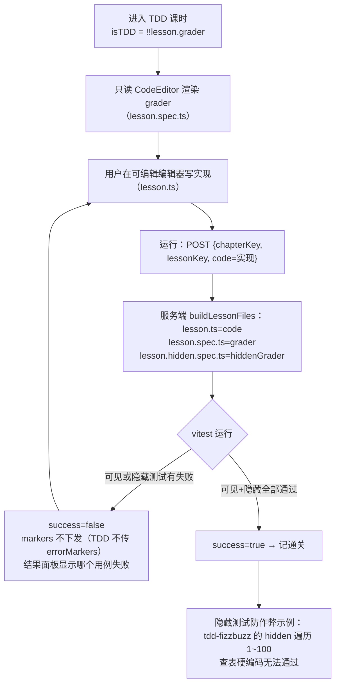
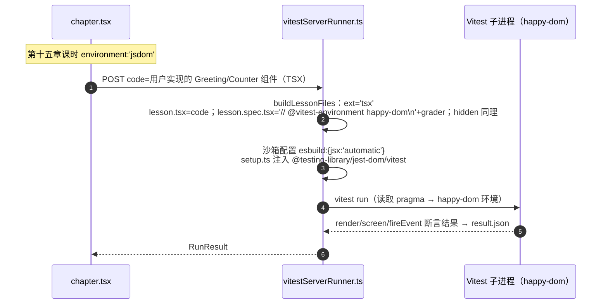
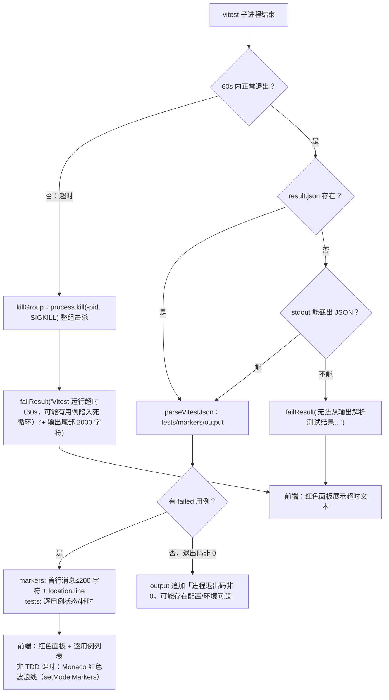
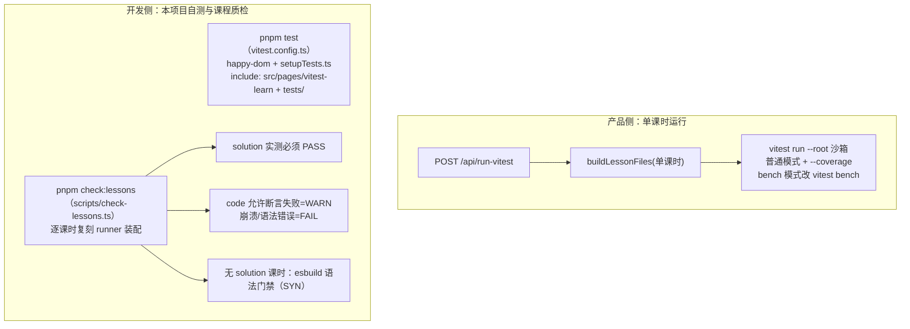

# 05 核心流程
> 项目：vitest-playground ｜ 版本：v1.0 ｜ 生成日期：2026-10-06 ｜ 依据：源码分析

本篇选取五个端到端流程，每个流程给出图示、分步说明与涉及文件清单。五个流程覆盖了产品的全部关键路径：普通运行、TDD 批改、jsdom 环境运行、死循环超时防护、以及基准测试（bench）。所有步骤描述均以源码为准。

## 流程一：编写用例 → 触发运行 → 结果渲染（主干流程）

```mermaid
sequenceDiagram
    autonumber
    participant U as 用户
    participant LP as chapter.tsx
    participant CE as CodeEditor.tsx
    participant RN as runner.ts
    participant SR as vitestServerRunner.ts
    participant FS as 沙箱目录

    U->>CE: 编辑代码（每次击键 onChange）
    CE->>LP: handleCodeChange → setCode + setLessonProgress({code})
    U->>CE: 点击"运行测试" / Ctrl+Enter（或自动重跑到期）
    CE->>LP: onRun → handleRunTest
    LP->>LP: setResult({status:'running', output:'准备运行环境...'})
    LP->>RN: runCode({chapterKey, lessonKey, codeToRun})
    RN->>SR: POST /api/run-vitest
    SR->>SR: 校验(400)→findLesson→limiter.acquire(429)
    SR->>FS: mkdtemp run-&lt;rand&gt; + writeRunConfig + buildLessonFiles 写盘
    SR->>SR: spawn vitest run --root --reporter=json --outputFile.json=result.json
    SR->>FS: 子进程退出后读 result.json（+coverage-summary.json）
    SR->>SR: parseVitestJson → RunResult；finally 删除 runDir
    SR-->>RN: 200 JSON RunResult
    RN-->>LP: RunResult
    alt success
        LP->>LP: setResult(success 态) + setLessonProgress({status:'passed', lastRunAt})
        LP->>U: message.success('测试全部通过！') + 绿色结果面板
    else 失败
        LP->>LP: setResult(error 态)
        LP->>U: message.error('有测试未通过') + 红色面板 + 逐用例红绿列表
    end
```

分步说明：

1. **编辑与存档**：`CodeEditor` 的每次 onChange 触发 `handleCodeChange`（`chapter.tsx`），除更新 React state 外同步 `setLessonProgress({ code: value })` 写 localStorage——因此刷新/切课时后代码可完整恢复（`useEffect` 按 `effectiveLessonKey` 恢复）。
2. **触发**：三个入口汇合到 `handleRunTest`——工具栏按钮、Monaco 的 `Ctrl/Cmd+Enter` 命令（`CodeEditor.handleMount` 中 `addCommand`）、以及自动重跑的 1.2s debounce 定时器（经 `handleRunTestRef` 调用）。查看答案状态下提交的是 `solution` 文本。
3. **请求**：`runner.ts` 的 `runVitest` fetch POST；非 2xx 与网络异常都被合成为 `success:false` 的 RunResult（见 03 篇 §4）。
4. **服务端装配与执行**：校验链（方法/体积/字段/课时存在性）→ 并发信号量 → `buildLessonFiles` 装配（普通模式即 `lesson.spec.ts = code`）→ `writeRunConfig` 写配置 → `spawnVitest` 起进程。
5. **解析与回传**：优先 `result.json`（免疫 stdout 污染），回退 `extractJson` 截取 stdout；`parseVitestJson` 产出 output 文本、tests、markers；非 bench 课时附带 `readCoverage` 结果。
6. **渲染**：`CodeEditor` 结果面板按 `result.status` 换色；`tests` 渲染逐用例耗时列表；`coverage` 渲染行/分支/函数三条进度条与分文件摘要；`markers`（仅非 TDD）经 `setModelMarkers` 变成编辑器内红色波浪线。
7. **记进度**：success 时写 `status:'passed'`，首页统计、导航栏进度、侧栏对勾、徽章全部随之联动（下次计算 localStorage 时生效）。

涉及文件：`src/pages/vitest-learn/chapter.tsx`、`CodeEditor.tsx`、`runner.ts`、`progress.ts`、`types.ts`；`vitestServerRunner.ts`；`vite.config.ts`（中间件挂载）；`src/pages/vitest-learn/data.ts`（课时数据）。

## 流程二：TDD 课时自动批改（grader + hiddenGrader）



分步说明：

1. **模式判定**：`chapter.tsx` 中 `isTDD = !!currentLesson?.grader`，编辑器文件名显示 `lesson.ts`（jsdom 课时为 `lesson.tsx`）；grader 预览以只读 `CodeEditor` 呈现（高度 240px、`readOnly` 标签、无结果面板）。`data.ts` 中共 10 个 TDD 课时：第十四章 5 个、第十五章 3 个（jsdom）、第十六章 2 个。
2. **服务端装配的不对称性**：`buildLessonFiles` 里 grader 与 hiddenGrader 都经过 `.trim()` 守卫（纯空白视为不存在），但 hidden 文件**从不**出现在任何 HTTP 响应中——用户无法通过接口读到隐藏测试内容，只能"把实现写对"。
3. **markers 的取舍**：失败定位行号来自 spec 文件（`t.location?.line`），TDD 课时用户编辑的是 `lesson.ts`，行号体系不匹配，因此 `chapter.tsx` 明确 `errorMarkers={!isTDD ? result.markers : undefined}`，靠结果面板的逐用例列表传达失败信息。
4. **防作弊语义**：以 `tdd-fizzbuzz` 为例（`data.ts`），hiddenGrader 循环断言 1~100 全部输出，tips 直言"硬编码几组答案是行不通的"。注意：查看参考答案再运行，提交的代码就是 `solution`，同样会通过并记通关——"参考答案运行不标记 passed"是 backlog 项，未实现（⚠️ 见 `docs/superpowers/plans/2026-09-27-runner-hardening.md` 的 Spec 之外不做清单）。

涉及文件：`src/pages/vitest-learn/chapter.tsx`、`data.ts`（grader/hiddenGrader 字段）、`vitestServerRunner.ts` 的 `buildLessonFiles`、`tests/runner-security.test.ts`（装配矩阵用例）。

## 流程三：jsdom 课时（React 组件测试）的差异化装配



要点：jsdom 课时全部是 TDD 课时（用户实现组件，grader 用 `@testing-library/react` 的 `render/screen/getByRole/fireEvent` 断言）。环境切换不靠沙箱配置的 `environment` 字段（那里固定 `node`），而是**文件级 pragma** `// @vitest-environment happy-dom`——因为同一沙箱要同时容纳 node 环境的用户文件与环境敏感的 spec。`esbuild: { jsx: 'automatic' }` 让 `.tsx` 里的 JSX 无需 import React 即可编译。编辑器侧配套：`monacoSetup.ts` 的 compilerOptions 开了 `jsx: ReactJSX`，且 `addExtraLib` 同时注入 TS 与 JS 两个语言服务。

涉及文件：`src/pages/vitest-learn/data.ts`（react-testing 章）、`vitestServerRunner.ts`（`buildLessonFiles` 的 pragma/ext 分支、`writeRunConfig`）、`monacoSetup.ts`、`vitestGlobalsDts.ts`。

## 流程四：错误用例的诊断展示（含死循环超时）

失败诊断分两个层级——**断言失败**（有 JSON 报告）与**执行异常**（超时/崩溃/解析失败），前端统一以"测试失败"呈现，但信息来源不同。



分步说明：

1. **断言失败**：`parseVitestJson` 遍历 `assertionResults`，对 `status==='failed'` 的用例截取 `failureMessages[0]` 前 6 行拼进 output，并生成 marker（`location.line ?? 1`，消息首行截 200 字符）。`CodeEditor` 的 `useEffect([errorMarkers])` 把 markers 写入 Monaco 模型（owner `'vitest'`），形成行内红色波浪线与 hover 信息。
2. **死循环超时**：`spawnVitest` 的 `setTimeout(RUN_TIMEOUT=60s)` 到点先 `killGroup()`（`detached:true` 建立的独立进程组整体 SIGKILL，vitest 的 worker 无一漏网），然后以超时失败结果 resolve；`close` 回调里 `if (killed) return` 防止重复 resolve。沙箱目录在 `runInSandbox` 的 `finally` 中删除——`tests/runner-security.test.ts` 的死循环用例（`timeoutMs:2000`）同时断言了"输出含超时"与"`readdirSync(RUNS_ROOT)` 为空"（目录零残留）。
3. **进程级失败**：vitest 未安装（`child.on('error')`）返回安装提示；测试文件语法错误导致套件级失败时，JSON 报告仍会产出（`numFailedTests===0` 但 exitCode 非 0），output 追加配置/环境问题提示。
4. **输出洪泛防护**：用户 `console.log` 20 万行时，stdout 累计在 1MB 处截断（`out.length < 1_000_000`），解析主路径又不依赖 stdout，因此结果不受影响（集成测试「海量 stdout 不破坏解析且进程稳定」验证）。

涉及文件：`vitestServerRunner.ts`（`spawnVitest/killGroup/parseVitestJson/finishRun/extractJson/failResult`）、`CodeEditor.tsx`（markers effect 与结果面板）、`tests/runner-security.test.ts`（对应防线用例）。

## 流程五：单课时运行 vs 全量运行的边界（含 bench 模式）

需要澄清一个容易混淆的点：**本产品的"运行"永远是单课时运行**。每次 POST 只装配一个课时的文件集，沙箱 `include: ['*.spec.ts', ...]` 虽然会匹配目录里全部 spec，但目录里本来只有一个课时的文件（lesson.spec + 可选 hidden + extraFiles），因此"hidden 测试与可见测试在同一进程中一起跑"是最大范围。"全量运行"只存在于两个开发侧场景：



**bench 模式**的完整链路：`resolveRunOptions` 判定 `{coverage:false, benchmark:true}` → `runInSandbox` 写入带 `benchmark.include` 的配置 → `spawnVitest` 改用 `['bench', '--root', runDir]` 参数 → 无 JSON reporter 可用（Vitest 4.1.8 限制，源码注释说明），`finishRun` 走 `parseBenchTable(out)`：先剥 ANSI 色码，再以行正则 `/^\s*[·✓×]\s+(.+?)\s{2,}([\d,.]+)\s+([\d.]+)\s+([\d.]+)\s+([\d.]+)/` 提取名称/hz/mean → 生成 `• 名称: mean ms (hz ops/s)` 的 output 与 `tests[]`（status 一律 passed，duration=mean 秒）。bench 用例抛错时默认 reporter 不输出表格行，解析得 0 行 → 返回失败（有测试锁定该行为）。`scripts/check-lessons.ts` 对 bench 课时做了同构处理（`vitest bench` + 相同正则），保证课程质检与产品行为一致。

**单文件运行 vs 全量运行的取舍**：产品刻意不提供"跑全部课时"的按钮——56 个课时串行跑在服务端毫无教学意义且极易触达并发上限；开发侧的全量校验（`check:lessons`）则以 CI job 形态存在（`.github/workflows/ci.yml` 的 `lessons` job），每次 push/PR 自动逐课时体检。

涉及文件：`vitestServerRunner.ts`（`resolveRunOptions/spawnVitest/parseBenchTable/finishRun`）、`scripts/check-lessons.ts`、`.github/workflows/ci.yml`、`data.ts`（`benchmark: true` 的 `coverage-advanced/benchmark` 课时）。

## 流程六（开发侧）：一次 `pnpm check:lessons` 的内部旅程

虽然课程质检是开发侧工具，但它与产品运行器的关系如此紧密（装配规则逐行对齐），值得单独给出流程说明，帮助维护者在两者行为出现分歧时定位：

1. **启动与编译**：脚本先从 `node_modules/.pnpm` 中探测 `esbuild@` 版本目录取得可执行二进制（不能 `node esbuild`，pnpm allowBuilds 下那是原生二进制），把 `src/pages/vitest-learn/data.ts` bundle 成临时 mjs 并动态 import——之所以绕这一步，是因为 `node --experimental-strip-types` 无法处理 data.ts 里嵌套模板字符串的转义；
2. **环境消毒**：解构剔除 `CI` 与 `GITHUB_ACTIONS` 两个变量（源码注释说明：产品运行器的 env 白名单本就不含它们，若质检子进程带着 CI 标记，vitest 会进入 CI 模式，`.only` 直接判失败、缺失快照不创建而判失败，使 skip-only 与 snapshot 课时出现"本地没有的假失败"）；
3. **逐课时装配**：`buildRuns` 按 `isTDD/jsdom/extraFiles` 复刻 `buildLessonFiles` 的全部规则（含 pragma 与 `.tsx` 扩展名），在 `os.tmpdir()` 下建沙箱；`fs.realpathSync` 解掉 macOS `/var/folders` 符号链接（否则 vitest 把 spec 解析到 `/private/var`，root 与文件路径不一致导致模块被外部化报 `Cannot find module '/@fs/...'`）；仓库 `node_modules` 以 junction 链接进沙箱，`cacheDir` 重定向到沙箱内防污染；
4. **判定与汇总**：有 solution 的课时跑 code 与 solution 两轮——solution 必须全绿（PASS），code 允许断言级失败（WARN，教学性失败起点），但进程崩溃/套件级失败/无合法 JSON 判 FAIL；无 solution 的课时把 code/grader/hiddenGrader/extraFiles 喂给 esbuild transform 过语法门禁（SYN）；bench 课时与产品一致用 `vitest bench` 加相同的表格行正则。最终输出五计数摘要，`failed > 0` 时退出码 1 供 CI 拦截。

涉及文件：`scripts/check-lessons.ts`；对照实现：`vitestServerRunner.ts` 的 `buildLessonFiles/writeRunConfig/spawnVitest`。两者唯一的已知差异是沙箱位置（tmpdir + junction 链接 vs 仓库内 `.vitest-runs/`）与配置文件名（`vitest.config.mjs` vs `vitest.config.js`）——语义等价，均可运行扁平 spec。

## 补充：课时刻服链（学习闭环）

把五个流程串起来的产品级闭环是：首页选章（`index.tsx` 卡片）→ 进课时页恢复上次代码（`chapter.tsx` useEffect + `getLessonProgress`）→ 可选完成 `Quiz` 小测 → 编辑/运行/失败迭代（流程一/二/三/四）→ success 记通关 → 上一节/下一节推进 → `/progress` 查看徽章与分章进度（`computeBadges`）→ 必要时重置或导出进度。整个闭环中唯一的"服务端记忆"是沙箱的瞬时存在，学习者的全部足迹都留在自己浏览器的 localStorage 里。

## 跨流程的公共不变量

五个流程无论怎么组合，都遵守一组可以当作"公理"使用的不变量。改动任何一处代码前，先确认没有破坏它们：

1. **一次请求 = 一个目录 = 一组文件**。沙箱目录在 `runInSandbox` 进入时创建、`finally` 删除；并发请求各自持有独立目录，互不可见。任何"跨请求复用文件"的优化（如缓存 node_modules 之外的公共文件）都必须重新推导竞态与清理语义。
2. **`success` 的唯一判据是"没有失败用例"**。`parseVitestJson` 里 `success = failed === 0`——pending/skipped 不影响通关；而超时、启动失败、解析失败等异常路径一律 `failed: 1`。前端不重复判断，直接信任该字段。
3. **客户端永远不能扩大自己的权限**。装配要素（grader/hidden/extraFiles/环境/模式）只由服务端课时数据决定；文件名过白名单；请求体字段白名单之外的一切（包括旧契约的 `files`）被 400 拒绝。
4. **失败信息分层呈现但不下毒**。可见层（output/tests/markers）可以包含隐藏测试的失败事实（毕竟要告诉用户"没通过"），但绝不包含隐藏测试的源码——`RunResult` 的所有字段都从 vitest 的 JSON 报告派生，而报告只含用例标题与失败消息。
5. **进度只进不退**（除用户显式重置）。重置代码不清通关态；查看答案运行照样通关（⚠️ backlog）；切换课时只是恢复现场。要"倒扣"进度只有 `clearProgress()` 一条路。
6. **每个防御常量都有测试看守**。60s 超时、2/8 信号量、20 文件、5MB 请求体、1MB 输出、白名单规则——在 `tests/runner-security.test.ts` 中一一对应。修改任一常量而不改测试，CI 会失败；反之，绕过测试直接改行为则违背 `AGENTS.md` 铁律 2（不得削弱防线）。

把这六条不变量与 04 篇的数据生命周期图对照阅读，可以覆盖接手维护时 90% 以上的决策场景：任何新需求的落点（改课程 → `data.ts`；改协议 → 三处联动；改防线 → 常量 + 测试 + runbook；改呈现 → `CodeEditor/chapter.tsx`）都能自然浮现。
