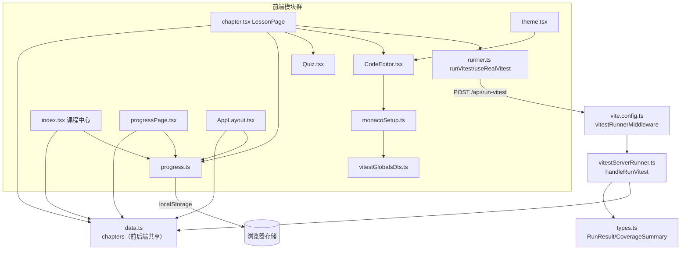

# 07 模块详解
> 项目：vitest-playground ｜ 版本：v1.1 ｜ 生成日期：2026-10-06 ｜ 依据：源码分析

本篇逐模块深读项目源码，是 00～06 篇的"落地层"：架构如何映射为文件（见《01-系统架构》）、接口如何定义（见《03-接口设计》）、数据结构如何组织（见《04-数据模型》）在本篇都落到具体的函数与行级走读上。全项目没有多余的抽象层，模块边界与文件边界几乎一一对应，因此本篇以文件为单位组织：先讲产品核心的服务端运行器，再讲挂载层与数据层，最后讲前端模块群。

## 1. 服务端运行器：vitestServerRunner.ts（全函数走读）

`vitestServerRunner.ts`（项目根，485 行）是全项目唯一同时接触 HTTP、文件系统与进程三个运行时域的模块，四重职责（HTTP 处理器、装配器、执行器、解析器）集于一身。它对外只暴露 10 个具名导出（`RUNS_ROOT`、`sanitizeEntryName`、`findLesson`、`resolveRunOptions`、`buildLessonFiles`、`buildChildEnv`、`createRunLimiter`、`runInSandbox`、`handleRunVitest`、`parseBenchTable`），其余函数均为模块私有——这个导出面本身就是按"可测试性"设计的（见《01-系统架构》§3.8）。

### 1.1 函数清单总表

| 函数/常量 | 位置（约行号） | 签名/形态 | 职责 | 下游消费者 |
| --- | --- | --- | --- | --- |
| `ROOT`/`VITEST_BIN` | 18-19 | 常量 | 项目根与 `node_modules/vitest/vitest.mjs` 绝对路径 | `spawnVitest` |
| `RUNS_ROOT` | 21 | 导出常量 | 运行临时目录根 `.vitest-runs/` | `makeRunDir`、测试清理断言 |
| `RUN_TIMEOUT` | 23 | 常量 60_000 | 单次执行超时上限 | `runInSandbox`/`spawnVitest` |
| `MAX_FILES` | 25 | 常量 20 | 单请求文件数上限 | `runInSandbox` |
| `PROTECTED_NAMES`/`VITE_CONFIG_RE`/`SAFE_NAME_RE` | 28-32 | 常量 | 文件名白名单三件套 | `sanitizeEntryName` |
| `sanitizeEntryName` | 35-47 | `(unknown) => string` | 文件名白名单校验，非法抛错 | `runInSandbox`、异常经 `handleRunVitest` catch 转 500 |
| `findLesson` | 56-58 | `(chapterKey, lessonKey) => Lesson?` | 按课时 key 寻址 `data.ts` | `handleRunVitest`、测试 |
| `resolveRunOptions` | 61-63 | `(lesson) => {coverage, benchmark}` | 运行模式推导（bench 关 coverage） | `handleRunVitest` |
| `buildLessonFiles` | 72-88 | `(lesson, userCode) => Record<string,string>` | 服务端装配沙箱文件（防篡改核心） | `handleRunVitest` |
| `makeRunDir` | 90-93 | 私有 async | `mkdir -p .vitest-runs` + `mkdtemp run-` | `runInSandbox` |
| `buildChildEnv` | 96-108 | 导出 `(homeDir) => ProcessEnv` | 子进程环境变量白名单 | `spawnVitest` |
| `writeRunConfig` | 110-127 | 私有同步 | 写 `vitest.config.js` 与 `setup.ts` | `runInSandbox` |
| `readCoverage` | 130-149 | 私有 | 读 `coverage/coverage-summary.json` 映射摘要 | `spawnVitest` close 分支 |
| `parseVitestJson` | 151-217 | 私有 | jest 兼容 JSON → `RunResult`（output/tests/markers） | `finishRun` |
| `parseBenchTable` | 223-243 | 导出 | bench 表格文本 → `RunResult` | `finishRun`、`check-lessons.ts` 同构实现 |
| `readBody` | 245-273 | 私有 async | 读请求体：JSON 解析 + 5MB 上限 + 防双重 settle | `handleRunVitest` |
| `failResult` | 283-285 | 私有 | 构造 `{success:false, output, passed:0, failed:1}` | 各失败路径 |
| `runInSandbox` | 292-314 | 导出 async | 单次执行全流程：校验→建目录→写文件→spawn→finally 删除 | `handleRunVitest`、集成测试 |
| `MAX_CONCURRENT_RUNS`/`MAX_QUEUE` | 317-318 | 常量 2/8 | 并发与排队上限 | `createRunLimiter` |
| `createRunLimiter` | 320-342 | 导出工厂 | 计数信号量（所有权转移语义） | 模块级单例 `limiter` |
| `spawnVitest` | 346-398 | 私有 | spawn 子进程、超时 kill、close/error 分支 | `runInSandbox` |
| `finishRun` | 402-420 | 私有 | 结果读取分派：bench 表格 / result.json / stdout 回退 | `spawnVitest` |
| `extractJson` | 423-428 | 私有 | stdout 首个 `{` 到最后一个 `}` 截取 | `finishRun` 回退路径 |
| `sendJson` | 430-434 | 私有 | 统一 JSON 响应写出 | `handleRunVitest` |
| `handleRunVitest` | 437-485 | 导出 async | HTTP 门面：快速失败链 + 限流 + 装配执行 | `vite.config.ts` 唯一消费点 |

### 1.2 请求接入层走读（readBody → handleRunVitest）

`handleRunVitest` 是一条严格排序的快速失败链：方法检查（非 POST 立即 405 纯文本）→ `readBody`（非法 JSON 与超 5MB 都转 400）→ 三字段类型校验（`chapterKey/lessonKey/code` 必须都是 string，且 body 必须是对象——`typeof null === 'object'`，所以判断写成 `!body || typeof body !== 'object'` 的合取，null 与数组都会被拦下）→ `findLesson` 寻址（未知课时 400）→ `limiter.acquire()`（排队满抛 `RUNNER_BUSY` 转 429）→ 装配执行 → 异常兜底 500 → `finally limiter.release()`。这个顺序的含义是"越廉价的检查越靠前"：非法请求在触碰文件系统与并发槽位之前就被弹回，槽位永远不会被无效请求占用。

`readBody` 值得单独说两处细节。其一，5MB 上限的判定在 `data` 事件里做：`data.length > 5 * 1024 * 1024` 时置 `settled = true`、`req.destroy()` 并 reject——`settled` 标志防止销毁后残余 chunk 触发二次 settle（测试「超过 5MB 的请求体被 400 拒绝」专门先挂监听再灌数据来覆盖这个时序）。其二，这里的 `length` 是字符串长度（UTF-16 码元数）而非字节数，对多字节字符的请求实际允许略小于 5MB 的字节量——在"防 DoS"的目标下这是保守方向的偏差，无风险。

### 1.3 装配层走读（findLesson → resolveRunOptions → buildLessonFiles）

`findLesson` 是两层数组 find：先按 `c.key` 找章，再按 `l.key` 找课时，返回 undefined 由 HTTP 层转 400。`resolveRunOptions` 一行完成模式推导：`coverage: !lesson.benchmark, benchmark: !!lesson.benchmark`——bench 课时不收覆盖率，其余课时默认收，两者互斥被类型层面隐含（没有同时为真的路径）。

`buildLessonFiles` 是防篡改契约的物理实现（规则总览见《01-系统架构》§3.2，模式矩阵见《04-数据模型》§1.2）。走读要点有三：第一，`grader?.trim()` 的守卫让"纯空白 grader"等价于"没有 grader"，与旧前端 trim 守卫语义对齐，测试用例「纯空白的 grader/hiddenGrader 视为不存在」锁定了它；第二，jsdom 分支做两件事——扩展名从 `.ts` 换成 `.tsx`、给 spec/hidden 文件头部拼 `// @vitest-environment happy-dom\n\n` pragma，环境切换是文件级的而非配置级的（原因见《05-核心流程》流程三）；第三，`extraFiles` 用 `Object.assign` 原样并入文件表，这些文件名也会在 `runInSandbox` 入口统一过 `sanitizeEntryName` 白名单，课时数据若写进非法名同样会被拒。

### 1.4 沙箱执行层走读（runInSandbox → writeRunConfig → spawnVitest）

`runInSandbox` 的结构是一个"包了 finally 的三明治"：入口三道检查（空文件表、超 20 文件、逐名过白名单）→ `makeRunDir()` 创建一次性目录 → try 块内写配置、写课时文件、`spawnVitest` → `finally fs.promises.rm(runDir, {recursive, force})`。目录生命周期严格归属本次调用，任何路径（包括超时、异常）退出后目录都被删除，这是"零残留"不变量的实现点（测试在死循环用例后断言 `readdirSync(RUNS_ROOT)` 为空）。

`writeRunConfig` 写出的 `vitest.config.js` 值得逐行看：`globals: true` 让课时代码不必 import test/expect；`environment: 'node'` 是基线环境，jsdom 由文件级 pragma 覆盖；`include` 只匹配目录根部的扁平 spec/test 文件（沙箱里所有文件本来就在根部）；coverage 块写在 `test` 键内部且只声明 `reporter: ['json-summary']`——与遗留目录 `.vitest-sandbox/` 里"coverage 写在顶层"的旧形态不同（见《00-项目总览》§8）；benchmark 时追加 `benchmark.include`；顶层 `esbuild: { jsx: 'automatic' }` 让 `.tsx` 无需 import React。`setup.ts` 只有一行 `import '@testing-library/jest-dom/vitest';`，为 DOM 断言注入匹配器。

`spawnVitest` 是防御最密集的函数。命令分叉：普通运行 `node vitest.mjs run --root <runDir> --reporter=json --outputFile.json=result.json`（coverage 时追加 `--coverage`），bench 运行 `node vitest.mjs bench --root <runDir>`。spawn 选项四件套：`cwd` 指向沙箱、`env` 用 `buildChildEnv` 白名单、`detached: true` 建立独立进程组、`stdio: ['ignore','pipe','pipe']`。stdout/stderr 汇入同一个 `out` 字符串且只累计前 1MB（`out.length < 1_000_000` 才追加）——注释明确说明解析主路径是 result.json，`out` 的消费方只读尾部 `slice(-2000)`。超时分支：`setTimeout` 到点 `killGroup()`（`process.kill(-child.pid, 'SIGKILL')` 整组击杀，负数 pid 表示进程组）并以超时失败结果 resolve；`close` 回调里 `if (killed) return` 防止超时分支已经 resolve 后的二次 resolve——Promise 的 resolve 是幂等的，但这里的守卫避免了重复读文件的成本。`error` 事件（通常是 vitest 二进制不存在）返回带 `pnpm install` 提示的失败结果。

一个走读中确认的实现细节：`child.on('close', () => {...})` **没有捕获退出码参数**，`finishRun` 调用 `parseVitestJson(raw, 0, coverageData)` 时 exitCode 硬编码为 0，因此 `parseVitestJson` 中 `exitCode !== 0 && failed === 0` 的"进程退出码非 0，可能存在配置/环境问题"提示分支在当前代码中**不可达**（该文案只出现在历史版本的 stdout 回退路径上）。这不影响正确性（failed 统计来自 result.json），但意味着"套件级失败但无断言失败"的场景只能靠 output 里的原始错误文本传达，属于一处可改进点（⚠️ 按 `vitestServerRunner.ts` 第 386-391 行与 410 行推导，已在《13-技术债务与演进建议》立项）。

### 1.5 解析层走读（finishRun → parseVitestJson / parseBenchTable / readCoverage）

`finishRun` 的分派优先级是免疫污染设计的关键：bench 路径直接解析表格；test 路径先读 `result.json`（`--outputFile.json` 写出的 jest 兼容 JSON，完全不经过 stdout），文件不存在或读取异常才回退 `extractJson` 从 stdout 截取 JSON 片段，再不行返回"无法从输出解析测试结果"并附尾部 2000 字符。`parseVitestJson` 内部整体 try/catch，损坏 JSON 返回"测试结果解析失败"。

`parseVitestJson` 的产出组装规则（字段语义见《03-接口设计》§3）：统计键取 `numPassedTests/numFailedTests/numPendingTests`；`success` 的唯一判据是 `failed === 0`（pending/skipped 不影响通关）；遍历 `testResults[].assertionResults[]` 产出 `tests[]` 与文本 output（图标映射 ✓/✗/○/·，耗时 `Math.round` 附注）；失败用例取 `failureMessages[0]` 前 6 行拼进 output、首行截 200 字符生成 marker（行号取 `location?.line ?? 1`）。`readCoverage` 读取 `coverage-summary.json`，`total` 键单独提取、其余键取 `path.basename` 作为文件名，四项 pct 缺省补 0，任何异常静默返回 undefined（UI 跳过渲染）。

`parseBenchTable` 的存在理由写在源码注释里：Vitest 4.1.8 的 bench 内置 reporter 只有 default/verbose，`--reporter=json` 会报 Failed to load custom Reporter。它先剥 ANSI 色码（正则 `/\x1B\[[0-9;]*[A-Za-z]/g`），再用行正则 `/^\s*[·✓×]\s+(.+?)\s{2,}([\d,.]+)\s+([\d.]+)\s+([\d.]+)\s+([\d.]+)/` 提取名称/hz/min/max/mean（hz 含千分位逗号需去逗号），生成 `• 名称: mean ms (hz ops/s)` 的 output 与 `tests[]`（status 一律 passed、duration=mean 秒——注意单位与普通测试的毫秒不同，前端渲染时直接 `Math.round` 拼接 `ms`，此处 bench 的 mean 实际是亚毫秒小数，见《04-数据模型》§12 的约定说明）。0 行解析即返回失败——bench 用例抛错时默认 reporter 不打印表格，恰好使"抛错"落到失败分支（测试锁定）。

### 1.6 并发层走读（createRunLimiter）

`createRunLimiter` 是手写计数信号量，`acquire` 在 `active < max` 时直接占槽返回；否则检查 `waiters.length >= maxQueue` 满则抛 `RUNNER_BUSY`；再否则把自己包成 promise 塞进等待队列挂起。精髓在 `release`：队列有等待者时直接唤醒队头且**不减少** active——槽位所有权从释放者直接移交等待者，消除了"先减一、微任务、再加一"间隙里第三个请求可能乘虚而入的超订窗口；无等待者才 `active--` 并用 `Math.max(0, ...)` 兜底冗余 release。模块底部 `const limiter = createRunLimiter(2, 8)` 是进程级单例——它活在 Vite 服务器进程里，跨请求共享，这就是并发闸门是"全局"而非"每用户"的原因（公网多用户共享 2 个槽位，见《08-安全与权限设计》§6）。

## 2. vite 插件挂载层：vite.config.ts 的 vitestRunnerMiddleware

挂载层薄到极致：一个返回 `{ name, configureServer, configurePreviewServer }` 的工厂函数，两个钩子里都是同一句 `server.middlewares.use('/api/run-vitest', (req, res, next) => { handleRunVitest(req, res).catch(next); })`。三个设计意图值得点破：其一，**dev 与 preview 同构**——同一中间件同时挂在开发服务器与预览服务器上，`pnpm dev` 与 `pnpm preview` 的测试能力完全一致，生产链路可在本地完整验证；其二，**单向最小依赖**——`vite.config.ts` 只 import `handleRunVitest` 一个符号，构建配置与产品逻辑之间没有更深的纠缠，未来做容器化后端切换时这个唯一接缝应该保持不变；其三，**错误上抛语义**——`.catch(next)` 把 handleRunVitest 内部未被捕获的异常交给 connect 的错误处理链而不是吞掉，但注意 `handleRunVitest` 自身已经 try/catch 兜底了装配执行阶段，能漏到 next 的只剩实现 bug。

## 3. 课时数据模块：src/pages/vitest-learn/data.ts

`data.ts`（4900 行）是全站唯一的内容事实来源，前端渲染与后端装配 import 的是同一个对象。类型定义在文件顶部：`Lesson` 接口 11 个字段，其中 `grader/hiddenGrader` 带注释前缀 M4、`quiz` 带 M5、`environment` 带 M6——这些 M 编号是历史上多轮扩展留下的痕迹，也是"新增字段走可选字段 + 注释标记"惯例的证据（扩展方法论见《11-扩展开发指南》）。`chapters: Chapter[]` 共 16 章 56 课时，每章 `{key, title, description, lessons[]}`。

模块内有一个值得记录的死代码：第 34-36 行的 `export interface APIData { name: string }` 在 `src/`、`tests/`、`scripts/` 全仓 grep 无任何引用，属模板时代遗留（已列入《13-技术债务与演进建议》）。数据分布统计（与 15 篇索引表互为印证）：56 课时全部有 `solution` 与 `tips`；10 个 TDD 课时（第十四章 5 个、第十五章 3 个、第十六章 2 个）且全部配有 `hiddenGrader`；3 个 jsdom 课时与 TDD 叠加；1 个 bench 课时（`coverage-advanced/benchmark`）；2 个 `extraFiles` 课时（`mock/vi-mock` 的 api.ts、`vitest-vs-jest/migration-guide` 的 database.ts）；9 个课时带 `quiz`（basics/first-test + 第十四章 5 个 + 第十五章 3 个）。

## 4. 判题器体系：grader 与 hiddenGrader 的机制视角

严格说项目没有独立的"判题器模块"——判题逻辑由三个角色协作完成，理解这个协作链是接手 TDD 课时的前提。**第一角色是数据侧的判题器定义**：`grader` 是可见主校验（只读展示给用户并作为 `lesson.spec.*` 运行），`hiddenGrader` 是隐藏强化校验（`lesson.hidden.spec.*`，从不进入任何 HTTP 响应）；两者的编写约定是测试文件引用用户实现用相对导入 `./lesson`（jsdom 时 `./lesson.tsx` 候选由装配端扩展名机制处理）。**第二角色是服务端的装配与执行**：`buildLessonFiles` 决定判题器出现在沙箱的哪个文件、以什么扩展名和 pragma 运行；vitest 子进程把可见与隐藏测试在同一目录一次跑完。**第三角色是结果侧的信息过滤**：`success` 由全部用例（含隐藏）共同决定，`output/tests` 会如实显示隐藏用例的失败事实（用例标题与失败消息），但不包含隐藏测试源码——失败信息的分层呈现原则见《05-核心流程》跨流程不变量第 4 条。前端侧的配合是 TDD 课时不下发 markers（行号属于 spec 文件，与用户编辑的 `lesson.ts` 不对应）。

防作弊语义以 `tdd-practice/tdd-fizzbuzz` 为范本：hiddenGrader 遍历断言 1～100 全量输出，硬编码查表的实现会在可见测试通过后仍被隐藏测试拦下。当前体系的边界也要明确：判题器防的是"偷懒实现"，不防"查看参考答案后提交答案"——`chapter.tsx` 的 `handleRunTest` 在 `showSolution` 状态下提交的就是 `solution` 文本，通过即记通关（backlog 未实现，见《13-技术债务与演进建议》）。

## 5. 前端模块群

### 5.1 请求客户端：src/pages/vitest-learn/runner.ts（57 行）

`runVitest(opts)` 是唯一的网络出口：fetch POST `/api/run-vitest`，非 2xx 合成 `{success:false, output:'服务端返回 {status}'}`，网络异常合成 `无法连接运行服务: {message}`——调用方永远拿到 `RunResult`，无需区分异常类型（错误四象限见《03-接口设计》§4）。`useRealVitest()` 是包着 `useCallback` 的薄 Hook，返回 `{runCode, isReady}`；`isReady` 是 `useState(true)` 的恒真值，属 WebContainer 时代异步就绪检测的兼容垫片（见《13-技术债务与演进建议》）。

### 5.2 课时工作台：src/pages/vitest-learn/chapter.tsx（471 行）

`LessonPage` 是产品核心页面，交互设计在《02-页面设计》§2.2 已完整描述，此处补模块视角的函数清单：派生计算区（`isTDD/isJsdom/editorFileName/graderFileName`、章节通过数 `chapterPassedCount` 每渲染重算）；`useEffect` 课时切换恢复区（读 `getLessonProgress().code` 恢复代码、结果复位 idle、收起答案）；`handleCodeChange`（setCode + 每次击键 `setLessonProgress({code})`）；`handleReset`（恢复初始 code，不动 passed 状态）；`handleExport`（Blob 下载，导出内容随 `showSolution` 取当前编辑文本或答案）；`handleRunTest`（状态机核心：先置 running，`codeToRun` 在查看答案时取 solution，`.then` 里按 `runResult.success` 分叉记进度、`.catch` 兜底极端未捕获错误）；自动重跑区（`handleRunTestRef` 持最新回调 + 以 `[code, autoRun]` 为依赖的 1200ms debounce effect）。值得注意的容错：`chapter` 查不到时渲染"章节未找到"兜底页；`currentLesson` 为空时右侧内容区不渲染。

### 5.3 编辑器复合组件：src/pages/vitest-learn/CodeEditor.tsx（262 行）

`CodeEditor` 以 props 在三种形态间复用（可编辑主编辑器、TDD 只读 grader 预览 240px、extraFiles 只读 Tabs 240px）。模块内部四个机制点：`onRunRef` 转发让 Monaco `addCommand(Ctrl/Cmd+Enter)` 绑定的回调永远是最新闭包；markers effect（依赖 `[errorMarkers]`）用 `monaco.editor.setModelMarkers(model, 'vitest', ...)` 写行级错误标记，空数组显式复位；`covColor` 按 80/60 分档给覆盖率条着色（≥80 绿 #34d399、≥60 黄 #fbbf24、否则红 #f87171）；结果面板按 `result.status` 换类名（resultSuccess/resultError），覆盖率区与逐用例列表用内联样式渲染。主题经 `useTheme()` 映射 `vs-dark`/`vs` 传给 Monaco。

### 5.4 编辑器基础设施：monacoSetup.ts 与 vitestGlobalsDts.ts

`monacoSetup.ts`（63 行）作为副作用 import 生效：从 `monaco-editor/esm/vs/editor/editor.api` 引内核并只追加 TypeScript 语言贡献（体积裁剪，见《10-性能设计与优化》§5）；`MonacoEnvironment.getWorker` 按 label 路由 tsWorker/editorWorker；`unhandledrejection` 监听吞掉 TS worker 模型异步回收时的已知报错；`setCompilerOptions` 开 strict/ReactJSX/ESNext；`addExtraLib(VITEST_GLOBALS_DTS)` 同时注入 TS 与 JS 两个语言服务。`vitestGlobalsDts.ts`（125 行）是手写的精简声明串（describe/test/钩子/Expect 匹配器/vi 对象/RTL），文件头注释明确其定位：只用于编辑器诊断，让 90%+ 课时代码不爆红，真正的运行结果以服务端 vitest 为准。

### 5.5 进度模型与支撑组件

`progress.ts`（89 行）是纯函数集合：`loadProgress`（try/catch 容错损坏数据返回空 Map）、`saveProgress`、`getLessonProgress`、`setLessonProgress`（读-合并-写）、`isLessonPassed`、`clearProgress`、`computeBadges`（五徽章纯计算，零课时特例）。注意 `saveProgress` 的 `localStorage.setItem` 没有 try/catch——配额溢出会抛异常（隐患分析见《08-安全与权限设计》§6 与《13》）。`Quiz.tsx`（77 行）自持 `answers/submitted` 两个 Record，提交后锁定并即时反馈对错。`AppLayout.tsx`（105 行）在挂载时用 `useMemo([])` 一次性计算全局进度（顶栏不实时刷新的原因）；`index.tsx`（271 行）持有 `FILTER_TAGS`/`TAG_MAP`/`CHAPTER_STYLES`/`FEATURES` 四个常量与筛选状态；`progressPage.tsx`（185 行）用 `version` state 强制 useMemo 重算，导出进度读原始 localStorage key；`theme.tsx` 管理明暗主题与 `vitest-playground-theme` 持久化；`usePageMeta.ts` 零依赖设置 title/meta description。

## 6. 模块依赖关系总览

这张图与《01-系统架构》§1 的部署视角图互为补充：部署图看"进程与网络"，本图看"import 与调用"。三个要点：`data.ts` 被前后端同时依赖（防篡改装配的根基）；`types.ts` 是前后端共享的类型契约（`RunResult` 两端 import 同一定义）；前端模块群内部没有任何全局状态库，唯一跨模块通道是 ThemeContext 与 localStorage。改动任何一个模块前，建议先在图中确认它的上下游——尤其是 `data.ts` 与 `types.ts` 这两个"共享枢纽"，它们的变化半径覆盖全仓。
