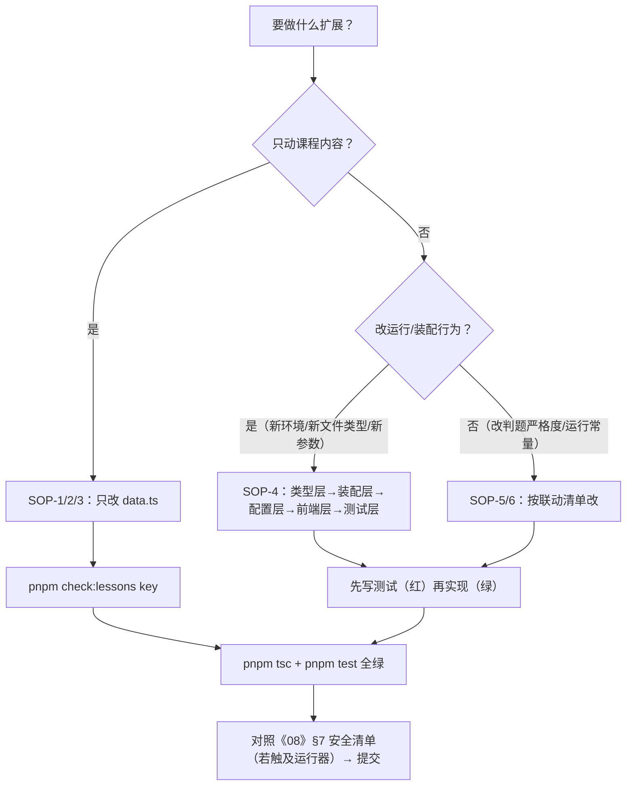

# 11 扩展开发指南
> 项目：vitest-playground ｜ 版本：v1.1 ｜ 生成日期：2026-10-06 ｜ 依据：源码分析

本篇是"怎么改"的操作手册，覆盖五类高频扩展场景的标准作业程序（SOP）：新增普通课时、新增 TDD 课时、新增章节、新增一种课时形态、调整判题与运行规则。每个 SOP 都给出前置条件、步骤清单、验收命令与易错点。所有扩展的基础约定（Lesson 字段、模式矩阵、装配规则）见《04-数据模型》与《07-模块详解》§3-§4，本篇只讲动作，不重复机制。

## 0. 扩展总纲：改哪一层、过哪三道门

开始任何扩展前先做两个判断。**判断一：改哪一层。** 本项目的内容扩展与工程扩展是分离的——课程内容（课时/章节/判题器文本）只动 `src/pages/vitest-learn/data.ts`；执行行为（新增环境、新增文件类型、改运行参数）才动 `vitestServerRunner.ts` 与配置层。**判断二：过哪三道门。** 任何提交前的统一验收是三条命令：`pnpm tsc`（类型门禁）、`pnpm test`（行为门禁，含安全集成用例）、`pnpm check:lessons`（内容门禁；只改了单个课时可传 key 过滤，如 `pnpm check:lessons tdd-fizzbuzz`）。改执行行为时另需对照《08-安全与权限设计》§7 的安全检查清单。

## 1. SOP-1：新增一个普通课时（最常见改动）

普通课时 = 用户编辑的就是测试文件（`lesson.spec.ts`），无 grader。步骤：

1. **选定归属章节**：在 `data.ts` 找到目标 `Chapter`，确定插入位置（`lessons` 数组顺序即左侧导航与"上一节/下一节"顺序）。
2. **写 Lesson 对象**，必填字段四个：`key`（全局唯一、路由与进度索引用，建议 `章节语义-课时语义` 的 kebab-case，如 `async-await`）、`title`（含序号，如 `4.4 超时与 rejects`）、`description`（任务描述）、`code`（初始展示代码）。推荐补齐：`solution`（**强烈建议**——有 solution 才能被 `check:lessons` 实测，无 solution 只过语法门禁）、`tips`（学习提示数组）。可叠加 `quiz`（选择题数组，`answer` 是正确下标）。
3. **code 的写法要求**：`code` 是用户的起点，应当是"差一步通过"的教学性失败状态——`check:lessons` 对 starter code 允许断言级失败（WARN），但**禁止语法错误与套件级崩溃**（FAIL）。模板字符串嵌套注意转义（历史真实缺陷形态就是模板字符串少闭合，质检脚本注释原文）。
4. **验收**：`pnpm check:lessons <新课时key>` 看输出 `[PASS]`/`[WARN]`（允许）而非 `[FAIL]`；`pnpm tsc`；本地 `pnpm dev` 进课时页实际跑一遍运行-失败-查看答案-通过的全旅程。

易错点：key 与既有课时重复会被 `tests/lessons.test.ts` 的唯一性测试拦下（全局唯一，跨章也算）；`code` 里引用额外模块时确认 `extraFiles` 是否需要（见 SOP-1b）；不要在课时代码里写依赖特定 cwd 的逻辑——运行时 cwd 是沙箱目录。

**SOP-1b（子场景）：课时需要额外模块文件**。若测试要 `vi.mock('./api')` 或 import 被测模块，给 Lesson 加 `extraFiles: { 'api.ts': '...' }`——文件名必须是扁平名（白名单 `SAFE_NAME_RE`，见《08》§3 L3），内容会原样写入沙箱并被前端以只读 Tabs 展示。现有范例：`mock/vi-mock` 的 api.ts、`vitest-vs-jest/migration-guide` 的 database.ts（`data.ts` 第 541、3457 行附近）。

## 2. SOP-2：新增一个 TDD 课时（grader 编写与验收）

TDD 课时 = 用户编辑被测实现，测试由课程给定。装配规则（《07-模块详解》§1.3）：`grader` 存在且非纯空白 → `lesson.ts` = 用户代码、`lesson.spec.ts` = grader、`lesson.hidden.spec.ts` = hiddenGrader（如有）；jsdom 叠加时扩展名换 `.tsx` 并注入 happy-dom pragma。步骤：

1. **在 `data.ts` 目标章节写 Lesson**：`code` 填函数骨架（如带 TODO 的空实现——TDD 的起点是"测试全红"），`grader` 填**可见主校验测试**（会以只读编辑器展示给用户，引导语自动变为"请在编辑器中实现让它们全部通过"），`hiddenGrader` 填**隐藏强化校验**。
2. **grader 的编写约定**：测试文件引用用户实现用相对导入 `./lesson`（jsdom 时 import 路径同样写 `./lesson`，装配端用 `.tsx` 扩展名落地，模块解析可命中）；断言覆盖教学目标的核心行为；避免依赖执行顺序。**hiddenGrader 的设计原则**：覆盖"可见测试拦不住的作弊形态"——范例 `tdd-practice/tdd-fizzbuzz` 的 hidden 遍历 1～100 全量断言，让硬编码查表无法通过（该课时的 tips 甚至直接告知学习者这一点）；hidden 测试永不回传前端，可以放心写全量边界。
3. **可选叠加**：`environment: 'jsdom'`（React 组件测试，代码里写 JSX）、`quiz`（TDD 课时配小测是现有惯例：第十四章 5 课与第十五章 3 课全配）。
4. **验收**：`pnpm check:lessons <key>` 必须出现两条记录——`solution` 是 `PASS`、`code`（骨架）通常是 `WARN`（断言失败 = TDD 起点，正确状态；若出现 FAIL 说明骨架崩溃或语法错误）；`pnpm tsc`；本地实际跑通"骨架全红 → 补实现全绿 → 刷新后进度对勾"。

易错点：`grader`/`hiddenGrader` 若只写了空白字符会被装配端视为"不存在"（`.trim()` 守卫），课时静默退化为普通模式；hidden 测试里不要 console.log 敏感内容——虽然文件不回传，但失败消息（断言 diff）会出现在 `output` 里（信息分层原则见《05》不变量 4）。

## 3. SOP-3：新增一个章节

1. 在 `data.ts` 的 `chapters` 数组**末尾**（或期望位置）追加 `{ key, title, description, lessons: [...] }`，`key` 用 kebab-case 且全局唯一；至少 1 个课时（`tests/lessons.test.ts` 强制）。
2. **首页筛选**：`src/pages/vitest-learn/index.tsx` 的 `TAG_MAP` 决定章节出现在哪些主题标签下——不映射的章节只在"全部"下出现（有意行为）；需要按主题筛到新章就在 `TAG_MAP` 加映射，必要时在 `FILTER_TAGS` 加新标签。
3. **进度与路由零改动**：`/vitest-learn/:chapterKey` 路由、左侧导航、进度统计全部由数据驱动，无需动组件。
4. **验收**：`pnpm tsc && pnpm test`（lessons.test.ts 会校验 key 唯一性与课时非空）+ `pnpm check:lessons`（新章课时全量）+ 首页与课时页人工过一遍。
5. **同步项**：`README.md` 的章节清单（注意现有 README 的链接写法本就是坏的，见《13-技术债务与演进建议》问题 1，新增时建议顺手按实际路径写）；`public/sitemap.xml`/`llms.txt` 若含课程结构也需同步（`AGENTS.md` 铁律 7）。

## 4. SOP-4：新增一种课时形态（以"给课时注入自定义 setup 片段"为例）

这是最重的扩展，走"类型层 → 装配层 → 配置层 → 前端层 → 测试层 → 质检对齐"六步。假设需求是：某些课时需要在沙箱 `setup.ts` 里追加全局代码（例如注入自定义匹配器教学的前置代码）。以 `environment` 字段的历史做法为模板：

1. **类型层**：`data.ts` 的 `Lesson` 接口加可选字段 `setupSnippet?: string`（可选保证 56 个存量课时不动；注释沿用 M 编号惯例，如 M7）。纯展示字段到此为止，影响执行的继续往下。
2. **装配层**：`vitestServerRunner.ts` 的 `buildLessonFiles` 或 `writeRunConfig` 消费新字段——本例是 `writeRunConfig` 在写 `setup.ts` 时拼接 `lesson.setupSnippet ?? ''`。同时自查三个安全问题（《04-数据模型》§10 反例清单）：新文件名要不要进 `PROTECTED_NAMES`？会不会改变超时/并发语义？要不要动 nginx 预算？本例 setupSnippet 来自课程数据（非用户输入），风险面与 `grader` 等价。
3. **配置层**：如需新的沙箱配置（新 include、新环境），改 `writeRunConfig` 的模板字符串；`tests/runner-security.test.ts` 对配置内容没有直接断言，但装配矩阵有——先写失败测试。
4. **前端层**：`chapter.tsx` 若需要新的徽章/文件名分支（如本例不需要），仿照 `isTDD/isJsdom` 的派生模式扩展；`CodeEditor` 的 props 通常无需动。
5. **测试层**：先在 `tests/runner-security.test.ts` 的 `buildLessonFiles` describe 组加装配矩阵用例（红），实现后转绿；`resolveRunOptions` 若受影响同步补。
6. **质检对齐**：`scripts/check-lessons.ts` 的 `buildRuns`/`writeSandbox` 必须与产品装配**逐行对齐**（该脚本的存在意义就是复刻装配规则，见《05》流程六）——漏掉这步会出现"CI 质检跑的形态和用户实际跑的不一样"的暗分歧。
7. **验收**：`pnpm tsc && pnpm test && pnpm check:lessons` 三绿 + 用一个改造的课时在 `pnpm dev` 实测。

## 5. SOP-5：调整判题规则（改既有课时的测试严格度）

场景：某课时被反馈"实现有漏洞也能通关"（判题太松）或"正确实现被误判"（判题太严）。

1. **定位**：进度键格式 `${chapterKey}:${lessonKey}` 帮你从 URL 直接定位到 `data.ts` 的课时对象；看 `grader`（用户能看到的测试）与 `hiddenGrader`（隐藏校验）各自断言了什么。
2. **补断言而不是重写**：判题太松 → 优先在 `hiddenGrader` 追加边界用例（保持可见测试对学习者友好）；判题太严 → 检查是否断言了实现细节（内联实现方式、具体中间值），测试策略方法论见第十三章课程内容本身。
3. **回归**：改完立刻 `pnpm check:lessons <key>`——重点确认 solution 仍 PASS（**改判题器后 solution 就是回归基准**，solution 挂了说明判题器改过头）；再人工用"错误实现"验证新断言真的能拦住。
4. **联动**：若改动影响 `output` 展示的失败信息形态，确认前端无需变更（`output/markers` 全部动态渲染，通常无联动）。

## 6. SOP-6：调整运行常量（超时/并发/上限）的联动清单

`RUN_TIMEOUT`(60s)、`MAX_CONCURRENT_RUNS`(2)、`MAX_QUEUE`(8)、`MAX_FILES`(20)、5MB 请求体、1MB 输出这组常量是"三处联动"的整体（《03-接口设计》§8 末尾的警告）：

1. `vitestServerRunner.ts` 的常量本体；
2. `tests/runner-security.test.ts` 中锁定这些常量行为的用例（如 21 文件拒绝、`timeoutMs` 钳制、排队拒绝）——**先改测试期望再改常量**，否则 CI 直接红；
3. `docs/deploy/runbook.md` 的 nginx 配置与 `proxy_read_timeout 600s` 预算推导（排队最坏时间 = 队列深度 × 超时，代理超时必须显著大于它）；
4. （可选）`AGENTS.md` 铁律 2 中引用的参数描述。

放宽方向的改动额外触发《08-安全与权限设计》§7 安全清单逐项复核——AGENTS.md 铁律 2 明文要求不得削弱这些防线，任何放宽都应有书面理由。

## 7. 扩展时的通用禁忌（从源码约定反推）

最后把散落在各 SOP 的"不要做"收拢：不要在课时数据里写非扁平文件名（白名单必拒）；不要让课时代码依赖进程环境（子进程 env 只有 PATH/HOME/LANG/NODE_ENV，见《06-部署运行》§3）；不要在 grader/hiddenGrader 里 import 不存在的模块（`extraFiles` 是唯一的模块注入通道）；不要动 `lesson.ts/lesson.spec.ts/lesson.hidden.spec.ts` 这组文件名约定（前后端与质检脚本三处都硬编码依赖它，《04-数据模型》§12）；不要绕过 `check:lessons` 直接提交 data.ts（CI 的 lessons job 会替你补这一课，但那时候往返成本更高）；不要引入新的重型前端依赖（AGENTS.md 铁律 4，manualChunks 与体积告警是既定约束）。
