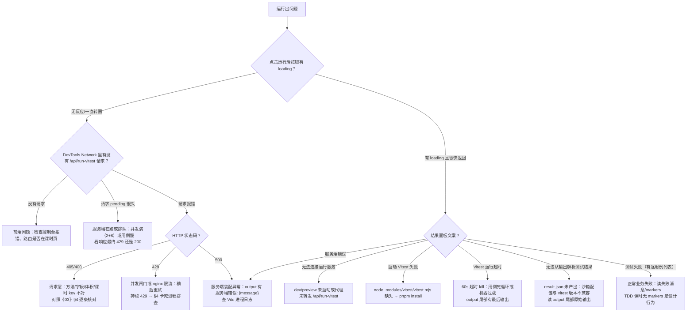

# 12 FAQ 与故障排查
> 项目：vitest-playground ｜ 版本：v1.1 ｜ 生成日期：2026-10-06 ｜ 依据：源码分析

本篇是排障手册：先讲日志入口与排查总原则，再用决策树定位"运行不了/运行失败"两大类问题，最后逐条拆解高频报错与坑。接口错误码的完整语义见《03-接口设计》§4，运维命令的部署语境见《06-部署运行》§8，本篇按"用户/维护者遇到现象 → 最短定位路径"组织。

## 1. 日志入口与排查总原则

**日志入口现状**：项目没有文件日志与结构化日志（⚠️ 待确认：运行器不写任何日志文件，`vitestServerRunner.ts` 无 logger 调用）。全部诊断信息有三个去处：其一，**Vite 服务器进程的 stdout/stderr**——`pnpm dev`/`pnpm preview` 的终端输出，以及生产容器 `vitest-playground-web` 的容器日志（`docker logs`）；中间件抛到 `next` 的异常会出现在这里，`handleRunVitest` 的 500 分支信息也只在响应体里。其二，**HTTP 响应的 `output` 字段**——所有 200 + `success:false` 的异常路径（超时、启动失败、解析失败）都会把定位线索附在 output 尾部（尾部 2000 字符的原始输出），这是排障的第一现场；用 curl 重放即可拿到（命令见《06-部署运行》§2）。其三，**文件系统状态**——`.vitest-runs/` 的残留情况与 `pgrep` 的进程快照（§5 命令速查）。

**总原则**：先分清"没运行"还是"运行了没过"。HTTP 状态码 4xx/5xx = 没运行（请求层问题）；HTTP 200 + `success:false` = 运行了但失败（执行层问题，读 output）；浏览器界面"测试失败"红面板同时承接两者（前端把一切折叠成 error 态，见《03-接口设计》§4 的四象限）。第二原则：**改动防御常量前先看《03》§8 的联动警告**——很多"偶发 429/超时"其实是参数联动被单独调整过的后果。

## 2. 排查决策树

## 3. 高频报错逐条拆解

### 3.1 「无法连接运行服务: …（请确认开发服务器已启动）」

fetch 网络层失败（`runner.ts` 的 catch 合成）。最常见原因按序排查：dev/preview 进程没起（`pgrep -af vite`）；端口不对（`vite.config.ts` 的 `server.port: 8000`，访问的却不是 8000）；经反代/容器访问时 `/api/run-vitest` 路径没被转发（nginx 只转发了静态资源）；frpc 隧道断了（生产链路见《14-配置与环境详解》§9）。注意 COEP/COOP 头缺失**不会**导致这个报错（它影响的是 Monaco，见 3.7）。

### 3.2 「启动 Vitest 失败: …（请确认项目已安装 vitest：pnpm install）」

子进程 spawn 的 `error` 事件路径（`vitestServerRunner.ts`）。几乎总是 `node_modules/vitest/vitest.mjs` 不存在：依赖没装、用非 pnpm 包管理器装出了异常结构、或部署时 install 被 skip。处置：`pnpm install`（铁律：只用 pnpm）；仍失败则删 `node_modules` 重装。runbook 的发布清单第一项就是验它。

### 3.3 一直 429（「运行排队已满，请稍后再试」或 nginx 429）

两个来源要分清：应用内信号量（2 并发/8 排队，body 是 `RunResult` JSON）与 nginx 限流（10r/m + burst 3，`limit_req_status 429`）。区分方法：看响应体——JSON 且文案是"运行排队已满"是应用层；非 JSON 或直接 429 页面是 nginx 层。持续应用层 429 说明有运行卡死占着槽位：正常情况下 60s 超时必然释放，若超过 60s 仍 429，按 §4 的卡死进程流程处理。生产环境先跑 runbook 的 6 连 curl 验证限流本身没配错。

### 3.4 「Vitest 运行超时（60s，可能有用例陷入死循环）」

超时防线正常工作的样子（`spawnVitest` 的 setTimeout 分支）。用户侧：检查用例里的 `for(;;)`、未推进条件的 while、未释放的假时钟等待（fake timers 下 await 真实定时器）。维护者侧注意两点：output 附的"尾部 2000 字符"取自 stdout 累计缓冲（前 1MB）的尾部，海量输出 + 死循环时真正的最后日志可能被截掉（《08》§6-7）；若频繁出现超时但用例明明是良性的，优先怀疑宿主机过载（并发跑满拖慢正常用例越过 60s），其次才考虑调参（SOP-6 联动，见《11-扩展开发指南》§6）。

### 3.5 「无法从输出解析测试结果，Vitest 输出: …」

result.json 不存在且回退 stdout 截取也失败（`finishRun` → `failResult`）。output 尾部附带的原始输出是唯一线索，常见根因：沙箱配置与 vitest 版本不兼容（本项目 vitest/coverage-v8/ui 三包钉在 4.1.8，升级必须三包联动并全量回归《06-部署运行》§9）；`--reporter=json` 行为变更；磁盘满导致 result.json 没写出来。若 output 里看到 "Failed to load custom Reporter" 字样，是有人给 bench 模式加了 json reporter（Vitest 4.1.8 不支持，`parseBenchTable` 注释原文）。

### 3.6 未知课时 / 提交内容过大 / 非法文件名

三个形态对应快速失败链的不同环节，且状态码出口不同：「未知课时: chapter/lesson」走 400，说明 `chapterKey/lessonKey` 在 `data.ts` 里寻址不到（手输错 URL 或数据被改）；「提交内容过大」走 400，是超 5MB（正常学习不可能触达，多为脚本滥用）；「非法文件名」理论上用户不可触发（文件名服务端生成），出现即说明有人绕过前端直发请求且课时数据被改出非法 `extraFiles` 名，且实际走 **500** 而非 400——文件名校验（`sanitizeEntryName`）位于 `handleRunVitest` try 块内的 `runInSandbox` 调用中，抛出的异常落入 500 分支，报文为「服务端错误: 非法文件名: …」（口径核实见《19-数据契约与示例集》§3.5）。它与未知课时一样值得查 `data.ts` 的近期改动。

### 3.7 页面能开但编辑器空白/挂载失败（COEP/COOP 与 Monaco）

Monaco 的 worker 是同源 Worker 资源，在跨域隔离头（`Cross-Origin-Embedder-Policy: require-corp` + `Cross-Origin-Opener-Policy: same-origin`）缺失的环境下可能出现 worker 加载失败、编辑器区域空白、控制台报 SharedArrayBuffer 或 worker 相关错误——这是部署层最典型的坑：**Vite dev/preview 由 `vite.config.ts` 的 server.headers/preview.headers 注入这两个头，但生产宿主若用 nginx 层改写/剥掉了响应头（或未按铁律 5 配置），前端就会挂**。验证：`curl -sI https://<域名>/ | grep -i cross-origin` 应看到两个头（《06-部署运行》§10 第 6 项）。注意方向别搞反：是"缺头导致挂"，nginx 不需要重复 add_header（应用侧已带，`location /` 注释明确警示勿重复）。另一类"编辑器爆红"（test/expect 全部下划线）不是 COEP 问题，是 `addExtraLib` 注入失效，见 3.9。

### 3.8 stdout 污染疑云（用户视角）

学习者在测试里大量 `console.log` 后结果"看起来不对"的两种真实形态：其一，结果解析其实**不受影响**——主路径读 result.json，有专门用例锁定（`console.log('{"fake": "json"}'）不污染）；其二，受影响的是 output 面板的可读性（用户自己的日志不会出现在 output 里，因为 output 只由 JSON 报告组装；terminal 里才看得到 stdout）。若确实出现"结果内容明显错乱"，那不是污染而是解析失败（走 3.5），读 output 尾部原始输出定位。历史语境：stdout 污染是加固方案明确要修复的旧缺陷（旧版 `extractJson` 首尾大括号截取会被伪造 JSON 破坏），现状已免疫。

### 3.9 前端侧高频小问题速答

**编辑器内全篇爆红（test/expect 未定义）**：`monacoSetup.ts` 的 `addExtraLib(VITEST_GLOBALS_DTS)` 未生效——检查 `CodeEditor.tsx` 顶部 `import './monacoSetup'` 副作用导入是否被改动。**切课时后代码没恢复**：进度键是 `${chapterKey}:${lessonKey}` 且大小写敏感，确认 URL 两级参数正确。**顶栏"已完成 x/y"不涨**：`AppLayout` 挂载时计算一次（`useMemo([])`），跨页标记通过后需路由跳转重挂载才刷新（已知取舍，见《13》问题 8）。**TDD 课时失败没有红色波浪线**：设计行为——markers 的行号属于 grader 文件，与用户编辑的 `lesson.ts` 不对应，`chapter.tsx` 在 TDD 下不下发（《02-页面设计》§5.3）。**进度丢失/白屏**：`loadProgress` 对损坏 JSON 有容错（返回空 Map），真正丢数据只会是浏览器清存储；白屏则查控制台是否 localStorage 相关异常（写入无 try/catch 的已知隐患，《08》§6-1）。**jsdom 课时报 DOM 未定义类错误**：检查课时数据 `environment: 'jsdom'` 拼写——装配端靠它注入 happy-dom pragma，拼错会静默按 node 环境跑（《06-部署运行》§8）。

## 4. 维护者排障：卡死进程与残留目录

**卡死 vitest 进程**（持续 429 的常见根因）：`pgrep -af 'vitest.mjs' | wc -l` 正常应为 0（60s SIGKILL 兜底 + finally 清理 + 测试断言三重保障）；非 0 说明有进程组逃过击杀（如 SIGKILL 前进程已 re-parent 的极端时序）——确认 Vite 日志后重启 preview 进程即可，容器形态重启容器。**沙箱残留目录**：`du -sh .vitest-runs` 应接近 0（目录生命周期归属单次调用，见《05》不变量 1）；有 `run-*` 残留说明某次强杀后 finally 未执行（如进程被 OOM killer 或宿主 kill -9 连坐），`rm -rf .vitest-runs/run-*` 手动清理并留意是否复现。**磁盘增长排查**同样从这两个命令入手（runbook 故障处理节原文）。

## 5. 命令速查表

| 场景 | 命令 | 期望 |
| --- | --- | --- |
| 服务在不在 | `pgrep -af 'vite'` | 1-2 个进程（主 + 可能 worker） |
| 卡死运行进程 | `pgrep -af 'vitest.mjs' \| wc -l` | 0 |
| 链路连通 | `curl -s -X POST localhost:8000/api/run-vitest -H 'Content-Type: application/json' -d '{"chapterKey":"basics","lessonKey":"first-test","code":"test(\"ok\",()=>expect(1+1).toBe(2));"}'` | `success:true` |
| 限流生效 | 6 连 curl POST（runbook §nginx） | 约 4~5 个起 429 |
| 沙箱残留 | `du -sh .vitest-runs` / `ls .vitest-runs` | 接近 0 / 空 |
| 响应头 | `curl -sI https://<域名>/ \| grep -i cross-origin` | COEP/COOP 两个头 |
| 容器日志 | `docker logs vitest-playground-web --tail 200` | 中间件异常可见 |
| 课程体检 | `pnpm check:lessons [key]` | failed:0 |

## 6. 何时该升级为 issue

排障的止损终点是"知道什么时候该停手"：需要改防御常量才能恢复的（《11-扩展开发指南》§6 的联动没做完）、`finally` 清理复现失效的、`parseVitestJson` 对新版 vitest 输出解析失败的（版本联动问题，先回滚 vitest 版本再立 issue）、以及 COEP/COOP 与限流这类部署侧配置反复漂移的——都应立 issue 跟踪而不是每次手修。issue 里附三样东西：HTTP 状态码与完整 `output`、`pgrep`/`du` 快照、当时的 vitest 版本（`node_modules/vitest/package.json`），可省掉一轮往返。
