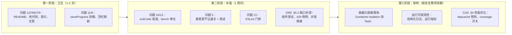

# 13 技术债务与演进建议
> 项目：vitest-playground ｜ 版本：v1.1 ｜ 生成日期：2026-10-06 ｜ 依据：源码分析

本篇把散落在前文的"已知问题"集中立项：每条给出位置、证据、影响与建议，最后给出分阶段演进路线图。定位依据全部来自本次源码走读；`docs/superpowers/plans/` 的历史方案文档（runner-hardening 已落地、container-isolation 仅有方案）是多项债务的出处。优先级判定用三个维度：是否影响正确性、是否影响安全水位、是否影响维护成本。

## 1. 已知问题清单

### 问题 1：README 文档漂移——章节链接指向不存在的目录

- **位置**：`README.md` 的"学习章节"小节全部链接。
- **证据**：链接形如 `./src/pages/vitest-learn/basics`、`./src/pages/vitest-learn/structure` 等，但 `src/pages/vitest-learn/` 下只有 `data.ts`、`chapter.tsx` 等文件，**不存在任何章节子目录**（`ls` 与 00 篇目录树均确认）；课程内容实际全部在 `data.ts` 单文件内。
- **影响**：新人按 README 找课程源码会扑空；GitHub 页面上 56 个死链；对"课程在哪维护"产生持续性误导。功能零影响。
- **建议**：把链接改为锚点式目录（`#第一章vitest-基础入门` 纯文本清单）或直接指向线上路由 `/vitest-learn/basics`；同时删除"学习章节"里与 `data.ts` 现实矛盾的目录式结构暗示。半小时的纯文档改动，建议尽快做。

### 问题 2：tests/__mocks__/mermaid.ts 与 raw.ts 死代码

- **位置**：`tests/__mocks__/mermaid.ts`（内容 `export default {}`）、`tests/__mocks__/raw.ts`（内容 `export default 'mock-md-content'`）。
- **证据**：全仓 grep 无 `mermaid` 导入、无 `?raw` 导入；`vitest.config.ts` 未配置任何指向 `__mocks__` 的 alias；vitest 的 `__mocks__` 自动机制也需要显式 `vi.mock` 调用才会生效。两文件是 Ant Design Pro 模板时代的遗留（《00-项目总览》§8 已记）。
- **影响**：误导读者以为存在 markdown 渲染能力；增加 tests 目录的理解成本。运行时零影响（不会被加载）。
- **建议**：直接删除两文件与空目录；若未来真引入 mermaid，届时按实际 API 重新写 mock。

### 问题 3：.vitest-sandbox/ 旧方案遗留

- **位置**：仓库根 `.vitest-sandbox/`（已 gitignore）。
- **证据**：现行运行时目录是 `.vitest-runs/`（`vitestServerRunner.ts` 第 21 行 `RUNS_ROOT`）；`.vitest-sandbox/` 内残留早期共享沙箱方案的样例文件，其 `vitest.config.js` 形态（coverage 写在顶层键）与现行 `writeRunConfig`（coverage 在 `test` 键内）不一致（《00-项目总览》§4 注释"仅作历史参考"）。
- **影响**：目录名与运行时目录只差一个词，是接手者最容易混淆的概念之一（00 篇 §7 术语表专门点破过）；磁盘上有陈旧配置样例可能被误当参考。
- **建议**：本地删除该目录（已 gitignore 不影响仓库）；若想保留历史，迁移一份说明进 `docs/superpowers/plans/` 即可。

### 问题 4：容器化隔离仅有计划文档、未实现

- **位置**：`docs/superpowers/plans/2026-09-28-container-isolation.md`（完整方案）对照 `vitestServerRunner.ts`（无任何实现）。
- **证据**：方案定义了 `VITEST_RUNNER_BACKEND=local|docker` 双后端、`resolveBackend` 纯函数、`spawnVitestDocker`、Dockerfile（node:22-slim、非 root、baked node_modules 符号链接）与容器参数（`--network none --memory 512m --cpus 1 --pids-limit 128 --read-only`）；源码与 `tests/` 中无对应符号，`RunInSandboxOptions` 无 `backend` 字段。
- **影响**：安全水位停留在"进程级受限"（见《08-安全与权限设计》§2：文件系统读取与网络出站两个威胁面无解）；公网运营的长期风险敞口。
- **建议**：按方案四个 Task 顺序落地（镜像 → 后端抽象 → 集成测试 → runbook），方案质量很高可直接执行；短期若不落地，至少把 `AGENTS.md` 铁律 2 的"不要暴露公网"警告与 nginx 限流现状一起写入 runbook 醒目位置（现状已部分做到）。

### 问题 5：看参考答案跑通记通关（防刷未落地）

- **位置**：`src/pages/vitest-learn/chapter.tsx` 的 `handleRunTest`（`codeToRun = showSolution && solution ? solution : code`）与 success 分支的 `setLessonProgress({status:'passed'})`。
- **证据**：runner-hardening 方案的"Spec 之外明确不做（后续 backlog）"原文列出"防刷通关（参考答案运行不标记 passed）"；《03-接口设计》§7 与《05-核心流程》流程二均标注 ⚠️ 未实现。
- **影响**：进度与徽章（`computeBadges`）的可信度——查看答案一键通关可刷满"测试大师"；对个人学习是自律问题，对教学场景是考核有效性问题。
- **建议**：最小实现是前端侧——`handleRunTest` 记进度前判断 `codeToRun === currentLesson.solution` 时不写 `status:'passed'`（或写独立的 `status:'cheated'` 态）；更完整的做法是把 `showSolution` 事件传给服务端由服务端裁决，但那会改请求契约，收益不成比例。注意补测试（该行为目前无测试表达期望，见《09-测试与质量保障》§5.2-1）。

### 问题 6：runner.ts 的 useRealVitest 恒真垫片

- **位置**：`src/pages/vitest-learn/runner.ts` 第 52 行 `const [isReady] = useState(true);`。
- **证据**：`isReady` 恒为 true，被 `chapter.tsx` 传给 `CodeEditor` 的运行按钮 `disabled={!isReady}`——永远不生效；`AGENTS.md`/00 篇记载其为 WebContainer 时代异步就绪检测的兼容垫片。
- **影响**：死代码语义；新人会误以为存在"运行引擎未就绪"的分支。无运行时影响。
- **建议**：二选一——删除 `isReady`（连带 `CodeEditor` 的 prop 与 `chapter.tsx` 传参）或保留并在注释里写明"恒真，兼容保留"。倾向删除，一次 `pnpm tsc` 就能保证改动完整。

### 问题 7：占位文案与实际行为不符

- **位置**：`src/pages/vitest-learn/CodeEditor.tsx` 第 194 行结果面板占位文案：`点击"运行测试"查看结果（首次运行需联网安装依赖）`。
- **证据**：架构上运行完全本地化——服务端 spawn 本机 `node_modules/vitest/vitest.mjs`，`README.md` 运行注意明确"依赖就绪后即可离线运行"；"联网安装依赖"是 WebContainer 时代的残留语义。
- **影响**：直接误导用户（会让本地断网使用者以为必须联网）；属于产品文案与架构事实的漂移。
- **建议**：改为「点击"运行测试"查看结果（本地 Vitest 执行，依赖需已安装）」一类的准确文案；顺带检查其他 WebContainer 时代文案残留（本次走读仅发现这一处）。

### 问题 8：顶栏进度不实时刷新

- **位置**：`src/components/AppLayout.tsx` 第 26-37 行：`total` 与 `passed` 均为 `useMemo(fn, [])`。
- **证据**：空依赖数组使进度在组件挂载时计算一次；`localStorage` 非响应式数据源，其他页面标记通过后回到挂载了 AppLayout 的页面时数字不变——只有路由跳转导致的重新挂载才刷新（《04-数据模型》§8 已记）。
- **影响**：正反馈体验缺失（通过后顶栏数字不动）；首页统计块同理（`useMemo` 无 version 机制，但首页通常整页重挂载，实际感知更弱）。
- **建议**：轻量方案是给 AppLayout 加 `location.pathname` 进 useMemo 依赖（路由变化即重算，成本是每次导航重读 localStorage，规模下无感知）；彻底方案是 `progress.ts` 提供订阅机制（storage 事件 + 内存通知）。当前规模建议前者。

### 问题 9：data.ts 的 APIData 死接口

- **位置**：`src/pages/vitest-learn/data.ts` 第 34-36 行 `export interface APIData { name: string }`。
- **证据**：全仓（src/tests/scripts）grep 仅定义处一处出现，无任何引用。
- **影响**：噪声代码。零风险。
- **建议**：删除。

### 问题 10：parseVitestJson 的 exitCode 分支不可达

- **位置**：`vitestServerRunner.ts`——`spawnVitest` 的 `child.on('close', () => {...})`（约 386-391 行）未捕获退出码；`finishRun` 调 `parseVitestJson(raw, 0, coverageData)`（约 410、419 行）硬编码 0；`parseVitestJson` 内 `exitCode !== 0 && failed === 0` 的提示分支（约 205-207 行）因此永不触发。
- **影响**：「（进程退出码非 0，可能存在配置/环境问题）」这一诊断文案实际不会出现；"套件级失败但无断言失败"场景的信息量下降（只能靠 result.json 里的原始 message）。正确性影响极小（success 判定不受影响），诊断体验受损。
- **建议**：`close` 回调改为 `child.on('close', (code) => ...)`，把 code 穿透 `finishRun` 传入 `parseVitestJson`；补一条"套件级失败"集成用例（《09》§5.2-3）。改动半径：三个私有函数签名。

### 问题 11：saveProgress 无 try/catch（localStorage 配额溢出）

- **位置**：`src/pages/vitest-learn/progress.ts` 第 26-28 行；触发点 `chapter.tsx` 的 `handleCodeChange`（每次击键写入）。
- **证据**：`loadProgress` 有 try/catch（读取容错），`saveProgress` 的 `localStorage.setItem` 裸奔；进度 JSON 含全部课时完整代码（全量写策略见《10-性能设计与优化》§6）。
- **影响**：配额溢出（QuotaExceededError）时写入抛异常且无降级，`handleCodeChange` 的异常可能打断 React 事件处理；触发概率低（56 课时 × 数 KB 远小于 5MB 配额）但存在（隐私模式下配额可能更小 ⚠️ 待确认各浏览器行为）。
- **建议**：`saveProgress` 包 try/catch，失败时 `console.warn` 一次（防日志风暴可做节流告警）；与《10》§6 的 debounce 建议可同批做。

### 问题 12：bench 的 duration 单位语义混乱

- **位置**：`vitestServerRunner.ts` 的 `parseBenchTable`（`duration: mean`，mean 为 vitest bench 表格的**秒**值、亚毫秒小数）对照 `CodeEditor.tsx` 第 251 行渲染 `${Math.round(t.duration)}ms`。
- **证据**：集成用例断言 `duration: 0.0009`（秒）对应表格 mean 列 0.0009；前端直接把它当毫秒取整显示——9.7 课时结果面板的耗时列多数显示 0ms 或 1ms，真实 mean（如 0.9ms）不可见。
- **影响**：bench 结果面板的核心指标之一（逐项耗时）失真；output 文本行的 `mean ms` 是正确换算的（`mean.toFixed(3)` 按 vitest 语义直接拼 ms——注意 vitest 表格 mean 列单位就是 ms 级小数，此处 output 与 tests 的换算不一致 ⚠️ 待确认 vitest 4.1.8 bench mean 列的精确单位后统一）。
- **建议**：确认单位后统一：要么 `duration: mean * 1000`（若 mean 是秒），要么前端渲染对 bench 保留三位小数。补契约用例锁定。

### 问题 13：无 lint 门禁与 progressPage 的 eslint-disable 残留

- **位置**：仓库无 `.eslintrc*`/`eslint.config.*`/prettier 配置；`src/pages/vitest-learn/progressPage.tsx` 第 54 行残留 `// eslint-disable-next-line react-hooks/exhaustive-deps` 注释。
- **证据**：`ls` 与配置文件清单（详见《14-配置与环境详解》§6）；disable 注释暗示模板时代有 ESLint 而现在没有执行主体。
- **影响**：Hooks 依赖数组、未用变量等静态可查问题没有门禁（本次发现的 `useMemo([])` 问题正是 lint 类会捕获的）；disable 注释指向不存在的检查器，语义悬空。
- **建议**：引入 flat-config ESLint（typescript-eslint + react-hooks 插件）进 CI quality job，首期规则从宽（warn）逐步收紧。

## 2. 演进路线图

三阶段的排序逻辑：第一阶段全部是零风险、半小时级的卫生改动，能立即降低接手者的理解成本，优先清掉；第二阶段处理"正确性与可信度"（exitCode、bench 单位、防刷）并补上最薄的测试缺口，其中防刷建议与组件测试同批做（互为验证）；第三阶段是唯一需要立项的架构工作——容器化是安全演进的主线（方案已备好），可观测性与性能优化都应等容器化落定后再做（容器会改变超时与冷启动预算，先优化会白做）。每阶段完成的判定沿用项目既有门禁：`pnpm tsc && pnpm test && pnpm build && pnpm check:lessons` 四绿 + 涉及运行器的改动过《08-安全与权限设计》§7 安全清单。最后重申一套文档债务的处理约定：本套文档（00-15）在上述任何一项落地后需要同步修订对应条目，避免文档本身成为新的"问题 1"。
