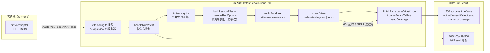

# 15 接口全量参考
> 项目：vitest-playground ｜ 版本：v1.1 ｜ 生成日期：2026-10-06 ｜ 依据：源码分析

本篇是 `/api/run-vitest` 接口与 `Lesson` 数据类型的"查表式"全量参考：一张总览图开场，之后全部以大表格承载——请求规格、校验链、错误码、响应结构、结果子结构、Lesson 全字段、四种形态组合推导、限制参数、以及 16 章 56 课时的索引表。行为语义与设计理由不在本篇展开（引用《03-接口设计》《04-数据模型》），本篇追求的是"一次查全"。

## 1. 接口总览图

## 2. 请求规格

| 项 | 值 | 依据 |
| --- | --- | --- |
| 方法 | `POST`（其他方法 405 纯文本 `Method Not Allowed`） | `handleRunVitest` 首检查 |
| 路径 | `/api/run-vitest` | `vite.config.ts` 两处 `middlewares.use` |
| Content-Type | `application/json`（客户端显式设置） | `runner.ts` 第 25 行 |
| 请求体 | `{ "chapterKey": string, "lessonKey": string, "code": string }` | `RunBody` 接口 |
| 体积上限 | 5MB（字符长度近似），超限 `req.destroy()` + 400 | `readBody` |
| 鉴权 | 无（同源匿名） | 《08-安全与权限设计》§1 |
| 旧契约 | `{ files, jsdom, coverage, benchmark }` 形态 → 400（无三字符串字段） | 测试锁定 |

请求体字段校验失败统一返回 400「请求无效: 需要 chapterKey / lessonKey / code 三个字符串字段」；body 为 JSON `null`、数组同样 400（`!body || typeof body !== 'object'` 合取判断）。

## 3. 处理链与错误码总表

按 `handleRunVitest` 执行顺序，每个环节的失败出口：

| 序 | 环节 | 失败条件 | HTTP 码 | output 文案（源码原文） |
| --- | --- | --- | --- | --- |
| 1 | 方法检查 | 非 POST | 405 | 纯文本（非 JSON） |
| 2 | readBody | body 非法 JSON | 400 | `请求无效: 请求体不是合法 JSON` |
| 3 | readBody | 超 5MB | 400 | `请求无效: 提交内容过大` |
| 4 | 字段校验 | 三字段非字符串 / body 非 object | 400 | `请求无效: 需要 chapterKey / lessonKey / code 三个字符串字段` |
| 5 | findLesson | 课时不存在 | 400 | `未知课时: {chapterKey}/{lessonKey}` |
| 6 | limiter | 并发 2 满 + 排队 8 满 | 429 | `运行排队已满，请稍后再试` |
| 7 | runInSandbox | 装配/执行抛意外异常 | 500 | `服务端错误: {message}` |
| 8 | spawnVitest | 超时 60s（进程组 SIGKILL） | 200 | `Vitest 运行超时（60s，可能有用例陷入死循环）:` + 输出尾部 2000 字符 |
| 9 | spawnVitest | 子进程 error 事件 | 200 | `启动 Vitest 失败: {message}（请确认项目已安装 vitest：pnpm install）` |
| 10 | finishRun | result.json 缺失且 stdout 无 JSON | 200 | `无法从输出解析测试结果，Vitest 输出:` + 尾部 2000 字符 |
| 11 | parseVitestJson | result.json 损坏 | 200 | `测试结果解析失败，原始输出:` + 前 2000 字符 |
| 12 | parseBenchTable | bench 无表格行 | 200 | `无法从输出解析基准结果，Vitest 输出:` + 尾部 2000 字符 |

约定：序 8-12 是"运行了但失败"（200 + `success:false`），序 1-7 是"没运行"（4xx/5xx）；所有 JSON 错误体都是 `RunResult` 形态（`failResult` 构造：`{success:false, output, passed:0, failed:1}`），前端统一按失败渲染。

## 4. 响应结构：RunResult 全字段表

| 字段 | 类型 | 必有 | 生产者 | 说明 |
| --- | --- | --- | --- | --- |
| `success` | boolean | 是 | `parseVitestJson`（`failed === 0`）/ 各失败路径 | 唯一通关判据 |
| `output` | string | 是 | `parseVitestJson`/`parseBenchTable`/`failResult` | 展示用文本报告（结构见 §5.4） |
| `passed` | number | 是 | `numPassedTests` | 通过用例数 |
| `failed` | number | 是 | `numFailedTests`（异常路径固定 1） | 失败用例数 |
| `pending` | number | 否（test 路径有） | `numPendingTests` | 跳过/待运行数 |
| `error` | string | 否 | 预留 | 当前无生产者与消费者 |
| `tests` | TestCaseSummary[] | 否（成功与失败均可有） | `assertionResults` 遍历 | 逐用例明细 |
| `markers` | ErrorMarker[] | 否 | `failureMessages[0]` 派生 | 失败行内定位 |
| `coverage` | CoverageSummary | 否（非 bench 课时） | `readCoverage` | 覆盖率摘要 |

### 4.1 TestCaseSummary

| 字段 | 类型 | 说明 |
| --- | --- | --- |
| `name` | string | 用例标题（`title`） |
| `status` | `'passed' \| 'failed' \| 'pending' \| 'skipped'` | vitest 原生状态 |
| `duration` | number? | 毫秒（test 路径）；bench 路径为 mean 值（单位语义见《13》问题 12） |
| `file` | string? | 所属文件 basename（`path.basename(fileResult.name)`） |
| `line` | number? | 失败定位行号（`location?.line`，仅失败用例有值） |

### 4.2 ErrorMarker

| 字段 | 类型 | 说明 |
| --- | --- | --- |
| `line` | number | 失败行号（缺省 1） |
| `message` | string | `failureMessages[0]` 首行截 200 字符 |

前端消费约束：仅普通模式（非 TDD）下发到编辑器（TDD 行号体系不匹配，见《02-页面设计》§5.3）。

### 4.3 CoverageFile / CoverageSummary

| 字段 | 类型 | 说明 |
| --- | --- | --- |
| `CoverageFile.file` | string? | 文件 basename（`total` 键无此字段） |
| `CoverageFile.lines/statements/branches/functions` | number | 0-100 百分比（pct，缺省 0） |
| `CoverageSummary.total` | CoverageFile | 整体覆盖率 |
| `CoverageSummary.files` | CoverageFile[] | 分文件覆盖率（coverage-summary.json 除 total 外的全部键） |

### 4.4 output 文本结构（两种模板）

普通/失败路径（`parseVitestJson`）：首行 `Test Results` + `============` → 逐文件 `📄 {basename}` → 逐用例 `  {✓|✗|○|·} {title} ({Math.round(duration)}ms)` → 失败用例附 `failureMessages[0]` 前 6 行（4 空格缩进）→ 末尾 `通过: x  失败: y  跳过: z` → （死分支）退出码非 0 提示。bench 路径（`parseBenchTable`）：首行 `Benchmark Results` + `================` → 逐基准 `  • {name}: {mean.toFixed(3)}ms ({Math.round(hz)} ops/s)`。图标映射：passed→✓、failed→✗、skipped/pending→○、其余→·。

## 5. Lesson 类型全字段表与形态推导

定义位置：`src/pages/vitest-learn/data.ts` 第 6-25 行（Quiz 在 `types.ts`）。

| 字段 | 类型 | 必有 | 默认语义 | 对执行的影响（消费方） |
| --- | --- | --- | --- | --- |
| `key` | string | 是 | - | 路由参数、请求寻址、进度键（全局唯一） |
| `title` | string | 是 | - | 页面标题/document.title |
| `description` | string | 是 | - | 任务描述展示 |
| `code` | string | 是* | - | 普通=测试文件内容；TDD=实现骨架（*与 grader 至少其一） |
| `solution` | string? | 否 | 无答案 | check:lessons 实测基准；前端"查看答案"提交它 |
| `tips` | string[]? | 否 | 不展示 | Alert 提示列表 |
| `grader` | string? | 否 | 普通模式 | **形态开关**：非纯空白即 TDD——写入 `lesson.spec.*` 只读展示 |
| `hiddenGrader` | string? | 否 | 无隐藏测试 | 非 TDD 时也可存在；写入 `lesson.hidden.spec.*`，不回传 |
| `quiz` | Quiz[]? | 否 | 无小测 | 纯前端展示（`{question, options[], answer 下标}`） |
| `environment` | `'jsdom'`? | 否 | node | 扩展名换 `.tsx` + spec/hidden 注入 happy-dom pragma |
| `extraFiles` | Record<string,string>? | 否 | 无附加文件 | 原样写入沙箱（文件名过白名单），前端只读 Tabs |
| `benchmark` | boolean? | 否 | false | 改 `vitest bench`、关 coverage、配置 benchmark.include |

### 5.1 四种形态组合推导矩阵

| 字段组合 | 形态 | 用户编辑文件 | 沙箱文件集 | 执行命令 |
| --- | --- | --- | --- | --- |
| 无 `grader` | 普通模式 | `lesson.spec.ts` | `lesson.spec.ts = code`（+hidden 如有）（+extraFiles） | `vitest run --coverage` |
| `grader` 非空白 | TDD 模式 | `lesson.ts` | `lesson.ts = code`、`lesson.spec.ts = grader`、`lesson.hidden.spec.ts = hiddenGrader?` | `vitest run --coverage` |
| 上两者 + `environment:'jsdom'` | TDD + jsdom | `lesson.tsx` | 全部换 `.tsx`，spec/hidden 头部加 `// @vitest-environment happy-dom\n\n` | `vitest run --coverage` |
| 无 `grader` + `benchmark:true` | 基准模式 | `lesson.spec.ts` | 同普通（coverage.enabled:false + benchmark.include） | `vitest bench`（无 JSON reporter） |
| `hiddenGrader` 单独存在（无 grader） | 普通 + 隐藏校验 | `lesson.spec.ts` | `lesson.spec.ts = code` + `lesson.hidden.spec.ts` | `vitest run --coverage` |

推导规则（`buildLessonFiles` 实现语义）：`grader?.trim()` 为假一律按普通模式；`environment` 只影响扩展名与 pragma；`benchmark` 只影响执行命令与 coverage 开关（`resolveRunOptions: coverage = !benchmark`）。当前数据中 jsdom 课时全部与 TDD 叠加，但机制上允许普通 + jsdom 组合。

## 6. 限制参数汇总表

| 参数 | 值 | 位置 | 锁定测试 |
| --- | --- | --- | --- |
| 请求体上限 | 5MB（字符长度） | `readBody` | 超 5MB 请求体 400 |
| 单请求文件数 | 20（`MAX_FILES`） | `runInSandbox` | 21 文件拒绝 |
| 执行超时 | 60s（`RUN_TIMEOUT`），注入值被 `Math.min` 钳制 | `runInSandbox`/`spawnVitest` | 死循环 2s kill |
| 并发 / 排队 | 2 / 8（超出 429） | `createRunLimiter` 单例 | 排队/拒绝/所有权转移 |
| stdout+stderr 累计 | 1MB（超出停止追加） | `spawnVitest` | 海量 stdout 稳定 |
| marker 消息 | 200 字符 | `parseVitestJson` | - |
| output 附加原始输出 | 尾部/前 2000 字符 | 各 failResult | - |
| marker 失败消息行数 | 6 行 | `parseVitestJson` | - |
| nginx 限流（生产） | 10r/m + burst 3，`proxy_read_timeout 600s` | `docs/deploy/runbook.md` | 6 连 curl 验证 |

## 7. 章节课时索引表（16 章 56 课时）

形态列缩写：普=普通模式、T=TDD、J=jsdom、B=benchmark、EF=extraFiles、Q=quiz；隐藏列表示该章 TDD 课时全部配 hiddenGrader（当前 10/10）。

| 章 | key | 标题 | 课时数 | 形态分布 | 附加字段分布 |
| --- | --- | --- | --- | --- | --- |
| 1 | `basics` | 第一章：Vitest 基础入门 | 3 | 普×3 | Q×1（first-test） |
| 2 | `structure` | 第二章：测试结构 | 3 | 普×3 | - |
| 3 | `mock` | 第三章：Mock 与 Stub | 4 | 普×4 | EF×1（vi-mock 的 api.ts） |
| 4 | `async` | 第四章：异步测试 | 3 | 普×3 | - |
| 5 | `array-object` | 第五章：数组和对象测试 | 4 | 普×4 | - |
| 6 | `timers` | 第六章：Timer 和 Fake Timers | 3 | 普×3 | - |
| 7 | `snapshot` | 第七章：Snapshot 测试 | 2 | 普×2 | - |
| 8 | `advanced` | 第八章：高级测试技巧 | 3 | 普×3 | - |
| 9 | `coverage-advanced` | 第九章：覆盖率与高级技巧 | 7 | 普×6 + B×1（benchmark） | - |
| 10 | `test-doubles` | 第十章：测试替身 | 5 | 普×5 | - |
| 11 | `fixture` | 第十一章：测试数据构建 | 3 | 普×3 | - |
| 12 | `vitest-vs-jest` | 第十二章：Vitest 与 Jest 对比 | 3 | 普×3 | EF×1（migration-guide 的 database.ts） |
| 13 | `test-strategy` | 第十三章：测试策略 | 3 | 普×3 | - |
| 14 | `tdd-practice` | 第十四章：TDD 实战演练 | 5 | T×5（全带隐藏） | Q×5 |
| 15 | `react-testing` | 第十五章：React 组件测试（jsdom） | 3 | T+J×3（全带隐藏） | Q×3 |
| 16 | `tdd-advanced` | 第十六章：TDD 进阶实战 | 2 | T×2（全带隐藏） | - |

课时 key 全表（按章节顺序）：basics：`first-test`、`matchers-basic`、`run-mode`；structure：`describe-it`、`before-after`、`skip-only`；mock：`vi-fn`、`vi-mock`、`vi-spy`、`vi-clear`；async：`async-await`、`promise-test`、`error-handling`；array-object：`deep-equal`、`array-matchers`、`object-matchers`、`combined-matchers`；timers：`fake-timers`、`setinterval`、`date-fake`；snapshot：`snapshot-basic`、`snapshot-update`；advanced：`test-each`、`custom-matchers`、`setup-teardown`；coverage-advanced：`coverage-basics`、`test-tags`、`concurrent`、`retry-flaky`、`organization`、`mock-advanced`、`benchmark`；test-doubles：`dummy`、`stub`、`spy`、`fake`、`test-doubles-summary`；fixture：`implicit-inline`、`factory-function`、`factory-sequence`；vitest-vs-jest：`syntax-comparison`、`migration-guide`、`why-vitest`；test-strategy：`state-vs-behavior`、`solitary-sociable`、`what-not-to-test`；tdd-practice：`tdd-fizzbuzz`、`tdd-anagram`、`tdd-leapyear`、`tdd-palindrome`、`tdd-caesar`；react-testing：`rt-greeting`、`rt-counter`、`rt-mirror`；tdd-advanced：`roman`、`valid-parens`。

## 8. 查表后的去处

拿到本篇的表之后，下一步通常属于三类：**要理解"为什么"** → 对应行为的设计依据在《03-接口设计》（错误四象限、防篡改契约）与《01-系统架构》（执行链与安全加固）；**要改数据** → 《11-扩展开发指南》的 SOP-1/2/3；**要排障** → 状态码先查 §3 错误码总表，再到《12-FAQ与故障排查》的决策树。本篇所有表格的直接依据是 `vitestServerRunner.ts`（485 行）、`src/pages/vitest-learn/types.ts`、`src/pages/vitest-learn/data.ts`（4900 行）与 `docs/deploy/runbook.md`，若源码与本表冲突，以源码为准并回改本表。
