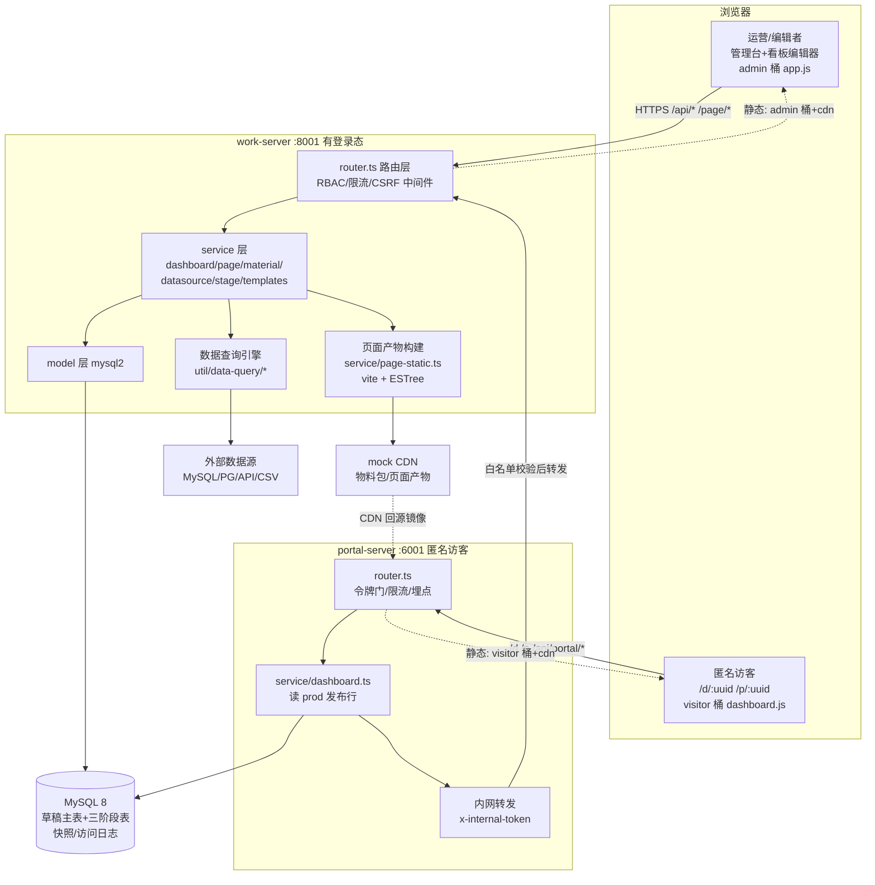

# 01 - 系统架构

> 项目：运营搭建平台（vue3-course） ｜ 版本：v1.0 ｜ 生成日期：2026-10-05 ｜ 依据：源码分析

## 1. 整体架构：一库两服一前端

平台在部署形态上是「**单 MySQL 库 + 两个 Koa 服务 + 一个前端包（两产物桶）**」的最小闭环。两个服务端口与职责刻意切分：

- **work-server（默认 8001）**：承载一切"有登录态"的场景——登录/注册、RBAC、看板与页面的草稿 CRUD、快照与回滚、三阶段发布动作、模板中心、数据源与数据库连接管理、数据查询执行、AI 流式代理、出码下载、日志。它同时静态托管编辑器前端产物（`/public/dist/page/app.js`，即 admin 桶）与页面线构建产物（`/public/cdn/page*/*`）。
- **portal-server（默认 6001）**：承载一切"匿名访客"场景——`/d/:uuid` 已发布看板、`/p/:uuid` 已发布页面、demo 页、令牌验证门、门户取数通道 `/api/portal/dashboard/query`、前端日志上报。它只持有 visitor 桶产物（`/public/dist/page/dashboard.js`），公开目录里**不存在**编辑器代码（`scripts/build-work-front.ts` 注释明确说明了这种"桶隔离"动机：模板按 URL 参数拼 `pageName`，任何落在公开目录的文件都能被匿名取到）。

两服务不共享代码文件，但共享 `@my/server-kit`（连接池、安全响应头、cookie/CSRF 基线、限流）与 `@my/work-front` 的产物拷贝；它们通过一条**内网取数通道**协作：portal 收到访客取数请求 → 校验发布白名单与令牌门 → 携带 `x-internal-token` 转发给 work-server 的 `/api/post/dashboard/portal-data` → work-server 执行查询返回。这样数据库口令、内网地址等敏感配置永远不出 work-server。



## 2. 各包职责与依赖关系

每个 workspace 包的边界在设计上有明确的"单一职责"：

| 包 | 职责 | 被谁依赖 | 关键文件 |
| --- | --- | --- | --- |
| `@my/shared` | 看板 Schema 类型体系（`DashboardSchema`/`ComponentInstance`/`ComponentMeta`/`PropSchemaItem`）、样式白名单与 `sanitizeComponentStyle`、显隐求值 `evaluateVisibleWhen`、**页面方法运行时**（`compilePageMethods` 用 `AsyncFunction` 编译方法体） | work-front、charts、portal 渲染器（经 visitor 桶） | `packages/shared/src/schema/index.ts`、`runtime.ts` |
| `@my/charts` | 图表组件（Line/Bar/Pie/Area/MetricCard/DataTable）、`ElementPlusRenderer`（el-* 动态解析渲染）、`DashboardFlowNode`（运行时节点）、物料元表与 `getComponentMeta` 注册表 | work-front | `packages/charts/src/index.ts`、`meta/*` |
| `@my/business` | `Drag` 拖拽引擎（页面线编辑器使用）、home 业务组件、主题；构建产物含 CSS | work-front（页面线） | `packages/business/src/drag/` |
| `@my/work-front` | 唯一前端源码包：管理台 + 看板编辑器 + 画布 + 访客渲染器；一个包两个产物桶 | 两个服务端（仅产物拷贝） | `packages/work-front/src/` |
| `@my/work-server` | 主后端（见上节） | — | `packages/work-server/src/` |
| `@my/portal-server` | 访客门户（见上节） | — | `packages/portal-server/src/` |
| `@my/server-kit` | `runSQL`/`runTransaction`/`parseJsonText`（JSON 列处理）、`securityHeaders`、`cookieFlags`/`sameSiteGuard`、`rateLimit`/`dailyQuota`（支持 MySQL 集中计数）、`createSyncCDNMirror` | work-server、portal-server | `packages/server-kit/src/` |
| `@my/init-database` | `db:init`：幂等建库建表、老库列自愈（information_schema 检查缺列才 ALTER）、角色/权限/种子账号/示例看板/页面模板种子 | 仅 CLI | `packages/init-database/src/index.ts`、`packages/init-database/src/sql/*.sql` |
| `@my/dashboard-codegen` | 纯函数出码器：schema → Vue3+Vite 工程（图表层 vendor 自 @my/charts 源码、数据源只带快照） | work-server | `packages/dashboard-codegen/index.ts` |
| `@my/material-*` | 独立物料包，构建进 mock CDN 按版本号发布 | 页面线运行时经 requirejs 加载 | `packages/materials/*/` |
| `@my/mock-cdn` | 文件型 CDN 抽象（`readFileFromCDN`/`pushPageToCDN`），两服务端经 `createSyncCDNMirror` 回源 | work-server、portal-server、server-kit | `packages/mocks/mock-cdn/` |

```mermaid
graph LR
  subgraph 前端
    WF[@my/work-front]
    CH[@my/charts]
    BU[@my/business]
    SH[@my/shared]
  end
  subgraph 服务端
    WS[@my/work-server]
    PS[@my/portal-server]
    SK[@my/server-kit]
    MC[@my/mock-cdn]
    DC[@my/dashboard-codegen]
  end
  subgraph 数据与运维
    ID[@my/init-database]
    MA[materials/*]
    DB[(MySQL)]
  end
  WF --> SH
  CH --> SH
  WF --> CH
  WF --> BU
  WS --> SK
  PS --> SK
  SK --> MC
  WS --> MC
  PS --> MC
  WS --> WF
  PS --> WF
  WS --> DC
  DC -.->|vendor 源码| CH
  ID --> DB
  WS --> DB
  PS --> DB
  MA -.->|requirejs AMD| WF
```

## 3. 关键设计决策

### 3.1 低代码方案：schema 驱动 + 运行时渲染，而非编译时出码

看板线的核心抽象是 `packages/shared/src/schema/index.ts` 里的 `ComponentInstance`：每个组件是一段纯 JSON（id/type/x/y/w/h/props/style/visibleWhen/children/dataBinding/events），画布、门户、出码三端消费同一份 JSON。选择"运行时渲染"而非"发布即编译"的理由在源码里可推断：发布只需 JSON 快照落库（`packages/work-server/src/service/dashboard-stage.ts` 的 `pushDashboardStage` 全程无构建），秒级完成、可随回滚秒级还原；而页面线选择了"真实构建产物"（`packages/work-server/src/service/page-static.ts` 用 vite build + `packages/work-server/src/util/transform.ts` 的 ESTree 变换生成 `index.esm.js`/`bundle.js`），因为页面线物料是独立 npm 包，产物需要脱离平台自证可运行。两条线并存本身就是一次架构 A/B：**看板线求发布敏捷，页面线求产物自治**。出码（dashboard-codegen）则是第三条路——把 schema 编译成可独立部署的 Vue 工程，作为"平台锁定"的逃生阀。

### 3.2 物料体系：元表协议 + 配置器注册表（借鉴 TinyEngine）

物料不是组件实例而是**组件元数据**（`ComponentMeta`：type/label/category/defaultSize/defaultProps/propSchema/propGroups/container/dataBinding/events）。属性面板是"schema 驱动"的：`propSchema` 每项可声明 `widget: { component, props }`，面板按 `packages/work-front/src/ui/prop-configurator/registry.ts` 的注册表查到具体配置器组件渲染（Input/Number/Switch/Select/Color 内置，业务可 `registerPropConfigurator` 扩展）。这套协议是对 `tiny-engine-study/designer-demo/public/mock/bundle.json` 的 widget 化 schema 的吸收，`tiny-engine-borrow-plan.md` 任务 1/2 记录了决策过程："协议先统一，渲染方式暂不合并"——页面线（AMD 远程物料）与看板线（本地元表）共用同一套属性协议与配置面板模块。

容器语义同样来自 TinyEngine：`meta.container.acceptChildren` 对齐官方 `configure.isContainer`；容器子组件走 `children` 数组按文档流纵排，不进顶层栅格（`useDashboardEditor.ts` 的 `addChildToContainer`/`moveChildIntoContainer`）。

### 3.3 三阶段发布：表级快照 + 白名单注入 + 版本自增

发布不是"把草稿改名"，而是**把内容复制进下一张阶段表**：test 从草稿主表取当前 schema 并注入 `publishedDataSources` 脱敏白名单（仅 id/name/type，`buildPublishedDataSources`）；pre 复制 test；prod 复制 pre 并在事务内行锁自增版本（`nextProdVersion`）、自动打 `source='publish'` 快照（`packages/work-server/src/service/dashboard-stage.ts` 167-196 行）。这一设计有三个直接收益：阶段间内容不可变（pre 永远是 test 的快照，可对比可回退）；portal 只读 prod 表，权限面极小；prod 下线（`unpublishStage` 置 status=0）即门户 404，不需要任何缓存清理。版本号只在 prod 递增——test/pre 只是"晋级中的副本"。

### 3.4 访问控制：四条线一套判定（visibility.ts）

页面、看板、数据源、数据库连接四类资产共用 `packages/work-server/src/util/visibility.ts` 的一套语义：读判定 `isVisibleTo`（本人 / 租户内 public / 同租户同 department / 无主可读）与 SQL 化的 `visibilityWhere`；写判定在各 service 的 `check*Ownership`（仅 owner，无主行首次写入即认领）。README 记载了这次收敛的动机：看板线此前是手写的 owner-or-public，`visibility='department'` 的看板对同部门同事"既不在列表也读不到详情"，而编辑器却提供部门共享选项——"静默黑洞"。设计上的分寸感体现在两层拒绝文案：私有资源非所有者先被读校验拦下（"暂无权限访问该看板"，不泄露存在性），公开资源才走到归属层（"只有所有者可以…"）。

### 3.5 安全作为架构约束而非补丁

多处安全机制直接塑造了架构形状：`SECRET_BOX_KEY`（AES-256-GCM，`packages/work-server/src/util/secret-box.ts`）决定了数据源口令"密文落库、取数出口统一解密"（`packages/work-server/src/service/data-query.ts` 的 `executeDataSourceQuery` 是唯一解密点）；页面方法 `AsyncFunction` 无沙箱执行（`packages/shared/src/runtime.ts`）导致"含方法体的看板不得公开"的双闸门（`packages/work-server/src/util/page-methods-guard.ts` + 发布/切公开两处拦截）与 `securityHeaders` 刻意不下发 `script-src` CSP；API 数据源的 SSRF 收口（`packages/work-server/src/util/net-guard.ts`：恒拒元数据地址含 IPv6 包裹写法、默认拒内网、authority 禁参数化、不跟随重定向）；两服务 frame 策略刻意相反（work-server `X-Frame-Options: SAMEORIGIN` 防点击劫持，portal `CSP: frame-ancestors *` 支持嵌入——嵌入是产品功能）。

## 4. 分层与数据流约定

服务端内部是三层：`controller/`（解析请求、组装 actor、调 service、写响应）→ `service/`（业务规则、归属/可见性判定、事务边界）→ `model/`（纯 SQL）。控制器不写 SQL、模型不做权限——例如 `packages/work-server/src/controller/dashboard.ts` 从 `ctx.state.user` 取出由 `requirePermission` 中间件注入的用户，service 层的 `checkDashboardAccess` 再做归属判定，双层独立演进。统一响应结构 `{ data, success, message }`（`packages/work-server/src/types.ts` 的 `MyAPIResult`），HTTP 状态码只表达认证/限流/不存在等传输层事实。

前端侧，编辑器域内的数据流是单向的：`useDashboardEditor` 持有 `components` 响应式数组（唯一事实源）→ 画布 iframe 是纯渲染端（schema 下行、事件上行）→ 属性/大纲/区块等面板全部读写同一个 composable 单例。历史栈（undo/redo）以"全量 JSON 快照"为粒度（30 条上限、300ms debounce 合并连续变更），代价是内存换简单，收益是任何操作的撤销语义天然一致。

## 5. 设计模式清单

| 模式 | 落点 | 说明 |
| --- | --- | --- |
| 注册表（Registry） | `packages/charts/src/index.ts` 的 `getComponentMeta`；`packages/work-front/src/ui/prop-configurator/registry.ts` | 物料元表与配置器均按名注册、按名查找，扩展零侵入 |
| 协议对象（消息协议） | `packages/work-front/src/pages/dashboard-canvas/protocol.ts` | 编辑器↔画布 iframe 的 `canvas:*` 消息联合类型 + 类型守卫 `isCanvasMessage` |
| 单例 Composable | `useDashboardEditor()` | 模块级单例 + `effectScope(true)` 挂 watch，路由离开不销毁（文件 162-170 行注释） |
| 快照（Memento） | 编辑器历史栈、`dashboard_snapshot`/`page_snapshot` 表 | 全量快照换实现简单，undo/redo 与服务端回滚同构 |
| 策略（Strategy） | `util/data-query/*` 按 type 分派 mysql/postgresql/api/csv/static 查询器 | 新增数据源类型只需新增一个查询器文件 + switch 一行 |
| 中间件管道 | Koa `app.use` 链、`requirePermission(code)` 高阶中间件 | 横切关注点（安全头、CSRF、限流、RBAC、配额）全部管道化 |
| 门面（Facade） | `@my/server-kit` | 两服务端共用的全部横切能力收敛为一个包入口 |
| 回源镜像 | `packages/server-kit/src/sync-cdn.ts` `createSyncCDNMirror` | 本地 404 时回源 mock CDN 并落盘，静态资源两级缓存 |
| 白名单校验 | `sanitizeComponentStyle`、`SAFE_ASSET_NAME`、`publishedDataSources` | 对一切外部输入（导入/AI/URL 参数）做"先收窄再使用" |

## 6. 与 tiny-engine-study 的关系

`tiny-engine-study/` 是 **OpenTiny TinyEngine 2.11.0 的完整源码副本**（含独立的 `pnpm-workspace.yaml`、`lerna.json`、官方 packages 目录），仅作为机制调研材料，不参与主工程构建（主工程 workspace 清单不含它）。借鉴路径由 `tiny-engine-borrow-plan.md` 系统记录，已落地的包括：画布 iframe + postMessage 消息模型（对应官方 canvas 插件）、widget 化属性 schema 与配置器注册表（对应 settings/props）、页面方法 `(state, methods)` 签名约定（对应官方 script 插件）、`isContainer` 容器语义、AI 补丁的"originalNodeData 可回滚"语义（本工程用 undo 栈承担）、出码的"schema → 源码"分层思路（对应 vue-generator）。`packages/shared/src/schema/index.ts` 多处注释直接标注"对齐官方 xxx"，是研究该仓库时判断协议来源的第一线索。
