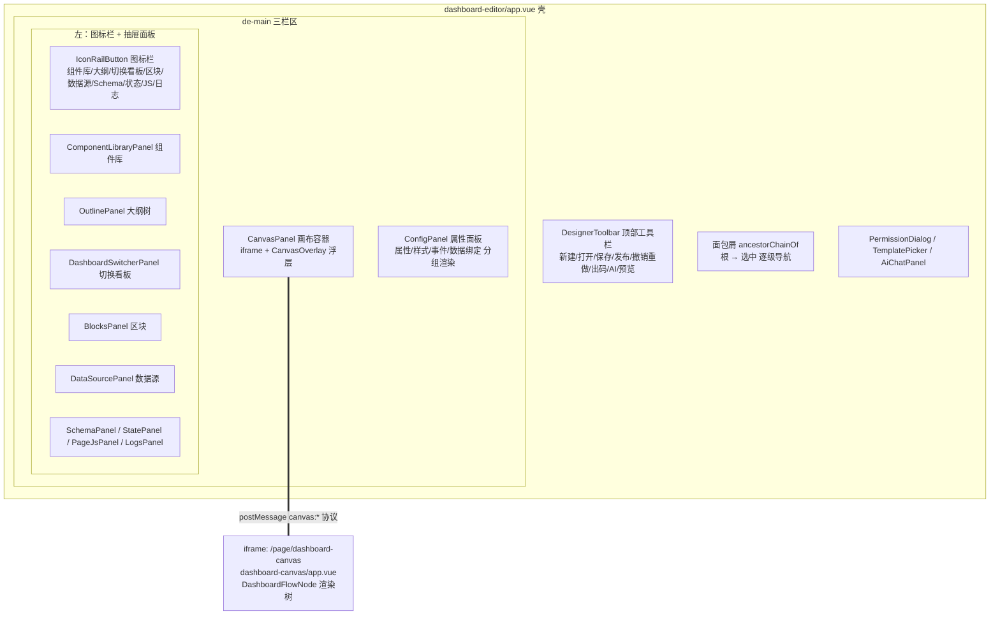
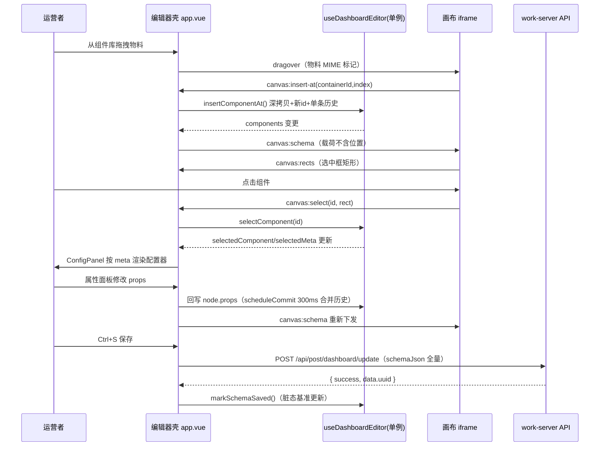

# 02 - 页面设计

> 项目：运营搭建平台（vue3-course） ｜ 版本：v1.0 ｜ 生成日期：2026-10-05 ｜ 依据：源码分析

## 1. 页面与路由总表

前端只有一个包 `@my/work-front`，构建时分成 admin（管理端）与 visitor（访客端）两个产物桶。管理端 SPA 以 `/page` 为 base（`packages/work-front/src/router.ts` 的 `createWebHistory('/page')`），全局 `beforeEach` 守卫强制刷新当前用户后放行/重定向登录页。

| 路由（管理端，base /page） | 视图文件（`packages/work-front/src/pages/`） | 用途 |
| --- | --- | --- |
| `/home` | `packages/work-front/src/pages/home/app.vue` | 平台首页（未登录可达） |
| `/sign-in` / `/sign-up` | `packages/work-front/src/pages/sign-in/app.vue`、`packages/work-front/src/pages/sign-up/app.vue` | 登录 / 注册 |
| `/dashboard-editor` | `packages/work-front/src/pages/dashboard-editor/app.vue` | 看板编辑器（核心，957 行模板壳） |
| `/dashboard-canvas` | `packages/work-front/src/pages/dashboard-canvas/app.vue` | 画布路由，被编辑器以 iframe 内嵌（976 行） |
| `/manage` → `/manage/page-list` | `packages/work-front/src/pages/manage/app.vue`（布局壳） | 管理台，默认重定向到页面列表 |
| `/manage/page-list` | `packages/work-front/src/pages/manage/views/page-list.vue` | 页面资产列表（新建/复制/删除/可见范围） |
| `/manage/page`、`/manage/page-publish`、`/manage/page-flow` | `packages/work-front/src/pages/manage/views/page.vue`、`page-publish.vue`、`page-flow.vue` | 页面编辑（AMD 物料）、发布运维、发布流程视图 |
| `/manage/dashboard-list` | `packages/work-front/src/pages/manage/views/dashboard-list.vue` | 看板资产列表（新建/重命名/复制/删除/回收站/可见范围） |
| `/manage/dashboard-publish` | `packages/work-front/src/pages/manage/views/dashboard-publish.vue` | 看板发布运维页（test/pre/push 推进、下线、访问方式、令牌、统计） |
| `/manage/datasource-list` | `packages/work-front/src/pages/manage/views/datasource-list.vue` | 数据源管理台（新建/编辑/删除/测试连接/文件上传） |
| `/manage/db-connection-list` | `packages/work-front/src/pages/manage/views/db-connection-list.vue` | 数据库连接管理台（新建的入口，SQL 数据源依赖它） |
| `/manage/template-manage` | `packages/work-front/src/pages/manage/views/template-manage.vue` | 模板中心（页面线与看板线两套 tab） |
| `/manage/material-list/-create/-edit/-preview` | `packages/work-front/src/pages/manage/views/material-*.vue` | 物料管理与预览 |
| `/manage/log-list` | `packages/work-front/src/pages/manage/views/log-list.vue` | 日志查询 |

访客端（portal-server 模板渲染，不走 vue-router）：

| URL | 入口文件 | 用途 |
| --- | --- | --- |
| `/d/:uuid` | `packages/work-front/src/visitor/pages/dashboard/app.vue` | 已发布看板渲染（boot 数据内联注入） |
| `/p/:uuid` | `visitor/pages/home/`（页面产物按 uuid 加载） | 已发布页面 |
| `/page/home`、`/demo/lazyload-image` 等 | `visitor/pages/home/`、`visitor/demos/` | 门户首页与演示页 |

预览三路由在 work-server 服务端渲染模板：`/preview/:uuid/:version/:type`（已发布，匿名可读）、`/preview-test/...` 与 `/preview-pre/...`（渲染未发布草稿，要求登录且有可见权，`packages/work-server/src/controller/page.ts` 走 `checkPageAccess`）。

## 2. 可视化编辑器布局与交互详解

看板编辑器（`/page/dashboard-editor`）的布局是「三栏 + 顶部工具栏 + 底部面包屑」，壳在 `packages/work-front/src/pages/dashboard-editor/app.vue`：

三个区域通过 `useDashboardEditor()` 这个**模块级单例 composable**（`packages/work-front/src/pages/dashboard-editor/composables/useDashboardEditor.ts`，1263 行）联动，它持有全部编辑态：

- `components: ref<ComponentInstance[]>` —— 组件树唯一事实源；
- `layout: ref<LayoutItem[]>` —— 顶层组件的栅格条目派生态（绝对定位模式不消费）；
- `selectedIds: ref<string[]>` —— 多选集合（`selectedId` 是首个选中的可写 computed，兼容旧单选调用方）；
- `pageState` / `pageMethods` —— 页面状态变量与页面方法源码；
- `layoutMode`（flow/absolute）、`canvasBackground`、`canvasGuides` —— 画布级配置；
- 撤销/重做双栈（上限 30 条，连续变更经 `deep watch + 300ms debounce` 合并为一次提交，`scheduleCommit`；离散操作如增删立即 `commitNow`）。watch 挂在独立 `effectScope(true)` 上，避免路由离开时宿主组件作用域停掉单例的监听。

### 2.1 画布：iframe 隔离 + postMessage 协议

画布不是普通子组件，而是一个同源 iframe（路由 `/page/dashboard-canvas`）。这样做的动机（`protocol.ts` 头注释 + `tiny-engine-borrow-plan.md` 任务 3）：画布与编辑器的样式/全局变量完全隔离，画布可以独立缩放；编辑器侧 `CanvasOverlay.vue`（1091 行）负责在 iframe 之上绘制选中框、hover 框、多选框、拖拽指示线与右键菜单——浮层矩形由画布内部 `getBoundingClientRect` 测量后经 `canvas:rects` 消息上报，与 iframe 共处同一缩放坐标系。

消息协议（`packages/work-front/src/pages/dashboard-canvas/protocol.ts`）是双向的联合类型 `CanvasMessage`，全部以 `canvas:` 前缀命名：

| 方向 | 消息 | 用途 |
| --- | --- | --- |
| 编辑器→画布 | `canvas:schema` | 下发组件载荷（含解析好的 data）、选中态、layoutMode、背景、state 快照 |
| 编辑器→画布 | `canvas:shortcut` | 键盘快捷键转发（undo/redo/delete/copy/cut/paste/save/方向导航） |
| 编辑器→画布 | `canvas:edit-text` / `canvas:hover-request` | 就地文本编辑入口 / 大纲 hover 联动 |
| 画布→编辑器 | `canvas:ready` / `canvas:select` / `canvas:hover` | 就绪握手、点选（含 multi 与 rect）、悬浮 |
| 画布→编辑器 | `canvas:insert-at` / `canvas:move-to` / `canvas:abs-move` | 物料落点（容器+下标）、重排、绝对布局坐标（**画布是位置唯一上传方**，避免双向回环） |
| 画布→编辑器 | `canvas:rects` / `canvas:multiSelect` / `canvas:menu` / `canvas:dropState` / `canvas:scroll` / `canvas:drag` / `canvas:remove` / `canvas:duplicate` | 浮层定位、框选、右键菜单、拖放指示、画布内删除/复制 |

协议里有个关键防回环设计：编辑器下发 `canvas:schema` 的载荷**不含位置字段**，位置只由画布上行（`canvas:abs-move`），编辑器收到后才写回 `components`。

### 2.2 物料面板与属性面板的联动

左侧组件库面板读取 `@my/charts` 导出的 `allComponentMetas`（`nativeMetas` + `elementPlusMetas`，按 category 分组渲染；图表物料已按产品决策从面板移除，但运行时仍兼容存量 chart 类型）。拖拽时写入 `dataTransfer` 的 MIME 标记 `CANVAS_DRAG_MIME = 'text/dashboard-component'`，画布根据落点计算 `(containerId, index)` 后回发 `canvas:insert-at`，编辑器调用 `insertComponentAt` 完成插入（整树新 id、历史单条提交）。

右侧属性面板（`ConfigPanel.vue`，785 行）按选中组件的 `ComponentMeta` 渲染四个区：**属性**（按 `getPropGroups(meta)` 分组，每组按 `PropSchemaItem.widget.component` 查 `packages/work-front/src/ui/prop-configurator/registry.ts` 注册表实例化配置器；缺省按 type 内置兜底映射）、**样式**（仅 `COMPONENT_STYLE_KEYS` 白名单 18 键：尺寸/背景/文本/边框/间距/效果，写入 `setComponentStyle`）、**事件**（按 `meta.events` 声明可绑定项，值是页面方法名）、**数据绑定**（`DataSourcePanel` 选定的数据源 + `fieldMap` 字段映射）。属性回写直接改 `components` 树上对应节点的 `props`，画布经 `canvas:schema` 重新下发——**面板改数据，画布只渲染**，这条单向数据流是编辑器稳定性的根基。

### 2.3 页面线编辑器（对照）

页面线编辑器 `packages/work-front/src/pages/manage/modules/page-editor.tsx` 是另一套形态：以 `@my/business` 的 `Drag` 引擎实现拖拽，物料经 requirejs 从 mock CDN 以 AMD 加载（`initAMDEnv` 把 `vue` 注入 AMD 定义、paths 指向 `/public/cdn/material/<name>/<version>/index.amd`），行/填充/数据三类表单（`page-editor-row-form.vue` 等）编辑布局 JSON（`page_info.layout`：rows/columns 结构）。管理端全部表单已 schema 化为 `packages/work-front/src/ui/dynamic-form.vue`（fieldType + `registerFieldComponent` 注册表），与看板线的配置器注册表同一模式。

## 3. 状态管理设计

本项目**没有引入 Pinia/Vuex**，状态策略分三层：

1. **服务端状态**：各页面组件用 fetch 直连 `/api/*`，登录态由 HttpOnly cookie 承载（前端 JS 不可读），当前用户经 `packages/work-front/src/composables/use-current-user.ts` 的 `fetchCurrentUser({ force })` 缓存共享（路由守卫刷一次，各页共用）。
2. **编辑器域状态**：即上文 `useDashboardEditor` 单例——相当于一个手工的 store：响应式引用 + computed 派生（`selectedComponent`/`selectedMeta`/`canUndo`）+ 显式动作函数（增删改/历史/剪贴板）。脏态跟踪用"与最后一次保存的 JSON 指纹比对"（`isDashboardDirty`），防止新建/切模板/关页静默丢弃未保存内容。
3. **看板运行时状态**：访客端的页面状态变量由 `packages/shared/src/runtime.ts` 的 `CanvasRuntime` 承载——`state` 是 `reactive` 对象，`methods` 是 `compilePageMethods` 用 `AsyncFunction('state','methods', body)` 编译的函数集；组件显隐 `visibleWhen.stateKey` 经 `evaluateVisibleWhen` 求值。编辑画布与访客端共用 `DashboardFlowNode` 渲染节点，用三个 Symbol 注入键（`CANVAS_RUNTIME_KEY`/`CANVAS_STATE_KEY`/`CANVAS_DESIGN_MODE_KEY`）区分"编辑态半透明示意"与"运行态真实隐藏"。

## 4. 关键 UI 交互流程

快捷键体系在编辑器壳与画布两侧都有入口，统一折算成 `canvas:shortcut` 或 composable 动作：Delete 删除选中（含后代清理 `purgeSelection`）、Ctrl+C/X/V 剪贴板（粘贴时选中容器则追加进容器，否则放顶层）、Ctrl+Z/Y 撤销重做（undo 前先 `commitNow` flush 未决提交）、方向键导航（left=选父级、right=首子、up/down=兄弟切换，对齐 TinyEngine keyboard.ts）。

布局模式切换（`setLayoutMode`）也有明确交互约定：切到 absolute 时对未锁定组件做一次级联摆放（x=20，y 按 90px 间距），避免遗留坐标把组件全堆在原点；文档流模式则把旧栅格 h 换算成 `min-height`（`applyFlowMigration`，每行约 40px）。

## 5. 视觉与主题

管理台样式基于 Less：`packages/work-front/src/assets/designer-vars.less` 定义设计变量、`packages/work-front/src/assets/manage-theme.less` 覆盖 Element Plus 变量；编辑器对话框样式收敛在 `packages/work-front/src/pages/dashboard-editor/modules/dialog.less`。图表主题（`packages/charts/src/theme/index.ts`）导出 `defaultChartTheme` 与 `darkChartTheme` 两套，编辑器深浅切换经 `canvas:theme` 消息同步进画布。看板画布自身支持背景色设置（`canvasBackground`，随 `schemaJson.canvas.background` 持久化）与三种参考线（无/线状/填充 960px 内容区，对齐官方 media 参考线）。
