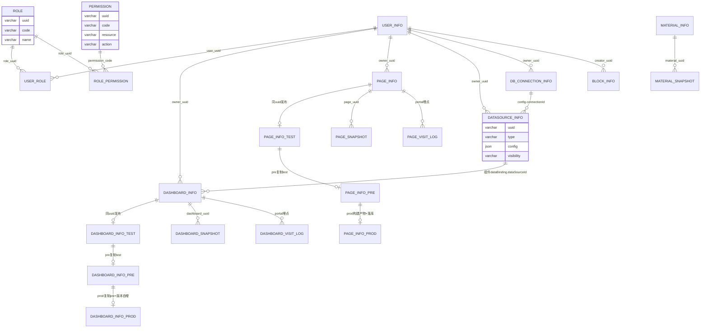

# 04 - 数据模型

> 项目：运营搭建平台（vue3-course） ｜ 版本：v1.0 ｜ 生成日期：2026-10-05 ｜ 依据：源码分析

## 1. 存储方案

平台采用**单 MySQL 主库**的存储方案，无 ORM——所有 SQL 是手写的：模型层（`packages/work-server/src/model/*.ts`）用 `@my/server-kit` 的 `runSQL`/`runTransaction` 执行参数化语句，DDL 集中在 `packages/init-database/src/sql/*.sql`（40 个文件），由 `npm run db:init`（入口 `packages/init-database/src/index.ts`）幂等执行：`CREATE TABLE IF NOT EXISTS` + 老库列自愈（`information_schema` 检查缺列才 ALTER，注释明确"幂等可重跑"）。JSON 列（`schema_json`/`layout`/`config` 等）统一用 MySQL `json` 类型，读写经 `server-kit` 的 `parseJsonText`/`normalizeJsonText` 规整。软删除约定全库一致：`status` 列 0=删除 1=正常，回收站与测试夹具清理（`pruneTestData` 硬删）都建立在这个约定上。

PostgreSQL **不是**平台主库，仅作为数据源类型之一（`packages/work-server/src/util/data-query/postgresql.ts` 用 `pg` 驱动直连查询）。另有两类辅助存储：mock CDN（`packages/mocks/mock-cdn`，文件型存储，承载物料包与页面构建产物，服务端经 `createSyncCDNMirror` 回源落盘）与进程内存（portal 的 PV 去重窗口、memory 模式限流桶——`docs/plans/deploy-ops-2026-09.md` 第七节明确这是单实例约束）。

## 2. 实体与表结构

### 2.1 资产主表：看板 / 页面 / 物料

**dashboard_info（看板草稿主表）** — `packages/init-database/src/sql/dashboard_info.sql`

| 字段 | 类型 | 约束 | 说明 |
| --- | --- | --- | --- |
| id | int(11) | PK, AUTO_INCREMENT | 自增主键 |
| uuid | varchar(128) | NOT NULL, UNIQUE | 看板对外标识（URL/接口均用 uuid） |
| name | varchar(128) | NOT NULL | 看板名称（写入前经 `normalizeResourceName` trim+去控制字符） |
| description | varchar(512) | NULL | 描述 |
| schema_json | json | NOT NULL | 看板 Schema（见第 4 节） |
| owner_uuid | varchar(128) | NOT NULL | 所有者；无主行可读，首次写入认领（`visibility.ts` 注释） |
| visibility | varchar(32) | NOT NULL DEFAULT 'private' | 可见范围 private/department/public（租户内语义） |
| tenant_id / department_id | varchar(128) | NULL | 租户与部门（NULL 按默认租户 `t-default` 参与匹配） |
| is_template | tinyint(1) | NOT NULL DEFAULT 0 | 是否模板；模板行是全局目录人人可读 |
| template_category | varchar(32) | NOT NULL DEFAULT '' | 模板分类 |
| access_mode | varchar(16) | NOT NULL DEFAULT 'public' | 访问方式 public/token（**实时列**，portal 改判即时生效） |
| access_token | varchar(64) | NULL | 访问令牌（不进发布产物） |
| thumbnail | mediumtext | NULL | 服务端生成的 SVG 线框缩略图（`packages/work-server/src/util/thumbnail.ts`） |
| status | int(2) | NOT NULL DEFAULT 1 | 软删标记 |
| create_time / modify_time | datetime | DEFAULT CURRENT_TIMESTAMP | 后者 ON UPDATE 自动更新 |

索引：`idx_owner_uuid`、`idx_visibility`、`idx_tenant_id`、`idx_department_id`。

**page_info（页面主表）** — `page_info.sql`：结构与看板表同构（uuid/name/is_template/template_category/access_mode/access_token/thumbnail/owner_uuid/visibility/tenant_id/department_id/status/时间），差异是内容列：`current_version` varchar(64) NOT NULL（当前版本）、`layout` json（行/列布局数据）、`info` json（`{esm, amd, bundle, stage}` 产物形态标记）、`extend` json（扩展数据）。**页面编辑内容存在 `page_info_test`**（README 归属节注明"内容在 page_info_test，判定挂在同 uuid 的 page_info 主表行上"）。

**material_info（物料表）** — `material_info.sql`：uuid、name（UNIQUE，字母数字）、current_version、info json、extend json、status、时间。物料版本快照在 `material_snapshot`（version/user_uuid/material_uuid/extend）。

### 2.2 三阶段发布表（×2 条线）

看板线 `dashboard_info_test` / `dashboard_info_pre` / `dashboard_info_prod` 三张表同构（`dashboard_info_test.sql`）：uuid（UNIQUE）、name、description、**current_version（prod 事务内行锁自增，test/pre 继承）**、schema_json（发布快照，含 `publishedDataSources` 脱敏白名单、prod 另注入 `accessMode`）、publish_user_uuid、status、时间。页面线 `page_info_test` / `page_info_pre` 与页面主表同构。发布即"复制进下一张表 + 状态置 1"，下线即置 `status=0`（`unpublishStage`），门户读 prod 表按 `status=1` 过滤。

### 2.3 协作与历史

| 表 | 关键字段 | 说明 |
| --- | --- | --- |
| dashboard_snapshot | dashboard_uuid, name, source('save'保存自动/'manual'手动/'publish'发布), schema_json, user_uuid | 看板历史快照；`idx_dashboard_snapshot_uuid`；回滚即把快照内容写回草稿 |
| page_snapshot | page_uuid, version, user_uuid, page_data json | 页面快照同构 |
| block_info | uuid, name, components_json longtext, creator_uuid | 看板编辑器"区块"（可复用组件组合） |

### 2.4 数据源与连接

**datasource_info** — `datasource_info.sql`：uuid、name、**type varchar(32)**（mysql/postgresql/api/csv/static）、**config json NOT NULL**（结构见 4.3 节；敏感项 AES-256-GCM 密文，`enc:v1:` 前缀幂等识别）、owner_uuid、visibility、tenant_id、department_id、status、时间。

**db_connection_info** — `db_connection_info.sql`：uuid、name、type（mysql/postgresql）、host、port、user、**password varchar(1024)**（AES-256-GCM 密文；SQL 注释说明列宽从 256 放宽的原因："256 字符明文加密后约 387 字符"——这正是"db:init 必须先于新版代码上线"的那条硬约束的落点）、database、options json、owner_uuid、visibility、tenant_id、department_id、status。

### 2.5 账号、权限与统计

| 表 | 关键字段 | 说明 |
| --- | --- | --- |
| user_info | uuid UNIQUE, username UNIQUE, password varchar(255), info json, extend json | password 存 bcrypt 哈希（60 字符）；存量旧全局盐 HMAC 为 64 hex，登录成功时透明重哈希（SQL 注释） |
| role / permission | uuid, code UNIQUE, name (+resource/action) | 角色与权限码定义；permission.code 形如 `dashboard:publish` |
| role_permission | role_uuid + permission_code（UNIQUE 联合键） | 角色-权限多对多 |
| user_role | user_uuid + role_uuid（UNIQUE 联合键） | 用户-角色多对多 |
| dashboard_visit_log / page_visit_log | dashboard_uuid/page_uuid, action, version, ip, user_agent, create_time | 服务端 PV 埋点；联合索引 `(uuid, create_time)` 支撑按天统计 |
| log_info | type（common/portal-front/portal-server/work-front/work-server）, info json | 前端日志上报归集 |
| rate_limit_bucket | name + bucket_key（联合主键）, count, reset_at bigint | 集中式限流计数（`RATE_LIMIT_STORE=mysql` 时启用；DDL 注释说明两进程共享、额度重启不清零） |

## 3. ER 图



关系要点：RBAC 四表构成经典星型；四类资产（看板/页面/数据源/连接）都以 `owner_uuid + visibility + tenant_id + department_id` 四元组挂在用户维度上，共用 `visibility.ts` 一套判定；三阶段表以"同 uuid 副本"而非外键关联——是值拷贝不是引用，这是发布不可变语义的物理体现；数据源对连接的引用存的是 `config.connectionId`（README 特别强调"存的是 connectionId，不是 host/port"），因此连接管理台是 SQL 数据源的先决入口。

## 4. 页面 Schema 的 JSON 结构设计

### 4.1 看板 schemaJson（低代码平台的核心载荷）

存于 `dashboard_info.schema_json`，类型定义在 `packages/shared/src/schema/index.ts`，落库形状由编辑器 `buildSchemaJson()`（`useDashboardEditor.ts` 1088 行）生成：

```jsonc
{
  "components": [ /* ComponentInstance[]，顶层组件进入栅格 */ ],
  "state":    { "loading": false, "keyword": "" },      // 页面状态变量（官方 plugins/state 简化版）
  "methods":  { "refresh": "await api.reload()" },       // 页面方法源码（官方 plugins/script 简化版）
  "layoutMode": "flow",                                   // flow 文档流 | absolute 绝对定位
  "canvas":   { "background": "#0b1220", "guides": "none" },
  // —— 以下仅出现在发布产物 ——
  "publishedDataSources": [ { "id": "…", "name": "…", "type": "mysql" } ],
  "accessMode": "public"                                  // 仅 prod 注入
}
```

**ComponentInstance**（单个组件节点）：

```jsonc
{
  "id": "uuid-v4",            // 副本/区块插入时整树重新生成（reassignInstanceIds 注释：防选中错乱）
  "type": "ElButton",          // 物料类型，对应 ComponentMeta.type
  "label": "按钮",
  "x": 0, "y": 0, "w": 6, "h": 3,   // absolute 模式的像素坐标 / 旧栅格单位（flow 模式忽略）
  "props": { "text": "查询" },  // 物料属性，纯 JSON 不做表达式求值
  "style": { "fontSize": "14px" },  // 白名单键（COMPONENT_STYLE_KEYS 18 键），渲染端 sanitizeComponentStyle 再过滤
  "visibleWhen": { "stateKey": "loading", "not": true }, // 显隐条件：状态变量为真显示，not 取反
  "children": [ /* 容器子组件，flow 纵排，不进顶层栅格 */ ],
  "dataBinding": { "dataSourceId": "ds-…", "transform": "…", "fieldMap": { "xField": "date", "yField": "pv" } },
  "events": { "click": "onSearch" },   // 事件名 → 页面方法名
  "locked": false, "zIndex": 1, "filterIds": []
}
```

设计上最值得注意的是**纵深防御的序列化边界**：`style` 只允许 18 个白名单键且必须是非空字符串（`sanitizeComponentStyle` 在画布/portal/出码三端渲染前统一调用，注释明确目的是"防止导入/AI 链路注入任意 CSS"；出码端 `dashboard-codegen` 用的是本地同名副本而非 shared 的导出，两份需同步——见 07 篇第 2 节与 13 篇第 3 节）；`visibleWhen` 保持纯 JSON 不做表达式求值（属性注释）；`methods` 的函数体虽是作者 JS（AsyncFunction 编译，方法体内可 await），但被"公开闸门"拦在匿名访问面之外。三端（编辑画布、访客渲染器、出码器）消费同一份 schema，`dashboard-codegen` 出码时把图表层 vendor 自 `@my/charts` 源码保证视觉一致，数据源只带快照（`resolveCodegenSnapshot` 限 500 行）。

### 4.2 数据源 config 结构（按 type 判别联合）

```jsonc
// mysql：连接以 connectionId 引用，SQL 由作者编写
{ "connectionId": "conn-…", "sql": "SELECT date, pv FROM t WHERE d BETWEEN {{start}} AND {{end}}", "defaultParams": {}, "mockData": [] }
// api：authority 段禁止 {{参数}}（net-guard 的 assertStaticAuthority 在替换前校验）
{ "method": "GET", "url": "https://api.example.com/v1/{{city}}/weather", "headers": {}, "params": {}, "dataPath": "data.list", "mockData": [] }
// csv：文件经 /api/post/datasource/upload 上传
{ "fileId": "…", "hasHeader": true, "encoding": "utf-8" }
// static：内联数据
{ "data": [ { "label": "周一", "value": 120 } ] }
```

`{{参数}}` 占位符由查询器（`packages/work-server/src/util/data-query/*.ts`）在执行时替换；`mockData` 配置后前端适配器优先使用（`MockableSourceConfig` 注释：用于编辑态联调、离线演示与预览）。敏感项（mysql/api 的口令、authToken、authorization 头）落库前经 `packages/work-server/src/util/secret-box.ts` 加密为 `enc:v1:base64(12B IV ‖ 16B authTag ‖ 密文)`，读接口再以 `maskConfigSecrets` 脱敏。

### 4.3 页面线 layout 结构（对照）

页面线没有组件树 schema，而是行列表格布局：`page_info.layout` 描述 rows → columns 的宽度占比与物料槽位（槽位含 materialName/materialVersion/materialData），`packages/work-server/src/util/thumbnail.ts` 的页面缩略图即"按 rows/columns 宽度比例分段"渲染。发布时 `packages/work-server/src/util/transform.ts` 把 layout 经 ESTree 变换为完整页面代码（`transformToFullPageESTree` → `transformESTreeToJS`）写入 `cdn/page*/<uuid>/<version>/`。

## 5. 迁移与自愈

`packages/init-database/src/index.ts` 的增量策略值得单独记录：所有新列以 `ensureColumns(table, migrations)` 统一模式处理——查 `information_schema` 确认缺列才 ALTER，返回本次真正补上的列供后续动作（如补索引）使用；凭据加密迁移独立为 `npm run db:encrypt-secrets` / `db:decrypt-secrets`（`scripts/migrate-secrets.ts`），密钥轮换必须"先解明文、换钥、再重加密"，不能直接替换环境变量（`.env.example` 注释）。种子数据（admin001/admin002、角色权限矩阵、示例看板、页面模板）全部随 db:init 幂等写入。
