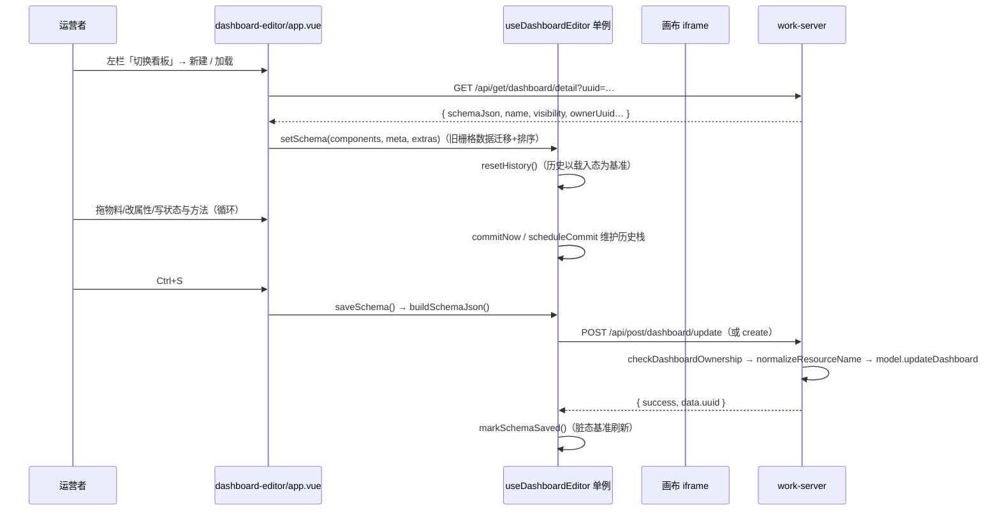
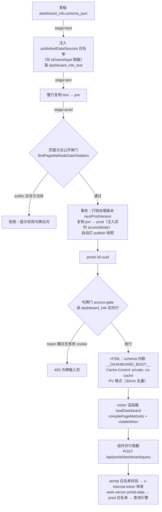
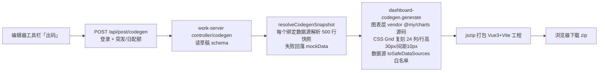

# 05 - 核心流程

> 项目：运营搭建平台（vue3-course） ｜ 版本：v1.0 ｜ 生成日期：2026-10-05 ｜ 依据：源码分析

本篇拆解五个端到端流程：看板搭建与保存、三阶段发布与访客访问、数据源接入与取数、令牌访问控制、看板出码。每个流程给出时序/流程图、分步说明与涉及文件清单——文件路径均相对 `vue3-course/`。

## 1. 流程一：看板搭建 → 保存

分步说明：

1. **上下文载入**：编辑器壳挂载后经 `loadSchema(uuid)` 拉取草稿（`packages/work-front/src/pages/dashboard-editor/composables/useDashboardEditor.ts` 1039-1085 行）。`setSchema` 对旧栅格数据做兼容迁移：按 `(y,x)` 稳定排序为文档顺序，并按 `applyFlowMigration` 给需要显式高度的组件（图表/表格/视频/图片）换算 `min-height`。
2. **编辑操作全部收敛到单例 composable**：物料插入（`insertComponentAt`/`insertSibling`/`wrapWithContainer`）、复制粘贴（`createCopy` 递归重发 id）、多选与框选（`selectComponentMulti` 按树的深度优先序稳定排序）、页面状态与方法（`setPageState`/`setPageMethods`）。每个离散操作一条历史；连续变更（拖动、属性编辑）由挂在独立 `effectScope` 上的 deep-watch 以 300ms debounce 合并提交。
3. **保存**：`buildSchemaJson()` 把 components/state/methods/layoutMode/canvas 打包全量上送。服务端 `packages/work-server/src/service/dashboard.ts` 的 `createDashboard`/`updateDashboard` 做名称规整与长度校验（`packages/work-server/src/util/sanitize.ts` 的 `normalizeResourceName`），归属校验确保仅所有者可写；改名走独立的 `/api/post/dashboard/rename`——路由注释写明这是为了并发下"旧 schema 覆盖新 schema"的问题不被整体回写放大。
4. **保存自动快照**：快照服务创建 `source='save'` 的 `dashboard_snapshot` 行（对照 `packages/work-server/src/service/dashboard-snapshot.ts`），与手动备份（'manual'）、发布快照（'publish'）共用一张表、以 source 区分。

涉及文件：`packages/work-front/src/pages/dashboard-editor/app.vue`、`packages/work-front/src/pages/dashboard-editor/composables/useDashboardEditor.ts`、`packages/work-front/src/pages/dashboard-canvas/protocol.ts`、`packages/work-server/src/controller/dashboard.ts`、`packages/work-server/src/service/dashboard.ts`、`packages/work-server/src/model/dashboard.ts`、`packages/work-server/src/service/dashboard-snapshot.ts`。

## 2. 流程二：三阶段发布 → 外网访问

分步说明：

1. **test**：从草稿主表取当前 schema，`extractDataSourceIds` 从组件 `dataBinding` 收集数据源 id（去重保序），`buildPublishedDataSources` 只取 `{id, name, type}`——**config（含口令）永远不进发布产物**（`packages/work-server/src/service/dashboard-stage.ts` 42-52 行）。白名单写入快照后落 `dashboard_info_test`。
2. **pre**：test 行不存在则拒绝（"请先发布到测试环境"）；pre 是 test 的整行复制。
3. **prod**：先过公开闸门——校验对象取 **pre 快照**而非草稿，注释解释了原因："prod 复制的是 pre……若作者推过 test/pre 之后才删掉草稿里的方法，只查草稿会放行"（148-151 行）。随后 `runTransaction` 内行锁自增版本、复制落 prod、自动创建 `发布 v{n}` 快照；`accessMode` 注入的是实时值，令牌本身不进产物。
4. **下线**：`POST /api/post/dashboard/stage/unpublish` 把阶段表置 `status=0`，门户立即 404——发布表按 status 读，无需缓存清理。
5. **访问**：portal `renderProdDashboard`（`packages/portal-server/src/controller/dashboard.ts`）读 prod 内容 → 令牌门（`packages/portal-server/src/util/access-gate.ts`，判定读 `dashboard_info` **实时行**，所以"改访问方式或轮换令牌即时生效，不需要重新发布"）→ schema 以 `window.__DASHBOARD_BOOT__` 内联（`<` 统一转义 `\u003c` 防脚本闭合；`accessMode`/`accessToken` 从下发内容里删除，"门在服务端判定"）→ 响应 `private, no-cache` → `shouldRecordVisit` 去重后 fire-and-forget 埋点。
6. **渲染**：访客端 `useDashboardRenderer`（`packages/work-front/src/visitor/pages/dashboard/composables/useDashboardRenderer.ts`）从 boot 数据初始化组件树、编译页面方法、`collectDataBoundNodes` 后**并行**取数——结构就绪即撤全局 loading，各节点独立呈现 loading/error；数据经 `shallowRef` 缓存 + `pendingQueries` 在途去重（同一数据源只发一次）。

页面线发布（对照）：`packages/work-server/src/service/page-stage.ts` 的 `pushPageStage` 语义相同（test 从草稿复制、pre 复制 test、prod 复制 pre），差异在 prod 额外调用 `packages/work-server/src/service/page-static.ts` 的 `pushFullPageStage`：`transformToFullPageESTree` 把 layout 编译为页面代码，写 `cdn/page/<uuid>/<version>/index.esm.js` 与 bundle.js/css，物料依赖从 mock CDN 镜像落盘到本地 `public/cdn/material/...`。

## 3. 流程三：数据源接入与取数

分步说明：

1. **建连接**（SQL 类数据源的前置）：管理台 `/page/manage/db-connection-list` → `POST /api/post/dbconnection/create` → `packages/work-server/src/service/db-connection.ts` 校验后把口令经 `packages/work-server/src/util/secret-box.ts` 加密（`enc:v1:` 前缀）落 `db_connection_info.password`。"测试连接"端点会真实建连一次并回报结果。
2. **建数据源**：`POST /api/post/datasource/create`，config 按 type 为判别联合（见 04 篇 4.2 节）。API 类的 url 在**创建与查询前**都过 `packages/work-server/src/util/net-guard.ts`：`assertStaticAuthority` 在 `{{参数}}` 替换**之前**校验 authority 段无参数化（替换后就分不清 host 来自配置还是访客）；恒拒元数据地址（含 IPv6 包裹写法——`ipv4FromIpv6` 按 `parseInt(x,16)` 还原，注释解释 WHATWG URL 会把 `[::ffff:127.0.0.1]` 规范化成 `[::ffff:7f00:1]` 导致点分十进制正则永远匹配不到）；默认拒内网/回环/链路本地；请求 `redirect: 'manual'`，3xx 拒且不重试。
3. **编辑器取数**：属性面板数据绑定后，画布数据经 `POST /api/post/datasource/query` → `queryDataSourceAsUser` → `checkDataSourceReadAccess`（可见范围判定）→ `executeDataSourceQuery`——这是**唯一取数出口**，解密只发生在这一处（`packages/work-server/src/service/data-query.ts` 27-72 行注释），按 type 分派到 `packages/work-server/src/util/data-query/` 下的 mysql/postgresql/api/csv/static 五个查询器，结果 `normalizeData` 归一化。
4. **发布冻结**：见流程二第 1 步，白名单随 test 发布进快照。
5. **访客取数**：见流程二第 6 步。注意 portal 通道 `queryParams` 固定空对象——访客不能注入查询参数，能影响的只有 url 模板里 path/query 段的占位符值。
6. **出码快照**：`resolveCodegenSnapshot` 与编辑器预览同源取数，失败回落 `mockData`，产物只带数据不带报错与配置（原始报错常含主机/账号）。

涉及文件：`packages/work-server/src/service/` 下的 db-connection.ts、datasource.ts、data-query.ts、dashboard-stage.ts；`packages/work-server/src/util/` 下的 secret-box.ts、config-secrets.ts、net-guard.ts；`packages/work-server/src/util/data-query/` 查询器目录、`packages/work-front/src/pages/manage/components/db-connection-dialog.vue`、`packages/work-front/src/pages/manage/views/datasource-list.vue`、`packages/work-front/src/pages/dashboard-editor/modules/DataSourcePanel.vue`。

## 4. 流程四：令牌访问控制

分步说明：

1. **作者开启**：发布运维页把访问方式切为 `token`（`POST /api/post/dashboard/access-mode`，仅所有者）——服务端生成/轮换 `dashboard_info.access_token`，**实时列**立即生效；切回 public 时校验页面方法闸门（草稿或 prod 产物任一含方法体即拒绝）。
2. **访客首访**：`GET /d/:uuid` → 令牌门无有效 cookie → 403 + `renderTokenGatePage` 令牌输入页（表单 action 指向 `/api/portal/dashboard/access`）。
3. **令牌提交**：表单 POST（经 `sameSiteGuard` 同源校验 + token-verify 限流桶 20 次/10min）→ `handleTokenVerify`（`packages/portal-server/src/util/access-gate.ts`）比对实时令牌 → 通过则下发 **7 天** HttpOnly cookie（`ACCESS_COOKIE_PATH = '/'` 落在**站点根路径**——HTML 门与取数门共用同一枚 cookie 所致，键名按 uuid 区分、不串门但随请求泛发，见 08 篇第 10 节）→ 回跳 `/d/:uuid`。
4. **取数同门**：`/api/portal/dashboard/query` 复用同一道令牌门——`packages/portal-server/src/controller/dashboard.ts` 143-156 行注释强调"否则 token 模式只挡住 HTML，数据接口仍匿名可读"。
5. **页面线**同构：`/api/portal/page/access` + `page_info.access_mode/access_token`。

涉及文件：`packages/portal-server/src/util/access-gate.ts`、`packages/portal-server/src/controller/dashboard.ts`、`packages/portal-server/src/controller/page.ts`、`packages/work-server/src/controller/dashboard-access.ts`、`packages/work-server/src/service/dashboard-access.ts`、`packages/work-server/src/service/access-mode.ts`。

## 5. 流程五：看板出码（schema → 独立工程）

分步说明：出码是"平台锁定"的逃生阀。`packages/dashboard-codegen/index.ts`（461 行）声明了三条生成策略（文件头注释）：图表渲染层整体 vendor 自 `@my/charts` 源码保证与画布视觉一致；数据源只带"出码当下解析出的数据快照"（`datasources.js` 读 snapshot/mockData），连接配置一律不落进导出包（`toSafeDataSources` 再做一次字段白名单，任何带 config 的入参都被剥掉）；布局用 CSS Grid 复刻编辑器网格语义。服务端侧 `packages/work-server/src/service/data-query.ts` 的 `resolveCodegenSnapshot` 负责解析快照：无权读的源不把名字带进导出包、行数上限 500 截断标记、失败只落布尔标记。`packages/work-server/src/controller/codegen.ts` 以 jszip 打包并经配额中间件（突发 + 自然日双档，按 user.uuid 分桶——`.env.example` 注释解释了为什么按用户而不按 IP：NAT 下一栋楼是一个来源）。

涉及文件：`packages/dashboard-codegen/index.ts`、`packages/dashboard-codegen/__tests__/dashboard-codegen.test.ts`、`packages/work-server/src/controller/codegen.ts`、`packages/work-server/src/service/data-query.ts`、`packages/work-front/src/pages/dashboard-editor/app.vue`（onCodegen）。
