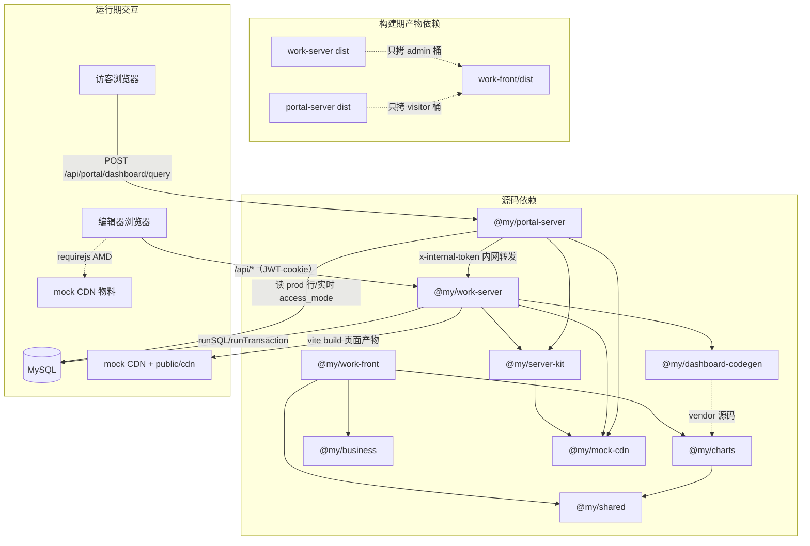

# 07 - 模块详解

> 项目：运营搭建平台（vue3-course） ｜ 版本：v1.1 ｜ 生成日期：2026-10-06 ｜ 依据：源码分析

本篇是对 monorepo 各包的逐一深读，是 01 篇（系统架构）的"下钻版"：旧篇讲分层与决策，本篇讲每个包内部的关键文件、关键函数与机制走读。所有路径相对 `vue3-course/`，行号以当前源码为准。包的整体职责与依赖图见 01 篇第 2 节，本篇不重复，只在每个包末尾补充"与谁交互、怎么交互"。

## 1. @my/shared —— 全仓的"宪法"包

`packages/shared/src/`（4 个文件，608 行）是体量最小的 workspace 包，却是唯一同时被前端（work-front）、渲染端（charts、visitor 桶）、服务端（work-server）三方消费的包，产物为 ESM/CJS 双格式（`scripts/build-module.ts` 构建）。它只有三类内容：

| 文件 | 关键导出 | 说明 |
| --- | --- | --- |
| `packages/shared/src/schema/index.ts`（320 行） | `ComponentInstance`、`ComponentMeta`、`PropSchemaItem`、`DashboardSchema`、`DataSourceConfig` 判别联合、`COMPONENT_STYLE_KEYS`（18 键白名单）、`sanitizeComponentStyle()`、`evaluateVisibleWhen()`、`getPropGroups()` | 看板 Schema 全部类型定义 + 三个纯函数；类型注释多处标注"对齐官方 xxx"（TinyEngine），是判断协议来源的第一线索 |
| `packages/shared/src/schema/diff.ts`（198 行） | `diffDashboardSchemas()`、`SchemaDiff` | 快照 diff 的纯函数实现：按组件 id 对齐，输出新增/删除/修改/移动四类变更，编辑器"快照对比"面板消费 |
| `packages/shared/src/runtime.ts`（88 行） | `compilePageMethods()`、`invokePageMethod()`、`CanvasRuntime`、三个 Symbol 注入键（`CANVAS_RUNTIME_KEY`/`CANVAS_STATE_KEY`/`CANVAS_DESIGN_MODE_KEY`） | 页面方法运行时 |

三个值得单独走读的机制：

1. **`compilePageMethods` 用 `AsyncFunction` 编译作者 JS**。`packages/shared/src/runtime.ts` 37-39 行没有直接写 `Object.getPrototypeOf(async function(){}).constructor`，而是 `new Function('return (async function(){}).constructor')()`——注释解释了原因：打包器会把源码里的 `async function` 字面量按构建 target（es2015）降级转译，届时取 prototype 拿到的是普通 `Function`，方法体里的 `await` 会直接报错。经运行时求值绕开转译是唯一稳妥写法。编译单方法失败不阻断其余方法，错误归集到 `errors` 数组由调用方上报。
2. **`sanitizeComponentStyle` 是样式注入的总闸**。`COMPONENT_STYLE_KEYS` 固定 18 键（尺寸 3 + 背景 1 + 文本 5 + 边框 4 + 间距 2 + 效果 2），画布（DashboardFlowNode）、portal 渲染器、出码器三端在应用样式前统一调用。⚠️ 注意 `packages/dashboard-codegen/index.ts` 77-97 行**复制了一份同名白名单**（注释声明"本包不依赖 shared，改动两处需同步"）——这是一处已知的口径重复，见 13 篇。
3. **三个 Symbol 注入键区分三种渲染语境**。编辑画布不注入 `CANVAS_RUNTIME_KEY`（点击保持"选中"语义）、注入 `CANVAS_DESIGN_MODE_KEY = true`（visibleWhen 不满足仅半透明示意）；portal 与编辑器预览浮层注入活运行时且 design-mode 为 false（真实隐藏）。共用同一份 `DashboardFlowNode` 实现，靠注入切换行为，这是"两端渲染语义不漂移"的关键设计。

## 2. @my/charts —— 渲染运行时与物料元表

`packages/charts/src/`（2185 行）承担双角色：看板组件的**运行时渲染器**（`resolveRenderer`）与**物料元表持有者**（`nativeMetas` + `elementPlusMetas`）。

| 文件 | 关键导出/函数 | 说明 |
| --- | --- | --- |
| `packages/charts/src/index.ts`（43 行） | `allComponentMetas`、`getComponentMeta(type)`、`getEditableTextProp(type)` | 元表注册表；`getEditableTextProp` 约定 propSchema 中 `name='text'` 的 string 项即可就地编辑文本 |
| `packages/charts/src/runtime-renderer.ts`（34 行） | `resolveRenderer(type)`、`isContainerType(type)` | 单一事实来源：图表类型走专用组件，其余（el-*、Native*）一律 `ElementPlusRenderer`；注释明确目的是杜绝"编辑器能渲染、访客端未知组件"的两端漂移 |
| `packages/charts/src/components/DashboardFlowNode.vue`（170 行） | 递归渲染节点 | 顶层与容器 children 共用；`data-id` 供浮层定位；显隐经 `evaluateVisibleWhen` + 设计模式半透明 |
| `packages/charts/src/components/ElementPlusRenderer.vue`（343 行） | `resolveComponent` 动态解析 el-* | 不直接 import element-plus（避免包边界副作用），依赖宿主 `app.use(ElementPlus)`；按"逗号分隔文本"把演示文本转成 Menu/Tabs/Table 等结构的子节点；经 `buildEventProps` 把 `events` 绑定翻译成 `onXxx` prop 并调 `invokePageMethod` |
| `packages/charts/src/meta/elementPlusMetas.ts`（915 行） | 53 个 `El*` 元表 | 头注释记录 2026-09 审查后的两条硬约束：type 必须对应真实存在的 el-* 组件；propSchema 每项 name 必须与 defaultProps 键一致（否则属性写入 `model['']` 空键，已修） |
| `packages/charts/src/meta/nativeMetas.ts`（109 行） | `NativeHeading`/`NativeParagraph`/`NativeVideo`/`NativeImage` 4 个原生物料 | 对齐 TinyEngine 官方基础元素，由 ElementPlusRenderer 识别后走原生标签渲染 |
| `packages/charts/src/components/`其余 | LineChart/BarChart/PieChart/AreaChart（各约 70 行）、MetricCard、DataTable、ChartEmpty | 图表运行时（ECharts 封装 + vxe-table 表格），出码器 vendor 的正是这些源文件 |
| `packages/charts/src/composables/useChartData.ts`（104 行） | `useChartData({ component, data })` | fieldMap（xField/yField/seriesField）→ ECharts 数据结构的统一换算，去重保序取 x 值、按 seriesField 分组 |
| `packages/charts/src/theme/index.ts`（26 行） | `defaultChartTheme`、`darkChartTheme` | 两套 ECharts 主题，编辑器深浅切换经 `canvas:theme` 消息同步 |

一个重要的产品口径（`packages/charts/src/index.ts` 23-26 行注释）：**图表物料已按产品决策从组件面板移除**（2026-09 起看板线不再提供图表新增），但运行时仍兼容存量看板数据里的 chart 类型组件，因此 charts 组件与 `/Chart$/` 兜底不能删。这解释了为什么 `allComponentMetas` 仍导出图表元表、而组件库面板里看不到它们（面板按 category 过滤，见 11 篇 SOP）。

## 3. @my/business —— 页面线的拖拽引擎与业务组件

`packages/business/src/` 三个子目录：`drag/`（Drag 拖拽引擎，页面线编辑器 `page-editor.tsx` 消费）、`home/`（门户首页业务组件）、`theme/`（主题样式）。产物含 ESM/CJS/CSS（`@my/business/css/index.css`）。`packages/business/src/drag/drag.vue` 61 行有一处 TODO：用 `structuredClone` 或深拷贝库替代 `JSON.parse(JSON.stringify())`（见 13 篇）。该包只在页面线使用，看板线完全不依赖。

## 4. @my/work-front —— 唯一前端包（两产物桶）

24227 行的最大包。目录职责与关键文件如下：

| 目录/文件 | 关键内容 | 说明 |
| --- | --- | --- |
| `packages/work-front/src/pages/dashboard-editor/composables/useDashboardEditor.ts`（1263 行） | `useDashboardEditor()` 模块级单例 | 编辑态唯一事实源：`components` 响应式数组、`selectedIds` 多选、`pageState`/`pageMethods`、`layoutMode`、撤销重做双栈（`HISTORY_LIMIT=30`、`HISTORY_COMMIT_DELAY=300ms`）、剪贴板、方向键导航、`buildSchemaJson()`（1088 行起） |
| `packages/work-front/src/pages/dashboard-editor/services/` | `dashboard-service.ts`（1095 行）、`canvas-service.ts`（446 行）、`dashboard-repository.ts`（409 行）、`datasource-repository.ts`（235 行）、`ai-service.ts`（269 行）、`registry.ts` | 借鉴 TinyEngine 的服务层拆分：dashboard-service 收拢状态与业务动作（含 `DEVICE_PRESETS` 五档画布宽度）；canvas-service 负责画布 iframe 挂载与协议接线（协议消息转总线广播，主题名=消息类型）；两个 repository 是纯 API 封装；registry 是服务间消息总线 |
| `packages/work-front/src/pages/dashboard-editor/modules/` | `DesignerToolbar.vue`（1529 行）、`CanvasOverlay.vue`（1091 行）、`ConfigPanel.vue`（785 行）、`ComponentLibraryPanel.vue`、`OutlinePanel.vue`、`BlocksPanel.vue`、`DataSourcePanel.vue`、`StatePanel.vue`、`PageJsPanel.vue`、`SchemaPanel.vue`、`LogsPanel.vue`、`DashboardSwitcherPanel.vue`、`designer-ui/AiChatPanel.vue`、`designer-ui/CodeEditor.vue`（CodeMirror 6）、`designer-ui/ChartIcon.vue` | 三栏面板全集；CanvasOverlay 是 iframe 之上的选中框/hover 框/多选框/拖拽指示线/右键菜单浮层，矩形来自画布上报的 `canvas:rects` |
| `packages/work-front/src/pages/dashboard-canvas/` | `app.vue`（976 行）、`protocol.ts`（145 行） | 画布路由页（被 iframe 内嵌）；protocol 定义 `canvas:*` 双向消息联合类型 + `CANVAS_DRAG_MIME` + `listenCanvasMessages`（跨源与非协议消息过滤） |
| `packages/work-front/src/pages/manage/` | `views/`（page-list、dashboard-list、dashboard-publish、page-publish、page-flow、datasource-list、db-connection-list、template-manage、material-*、log-list）、`modules/page-editor.tsx`（325 行，AMD 物料编辑器）、`components/datasource-config-dialog.vue`（516 行）、`components/db-connection-dialog.vue` | 管理台全部页面；页面线编辑器在此 |
| `packages/work-front/src/visitor/pages/dashboard/` | `app.vue`（403 行，含 getEmbedCode 嵌入代码生成）、`composables/useDashboardRenderer.ts`（267 行） | 访客看板渲染器（见 10 篇性能走读） |
| `packages/work-front/src/ui/prop-configurator/` | `registry.ts`、`builtin.ts`（144 行，5 个内置配置器） | 属性配置器注册表：`registerPropConfigurator(name, component)` 开放扩展；未声明 widget 时按属性 type 内置兜底 |
| `packages/work-front/src/ui/dynamic-form.vue`（199 行） | `registerFieldComponent` | 管理端表单 schema 化（fieldType 注册表），与配置器注册表同一模式 |
| `packages/work-front/src/composables/use-current-user.ts` | `fetchCurrentUser({ force })` | 登录态缓存共享（路由守卫刷一次，各页共用） |
| `packages/work-front/src/router.ts` | `createWebHistory('/page')` + 全局守卫 | 管理端 SPA base `/page` |
| `packages/work-front/src/pages/preview-amd/index.ts`（137 行） | preview-amd 产物入口 | 页面线预览的 AMD 运行环境 |
| `packages/work-front/src/ssr/` | SSR 页面残件 | `scripts/build-work-front-ssr.ts` 仍会编译；⚠️ 属半成品遗留（见 13 篇） |

编辑器内部联动机制（01 篇讲了单向数据流，这里补服务层视角）：`canvas-service` 收到画布上行消息后经 `registry.ts` 的 `publishMessage(主题, 载荷)` 广播，`dashboard-service` 订阅主题执行动作（插入/移动/选中/删除），动作改 `useDashboardEditor` 单例的状态；状态变化又由 canvas-service watch 后下发 `canvas:schema`。面板（如 ConfigPanel）对协议无感知，只读写 composable——三层（协议/服务/状态）各管一段，这是 1263 行 composable 没有膨胀成 3000 行的原因。

## 5. @my/work-server —— 主后端

`packages/work-server/src/`（约 13283 行，扣除 `src/public/cdn/` 产物后约 1.1 万行）分四层。controller 层（`controller/`）解析请求、组装 actor、调 service；service 层（`service/`）持有全部业务规则；model 层（`model/`）纯 SQL；`util/` 是横切工具。关键 service 深读：

| 文件 | 关键函数 | 机制要点 |
| --- | --- | --- |
| `packages/work-server/src/service/dashboard.ts`（446 行） | `checkDashboardAccess` / `checkDashboardOwnership`（94-120 行） | 读判定走 `isVisibleTo`；写判定仅 owner，**无主行首写认领**（`claimDashboardOwner`）。删除是事务级联：草稿 + 三阶段表 + 快照一起置 0（319-330 行注释解释"否则删掉的看板仍能在 /d/:uuid 被访问并匿名取数"） |
| `packages/work-server/src/service/dashboard-stage.ts`（310 行） | `extractDataSourceIds`（28 行，去重保序）、`buildPublishedDataSources`（42 行，仅 {id,name,type}）、`pushDashboardStage`（72 行）、`getProdDataSourceWhitelist`（63 行）、`queryPortalDashboardData`（283 行） | 三阶段发布核心；prod 分支先取 **pre 快照**过公开闸门（148-151 行注释解释为什么查 pre 不查草稿），再事务内 `nextProdVersion` 行锁自增 + upsert + 自动 publish 快照 |
| `packages/work-server/src/service/dashboard-snapshot.ts`（214 行） | `autoSnapshotOnSave`（source='save'，保留 30 条）、手动备份（'manual'）、`revertSnapshot` | 三种来源共用一张表；controller/dashboard.ts update 成功后自动打快照，失败不阻断保存 |
| `packages/work-server/src/service/data-query.ts`（168 行） | `executeDataSourceQuery`（27 行）、`queryDataSourceAsUser`（75 行）、`queryPublishedDataSource`（95 行）、`resolveCodegenSnapshot`（131 行） | `executeDataSourceQuery` 是**唯一取数出口与唯一解密点**（`openConfigSecrets`），两个入口各自做前置权限（用户可见性 / prod 白名单）；出码快照限 500 行、失败只落布尔标记 |
| `packages/work-server/src/service/datasource.ts`（454 行） | `SUPPORTED_TYPES`、`checkDataSourceReadAccess`、`checkDataSourceOwnership`、create/update/test | `parseConfig` 带"双重编码"防御（最多解两层 JSON 字符串，兼容历史缺陷行）；API 类型创建即过 `assertSafeHttpUrl`/`assertStaticAuthority` |
| `packages/work-server/src/service/db-connection.ts`（432 行） | 连接 CRUD + `test`（真实建连） | 口令 `encryptSecret` 后落库；测试连接临时建连即断，不留池 |
| `packages/work-server/src/service/dashboard-templates.ts`（238 行）/`page-templates.ts`（266 行） | saveAsTemplate / createFromTemplate / categoryRename / refreshThumbnail | 存为模板仅所有者；从模板新建复制 schema、重置 owner 与 visibility；缩略图由 `util/thumbnail.ts` 服务端生成 SVG 线框 |
| `packages/work-server/src/service/access-mode.ts`（142 行） | `setAccessMode`（token 生成/轮换）+ `assertPublicExposable` | 切 public 时校验页面方法闸门（草稿或 prod 产物任一含方法体即拒绝）；token 写 `dashboard_info.access_token` 实时列 |
| `packages/work-server/src/service/page-static.ts`（182 行） | `buildFullPage`、`copyPageFiles`、`pushFullPageStage` | 页面线 prod 构建：物料依赖先从 mock CDN 镜像落盘 → `transformToFullPageESTree` 出页面代码 → vite lib 模式打 bundle.js/css（`cssFileName: 'bundle'`，vite 7 要求显式声明）→ `pushPageToCDN` 回写 mock CDN |

`util/` 侧关键文件（`visibility.ts`、`page-methods-guard.ts`、`net-guard.ts`、`secret-box.ts`、`config-secrets.ts` 已在 05/08 篇详述）：`util/error-message.ts` 的 `internalFailure(err, module)` 把服务层异常收敛为用户可读文案并打日志（原始错误不外泄）；`util/sanitize.ts` 的 `normalizeResourceName`/`isResourceNameTooLong` 在边界上挡掉超长名（MySQL 1406 → "系统繁忙"）；`util/pagination.ts` 的 `clampPage` 统一分页上限（默认 10、四条线共用同一个上限）；`util/thumbnail.ts` 生成 SVG 线框缩略图；`util/estree.ts` + `util/transform.ts` 是页面线 layout → JS 代码的 ESTree 变换。

## 6. @my/portal-server —— 访客门户

1826 行的小而关键的服务。`packages/portal-server/src/controller/dashboard.ts`（162 行）的 `renderProdDashboard` 是 `/d/:uuid` 全链路：读 prod 行（库层异常 → 友好 503 页而非裸 500）→ `resolveDashboardAccess`（实时行优先、删除 fail-closed）→ 令牌门 → schema 经 `window.__DASHBOARD_BOOT__` 内联（`<` 全量转义 `\u003c`，`accessMode`/`accessToken` 从下发内容删除）→ `Cache-Control: private, no-cache` → 埋点放在响应体确定之后（101 行注释："此前在生成 HTML 前就写库，页面 500 也照样计一次 PV"）。`service/dashboard.ts`（146 行）持有令牌常量时间比对（`timingSafeEqual`，长度不等直接 false）与内网转发（`x-internal-token`，15 秒超时）。`util/file.ts`（204 行）的 `SAFE_ASSET_NAME = /^[a-z0-9][a-z0-9-]{0,31}$/` 是反射型 XSS 的修复点（注释保留了攻击 payload 原样记录）；`templateCache` 按 HTML 路径缓存模板避免每请求读盘。`util/visit-track.ts` 的 30 分钟 (uuid,ip) 去重窗口、爬虫 UA 正则、2 万条容量上限见 10 篇。

## 7. @my/server-kit —— 两服务端共用基建

666 行，五个文件全部值得读：`db.ts`（连接池 `connectionLimit: 10`、`runTransaction` 手写 START TRANSACTION/COMMIT/ROLLBACK、`normalizeJsonText`/`parseJsonText` 双向 JSON 列规整——后者注释点名"看板线曾在 5 个文件各写一份 parseSchemaJson 且兜底不一致"的收敛历史）；`http-security.ts`（258 行，`cookieFlags`/`sameSiteGuard`/`rateLimit`/`dailyQuota`，见 08 篇）；`rate-limit-store.ts`（memory/mysql 双后端，`MAX_BUCKETS=20000` 防海量键打爆内存、60 秒节流清扫）；`security-headers.ts`（52 行，frame 策略二选一与"刻意不下发 script-src CSP"的理由）；`sync-cdn.ts`（53 行，CDN 回源镜像：`/public/cdn/*` 404 时回源 mock-cdn 并落盘，下次本地命中）。

## 8. @my/init-database —— db:init

`packages/init-database/src/index.ts` 以 vite-node 直跑，`import xxx.sql?raw` 把 40 个 SQL 文件当字符串内联。执行序：建库（`CREATE DATABASE IF NOT EXISTS`，反引号包裹防标识符注入）→ 逐表 `CREATE TABLE IF NOT EXISTS` → `ensureColumns(table, migrations)` 老库自愈（查 `information_schema` 缺列才 ALTER，返回本次真正补上的列供补索引）→ 幂等种子 INSERT（角色/权限矩阵/admin001、admin002/示例看板/页面模板）。`src/util.ts` 单独持有一个不含库名的连接池（建库前用）与 `hashPassword`（bcrypt）。**这条命令是"db:init 先于上线"硬约束的执行体**，机理见 06 篇第 4 节、故障表现见 12 篇。

## 9. @my/dashboard-codegen —— 出码器

`packages/dashboard-codegen/index.ts`（461 行）是纯函数出码器：输入 schema + 快照数据 + `chartsSrcDir`，输出一份完整 Vue3+Vite 工程文件树（由 `controller/codegen.ts` 经 jszip 打包）。三条生成策略见文件头注释：图表层 vendor `@my/charts` 源文件保证视觉一致；数据源只带快照（`toSafeDataSources` 做第二道字段白名单，任何带 config 的入参都被剥掉）；布局用 CSS Grid 复刻 24 列/行高 30px/间距 10px。`__tests__/dashboard-codegen.test.ts`（230 行）断言生成产物的关键文件与内容。

## 10. materials 与 mocks

`packages/materials/material-banner-slides`、`material-product-list` 是两个独立 npm 包（`src/index.ts` + `src/*.vue` + `src/types.ts`），`scripts/build-materials.ts` 用 vite lib 模式一次打出 esm/cjs/iife 三格式 + `typescript-json-schema` 从 `types.ts` 生成 `props.schema.json`（页面线属性表单据此渲染），产物按 `<name>/<version>/` 目录推进 mock CDN——**不升版本号等于白改**（06 篇已述）。`packages/mocks/mock-cdn` 是文件型 CDN 抽象（`readFileFromCDN`/`pushPageToCDN`/`pushMaterialToCDN` 等，落盘在 `public/` 下），`packages/mocks/mock-logger` 是日志 mock。两者被两个服务端以 workspace 依赖消费。

## 11. 包间依赖与交互全景

三种依赖形态并存，排查问题时先分清是哪一种：①源码依赖（`workspace:*`，改了共享包 src 必须重建该包，消费方才解析到新 dist）；②构建期产物拷贝（`scripts/build-work-server.ts` 只拷 admin 桶并剥前缀，portal 只拷 visitor 桶）；③运行期网络交互（portal→work 的内网取数通道是唯一的跨服务调用）。tiny-engine-study 不在以上任何一种依赖里——它是纯参考材料。

## 12. tiny-engine-study 与主工程的关系

`tiny-engine-study/` 是 **OpenTiny TinyEngine 2.11.0 的完整源码副本**：自带独立的 `pnpm-workspace.yaml`、`lerna.json`、`packages/`（官方 packages 目录）、`designer-demo/`、`mockServer/` 与全量文档。它与主工程的关系有三条边界：

1. **不参与构建**。主工程 `pnpm-workspace.yaml` 的 workspace 清单不含该目录，CI 与任何 build 脚本都不会触碰它；它是只读的调研材料，改动它不影响平台行为。
2. **借鉴有账本**。根目录 `tiny-engine-borrow-plan.md` 系统记录了"哪些机制借了、怎么落地"：画布 iframe + postMessage 消息模型（对应官方 canvas 插件 → `packages/work-front/src/pages/dashboard-canvas/protocol.ts`）、widget 化属性 schema 与配置器注册表（对应官方 settings/props → `packages/work-front/src/ui/prop-configurator/registry.ts`）、页面方法 `(state, methods)` 签名（对应官方 script 插件 → `packages/shared/src/runtime.ts`）、`isContainer` 容器语义（→ `ComponentMeta.container`）、AI 补丁的 originalNodeData 可回滚语义（本工程用 undo 栈承担）、出码的 schema → 源码分层（对应官方 vue-generator → `packages/dashboard-codegen`）。
3. **借鉴取"context + 源码"两条路径**。协议层主要参考 `tiny-engine-study/designer-demo/public/mock/bundle.json` 的 widget 化 schema；交互层参考官方 packages 的 keyboard/canvas/settings 插件实现。反过来，主工程也有刻意**不抄**的部分：官方的渲染方式（页面线保留 AMD 远程物料，看板线本地元表）、官方的多包编辑器架构（本工程收敛为单包 + services 总线，`packages/work-front/src/pages/dashboard-editor/services/registry.ts` 的主题广播即其简化形态）。

接手者的实用建议：读主工程代码遇到"对齐官方 xxx"注释时，去 `tiny-engine-study/packages/` 下同名插件目录看原版实现，能快速理解设计意图；反之不要把 tiny-engine-study 的任何文件当成本工程的依赖去 import——它不在 workspace 里，路径解析不过去。
